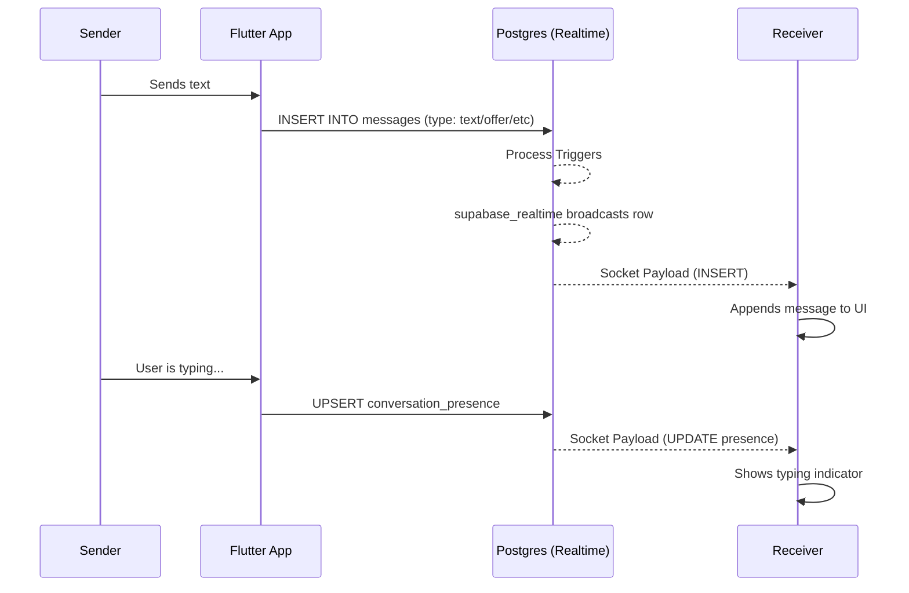

# Chat Realtime Sync & Presence — Diagram Document

---

## Diagram Title + Version

| Field | Value |
|-------|--------|
| **Diagram name (exact)** | 08_chat-realtime-sync |
| **Version** | v2 (Implemented) |
| **Date** | 2026-03-08 |
| **Owner/author** | SLine (Chat feature / Backend) |
| **Previous version** | v1 (2026-03-05) — preserved below as OLD |

---

## Purpose

**What this diagram is showing, in one paragraph.**  
This diagram shows how chat messages and typing presence are sent, stored, and synced in real time: the Flutter app inserts messages and presence rows into Postgres; Supabase Realtime broadcasts changes over WebSockets; the receiver’s app subscribes to `messages` and `conversation_presence`, merges incoming snapshots with the last known list (dedupe, sort), applies a 15s TTL to typing, and marks delivered/read via RPCs. It also shows the feature flag that enables or disables presence and receipt UI.

**What problem it solves (why it exists).**  
Realtime chat behaves differently from REST: the frontend must understand how to subscribe to `messages` and `conversation_presence`, merge stream snapshots without duplicates on reconnect, throttle presence writes, and respect RLS so only participants see data and only the receiver can set delivered/seen.

---

## Scope

| In scope | Out of scope |
|----------|----------------|
| Active chat: send message, subscribe to messages, merge, receipts (delivered/seen), typing indicator, 15s TTL, 5s presence throttle, feature flag | Inbox/conversation list subscription (see diagram 18) |
| Tables: `messages`, `conversation_presence`; RPCs: `mark_conversation_delivered`, `mark_conversation_seen`; publication: `supabase_realtime` | Conversation creation, archive, offer payloads, attachments upload (other docs) |
| ViewModel accumulation, ChatRealtimeMerger, stream error handling | E2E test automation (manual checklist only) |

---

## Assumptions

- **Payments** for offers are out of scope; chat only handles message and presence sync.
- **Presence expiry** is client-only: no DB trigger; app ignores `is_typing` when `updated_at` is older than 15 seconds.
- **Realtime** is best-effort; on stream error the app restores the last known message list and does not crash.
- **Feature flag** `chat_presence_receipts_enabled` is read from `app_config` (cached ~1 min); when `'false'`, no presence upsert and no receipt ticks (single tick only).
- **RLS** is the source of truth for who can SELECT/INSERT/UPDATE messages and presence.

---

## Glossary (Human-readable)

| Term | Definition |
|------|------------|
| **conversation** | A chat thread between two users (user1_id, user2_id), optionally linked to a task. |
| **message** | A row in `public.messages`: sender, receiver, content, type (text/offer/etc.), delivered_at, seen_at, created_at. |
| **conversation_presence** | A row per (conversation_id, user_id): is_typing, updated_at. Used only for typing indicator. |
| **participant** | A user who is user1_id or user2_id of the conversation. |
| **receiver** | The user who receives a message (receiver_id); only they can set delivered_at/seen_at. |
| **sent** | Message inserted; delivered_at and seen_at are null. UI: single tick. |
| **delivered** | delivered_at set by receiver (RPC). UI: double grey tick. |
| **read** | seen_at set by receiver (RPC). UI: double blue tick. |
| **typing** | is_typing = true in conversation_presence; client hides if updated_at older than 15s. |
| **TTL (time-to-live)** | 15 seconds: client treats typing as stale and hides “Typing…” after 15s without update. |
| **throttle** | At most one presence upsert per conversation per 5 seconds (service-side). |
| **merge** | ChatRealtimeMerger.merge(existing, newRows, fromJson): dedupe by message id, sort by created_at. |
| **accumulation** | ViewModel keeps _lastMessages; each stream emission is merged with _lastMessages then stored. |
| **RLS** | Row-Level Security: Postgres policies that restrict SELECT/INSERT/UPDATE by auth.uid() and participant. |
| **RPC** | Remote procedure call: mark_conversation_delivered(p_conversation_id), mark_conversation_seen(p_conversation_id). |
| **idempotency** | Repeating an operation (e.g. mark_seen) does not change outcome; safe to retry. |
| **publication** | Supabase Realtime: list of tables whose changes are broadcast over WebSockets (here: messages, conversation_presence). |

---

## Legend

| Symbol / element | Meaning |
|------------------|--------|
| **Actor (User A/B)** | Human using the app (sender/receiver). |
| **App / ViewModel** | Flutter UI + ChatViewModel (state, merge, subscriptions). |
| **Repository / Service** | ChatRepository, MessageService (Supabase client, streams, RPCs). |
| **DB / Postgres** | Tables messages, conversation_presence; RLS; triggers. |
| **Realtime** | Supabase Realtime engine; broadcasts INSERT/UPDATE to subscribers. |
| **Solid arrow** | Synchronous call (e.g. INSERT, RPC). |
| **Dashed arrow** | Async / stream event (e.g. WebSocket payload to client). |
| **Guard** | Condition (e.g. “feature flag on”, “receiver only”) shown in [brackets] or as a note. |

---

## Actors and Responsibilities

| Actor | Allowed | Forbidden |
|-------|--------|-----------|
| **Client (user A or B)** | Send messages in conversations they participate in; upsert own presence (typing) when flag on; call mark_delivered/mark_seen as receiver; subscribe to messages and presence for that conversation. | Insert messages as another user; set delivered_at/seen_at for messages they did not receive; INSERT/UPDATE presence for another user or for a conversation they are not in. |
| **System (Realtime)** | Broadcast INSERT/UPDATE on messages and conversation_presence to subscribers. | Cannot modify data; only forwards DB changes. |
| **App (ViewModel)** | Merge stream snapshots with _lastMessages; apply 15s TTL to typing; call markReceiptsForActive when new messages from other party; debounce offer refresh. | Must not call Supabase from View layer; must not forget to cancel subscriptions in dispose. |

---

## System Components (Where it lives)

- **App entry points:** Chat screen (`lib/features/chat/view/chat_screen.dart`); messages list and composer; typing indicator row; receipt ticks. Conversation list tile shows typing when within 15s (`lib/features/chat/view/widgets/conversation_list_tile.dart`).
- **ViewModel:** `lib/features/chat/viewmodels/chat_view_model.dart` — _lastMessages, subscribeToActiveConversation(), merge on message stream, presence subscription, otherUserTyping (15s TTL), setTyping(), markReceiptsForActive(), debounced refreshOfferStatusesForCurrentMessages.
- **Repository:** `lib/features/chat/data/chat_repository.dart` — delegates to MessageService (getMessages, sendMessage, subscribeToMessages, subscribeToPresence, upsertPresence, markDelivered, markSeen, isPresenceReceiptsEnabled).
- **Service:** `lib/features/chat/services/message_service.dart` — Supabase client; .from('messages').insert()/stream(); .from('conversation_presence').upsert()/stream(); .rpc('mark_conversation_delivered'|'mark_conversation_seen'); .from('app_config') for flag.
- **Merger:** `lib/features/chat/services/chat_realtime_merger.dart` — merge(existing, newRows, Message.fromJson); dedupe by id, sort by created_at; skip unparseable rows.

**Database objects:**

| Type | Name | Role |
|------|------|------|
| Table | `public.messages` | Message rows; delivered_at, seen_at for receipts. |
| Table | `public.conversation_presence` | (conversation_id, user_id, is_typing, updated_at). |
| Table | `public.app_config` | Key `chat_presence_receipts_enabled` ('true'/'false'). |
| RPC | `mark_conversation_delivered(p_conversation_id)` | Sets delivered_at for current user as receiver. |
| RPC | `mark_conversation_seen(p_conversation_id)` | Sets seen_at for current user as receiver. |
| Publication | `supabase_realtime` | Includes `messages` and `conversation_presence`. |
| RLS | messages_select*, messages_insert*, messages_update_by_receiver | Participant SELECT/INSERT; receiver UPDATE. |
| RLS | presence_select_participant, presence_upsert_self, presence_update_self | Participant SELECT; self INSERT/UPDATE. |

---

## OLD Diagram (v1 — 2026-03-05)

*Preserved for history. Does not show receipts, merge, feature flag, or 15s TTL.*



**Old step-by-step:** Sender sends → App inserts message → DB triggers + Realtime broadcast → Receiver gets payload and appends to UI. Presence: same loop for typing.

---

## Implemented Diagram (v2 — 2026-03-08)

*Full flow: messages, presence (throttle + 15s TTL), receipts (on open + on new-from-other), merge, feature flag, stream error.*

```mermaid
sequenceDiagram
    participant UserA as Sender
    participant VM as ChatViewModel
    participant Svc as MessageService
    participant DB as Postgres
    participant RT as Realtime
    participant UserB as Receiver

    Note over UserA,UserB: Feature flag: chat_presence_receipts_enabled (app_config)

    UserB->>VM: Open chat
    VM->>Svc: getMessages(cid)
    Svc->>DB: SELECT messages (RLS)
    DB-->>Svc: rows
    Svc-->>VM: List<Message>
    VM->>VM: _lastMessages = msgs; currentMessages = msgs
    VM->>Svc: subscribeToMessages(cid)
    Svc->>RT: stream messages WHERE conversation_id=cid
    VM->>Svc: markDelivered(cid) [if flag on]
    Svc->>DB: RPC mark_conversation_delivered
    VM->>Svc: subscribeToPresence(cid) [if flag on]
    Svc->>RT: stream conversation_presence WHERE conversation_id=cid

    UserA->>VM: Types text
    VM->>Svc: setTyping(true)
    Svc->>Svc: [throttle 5s per convo]
    Svc->>DB: UPSERT conversation_presence (is_typing=true)
    DB-->>RT: broadcast
    RT-->>VM: presence row (UserB app)
    VM->>VM: otherUserTyping = true if updated_at < 15s
    UserB->>UserB: Sees "Typing..."

    UserA->>VM: Send message
    VM->>Svc: sendMessage(...)
    Svc->>DB: INSERT messages (RLS: sender=uid, participant)
    DB-->>RT: broadcast INSERT
    RT-->>VM: new snapshot List<Message>
    VM->>VM: merged = Merger.merge(_lastMessages, newRows, fromJson)
    VM->>VM: _lastMessages = merged; currentMessages = merged
    VM->>VM: [if new msg from other → markReceiptsForActive]
    VM->>VM: [debounce 500ms] refreshOfferStatusesForCurrentMessages
    VM->>UserB: notifyListeners → UI update (no duplicates)

    VM->>Svc: markSeen(cid) [when flag on, e.g. on open or new-from-other]
    Svc->>DB: RPC mark_conversation_seen
    DB->>DB: UPDATE messages SET seen_at=now() (RLS: receiver only)
    DB-->>RT: broadcast UPDATE
    RT-->>VM: updated message row (UserA app)
    VM->>VM: merge → same id, updated row wins
    UserA->>UserA: Sees double blue (read)

    Note over RT,VM: On stream error
    RT-->>VM: onError
    VM->>VM: currentMessages = _lastMessages; notifyListeners
    UserB->>UserB: Sees last list (no crash)
```

---

## Step-by-step Flow ("Human Story")

### Happy path

1. **Receiver opens chat.** ViewModel fetches messages via Repository → MessageService → Postgres (RLS: participant). ViewModel sets _lastMessages and currentMessages, then subscribes to messages stream and (if flag on) presence stream and calls mark_conversation_delivered once.
2. **Sender types.** ViewModel calls setTyping(true). Service throttles (5s per conversation), then upserts conversation_presence (is_typing=true). Realtime broadcasts; Receiver’s ViewModel gets presence row, sets otherUserTyping if updated_at within 15s; Receiver sees “Typing…”.
3. **Sender sends message.** ViewModel calls sendMessage; Service inserts into messages (RLS: sender=auth.uid(), participant). Realtime broadcasts new snapshot. Receiver’s ViewModel merges snapshot with _lastMessages via ChatRealtimeMerger (dedupe by id, sort by created_at), updates _lastMessages and currentMessages. If the new messages include one where receiver = current user, ViewModel calls markReceiptsForActive (delivered/seen). Offer status refresh is scheduled with 500 ms debounce. UI updates with no duplicates.
4. **Receiver has opened chat; sender’s message is “read”.** ViewModel (when flag on) calls mark_conversation_seen. RPC updates messages.seen_at (RLS: receiver only). Realtime broadcasts UPDATE; Sender’s app merges and shows double blue.

### Common failure paths

5. **Stream error.** Message or presence stream emits onError. ViewModel restores currentMessages from _lastMessages and notifyListeners. User sees last known list; can reopen chat to resubscribe.
6. **Feature flag off.** No presence upsert, no presence subscription, no receipt ticks (single tick only). No error; behaviour is reduced.
7. **Reconnect.** After network blip, stream may re-emit full snapshot. Merge with _lastMessages ensures at most one row per message id; no duplicate bubbles.

---

## State Machine Explanation

- **Message (per row):** sent (delivered_at and seen_at null) → delivered (delivered_at set) → read (seen_at set). Transitions: receiver calls mark_conversation_delivered then mark_conversation_seen. No reverse transitions.
- **Presence (per user per conversation):** not_typing (is_typing=false or missing row) ↔ typing (is_typing=true). Client treats typing as false if updated_at older than 15s. Only that user can set their own row (RLS).
- **Forbidden:** Non-receiver cannot set delivered_at/seen_at. User C cannot INSERT/UPDATE presence for A–B conversation. Non-participant cannot SELECT/INSERT messages.

---

## Invariants (Must-always-be-true rules)

- Only conversation participants can read or insert messages (RLS).
- Only the receiver can set delivered_at/seen_at on messages (RLS messages_update_by_receiver).
- Presence rows are writable only by the user themselves for conversations they are in (RLS presence_upsert_self, presence_update_self).
- Message list has at most one row per message id after merge (ChatRealtimeMerger dedupes by id).
- Typing indicator is not shown for presence older than 15s (client TTL in ViewModel/UI).
- UI never calls Supabase directly (View → ViewModel → Repository → Service).

---

## Guards & Validation Rules

| Guard | Where | Source of truth |
|-------|--------|------------------|
| Participant can SELECT/INSERT messages | RLS (DB) | DB |
| Receiver can UPDATE delivered_at/seen_at | RLS (DB) | DB |
| Participant can SELECT presence; self can INSERT/UPDATE own presence | RLS (DB) | DB |
| Presence upsert at most once per 5s per conversation | MessageService (app) | App |
| Typing shown only if updated_at within 15s | ChatViewModel / ConversationListTile (app) | App |
| Presence and receipt UI only when chat_presence_receipts_enabled = 'true' | MessageService (flag read), ViewModel + UI (app) | DB (app_config) |
| Merge dedupe by id, sort by created_at | ChatRealtimeMerger (app) | App |

---

## Failure Modes (What can go wrong)

| Failure | System behaviour |
|--------|-------------------|
| App crash mid-send | Message either committed or not; on reopen, fetch + stream restore state. |
| Realtime stream error | ViewModel restores currentMessages from _lastMessages; user sees last list; can reopen to resubscribe. |
| Duplicate stream payload (reconnect) | Merge dedupes by id; no duplicate messages in UI. |
| Two users mark_seen at once | Both are receiver; RPC/UPDATE idempotent; no conflict. |
| Presence write storm | Throttle 5s per conversation limits writes; feature flag can disable presence. |
| TTL expiry (15s no update) | Client hides “Typing…”; no DB action. |
| Missing auth / session | RLS blocks; no rows returned or inserted. |

---

## Security & Abuse Scenarios

| Risk | Mitigation |
|------|------------|
| Spoofing identity (send as another user) | RLS: INSERT only when sender_id = auth.uid(). |
| Setting delivered/seen for messages you didn’t receive | RLS: UPDATE only when receiver_id = auth.uid(). |
| Reading another user’s messages | RLS: SELECT only for participants (conversation membership). |
| Faking typing for another user | RLS: INSERT/UPDATE presence only when user_id = auth.uid(). |
| Seeing another user’s private data | RLS on messages and conversation_presence; no direct Supabase in View. |

---

## Data Model Mapping

| Diagram / UI concept | DB / model |
|----------------------|------------|
| Message “sent” | delivered_at IS NULL AND seen_at IS NULL |
| Message “delivered” | delivered_at IS NOT NULL |
| Message “read” | seen_at IS NOT NULL |
| Typing indicator | conversation_presence.is_typing = true AND updated_at within 15s (client) |
| Presence stale | updated_at older than 15s → client treats as not typing |
| Feature flag “presence/receipts on” | app_config.chat_presence_receipts_enabled = 'true' |

Indexes: `idx_messages_convo_created` (conversation_id, created_at). Primary keys: messages(id), conversation_presence(conversation_id, user_id).

---

## Observability & Forensics

- **Logs:** AppLogger in MessageService (presence upsert, throttle, stream start/error, receipts marked, feature flag). ChatViewModel (merge count, stream_error, presence_updated, setTyping failed, receipt error with conversation_id + operation). No PII: no message body or other-user name/avatar in logs.
- **Receipt failure:** Log line includes conversation_id and operation (delivered/seen) for traceability.
- **Admin:** No dedicated admin view for “message story”; DB tables messages and conversation_presence can be queried with appropriate RLS bypass for support if needed.

---

## Verification Checklist

| Check | Status / location |
|-------|--------------------|
| Unit tests | `test/features/chat/services/chat_realtime_merger_test.dart` — empty merge, dedupe by id, order by created_at, skip unparseable. |
| Integration / E2E | Manual; see `.TODO/CHECKLIST_AND_SUMMARY_ChatRealtimeSync_Fixes_2026-03-08.md`. |
| RLS | Procedure in `.TODO/08_RLS_verification_chat.md` (Check 1–4: participant SELECT/INSERT, non-participant SELECT, receiver UPDATE, presence INSERT negative). Run before release. |
| Concurrency | Merge prevents duplicate messages on reconnect; idempotent RPCs for receipts. |

---

## Dependencies

- **Depends on:** Auth (auth.uid() for RLS); profiles (user_id in presence and messages); conversations (conversation_id). Diagram 18 (realtime subscription topology) for Inbox/conversation list.
- **Depended on by:** Chat Feature doc; contract `.TODO/08_chat_realtime_contract.md`; RLS matrix `.TODO/RLS_Matrix_Chat_2026-03-07.md`.
- **Ordering:** Migrations 20260307219900 (full presence + RLS + publication), 20260307220000 (idempotent ADD TABLE presence), 20260307220100 (app_config) applied in that order.

---

## Open Questions / Missing Evidence

- E2E tests are manual; no automated E2E in repo for chat realtime. Optional: add timeout/retry policy and document.
- RLS verification is manual (Check 1–4); no automated RLS test script in repo.

---

## Final Status

| Item | Value |
|------|--------|
| **Verdict** | PASS |
| **Production ready?** | YES. Implemented with merge, receipts, presence, feature flag, RLS, idempotent migration. RLS verification and app checklist must be run before release. |
| **Next actions** | (1) Run RLS verification (`.TODO/08_RLS_verification_chat.md`). (2) Run app checklist (`.TODO/CHECKLIST_AND_SUMMARY_ChatRealtimeSync_Fixes_2026-03-08.md`). (3) Optional: add automated RLS or E2E later. |

---

*Contract: `.TODO/08_chat_realtime_contract.md`. Plan: `.TODO/PLAN_ChatRealtimeSync_2026-03-07_PlanCritic.md`. Execution: `.TODO/EXECUTION_LOG_ChatRealtimeSync_2026-03-07.md`.*
