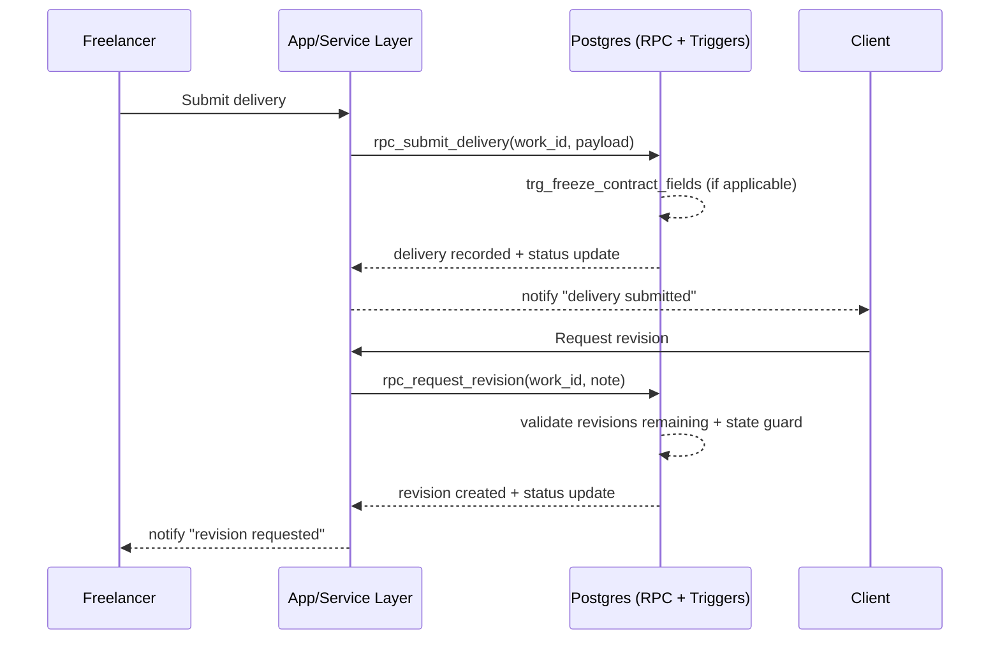
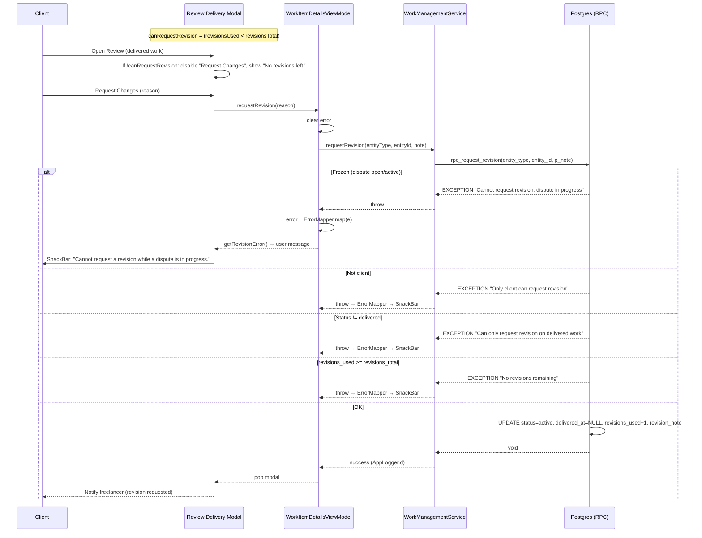

# 10 — Work Contract Revisions

---

## Diagram Title + Version

| Field | Value |
|-------|--------|
| **Diagram name (exact)** | 10_work-contract-revisions |
| **Version** | v2 / final — 2026-03-08 |
| **Owner/author** | SLine architecture / work flow |
| **Related diagrams** | 14a (dispute–entity–freeze), 12 (unified work view), 05 (booking lifecycle), 19 (direct-offers work contract), 16 (escrow invariants) |

---

## Purpose

- **What this diagram is showing:** The flow from freelancer submitting a delivery to client reviewing it and either approving or requesting a revision. It shows how the app and database enforce that revisions are only allowed when work is in `delivered` state, that the client has revisions remaining (`revisions_used < revisions_total`), that only the client can request a revision, and that no delivery or revision actions are allowed when the entity is Frozen (open/active dispute). It also shows how the UI disables "Request Changes" when no revisions are left and surfaces RPC errors via ErrorMapper.
- **What problem it solves:** Prevents abuse (e.g. requesting revisions when not delivered or after cap is reached), avoids generic "Failed to request revision" by mapping DB exceptions to user-facing messages, and aligns UI state with DB guards so the client sees "No revisions left" before tapping.

---

## Scope

- **What’s included:** Submit delivery (`rpc_submit_delivery`); request revision (`rpc_request_revision`) with state guard (status = delivered), cap guard (revisions_used &lt; revisions_total), client-only check, and Frozen guard (no open/active dispute); ErrorMapper for revision and Frozen errors; Review Delivery modal with `canRequestRevision` and `getRevisionError`; WorkManagementService and WorkItemDetailsViewModel; tasks and bookings entities.
- **What’s explicitly excluded:** Direct-offer revision flow (direct_offer branch not in rpc_request_revision); change requests (scope/price/deadline) and `rpc_accept_change_request`; extension requests; admin dispute workflow; escrow release (covered in diagram 16).
- **Assumptions:** Revisions are defined per entity (task or booking) via `revisions_total` / `revisions_used`; when `revisions_total` is NULL or 0, no revisions allowed; RPC is source of truth for all guards; "Frozen" means dispute status IN ('open','active') for the entity’s task (see 14a).

---

## Glossary (Human-readable)

| Term | Definition |
|------|-------------|
| **booking** | Session-based work entity; has `task_id`, `status` (e.g. active, delivered), `revisions_used`, `revisions_total`, `revision_note`, `delivered_at`, `review_expires_at`. |
| **task** | Tender or assigned task; has `status`, `revisions_used`, `revisions_total`, `revision_note`, `delivered_at`, `review_expires_at`. |
| **delivered** | Entity status after freelancer submits work; `delivered_at` and `review_expires_at` set; client can approve or request revision. |
| **active** | Entity status when work is in progress (or after revision resets from delivered back to active). |
| **completed** | Entity status after client approves delivery; work closed. |
| **revisions_total** | Max number of revision requests allowed for the entity (from work_contract or default). |
| **revisions_used** | Count of revision requests already used; must stay &lt; revisions_total to request another. |
| **revision_note** | Client’s feedback text stored when requesting a revision. |
| **Frozen** | When a dispute for the entity (task or booking’s task) has status IN ('open','active'); submit_delivery and request_revision are blocked (see 14a). |
| **RPC** | Remote procedure call (Postgres function); SECURITY DEFINER; source of truth for guards. |
| **ErrorMapper** | App utility that maps RPC exception messages to user-facing strings (e.g. "No revisions remaining"). |
| **RLS** | Row-Level Security; restricts table access by policy. |

---

## Legend (What each symbol means)

- **Nodes:** **Actor** = Client, Freelancer. **App/Service** = Flutter ViewModel or Service. **DB** = Postgres (tables, RPCs, triggers).
- **Arrows:** **Sync call** = App → Supabase RPC. **Return** = RPC result or exception back to app.
- **Guards:** Shown as conditions at RPC entry (e.g. "status = delivered?", "revisions_used &lt; revisions_total?"). If guard fails, RPC raises exception; app maps via ErrorMapper and shows in UI (SnackBar or disabled button).

---

## Actors and Responsibilities

| Actor | Allowed | Forbidden |
|-------|--------|-----------|
| **Client** | Approve delivery when delivered and no Frozen; request revision when delivered, revisions_used &lt; revisions_total, and no Frozen; see revision count and "No revisions left" when cap reached. | Request revision when status is not delivered; request revision when no revisions left; request revision when entity is Frozen; request revision as non-client. |
| **Freelancer** | Submit delivery when entity is in allowed state and not Frozen; see revision note after client requests revision; resubmit work after revision. | Submit delivery when Frozen; request revision (client-only). |
| **System/Cron** | rpc_finalize_auto_approval (respects Frozen; see 14a). | N/A. |

---

## System Components (Where it lives)

- **App entry points:** Work item details screen → Review Delivery modal (when client opens delivered work and taps Review). Submit Work / Review / Request Changes are disabled when entity is Frozen (14a); Request Changes disabled when `canRequestRevision` is false (no revisions left).
- **Service / ViewModel:**  
  - `lib/features/work/services/work_management_service.dart` — `requestRevision(entityType, entityId, note)` → `rpc_request_revision`; logs success/failure (tag WorkManagement).  
  - `lib/features/work/viewmodels/work_item_details_view_model.dart` — `requestRevision(note)`; clears error at start; calls service; on catch sets `_error = ErrorMapper.map(e)` (tag WorkItemDetails).  
  - `lib/features/work/view/widgets/review_delivery_modal.dart` — `canRequestRevision`, `getRevisionError`; disables "Request Changes" and shows "No revisions left." when no revisions; on reject failure shows SnackBar via `getRevisionError()`.  
  - `lib/features/work/view/work_item_details_screen.dart` — passes `canRequestRevision: revisionsUsed < revisionsTotal`, `getRevisionError: () => vm.error` into modal.  
  - `lib/core/utils/error_mapper.dart` — maps "Can only request revision on delivered work", "No revisions remaining", "Only client can request revision", "Cannot request revision: dispute in progress" to user-facing strings.
- **Database:**  
  - **Tables:** tasks (revisions_used, revisions_total, revision_note, delivered_at, review_expires_at, status); bookings (same fields).  
  - **Views:** vw_unified_work_items (exposes revision counts and status for UI).  
  - **RPCs:** rpc_submit_delivery (task, booking; Frozen guard in 14a); rpc_request_revision(entity_type, entity_id, p_note) — Frozen guard, client check, state guard (status = delivered), cap guard (revisions_used &lt; revisions_total), then UPDATE reset to active and increment revisions_used.  
  - **Triggers:** trg_freeze_contract_fields (immutability; see work_contracts).  
  - **Migrations:** `supabase/migrations/20260308120000_harden_rpc_request_revision.sql` (state + cap + client); Frozen guard in `20260308160000_14a_dispute_extension_frozen_guards.sql`.

---

## OLD Diagram (Pre–2026-03-08)

Original sequence diagram before RPC hardening, ErrorMapper, and UI revision cap.

---

## NEW Diagram (Implemented — 2026-03-08)

Current flow with explicit guards, ErrorMapper, and UI behaviour.

---

## Step-by-step Flow ("Human Story")

### Happy path — Client requests a revision

1. Freelancer has submitted work; entity status is **delivered**; client opens Work item and taps **Review**.
2. Review Delivery modal opens; client sees **Request Changes** enabled (revisionsUsed &lt; revisionsTotal).
3. Client enters reason and taps **Request Changes**.
4. ViewModel calls WorkManagementService.requestRevision(entityType, entityId, note) → rpc_request_revision.
5. RPC runs: Frozen guard (no open/active dispute) → client check (auth.uid() = client_id) → state guard (status = 'delivered') → cap guard (revisions_used &lt; revisions_total). Then UPDATE: status = 'active', delivered_at = NULL, review_expires_at = NULL, revision_note = p_note, revisions_used = revisions_used + 1, revision_requested_at = now().
6. App logs success; modal closes; freelancer sees work back in progress with the revision note.

### Happy path — Client has no revisions left (UI prevents tap)

1. Same as above but revisions_used >= revisions_total (e.g. both 2).
2. Modal opens with **Request Changes** disabled and text "No revisions left." Client cannot submit; no RPC call.

### Failure path — Client taps Request Changes but cap reached (race or stale UI)

1. Client had one revision left; another device or race used it; UI still showed enabled.
2. Client taps **Request Changes**; RPC runs cap check and raises "No revisions remaining".
3. App catches exception; ErrorMapper returns "No revisions remaining. You have used all allowed revision requests." ViewModel sets error; modal shows SnackBar with that message.

### Failure path — Entity Frozen (dispute in progress)

1. Client opens Review on delivered work; unbeknownst to them a dispute was just opened for this task.
2. Client taps **Request Changes**; RPC runs Frozen guard first and raises "Cannot request revision: dispute in progress".
3. ErrorMapper → "Cannot request a revision while a dispute is in progress." SnackBar shown.

### Failure path — Status not delivered

1. Some race or bug causes Review to be shown when status is not delivered (e.g. auto-approved in between).
2. RPC raises "Can only request revision on delivered work" → ErrorMapper → SnackBar.

---

## State Machine Explanation

- **Relevant states (entity):** active (work in progress), delivered (submitted for review), completed (approved).
- **Allowed transitions (revision flow):** delivered → active (when client requests revision; RPC resets status and increments revisions_used). active → delivered (freelancer submits again via rpc_submit_delivery).
- **Who triggers:** delivered → active: client only, via rpc_request_revision, and only when not Frozen and revisions_used &lt; revisions_total.
- **Forbidden:** Request revision when not delivered; when revisions_used >= revisions_total; when Frozen; by non-client. All enforced in RPC; UI supports by disabling button and showing mapped errors.

---

## Invariants (Must-always-be-true rules)

- Revision can only be requested when entity status is **delivered** (enforced in RPC).
- revisions_used must never exceed revisions_total (RPC refuses and increments only when &lt; total).
- Only the **client** (client_id = auth.uid()) can call rpc_request_revision (RPC).
- When a dispute for the entity has status IN ('open','active'), rpc_request_revision does not update state (Frozen guard in RPC; see 14a).
- User sees revision counts and "No revisions left" from vw_unified_work_items / ViewModel so UI can disable Request Changes without a round-trip.

---

## Guards & Validation Rules

| Guard | Where | Source of truth |
|-------|--------|------------------|
| Authenticated | rpc_request_revision | RPC (auth.uid() IS NOT NULL) |
| Caller is client | rpc_request_revision | RPC (client_id = auth.uid()) |
| Entity status = delivered | rpc_request_revision | RPC (state guard) |
| revisions_used &lt; revisions_total | rpc_request_revision | RPC (cap guard); when revisions_total IS NULL or 0, no revisions allowed |
| No open/active dispute for entity | rpc_request_revision | RPC (Frozen guard; 14a migration) |
| canRequestRevision (disable button) | UI (ReviewDeliveryModal) | App (revisionsUsed &lt; revisionsTotal from ViewModel) |

All authoritative checks are server-side (RPC). UI uses revision counts to avoid unnecessary failed calls and to show "No revisions left."

---

## Failure Modes (What can go wrong)

| Failure | System behaviour |
|---------|------------------|
| Client taps Request Changes with no revisions left (stale UI) | RPC raises "No revisions remaining"; ErrorMapper → SnackBar; no state change. |
| Double-tap Request Changes | First call succeeds and sets status to active; second call fails state guard (no longer delivered). ErrorMapper shows "Can only request revision on delivered work." |
| Dispute opened after modal opened | Next action (Request Changes or Approve) hits Frozen guard in RPC; user sees dispute-in-progress message. |
| App crash after RPC success | DB already updated; on reload, work is active and revision_note set; freelancer sees revision. |
| revisions_total NULL or 0 | RPC treats as 0 revisions allowed; cap check fails with "No revisions remaining." |

---

## Security & Abuse Scenarios

- **Spoofing client:** RPC checks client_id = auth.uid(); otherwise "Only client can request revision."
- **Requesting revision when not delivered:** RPC state guard; no way to force transition from active to active with revision note without going through delivered.
- **Exceeding revision cap:** RPC cap guard; revisions_used only incremented inside same RPC after check.
- **Bypassing Frozen:** rpc_request_revision checks dispute status at start; no update when Frozen.
- **Seeing another user’s work:** RLS and app only load work where user is participant; revision flow uses same entity_id from already-visible work item.

---

## Data Model Mapping

| Diagram term | DB / app |
|--------------|----------|
| delivered | status = 'delivered'; delivered_at IS NOT NULL |
| active (after revision) | status = 'active'; delivered_at = NULL, review_expires_at = NULL |
| revision count | revisions_used, revisions_total (tasks / bookings) |
| revision note | revision_note (tasks / bookings); set on request_revision |
| review window | review_expires_at (set on submit_delivery; cleared on request_revision) |
| revision requested at | revision_requested_at (set on request_revision) |

Indexes: normal PK/lookups; no dedicated index required for revision guards (single-row UPDATE by entity id).

---

## Observability & Forensics

- **Logs:** WorkManagementService logs success with tag WorkManagement; logs failure with outcome (limit_reached / state_invalid / error). WorkItemDetailsViewModel logs with tag WorkItemDetails on requestRevision; AppLogger.e on catch. ReviewDeliveryModal logs approve/reject with tag ReviewDelivery.
- **Audit:** RPC does not write separate audit table; state change is in tasks/bookings (revisions_used, revision_note, revision_requested_at). Admin can inspect row history if enabled elsewhere.
- **Orphan:** If RPC fails after SELECT but before UPDATE, no state change; client can retry (e.g. after dispute resolved or if transient error).

---

## Verification Checklist

- **Unit tests:** ErrorMapper work revision group (Can only request revision on delivered work; No revisions remaining; Only client can request revision) — `test/unit/core/error_mapper_test.dart`.
- **Integration / app:** Manual or E2E: open delivered work as client; request revision with reason; confirm status goes to active and freelancer sees note; confirm "No revisions left" when cap reached and button disabled; confirm SnackBar on RPC error (e.g. dispute in progress).
- **DB:** RPC logic and exception messages covered in migration; Frozen guard in 14a migration. No separate RLS on rpc (SECURITY DEFINER).
- **Concurrency:** Double-tap yields second call failing state guard; safe.

---

## Dependencies

- **Depends on:** Diagram 14a (Frozen guard semantics); unified work view (12) for revision counts in UI; work_contracts / bookings schema (revisions_used, revisions_total).
- **Depended on by:** 14a references request_revision as blocked when Frozen; 19 (direct-offers work contract) references work flow; escrow (16) for approve_delivery after review.
- **Ordering:** 20260308120000 (state/cap/client) applied before 20260308160000 (Frozen guard) so that 14a migration replaces rpc_request_revision with Frozen-at-start version.

---

## Open Questions / Missing Evidence

- **None** for task/booking revision flow: RPC, ErrorMapper, UI, and migrations are implemented and documented. Direct_offer branch for rpc_request_revision is out of scope for this diagram.

---

## Final Status

| Item | Value |
|------|--------|
| **Verdict** | PASS |
| **Production ready?** | YES — RPC guards (state, cap, client, Frozen) are in place; ErrorMapper and UI (canRequestRevision, getRevisionError) align with DB; migrations applied and documented in SUPABASE_SETUP §9.2. |
| **Next actions** | None for this diagram. Optional: E2E test for "no revisions left" and dispute-in-progress SnackBar. |
