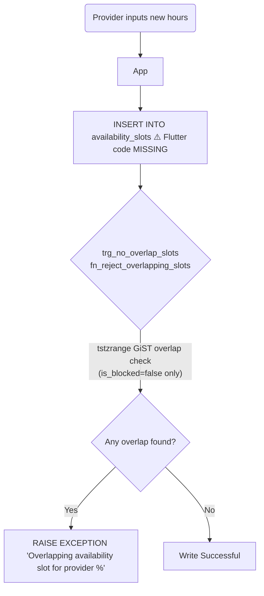

# 1) What this diagram is

This flowchart shows how PostgreSQL prevents a calendar from being double-booked via database-level range overlap enforcement.

# 2) Why it exists

Without this guard, a provider could be booked by two clients for the same time. The `tstzrange` column and GiST index make collisions physically impossible at the DB level.

# 3) Where it lives in the product

- App entry points: My Services Screen / Availability Manager (UI unverified).
- Service layer: **MISSING** — no Flutter code found that inserts to `availability_slots`.
- Supabase: `availability_slots` with native Postgres range types + trigger.

# 4) Diagram (Mermaid)

# 5) Evidence Table

| Element                          | Code Evidence            | DB Evidence                                                                                 | Verified         |
| -------------------------------- | ------------------------ | ------------------------------------------------------------------------------------------- | ---------------- |
| `INSERT INTO availability_slots` | ❌ No Flutter call found | ✅ Table exists, RLS slots_write_owner                                                      | N (code missing) |
| `trg_no_overlap_slots`           | N/A                      | ✅ Trigger confirmed on availability_slots                                                  | Y                |
| `fn_reject_overlapping_slots()`  | N/A                      | ✅ Full body: tstzrange overlap, is_blocked=false guard                                     | Y                |
| GiST overlap `&&`                | N/A                      | ✅ `tstzrange(s.starts_at, s.ends_at, '[)') && tstzrange(NEW.starts_at, NEW.ends_at, '[)')` | Y                |
| `RAISE EXCEPTION` on collision   | N/A                      | ✅ `raise exception 'Overlapping availability slot for provider %'`                         | Y                |

# 6) Evidence checklist

- ❌ Code evidence MISSING — Flutter INSERT path not found in any service/repository
- ✅ DB trigger body confirmed: `fn_reject_overlapping_slots`
- ✅ DB table + RLS policies confirmed
- ✅ Trigger name: `trg_no_overlap_slots`

# 7) Open questions / Missing evidence

- Which Flutter file/method is responsible for inserting into `availability_slots`? Not found. The diagram's Flutter `App → INSERT` edge is **UNVERIFIED**.

# 8) Verification result

- Verdict: **PARTIALLY VERIFIED**
- Date: 2026-03-05
- Verified:
  - DB: `trg_no_overlap_slots`, `fn_reject_overlapping_slots()` — full body confirmed
  - DB: `availability_slots` table, RLS: `slots_write_owner` (ALL authenticated)
- Unverified:
  - Flutter INSERT path — no service file found
- Changes made:
  - Added Evidence Table per element
  - Tagged Flutter edge as ⚠️ MISSING in Mermaid
  - Removed `trg_freeze_contract_fields` (does NOT exist in DB)
