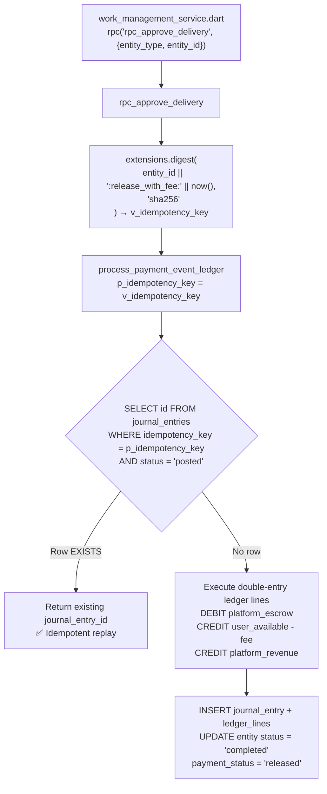
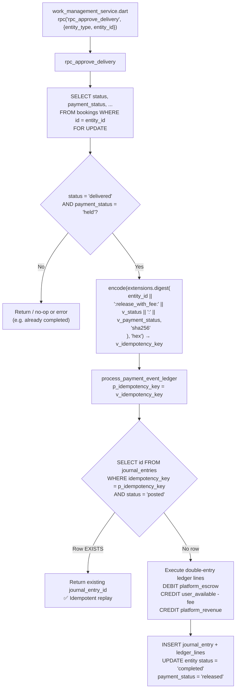

# Escrow Invariants & Idempotency

---

## Diagram Title + Version

- **Diagram name (exact):** Escrow Invariants & Idempotency
- **Version:** v2 (final) — 2026-03-07
- **Owner/author:** Backend / Supabase_Ops + Architect (plan: `.TODO/improvement_the_system/Done/16_escrow-invariants-idempotency/PLAN_EscrowInvariantsIdempotency_2026-03-07_CRITIC.md`)

---

## Purpose

- **What this diagram is showing, in one paragraph.**  
  It shows how SLine prevents double-release of escrow when a client approves delivery: the app calls one RPC; the RPC locks the booking row, computes a **stable** idempotency key (same key on retry), and calls the ledger; the ledger either inserts a new journal entry or returns the existing one if the key was already used. No `now()` in the key, so network retries are safe.

- **What problem it solves (why it exists).**  
  Double-processing financial data destroys trust. A slow or dropped connection could make the app retry “Approve”; without a stable key, each retry would get a new key and the DB could release escrow twice. This diagram documents the stable key + row lock so that the financial operation is safe to retry.

---

## Scope

- **What’s included (features/entities covered).**  
  Approve-delivery flow for **bookings** when `payment_status = 'held'`: one RPC (`rpc_approve_delivery`), one ledger RPC (`process_payment_event_ledger`), table `journal_entries` (idempotency_key), and app entry points (Work item details → Review delivery modal → Approve). **Tasks** are in scope only for “where it lives”; task branch has no ledger call (no escrow release).

- **What’s explicitly excluded (out of scope).**  
  `gateway_escrow` (QiCard deposit path), task_request release, direct_offer release, refund flow, withdrawal flow. Out of scope: client-supplied idempotency key, backfilling old journal_entries.

- **Assumptions.**  
  - Payments are finalised only via RPC (no direct INSERT into journal_entries from app).  
  - Escrow release is append-only (we only insert journal_entry + ledger_lines; we do not delete or amend them).  
  - `process_payment_event_ledger` on idempotent key collision returns existing journal id and does not raise.  
  - Only the client (entity owner) may call `rpc_approve_delivery` (enforced in RPC).

---

## Glossary (Human-readable)

Define every key term used in the diagram:

| Term | Definition |
|------|------------|
| **booking** | Entity: a confirmed session between client and provider; can hold escrow when `payment_status = 'held'`. |
| **task** | Entity: a job posting; task branch of approve_delivery has no ledger (no escrow release). |
| **task_request** | Entity: a bid on a task (not in this flow). |
| **direct_offer** | Entity: direct offer from freelancer to client (not in this flow). |
| **dispute** | Not in this flow; separate lifecycle. |
| **delivered** | Status: work submitted by freelancer; client can approve or request revision. |
| **completed** | Status: client approved; work closed. For booking, `payment_status` becomes `released`. |
| **active** | General status for in-progress work (not the focus of this diagram). |
| **disputed** / **refunded** | Not in this diagram. |
| **held** | Payment status: funds in platform_escrow. |
| **released** | Payment status: escrow released to freelancer (user_available) and platform_revenue. |
| **escrow_hold** | Money event: move funds into platform_escrow (not in this diagram). |
| **release_with_fee** | Money event: DEBIT platform_escrow, CREDIT user_available (minus fee), CREDIT platform_revenue. |
| **idempotency** | Same request repeated produces the same outcome; no duplicate side effects (here: at most one journal_entry per entity for release_with_fee). |
| **RPC** | Remote procedure call (Supabase Postgres function). |
| **RLS** | Row-Level Security (not changed by this flow; RPC is SECURITY DEFINER). |
| **TTL** | Time-to-live (not used in idempotency key). |
| **FOR UPDATE** | SQL row lock: only one transaction can hold the lock until commit; serializes concurrent approval attempts. |

---

## Legend: what each symbol means

- **What each node/shape represents (actor, service, DB table, trigger, gateway).**
  - **Rectangle “App”:** Application service layer (Flutter `WorkManagementService`); not an actor, not a DB table — the caller into the RPC.
  - **Rectangle “RPC1” / “rpc_approve_delivery”:** Postgres function (service); validates client, locks row, computes key, calls ledger.
  - **Rectangle “Lock”:** Step (operation): `SELECT ... FROM bookings WHERE id = entity_id FOR UPDATE`.
  - **Diamond “Guard”:** Condition (branch): status and payment_status check — transition guard.
  - **Rectangle “Hash” / “KeyGen”:** Step: compute `v_idempotency_key` from entity_id + v_status + v_payment_status (no time).
  - **Rectangle “RPC2” / “process_payment_event_ledger”:** Postgres function; checks idempotency, inserts or returns existing (no external gateway).
  - **Diamond “PK_CHK”:** Branch: does a row in journal_entries already exist for this idempotency_key and status = 'posted'?
  - **Rectangle “NoOp” / “IGNORE” / “Replay”:** Terminal: return existing journal id or no-op; no DB write.
  - **Rectangle “PROC” / “COMPLETE”:** Terminal: INSERT journal_entry + ledger_lines, UPDATE entity.
- **What each arrow means (sync call, async event, web-hook, scheduled job).**
  - **Solid arrow (→):** Synchronous call or sequential step (no async message bus, no web-hook, no scheduled job in this flow). All steps are sync RPC → RPC → DB.
- **What colours/labels (if used) represent.**
  - No colours are mandated in the Mermaid diagram; labels on arrows are “Yes” / “No” (Guard), “Row EXISTS” / “No row” (PK_CHK) to denote branch outcome.
- **What “guards” look like (conditions vs transitions).**
  - **Guard (diamond):** Condition only — e.g. `status = 'delivered' AND payment_status = 'held'?` “Yes” → proceed to key generation; “No” → NoOp or early return. Guards are not state transitions; they gate whether the release path runs.
  - **PK_CHK (diamond):** Condition — “Does journal_entries already have a row for this idempotency_key?” “Row EXISTS” → idempotent replay (return existing); “No row” → first-time path (insert + update).

---

## Actors and Responsibilities

List all actors (Client, Freelancer, Admin, System/Cron, Payment Gateway):

| Actor | Allowed | Forbidden |
|-------|--------|-----------|
| **Client** | Call approve delivery for their own delivered booking/task (as owner). | Approve for another user’s entity; approve when status is not delivered or (booking) payment_status not held. |
| **Freelancer** | — | Cannot approve delivery (only client/owner). |
| **Admin** | — | Not involved in this flow (no admin-triggered approve_delivery). |
| **System/Cron** | — | This flow is user-triggered only (no cron for approve_delivery). |
| **Payment Gateway** | — | Not involved in this diagram (gateway_escrow is separate). |

---

## System Components (Where it lives)

- **App entry points (which screens/actions trigger this flow):**  
  Work item details screen → “Review delivery” → “Approve” in `ReviewDeliveryModal`; callback is `WorkItemDetailsViewModel.approveDelivery()`.

- **Service layer / ViewModel / Repository involved (file paths):**
  - `lib/features/work/view/widgets/review_delivery_modal.dart` — UI + one-shot guard (`_hasApproved`).
  - `lib/features/work/viewmodels/work_item_details_view_model.dart` — `approveDelivery()`, calls service with optional correlationId.
  - `lib/features/work/services/work_management_service.dart` — `approveDelivery(entityId, entityType, correlationId?)` → `_supabase.rpc('rpc_approve_delivery', ...)`.

- **Database objects involved:**
  - **Tables:** `bookings`, `journal_entries`, `ledger_lines`, `accounts`.
  - **Views:** (none specific to this flow; wallet_balances aggregates ledger).
  - **RPC:** `rpc_approve_delivery(entity_type, entity_id)`, `process_payment_event_ledger(...)`.
  - **Triggers:** (none specific; ledger RPC does INSERT/UPDATE internally).
  - **Policies (RLS):** RPC is SECURITY DEFINER; RPC body enforces `client_id = auth.uid()`.

---

## Step-by-step Flow (“Human Story”)

A numbered narrative of the flow from start to finish. Include both happy path and most common failure path(s).

**Happy path**

1. **Trigger/entry action:** Client opens a delivered work item (booking with payment_status = held) and taps “Approve”.
2. **Validation step(s):** ViewModel calls WorkManagementService.approveDelivery(entityId, entityType) with optional correlationId. Service calls Supabase RPC `rpc_approve_delivery(entity_type, entity_id)`.
3. **RPC validation:** RPC asserts client is owner (`client_id = auth.uid()`); `SELECT ... FROM bookings WHERE id = entity_id FOR UPDATE`; read status, payment_status.
4. **Guard:** Assert status = 'delivered' and payment_status = 'held'; if not, return or no-op (e.g. already completed).
5. **Key + ledger:** Compute stable key = encode(digest(entity_id || ':release_with_fee:' || v_status || ':' || v_payment_status, 'sha256'), 'hex'). Call process_payment_event_ledger('release_with_fee', 'booking', entity_id, idempotency_key, amount, meta).
6. **DB write(s):** Ledger: SELECT id FROM journal_entries WHERE idempotency_key = p_idempotency_key AND status = 'posted'. If row exists → return that id (ok: true). If not → INSERT journal_entry, INSERT ledger_lines (DEBIT platform_escrow, CREDIT user_available, CREDIT platform_revenue), UPDATE bookings SET payment_status = 'released', status = 'completed'; return new id.
7. **Final state:** RPC updates bookings SET review_expires_at = null where id = entity_id. App receives success; modal closes; user sees work as completed.

**Most common failure path(s)**

- **Retry after success (e.g. network dropped after commit):** Client taps Approve again. Same entity, same status (already completed). For booking, RPC reads status = 'completed', payment_status = 'released'; so it does not enter the “held” branch and only updates review_expires_at (or no-op). If the second request had been in flight before the first committed, the second would use the same stable key and the ledger would return the existing journal id (idempotent replay).
- **Concurrent double-tap:** Two requests for the same entity. One acquires FOR UPDATE first; the other waits. First completes and commits; second then runs, sees status already completed (or same key in ledger), and either no-ops or returns existing id. No double release.

---

## State Machine Explanation (if states exist)

- **Relevant states:** For **booking**: `status` (e.g. delivered, completed), `payment_status` (held, released).
- **List every state used and what it means in plain English:**  
  **delivered** = work submitted, client can approve or request revision. **completed** = client approved; work closed. **held** = funds in platform_escrow. **released** = escrow released to freelancer and platform.
- **Allowed transition (this diagram):** delivered + held → completed + released (triggered by client via approve_delivery).
- **Who can trigger:** Only client (owner). RPC checks `client_id = auth.uid()`.
- **Forbidden transitions:** Non-owner cannot approve; cannot approve if not delivered or (booking) not held. Ledger and RPC enforce.

---

## Invariants (Must-always-be-true rules)

- Escrow release for a given entity (booking) happens at most once: one journal_entry with event_type = 'release_with_fee' per entity (enforced by stable idempotency key + UNIQUE on journal_entries.idempotency_key).
- Only the client (owner) can call approve_delivery (enforced in RPC).
- Release only when status = delivered and (for booking) payment_status = held (enforced in RPC and in process_payment_event_ledger).
- Sum of ledger_lines per journal_entry balances (DEBIT = CREDIT) (enforced in process_payment_event_ledger).
- A payment cannot be finalised unless the entity (booking) is owned by the caller and in delivered+held state.
- User can only see rows where they are a participant (RLS on bookings; RPC additionally enforces client_id = auth.uid() for this action).

---

## Guards & Validation Rules

Every guard condition must be written explicitly. Where it runs (client-side / server-side RPC / DB trigger). Source of truth should usually be DB/RPC.

| Guard | Where it runs | Source of truth |
|-------|----------------|------------------|
| Caller is owner (client_id = auth.uid()) | rpc_approve_delivery (server-side RPC) | DB (RPC) |
| status = 'delivered' | rpc_approve_delivery | DB (RPC) |
| payment_status = 'held' (booking branch) | rpc_approve_delivery | DB (RPC) |
| Idempotency: key already present → return existing | process_payment_event_ledger (server-side RPC) | DB (RPC + UNIQUE constraint) |
| One-shot Approve button (no double-tap) | ReviewDeliveryModal (_hasApproved) — client-side UI | App (defence-in-depth; DB is authority) |

---

## Failure Modes (What can go wrong)

For each: what the system should do.

| Failure | System behaviour |
|---------|------------------|
| App crash mid-step | If RPC already committed, retry uses same stable key → idempotent replay. If RPC did not commit, retry runs full path again. |
| Duplicate web-hook | N/A (no web-hook in this flow). |
| Retry causing duplicates | Prevented by stable key + UNIQUE on idempotency_key; second call gets existing journal id. |
| Race conditions (two users act at once) | FOR UPDATE serializes; only one transaction holds the booking row; the other waits then sees updated state or same key. |
| Missing metadata | RPC validates entity exists and has required fields; raises if not. |
| Timeout / TTL expiry | No TTL in this diagram; review_expires_at is separate (e.g. auto-complete). |

---

## Security & Abuse Scenarios

How the diagram prevents:

- **Spoofing identities:** RPC uses auth.uid(); client_id must match. No client-supplied identity.
- **Unauthorised state changes:** Only owner can call; status/payment_status checks in RPC and ledger.
- **Paying without owning:** N/A (this is release, not pay); release only for own entity.
- **Escrow trapped forever:** Business process (client must approve or request revision); outside this diagram.
- **User seeing another user’s private data:** RLS and RPC enforce; this diagram does not change RLS; RPC is SECURITY DEFINER but enforces client_id = auth.uid().

---

## Data Model Mapping

Map each diagram “thing” to DB fields. Mention required indexes/constraints if critical.

| Diagram “thing” | DB / field |
|----------------|------------|
| Entity (booking) | `bookings.id`, `bookings.status`, `bookings.payment_status`, `bookings.client_id` |
| “Delivered” | `bookings.status = 'delivered'` |
| “Held” | `bookings.payment_status = 'held'` |
| Idempotency key | `journal_entries.idempotency_key` (UNIQUE), computed as encode(digest(entity_id \|\| ':release_with_fee:' \|\| v_status \|\| ':' \|\| v_payment_status, 'sha256'), 'hex') |
| Release event | `journal_entries.event_type = 'release_with_fee'`, related_entity_type = 'booking', related_entity_id = booking id |
| Completed | `bookings.status = 'completed'`, `bookings.payment_status = 'released'` |

**Critical:** UNIQUE constraint on `journal_entries.idempotency_key` (e.g. `uq_journal_entries_idempotency_key` or `journal_entries_idempotency_key_key`).

---

## Observability & Forensics

- **What logs/audit events are written:** AppLogger in WorkManagementService (tag WorkManagement), WorkItemDetailsViewModel (tag WorkItemDetails), ReviewDeliveryModal (tag ReviewDelivery); optional correlationId (e.g. apv_&lt;entityId&gt;_&lt;timestamp&gt;) for tracing request across VM → Service. Ledger writes to journal_entries + ledger_lines; audit_logs INSERT on every release (in process_payment_event_ledger).
- **What admin views exist to trace “money story”:** Admin can query journal_entries + ledger_lines by related_entity_id, idempotency_key, event_type. No dedicated admin dashboard in this flow; recommended queries in improvement docs.
- **How to identify an orphan event and where it appears:** If an orphan journal_entry existed (e.g. entity rolled back), it would still be visible in journal_entries; reconciliation would be by related_entity_id and event_type.

---

## Verification Checklist

- **Unit tests required:** ViewModel/Service can be unit-tested with mocked Supabase (idempotent retry returns success).
- **Integration tests required:** Call RPC twice with same entity (delivered/held); assert one journal_entry (T1 in RUNBOOK).
- **DB tests (RLS/trigger/constraint):** RLS not changed by this flow; UNIQUE on idempotency_key. Trigger tests N/A for this flow.
- **Concurrency tests (double click, double booking, duplicate webhook):** Two concurrent calls for same entity; one succeeds, one idempotent replay (T2 in RUNBOOK). Bypass attempt: already completed entity rejects or no-op (T4).

**Runbook:** `.TODO/improvement_the_system/Done/16_escrow-invariants-idempotency/RUNBOOK_EscrowIdempotency_T1_T2.md`

---

## Dependencies

- **What other diagrams/features this diagram depends on:** Ledger schema (journal_entries, ledger_lines, accounts), process_payment_event_ledger, booking lifecycle (delivered, held). Diagram 09 (ledger event flow) and wallet/booking docs.
- **What diagrams depend on this one:** Diagram 21 (Wallet / Escrow / Available balances), booking lifecycle docs, developer guide Finance & Payment Ledger.
- **Ordering constraints (must be implemented first):** Migration `20260307000001_escrow_idempotency_stable_key.sql` must be applied after ledger and rpc_approve_delivery exist.

---

## Open Questions / Missing Evidence

- None for the core escrow+idempotency flow.
- `gateway_escrow` (QiCard deposit) uses a different path; not covered here.
- `fee_rate_bps = 0` in rpc_approve_delivery is a business choice (documented in 07_MINIMAL_PATCH_PLAN); no change in this diagram.
- **TODO list for closing gaps:** Run T1 before release (RUNBOOK); keep DEVELOPER_GUIDE and SUPABASE_SETUP in sync with any future RPC changes.

---

## Final Status

- **Verdict:** PASS (verified 2026-03-07).
- **Production Ready?** YES. Stable key + FOR UPDATE implemented; idempotency and concurrency verified; RUNBOOK and CONTRACT in place.
- **Next actions:** Run T1 before release (RUNBOOK); keep DEVELOPER_GUIDE and SUPABASE_SETUP in sync with any future RPC changes.

---

# OLD Diagram (Pre–2026-03-07) — Superseded

**Version:** v1 (superseded) — key used `now()`, so retries got a new key and idempotency did not apply.

**Why replaced:** `now()` in the key made every retry generate a different key, so the UNIQUE constraint never prevented double release. Replaced by v2 (stable key + FOR UPDATE).

---

# NEW Diagram (Implemented — v2 Final)

**Version:** v2 (final) — 2026-03-07. Stable key + FOR UPDATE; migration `20260307000001_escrow_idempotency_stable_key.sql`.

---

# Evidence Table

| Element | Code Evidence | DB Evidence | Verified |
|--------|----------------|-------------|----------|
| App calls rpc_approve_delivery | work_management_service.dart | Function in pg_proc | Y |
| Stable idempotency key (no now()) | N/A (server-side) | rpc_approve_delivery: FOR UPDATE + digest(entity_id \|\| v_status \|\| v_payment_status) — migration 20260307000001 | Y |
| Idempotency check in process_payment_event_ledger | N/A | SELECT id FROM journal_entries WHERE idempotency_key = p_idempotency_key AND status = 'posted' | Y |
| Unique constraint on idempotency_key | N/A | unique_violation handler + uq_journal_entries_idempotency_key | Y |
| Double-entry ledger lines | N/A | DEBIT platform_escrow, CREDIT user_available, CREDIT platform_revenue | Y |

---

# Document Metadata (for search/indexing)

- **Title:** Escrow Invariants & Idempotency
- **Type:** Flowchart
- **Status:** Implemented (v2 final)
- **Last verified:** 2026-03-07
- **Sources:** work_management_service.dart; rpc_approve_delivery; process_payment_event_ledger; journal_entries (idempotency_key UNIQUE); migration 20260307000001_escrow_idempotency_stable_key.sql
