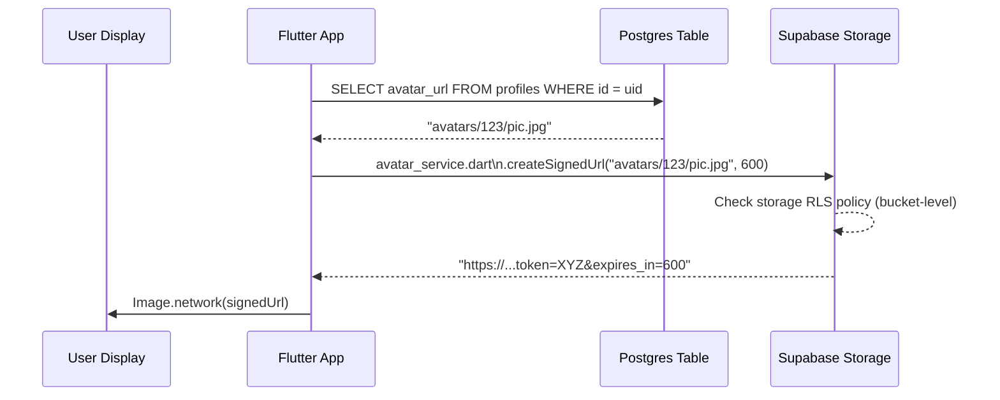
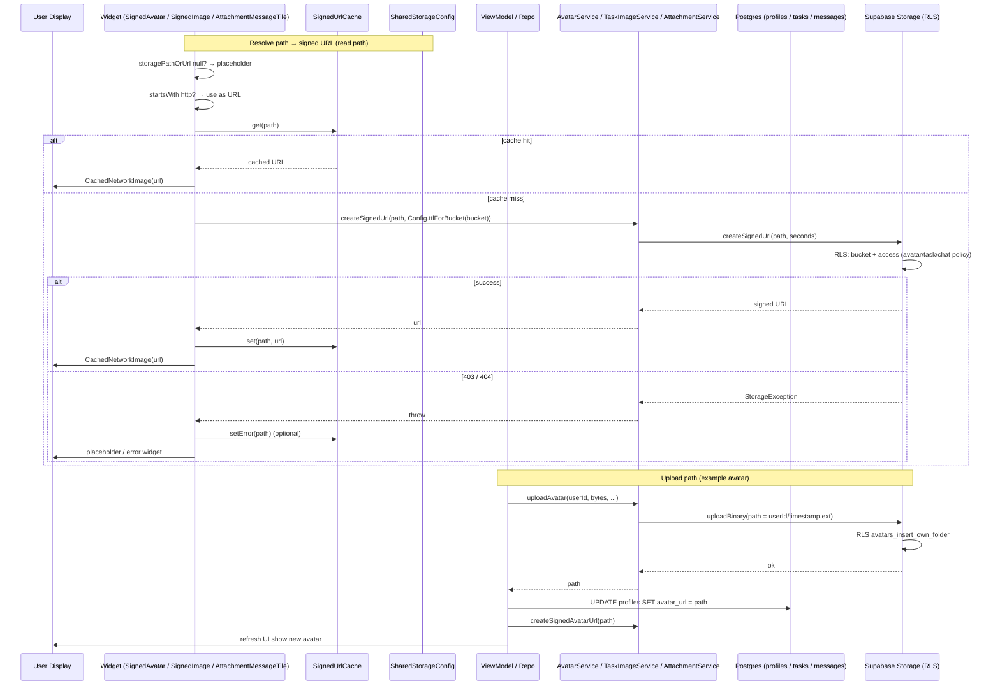

# Storage & Signed URLs Flow — Diagram Document

---

## OLD Diagram (Pre–v2 / Pre–2026-03-06)

**Kept for reference.** Superseded by the "New & Implemented Diagram" below.

### OLD — What this diagram was

Showed how SLine handles private images: the DB stores only a path string, and the app generates a short-lived signed URL on demand.

### OLD — Diagram (Mermaid)

### OLD — Evidence (partial)

| Element                           | Code Evidence                                                                     | DB Evidence                                                                       | Verified |
| --------------------------------- | --------------------------------------------------------------------------------- | --------------------------------------------------------------------------------- | -------- |
| `avatar_service.dart` exists      | ✅ File confirmed at `lib/features/profile/services/avatar_service.dart`          | N/A                                                                               | Y        |
| `upload_service.dart` exists      | ✅ File confirmed at `lib/features/chat/attachments/services/upload_service.dart` | N/A                                                                               | Y        |
| `avatars` bucket private          | N/A                                                                               | ✅ `storage.buckets` — public: false                                              | Y        |
| TTL = 600s signed URL             | ❌ Exact TTL not extracted from code                                              | N/A                                                                               | PARTIAL  |
| Storage RLS policy SQL            | N/A                                                                               | ❌ `storage.objects` policies not queried                                         | PARTIAL  |

---

## New & Implemented Diagram (v2 — 2026-03-06)

---

### Diagram Title + Version

- **Diagram name (exact):** Storage & Signed URLs Flow  
- **Version:** v2 (final)  
- **Date:** 2026-03-06  
- **Owner/author:** SLine backend/frontend (storage & app layer)

---

### Purpose

- **What this diagram is showing, in one paragraph.**  
  How SLine stores only **storage paths** in the database (no raw signed URLs), and how the app resolves those paths to **short-lived signed URLs** at display time via Supabase Storage, with in-memory caching, error handling, and RLS enforcing who can read/write which objects.

- **What problem it solves (why it exists).**  
  Storing signed URLs in the DB is unsafe (they expire). Storing public URLs would expose private content. This flow keeps paths in the DB and generates time-limited signed URLs on demand, with consistent TTLs, cache to reduce API calls, and RLS so only allowed users can read (e.g. avatars discoverable, task images and chat attachments scoped to participants/owners).

---

### Scope

- **What’s included (features/entities covered).**
  - Buckets: `avatars`, `task-images`, `chat-attachments` (private); `portfolio` (public, out of scope for signed-URL flow).
  - Path storage: `profiles.avatar_url`, task image paths (e.g. in `tasks` or related), `messages.attachment_url` (chat).
  - App: `SharedStorageConfig`, `SignedUrlCache`, `AvatarService`, `TaskImageService`, `AttachmentService`, widgets `SignedAvatar`, `SignedImage`, `AttachmentMessageTile`, profile avatar upload/refresh.
  - DB: `storage.objects` RLS policies for avatars (SELECT broad for authenticated, INSERT/UPDATE/DELETE own folder), task-images (SELECT via `can_access_task_image`, write own folder), chat-attachments (SELECT via `can_access_chat_attachment`, INSERT authenticated).
  - Feature flag: `app_config.storage_rls_v2_enabled` (task-images and chat-attachments only; avatars use fixed broad SELECT).

- **What’s explicitly excluded (out of scope).**
  - Portfolio bucket (public; no signed URLs in this flow).
  - Realtime or webhook delivery of URLs.
  - CDN or edge caching beyond app in-memory cache.
  - Admin-only buckets or separate admin tooling.

---

### Assumptions

- Signed URLs are created only via Supabase Storage `createSignedUrl` (no custom signing).
- TTLs are defined in `SharedStorageConfig` and used by all services/widgets; no raw TTL constants elsewhere for these buckets.
- RLS is the source of truth for who can read/write; the app does not bypass it.
- Paths stored in DB are **bucket-relative** (e.g. `userId/timestamp.jpg` for avatars, not `avatars/userId/...`).
- Cache is in-memory only; cleared on app restart; no persistent URL store.
- 404 (object not found) is treated as “no image” (placeholder) for avatars; errors can be cached briefly to avoid retry storms.

---

### Glossary (human-readable)

| Term | Definition |
|------|------------|
| **Storage path** | Bucket-relative object key stored in DB (e.g. `userId/123.jpg`), not a full URL. |
| **Signed URL** | Time-limited URL returned by Supabase Storage `createSignedUrl(path, seconds)`. |
| **TTL** | Time-to-live (seconds) for a signed URL before it expires. |
| **RLS** | Row-Level Security; Postgres policies on `storage.objects` that restrict SELECT/INSERT/UPDATE/DELETE. |
| **Bucket** | Supabase Storage container (e.g. `avatars`, `task-images`, `chat-attachments`). |
| **Discoverable (avatars)** | Any authenticated user can request a signed URL for any avatar path (profile pics visible in feed/cards). |
| **Participant-scoped (chat)** | Only users who are participants in the conversation can get signed URLs for that conversation’s attachments. |
| **Owner-scoped (task images)** | Only users with access to the task (e.g. owner or participant) can get signed URLs for that task’s images. |
| **SignedUrlCache** | In-app in-memory cache of path → signed URL (and optional error state) to avoid redundant API calls. |
| **SharedStorageConfig** | Central config for TTLs and cache durations (e.g. avatars 7200s, chat 3600s, cache 90min, error cache 30s). |
| **Error cache** | Short-lived cache of paths that recently failed (e.g. 403/404) to prevent retry storms. |
| **app_config.storage_rls_v2_enabled** | Feature flag; when true, task-images and chat-attachments use strict RLS helpers; avatars ignore it (always broad SELECT). |

---

### Legend (what each symbol means)

- **Nodes/shapes**
  - **Actor:** User (viewing profile/feed/chat/task).
  - **App/UI:** Flutter screens and widgets (`SignedAvatar`, `SignedImage`, `AttachmentMessageTile`, profile header).
  - **ViewModel/Repository:** ProfileViewModel, repositories that call avatar/task-image/attachment services.
  - **Service:** AvatarService, TaskImageService, AttachmentService (call Supabase Storage).
  - **Cache:** SignedUrlCache (in-memory).
  - **Config:** SharedStorageConfig (TTL and cache constants).
  - **DB:** `profiles`, `tasks`, `messages`, `storage.objects`, `app_config`.
  - **Storage:** Supabase Storage (buckets + RLS).

- **Arrows**
  - **Sync call:** Method call (e.g. cache get, config read).
  - **Async/network:** `createSignedUrl`, upload (Supabase client).
  - **Read path:** SELECT from DB or storage metadata.
  - **Write path:** INSERT/UPDATE on `storage.objects` (upload) or `profiles` (avatar_url update).

- **Guards**
  - Cache hit → use cached URL; no Storage call.
  - Cache miss or error cache expired → call Storage `createSignedUrl`; RLS evaluates on server.
  - 403/404 → show placeholder; optionally cache error for 30s.

---

### Actors and Responsibilities

| Actor | Allowed | Forbidden |
|-------|--------|-----------|
| **User (authenticated)** | View own and others’ avatars (signed URL); view task images for tasks they can access; view chat attachments in conversations they participate in; upload own avatar and task images in allowed scope. | Access other users’ private storage paths without RLS allowing it; store signed URLs in DB; extend TTL beyond app config. |
| **App (Flutter)** | Generate signed URLs via services; cache URLs/errors per SharedStorageConfig; show placeholders on 404/403. | Bypass RLS; store raw signed URLs in DB; use TTLs not from SharedStorageConfig for these buckets. |
| **Supabase Storage (RLS)** | Allow SELECT per policy (avatars: any authenticated; task-images/chat: helper-based); allow INSERT/UPDATE/DELETE only within policy (own folder or participant). | Allow anon access to private buckets; allow cross-user write outside own folder. |
| **Admin (if is_admin)** | Same as Storage; helper `is_admin(auth.uid())` can grant SELECT where used (e.g. in v2 task-images/chat; avatars do not use it). | N/A for this flow. |

---

### System Components (where it lives)

- **App entry points**
  - Profile: Profile screen, home/dashboard header (avatar), edit profile, avatar upload.
  - Task images: Task create/edit, task detail, cards showing task images.
  - Chat: Message list, attachment message tile (image/file).

- **Service / ViewModel / Repository (file paths)**
  - `lib/core/config/storage_config.dart` — SharedStorageConfig (TTL, cache duration, error cache duration).
  - `lib/core/utils/signed_url_cache.dart` — SignedUrlCache (get/set/setError/hasError/clear).
  - `lib/features/profile/services/avatar_service.dart` — AvatarService (upload, createSignedUrl).
  - `lib/features/profile/data/profile_repository.dart` — getAvatarPath, uploadAvatar, createSignedAvatarUrl.
  - `lib/features/profile/viewmodels/profile_view_model.dart` — refreshAvatarSignedUrl, pickAndUploadAvatar; 404 → placeholder, no error log.
  - `lib/features/tasks/services/task_image_service.dart` — TaskImageService (upload, createSignedUrl).
  - `lib/features/chat/services/attachment_service.dart` — AttachmentService (upload, createSignedUrl; 404 alternate path).
  - `lib/core/widgets/signed_avatar.dart` — SignedAvatar (cache, SharedStorageConfig TTL).
  - `lib/core/widgets/signed_image.dart` — SignedImage (cache, task-images TTL).
  - `lib/features/chat/attachments/widgets/attachment_message_tile.dart` — AttachmentMessageTile (cache, error cache, ErrorMapper).

- **Database objects**
  - **Tables:** `profiles` (avatar_url), `messages` (attachment_url), tasks / task image path storage; `storage.objects` (Supabase); `app_config` (storage_rls_v2_enabled).
  - **Views:** None specific to this flow.
  - **RPCs:** None for signing; signing is Storage API.
  - **Triggers:** None specific to signed URL generation.
  - **Policies (RLS):**
    - **avatars:** `avatars_select_authenticated` (SELECT, bucket_id = 'avatars'); `avatars_insert_own_folder` / update / delete (name LIKE auth.uid()::text || '/%').
    - **task-images:** `task_images_select_restricted_v2` (SELECT, can_access_task_image OR NOT storage_rls_v2_enabled); insert/update/delete own folder.
    - **chat-attachments:** `chat_attach_select_restricted_v2` (SELECT, can_access_chat_attachment OR NOT storage_rls_v2_enabled); `chat_attach_insert_auth` (INSERT authenticated).
  - **Migrations:** `20260306180000_avatars_storage_fix.sql` (avatars SELECT + INSERT fix).

---

### Step-by-step Flow (“human story”)

**Happy path — viewing an avatar**

1. User opens screen that shows an avatar (e.g. profile or feed card).
2. Widget (e.g. SignedAvatar) has `storagePathOrUrl` (from profile). If null/empty → show placeholder; end.
3. If path is full URL (starts with `http`) → use it; end.
4. Check SignedUrlCache.get(path). If hit and valid → use cached URL; render image; end.
5. Call AvatarService.createSignedUrl(path) with TTL from SharedStorageConfig (avatars: 7200s).
6. Supabase Storage checks RLS (avatars: any authenticated can SELECT) → returns signed URL.
7. SignedUrlCache.set(path, url); widget setState; render image.

**Happy path — uploading an avatar**

1. User taps change avatar, picks image; ProfileViewModel.pickAndUploadAvatar runs.
2. Image compressed; ProfileRepository.uploadAvatar calls AvatarService.uploadAvatar (path = `userId/timestamp.ext`).
3. Storage INSERT: RLS checks avatars_insert_own_folder (bucket_id = 'avatars' AND name LIKE auth.uid() || '/%') → allowed.
4. ProfileRepository updates profiles.avatar_url = path; ProfileViewModel gets new signed URL and notifies UI.

**Common failure — avatar 404 (object missing)**

1. profiles.avatar_url points to a path whose file was deleted (or never existed).
2. createSignedUrl(path) returns 404. ProfileViewModel.refreshAvatarSignedUrl catches StorageException 404 → sets avatarSignedUrl = null, notifyListeners; logs at debug only.
3. UI shows placeholder; no error to user.

**Common failure — cache miss then 403 (e.g. chat)**

1. User opens chat; AttachmentMessageTile requests signed URL for attachment path.
2. Cache miss → AttachmentService.createSignedUrl. RLS (can_access_chat_attachment) denies → 403.
3. Widget catches error; SignedUrlCache.setError(path); shows error placeholder. No retry for 30s (error cache).

---

### State Machine Explanation

- This flow does not define a single state machine; it is a **resolve-path-to-URL** flow with cache states:
  - **Path state:** Has path vs no path (placeholder).
  - **URL state:** Loading → Resolved (cached or fresh) | Error (403/404) → placeholder or error widget.
  - **Cache state:** Cold / Hit / Error-cached (short TTL).
- No explicit “from → to” state table; transitions are: request → (cache hit → resolved), (cache miss → API → resolved or error); error can be cached then retried after error TTL.

---

### Invariants (must-always-be-true rules)

- DB never stores raw signed URLs for avatars, task-images, or chat-attachments; only storage paths.
- Signed URL TTL for these buckets is taken from SharedStorageConfig only (no ad-hoc TTLs in widgets/services).
- RLS is the authority for who can read/write; the app does not grant access beyond what RLS allows.
- Avatar SELECT allows any authenticated user (discoverable); avatar INSERT/UPDATE/DELETE only for own folder (`auth.uid()/...`).
- Task image and chat attachment SELECT are restricted by helper functions (and feature flag); write policies restrict to own folder or allowed scope.
- Cache is best-effort only; expiry is enforced so URLs are refreshed before TTL (e.g. 90min cache vs 2hr TTL).
- 404 for avatar path is treated as “no avatar” (placeholder), not a fatal error.

---

### Guards & Validation Rules

| Guard | Where it runs | Source of truth |
|-------|----------------|------------------|
| Path null/empty → placeholder | Client (widget) | App |
| Cache hit → use URL | Client (SignedUrlCache) | App |
| createSignedUrl allowed for path | Server (storage.objects RLS) | DB |
| avatars: bucket_id = 'avatars' (SELECT) | Server | DB |
| avatars: name LIKE auth.uid() || '/%' (INSERT) | Server | DB |
| task-images: can_access_task_image(name, auth.uid()) | Server (RPC/helper) | DB |
| chat-attachments: can_access_chat_attachment(name, auth.uid()) | Server (RPC/helper) | DB |
| storage_rls_v2_enabled fallback (task-images, chat) | Server (app_config) | DB |
| 404 → no avatar, debug log only | Client (ProfileViewModel) | App |

---

### Failure Modes (what can go wrong)

| Failure | System behaviour |
|---------|------------------|
| App crash mid-step | No persistent URL state; next open re-resolves; cache empty. |
| Signed URL expires before use | Cache TTL &lt; Storage TTL; widget can re-request on next build; user may see brief reload. |
| 404 (object deleted) | Avatar: treat as no avatar, placeholder, debug log. Task/chat: error placeholder; error cached 30s. |
| 403 (RLS denies) | Error placeholder; SignedUrlCache.setError; no retry for 30s. |
| Duplicate createSignedUrl for same path | Mitigated by cache; first request fills cache, subsequent use cached URL. |
| Race (two widgets same path) | Both may call createSignedUrl; first sets cache; second may still call then overwrite cache (idempotent). |
| Missing metadata / wrong path format | createSignedUrl fails (404 or 400); error handling and optional error cache. |
| storage_rls_v2_enabled toggled | Task-images and chat-attachments SELECT use fallback when false (broad); when true, helper is used. Avatars unaffected (always broad SELECT). |

---

### Security & Abuse Scenarios

| Scenario | Mitigation |
|----------|------------|
| Spoofing identity | All requests use Supabase auth; RLS uses auth.uid(); no client-supplied identity for access. |
| Unauthorised state change | INSERT/UPDATE/DELETE restricted to own folder (avatars, task-images) or allowed scope (chat); no cross-user write. |
| Reading another user’s private file | Task-images: can_access_task_image; chat: can_access_chat_attachment; avatars: discoverable by design (profile pics). |
| Trapped escrow | N/A (no escrow in this flow). |
| User seeing another user’s private data | Chat/task attachments: RLS helpers restrict by participation/ownership. Avatars: intentionally visible to any authenticated user. |
| Storing long-lived URLs | App and DB store only paths; URLs are short-lived and generated on demand. |

---

### Data Model Mapping

| Diagram “thing” | DB / storage mapping |
|----------------|----------------------|
| Avatar path | `profiles.avatar_url` (e.g. `userId/timestamp.jpg`); bucket `avatars`. |
| Task image path | Stored per task (e.g. `userId/tasks/taskId/timestamp.ext`); bucket `task-images`. |
| Chat attachment path | `messages.attachment_url` (e.g. `convos/conversationId/randomId_filename`); bucket `chat-attachments`. |
| “Resolved” display | No DB field; in-memory SignedUrlCache + widget state. |
| “Expired” URL | Cache entry expiry &lt; SharedStorageConfig.cacheDuration; Storage URL has TTL (e.g. 7200s). |
| RLS “own folder” | storage.objects.name LIKE auth.uid()::text || '/%' for avatars/task-images. |
| Feature flag | `app_config.storage_rls_v2_enabled` (task-images, chat-attachments SELECT). |

Required: RLS on `storage.objects` for all four buckets; indexes as per Supabase (bucket_id, name) for policy evaluation.

---

### Observability & Forensics

- **Logs:** AppLogger in ProfileViewModel (avatar 404 debug), TaskImageService (upload success/failure), AttachmentService (optional debug); no signed URL logged (sensitive).
- **Audit:** Storage access is logged by Supabase; app does not persist audit of who resolved which path.
- **Admin:** Supabase Dashboard → Storage → bucket/object list; RLS policies in `pg_policies` / storage schema.
- **Orphan:** If a path exists in DB but object is missing → 404; avatar flow treats as no avatar; task/chat show error placeholder; no automatic DB cleanup in this flow.

---

### Verification Checklist

- **Unit tests:** SignedUrlCache (get/set/error/eviction); SharedStorageConfig TTL/cache values.
- **Integration tests:** Resolve path → signed URL (with mocked Storage or test project); upload avatar → path in DB.
- **DB tests (RLS):** test/storage_rls_test.dart; test/rls/storage_rls_test_harness.dart; fixtures in test/fixtures/storage_rls_test_data.sql.
- **Concurrency:** Cache is in-memory; duplicate requests for same path are safe (idempotent set); no duplicate upload intended (upsert used where applicable).

---

### Dependencies

- **Depends on:** Auth (auth.uid() for RLS); profiles, tasks, messages tables; app_config; Supabase Storage API.
- **Depended on by:** Profile feature, Home/feed, Task detail/create, Chat UI.
- **Ordering:** Storage buckets and RLS must exist before app uses them; migration `20260306180000_avatars_storage_fix.sql` must run for avatars SELECT/INSERT to match this doc.

---

### Open Questions / Missing Evidence

- None for current implementation. Evidence: SUPABASE_SETUP.md §11 (buckets + policies); DEVELOPER_GUIDE.md (Storage Configuration & Caching); code paths above; migration file.

---

### Final Status

- **Verdict:** PASS  
- **Production ready?** YES, provided: (1) migration `20260306180000_avatars_storage_fix.sql` is applied, (2) SharedStorageConfig and SignedUrlCache are used consistently, (3) RLS policies match this document.  
- **Next actions:** Keep SUPABASE_SETUP.md and DEVELOPER_GUIDE.md in sync with any future bucket or policy change; run storage RLS tests in CI if not already.

---

## New & Implemented — Diagram (Mermaid)

---

## Evidence Table (v2)

| Element | Code / config evidence | DB evidence | Verified |
|--------|-------------------------|------------|----------|
| SharedStorageConfig TTLs | `lib/core/config/storage_config.dart` — avatars 7200s, chat 3600s, task-images 7200s | N/A | Y |
| SignedUrlCache | `lib/core/utils/signed_url_cache.dart` — 90min cache, 30s error cache, 1000 max | N/A | Y |
| AvatarService path | `userId/${timestamp}.${fileExt}` in avatar_service.dart | profiles.avatar_url | Y |
| Task image path | `userId/tasks/taskId/timestamp.ext` in task_image_service.dart | task image path storage | Y |
| Chat path | `convos/conversationId/randomId_filename` in attachment_service.dart | messages.attachment_url | Y |
| avatars SELECT | Migration 20260306180000 | avatars_select_authenticated (bucket_id = 'avatars') | Y |
| avatars INSERT | Same migration | avatars_insert_own_folder (name LIKE auth.uid() || '/%') | Y |
| task-images SELECT | SUPABASE_SETUP.md §11.2 | task_images_select_restricted_v2 + can_access_task_image | Y |
| chat-attachments SELECT | SUPABASE_SETUP.md §11.2 | chat_attach_select_restricted_v2 + can_access_chat_attachment | Y |
| Avatar 404 handling | profile_view_model.dart refreshAvatarSignedUrl — 404 → null, debug log | N/A | Y |
