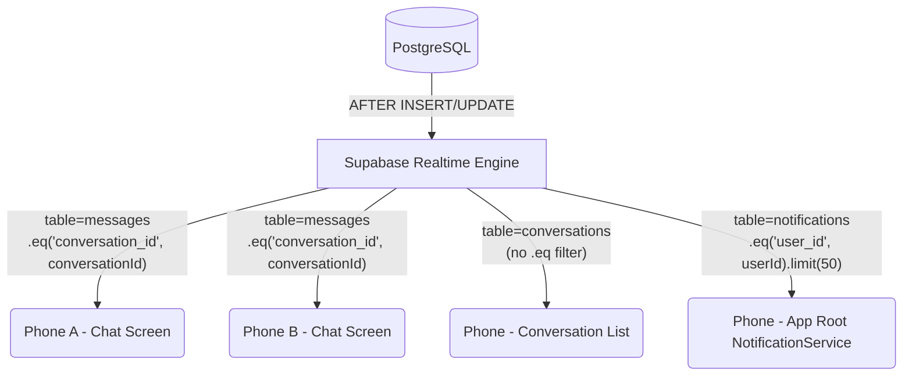
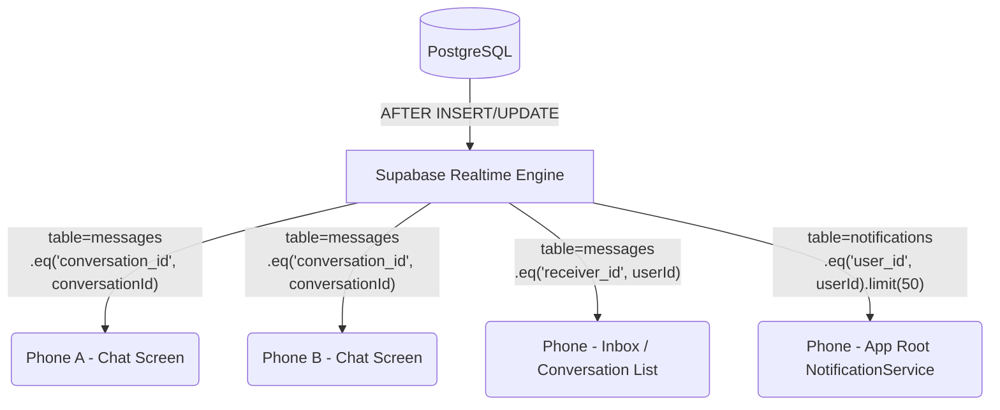

# Realtime Subscription Topology — Diagram Document

**Diagram name (exact):** Realtime Subscription Topology  
**Version:** v2 (Implemented) — 2026-03-07  
**Owner/author:** SLine (Backend/Architecture)  
**Last verified:** 2026-03-07

---

## Purpose

- **What this diagram is showing (one paragraph):**  
  Map of the WebSocket pipes (Supabase Realtime channels) that connect Postgres to the app for instant data: which tables are in the `supabase_realtime` publication, which client subscriptions exist, and with what filters (e.g. `conversation_id`, `receiver_id`, `user_id`). It shows how the Inbox (conversation list), the active Chat screen, and the app-wide Notification badge get live updates without polling.

- **What problem it solves (why it exists):**  
  Polling is inefficient and delays updates. Realtime subscriptions push events as they happen. The topology makes it explicit which tables are streamed, with which filters, so we avoid subscribing to tables not in the publication (silent failure), avoid N+1 queries inside stream handlers, and keep the publication minimal (e.g. no `conversations` table) to avoid global RLS evaluation and CPU load.

---

## Scope

- **What’s included:**  
  - Publication: `supabase_realtime` (tables: `messages`, `notifications`, `conversation_presence`).  
  - Client subscriptions: (1) active chat — `messages` filtered by `conversation_id`; (2) Inbox — `messages` filtered by `receiver_id=userId`; (3) app root — `notifications` filtered by `user_id`, limit 50.  
  - RLS application to realtime payloads (`messages_select`, `notifications_select_own`).  
  - App entry points and service/repository paths for each stream.

- **What’s explicitly excluded:**  
  - Realtime presence/typing (covered by diagram 08 / Chat Realtime Sync; `conversation_presence` is in publication but not drawn in this topology’s flow).  
  - Payment intents / wallet realtime.  
  - Admin-only streams or internal Supabase Realtime engine internals.

---

## Assumptions

- Only tables added to `supabase_realtime` receive WAL events and can be subscribed to by the app.
- RLS is applied by Supabase to realtime payloads; the client filter (e.g. `.eq('receiver_id', userId)`) narrows which rows are sent but does not replace RLS.
- The app never subscribes to `conversations` for realtime; Inbox updates are derived from the `messages` stream (receiver_id) and in-memory merge.
- No REST/select is performed inside realtime stream handlers for Inbox (no N+1); new conversations are hydrated with a single `getConversationById` call when needed, with a guard to prevent duplicate fetches.

---

## Glossary (Human-readable)

| Term | Definition |
|------|------------|
| **Publication** | Postgres mechanism that decides which table changes are forwarded to the Realtime engine; only tables in `supabase_realtime` emit events. |
| **Stream** | Client subscription to a table (or filtered view of it) over WebSocket; receives INSERT/UPDATE/DELETE as they occur. |
| **Inbox** | The conversation list screen; shows last message and sort order; must update in realtime when the user receives a new message. |
| **Active chat** | The single-conversation screen; shows messages for one `conversation_id`; subscribes to `messages` for that id only. |
| **RLS** | Row-Level Security; Postgres policies that restrict which rows a role can read/write; applied to realtime payloads. |
| **N+1** | Anti-pattern: one query per item in a list (e.g. per message event a bulk select of all conversations); must be avoided in stream handlers. |
| **receiver_id** | Column on `messages`; the user who receives the message; used to drive Inbox stream (messages where receiver_id = current user). |
| **conversation_id** | Column on `messages`; the conversation the message belongs to; used to filter the active-chat stream. |
| **idempotency** | Property that repeating an operation has the same effect as doing it once; relevant for merge/dedupe of stream events. |

---

## Legend

- **Node “PostgreSQL”:** Source of truth; WAL writes feed the publication.
- **Node “Supabase Realtime Engine”:** Service that receives publication events and multiplexes to WebSocket channels.
- **Arrows “AFTER INSERT/UPDATE”:** Direction of event flow (DB → engine).
- **Labels on arrows (e.g. “table=messages, .eq('receiver_id', userId)”):** Which table and which client-side filter the subscription uses.
- **Nodes “Phone A / Phone B / Phone - Inbox / Phone - App Root”:** Client app surfaces (screen or root); each has one or more subscriptions.
- **No colours** in this diagram; all flows are “allowed” once filters and RLS are satisfied.

---

## Actors and Responsibilities

| Actor | Allowed | Forbidden |
|-------|--------|-----------|
| **Client (app user)** | Subscribe to `messages` with `.eq('conversation_id', id)` when viewing a chat; subscribe to `messages` with `.eq('receiver_id', ownUserId)` for Inbox; subscribe to `notifications` with `.eq('user_id', ownUserId)`. | Subscribe to tables not in the publication; perform REST/select inside stream handlers for list updates (N+1); subscribe to `conversations` for realtime. |
| **System (Supabase)** | Emit events only for tables in `supabase_realtime`; apply RLS to payloads; deliver only rows that pass RLS and (where applicable) client filter. | Emit events for tables not in the publication; bypass RLS on realtime. |
| **Developer/ops** | Add/remove tables from publication via migrations; ensure migrations do not add `conversations` to realtime (enforced by migration 20260307230000). | Add `conversations` to `supabase_realtime` without architecture review. |

---

## System Components (Where it lives)

- **App entry points:**  
  - Inbox: `lib/features/chat/view/messages_screen.dart` (initState calls `subscribeToUserConversations()`).  
  - Active chat: `lib/features/chat/view/chat_screen.dart` (subscribes to messages for active conversation).  
  - Notifications: app root / `NotificationService` (stream on `notifications`).

- **Service / ViewModel / Repository:**  
  - `lib/features/chat/services/message_service.dart`: `subscribeToMessages(conversationId)`, `subscribeToInboxMessages(userId)`.  
  - `lib/features/chat/data/chat_repository.dart`: exposes same; `getConversationById(conversationId)` for new-conversation hydration.  
  - `lib/features/chat/viewmodels/chat_view_model.dart`: `subscribeToUserConversations()` → inbox stream; `_mergeInboxMessages()`; `_inboxMsgSub`, `_fetchingConversationIds`.  
  - `lib/features/notifications/services/notification_service.dart`: stream on `notifications` with `.eq('user_id', userId).limit(50)`.

- **Database objects:**  
  - **Tables:** `messages`, `notifications` (and `conversation_presence` for presence; not drawn in this topology).  
  - **Publication:** `supabase_realtime` — includes `messages`, `notifications`, `conversation_presence`; explicitly does **not** include `conversations` (enforced by migration `20260307230000_realtime_topology_no_conversations.sql`).  
  - **RLS policies:** `messages_select` (participant-only read), `notifications_select_own` (user_id = auth.uid()).  
  - **No RPC/triggers** specific to this topology; realtime is read-only from the app’s perspective.

---

## Step-by-step Flow (“Human Story”)

**Happy path — Inbox update:**

1. User B sends a message to User A (insert into `messages` with receiver_id = A).
2. Postgres WAL writes the row; `supabase_realtime` publication includes `messages`, so the Realtime engine receives the event.
3. User A’s app has an active subscription to `messages` with `.eq('receiver_id', A)`. The engine (and RLS) allow the row to be sent to A’s client.
4. A’s `MessageService.subscribeToInboxMessages(A)` stream emits the new message(s). `ChatViewModel._mergeInboxMessages()` updates the conversation list (existing conversation: copyWith new last message; new conversation: getConversationById once, then add). List is re-sorted by last_message_at; `notifyListeners()` runs.
5. User A sees the conversation move to the top and the preview update without refresh.

**Happy path — Active chat:**

1. User B sends a message in the same conversation. Insert into `messages` with same `conversation_id`.
2. Both A and B have a stream on `messages` with `.eq('conversation_id', thatId)`. The engine delivers the new row to both.
3. Each client’s message list updates; no extra REST call.

**Common failure path — Table not in publication:**

1. If the app had subscribed to `conversations` (old design), the stream would connect but receive no events because `conversations` is not in the publication.
2. Result: Inbox would not update in realtime (silent failure). Mitigation: we removed the conversations subscription and use the messages stream for Inbox.

**Common failure path — N+1 in handler:**

1. If on each stream event the app ran a bulk select (e.g. all conversations by id list), load would scale with number of conversations × number of events.
2. Mitigation: no REST/select in `subscribeToInboxMessages`; only in-memory merge and at most one `getConversationById` per new conversation_id (guarded).

---

## State Machine Explanation

This diagram is a **topology/data-flow** diagram, not a state machine. There are no conversation/message “states” drawn here; state machines for chat (e.g. delivered/seen) or notifications are out of scope. The only “state” that matters for the diagram is: **subscription active vs cancelled** (e.g. on dispose or role switch). Cancelling is required when leaving the Inbox or on teardown to avoid leaks and duplicate listeners.

---

## Invariants (Must-always-be-true rules)

- The `conversations` table is **not** in the `supabase_realtime` publication. (Enforced by migration 20260307230000.)
- Inbox realtime is driven **only** by the `messages` stream filtered by `receiver_id = current user`. No client subscription to `conversations` for list updates.
- No REST call or `.select()` is executed inside the Inbox realtime stream handler for the list (no N+1). At most one `getConversationById` per new conversation_id, guarded by `_fetchingConversationIds`.
- RLS is applied to realtime payloads: `messages_select` and `notifications_select_own` are the source of truth for who sees which rows.
- Realtime subscriptions are cancelled on ViewModel dispose and on role-switch teardown so no stale or cross-role data is shown.

---

## Guards & Validation Rules

| Guard | Where it runs | Source of truth |
|-------|----------------|------------------|
| Only rows for conversations the user participates in | DB (RLS `messages_select`) | DB |
| Only notifications for the current user | DB (RLS `notifications_select_own`) | DB |
| Client filter: only messages for this conversation | Client (`.eq('conversation_id', id)`) | Narrows set; RLS still applies |
| Client filter: only messages where I am receiver | Client (`.eq('receiver_id', userId)`) | Narrows set; RLS still applies |
| At most one getConversationById per new conversation_id | Client (ViewModel `_fetchingConversationIds`) | Client |
| Subscriptions cancelled on dispose / role switch | Client (ViewModel) | Client |

---

## Failure Modes (What can go wrong)

| Failure | What the system should do |
|---------|---------------------------|
| Stream connects but receives no events (e.g. table not in publication) | Log warning (AppLogger.w) in stream error handler; do not assume data will arrive; avoid N+1 in handler. |
| Duplicate or reordered events on reconnect | Merge/dedupe by message id; sort by created_at; ChatRealtimeMerger (active chat) and list merge (Inbox) handle idempotent merge. |
| getConversationById fails for new conversation | Remove conversation_id from _fetchingConversationIds; log; do not add duplicate; user can pull-to-refresh to load conversation. |
| Two messages for same new conversation in quick succession | Guard ensures at most one in-flight fetch per conversation_id; second add is no-op if conversation already in list. |
| App backgrounded / subscription dropped | On resume, existing streams may reconnect; initial load (fetchConversations) already ran; no special handling beyond normal reconnect. |
| Role switch without teardown | Stale data or wrong user’s chats. Mitigation: RoleSwitchCoordinator; ViewModel cancels subscriptions and clears list in teardown. |

---

## Security & Abuse Scenarios

- **Spoofing identity:** Realtime uses the same auth context as REST; RLS ensures user only gets rows they are allowed to read. Client filter (receiver_id / user_id) only narrows; it does not grant access.
- **Unauthorised state changes:** App does not write via realtime; it only reads. Writes are via REST/RPC with RLS and triggers.
- **User seeing another user’s private data:** Prevented by `messages_select` (participant check) and `notifications_select_own` (user_id = auth.uid()). Realtime does not bypass RLS.
- **Adding `conversations` to publication by mistake:** Would cause global RLS evaluation and potential N+1 if client re-subscribed. Mitigation: migration 20260307230000 drops `conversations` from publication if present; docs and diagram state that conversations must not be in publication.

---

## Data Model Mapping

| Diagram concept | DB / code |
|----------------|-----------|
| “Messages for this conversation” | `messages.conversation_id = :id`; stream `.eq('conversation_id', id)`. |
| “Messages where I am receiver” | `messages.receiver_id = :userId`; stream `.eq('receiver_id', userId)`. |
| “Notifications for me” | `notifications.user_id = :userId`; stream `.eq('user_id', userId).limit(50)`. |
| “Inbox conversation list” | ViewModel list built from initial `getUserConversations` and updated by merging message events (last_message_*, sort by last_message_at). |
| “New conversation” | Message with `conversation_id` not in current list → `getConversationById(conversation_id)` once, then add to list with last message from event. |
| Publication contents | `pg_publication_tables WHERE pubname = 'supabase_realtime'` → `messages`, `notifications`, `conversation_presence`; not `conversations`. |

---

## Observability & Forensics

- **Logs:** AppLogger.d for subscription start/stop, inbox merge count, new conversation added; AppLogger.w for stream errors (timeout/protocol) and getConversationById failure; AppLogger.e for parse/merge errors. No PII in logs; only UUIDs and counts.
- **Admin / forensics:** No dedicated admin view for “realtime story”; publication state can be checked with `SELECT * FROM pg_publication_tables WHERE pubname = 'supabase_realtime'`. N+1 regression: absence of bulk `SELECT ... conversations ... IN (...)` in logs during messaging.
- **Orphan events:** If a message is inserted but the receiver has no active subscription, they do not see it until they open Inbox (which does initial fetch) or pull-to-refresh; no orphan “event” stored in app.

---

## Verification Checklist

- **Unit:** ViewModel merge logic (copyWith, sort) can be unit-tested with mock message lists; guard (at most one fetch per conversation_id) is testable.
- **Integration:** Manual E2E — two users; one on Inbox, other sends message; Inbox updates without refresh. See `.TODO/improvement_the_system/ImplementReady/18_realtime-subscription-topology/MANUAL_E2E_INBOX_REALTIME.md`.
- **DB:** Publication check: `SELECT * FROM pg_publication_tables WHERE pubname = 'supabase_realtime'` → must not contain `conversations`. RLS tests for `messages` and `notifications` (existing) cover read access.
- **Concurrency:** Guard prevents duplicate getConversationById for same new conversation; no duplicate list entries. Role switch teardown prevents cross-role data.

---

## Dependencies

- **Depends on:** Supabase Realtime (messages, notifications in publication); RLS policies `messages_select`, `notifications_select_own`; Chat Feature (MessageService, ChatRepository, ChatViewModel). Diagram 08 (Chat Realtime Sync) for presence/typing.
- **Depended on by:** Chat Feature doc, SUPABASE_SETUP Realtime section, MVP_ROADMAP and STRUCTURE references. Plan: `.TODO/PLAN_RealtimeSubscriptionTopology_2026-03-07.md`.
- **Ordering:** Migration 20260307230000 must run so `conversations` is not in publication; app code assumes that.

---

## Open Questions / Missing Evidence

- None. Publication verified via MCP/execute_sql; code paths and diagram aligned; docs updated.

---

## Final Status

- **Verdict:** PASS  
- **Production ready?** YES. Inbox realtime is driven by messages stream; N+1 removed; conversations not in publication; subscriptions and guards in place; docs and checklist complete.  
- **Next actions:** Optional: run manual E2E (MANUAL_E2E_INBOX_REALTIME.md) and sign off before release.

---

# OLD Diagram (v1 — Pre–Plan 18)

*Kept for history. This version incorrectly showed a “conversations” stream and claimed conversations was in the publication. Do not use for implementation.*

## OLD — What it showed

- App subscribed to `messages` (by conversation_id) and to **conversations** (no filter).
- Diagram and evidence table claimed `conversations` was in `supabase_realtime` (it was not), so the conversations stream never received events (silent failure). The code also had an N+1 in the conversations stream handler.

## OLD — Mermaid (v1)

**Why deprecated:** `conversations` is not in the publication; P3 path never delivered events. Replaced by Inbox subscribing to `messages` with `.eq('receiver_id', userId)` (see Implemented diagram below).

---

# Implemented Diagram (v2 — Current)

**Version:** v2  
**Date:** 2026-03-07  
**Status:** Implemented and verified.

## Implemented — Mermaid (v2)

## Evidence Table (v2)

| Element | Code Evidence | DB Evidence | Verified |
| -------- | ------------- | ----------- | -------- |
| `messages` stream with `.eq('conversation_id')` (active chat) | ✅ `message_service.dart` subscribeToMessages | ✅ `supabase_realtime` publication | Y |
| `messages` stream with `.eq('receiver_id', userId)` (Inbox) | ✅ `message_service.dart` subscribeToInboxMessages | ✅ `supabase_realtime` publication | Y |
| `conversations` NOT in publication | N/A (no client stream on conversations) | ✅ Only messages, notifications (and conversation_presence) in publication | Y |
| `notifications` stream with `.eq('user_id').limit(50)` | ✅ `notification_service.dart` | ✅ `supabase_realtime` publication | Y |
| RLS applied to realtime payloads | Implicit (Supabase enforces) | ✅ `messages_select`, `notifications_select_own` | Y |

## Code / DB Sources (v2)

- **Code:** `lib/features/chat/services/message_service.dart` — subscribeToMessages(conversationId), subscribeToInboxMessages(userId).  
- **Code:** `lib/features/notifications/services/notification_service.dart` — stream on notifications with user_id and limit 50.  
- **DB:** Publication `supabase_realtime` — tables: messages, notifications, conversation_presence; not conversations. Migration: `supabase/migrations/20260307230000_realtime_topology_no_conversations.sql`.
