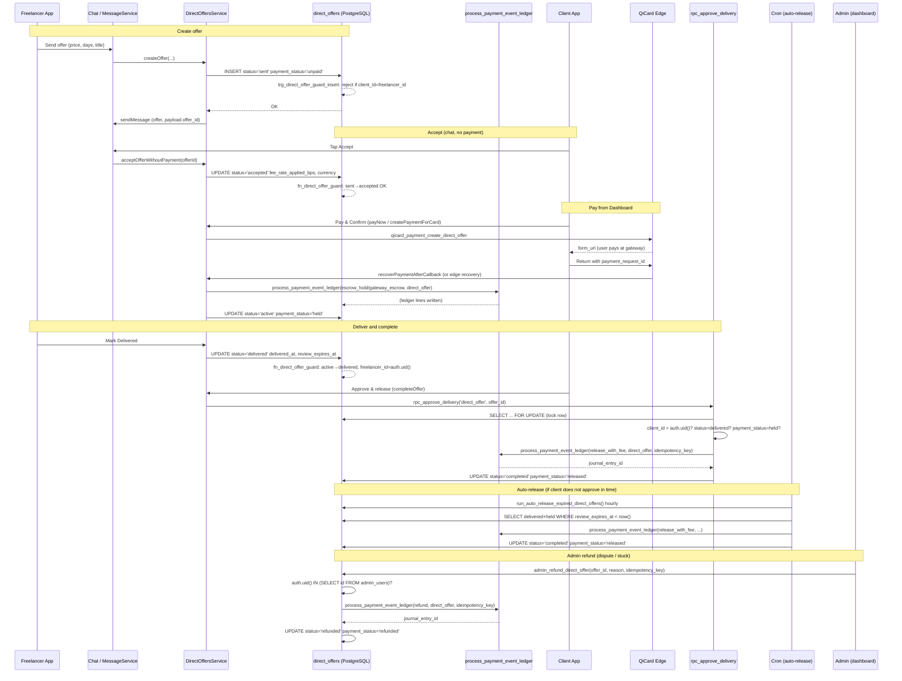
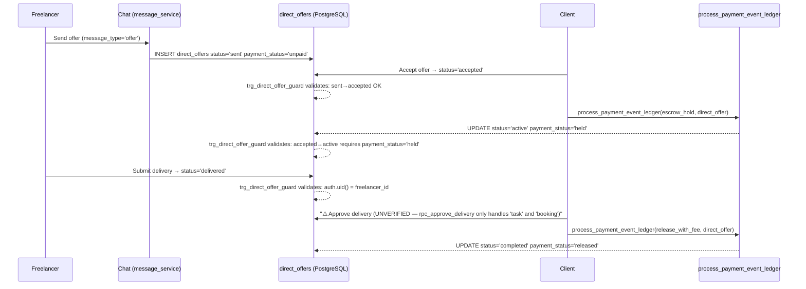

# 19 — Direct Offers Work Contract

---

## Diagram Title + Version

| Field | Value |
|-------|--------|
| **Diagram name (exact)** | 19_direct-offers-work-contract |
| **Version** | v2 (implemented) — 2026-03-08 |
| **Owner/author** | SLine team / Direct Offers & Plan 19 |
| **Previous version** | v1 (OLD) — 2026-03-05; rpc_approve_delivery did not support direct_offer; see § OLD Diagram below. |

---

## Purpose

- **What this diagram is showing:** How a **Direct Offer** (chat-to-work agreement with no task/booking) is created by the freelancer, accepted by the client in chat, paid via QiCard from the Dashboard, held in escrow, delivered by the freelancer, and released to the freelancer when the client approves (or when the review window expires via cron). The `direct_offers` row is the contract; a DB trigger enforces lifecycle and a self-offer guard blocks `client_id = freelancer_id`. Release is **only** via `rpc_approve_delivery(entity_type: 'direct_offer', entity_id)`; admin can refund via `admin_refund_direct_offer`.
- **What problem it solves:** Gives a single, auditable path from “offer in chat” to “money released,” with no separate work_contracts table, no double-release (idempotent RPC), and support for disputes/stuck funds via admin views and admin-only refund RPC.

---

## Scope

- **What’s included:** Create offer (chat), accept in chat (no payment), pay from Dashboard (QiCard edge + recovery), escrow_hold, mark delivered (delivered_at, review_expires_at), client approve → `rpc_approve_delivery` → release_with_fee; reject/cancel in sent state; self-offer guard (INSERT reject); admin views (`admin.vw_direct_offer_money_story`, `admin.vw_direct_offer_stuck_funds`), admin refund RPC; cron `run_auto_release_expired_direct_offers`; AppLogger in DirectOffersService; triggers `fn_direct_offer_guard`, `fn_direct_offer_guard_insert`, `trg_direct_offer_protect_price_currency`.
- **What’s explicitly excluded:** Task/booking flows; withdrawal; legacy `wallet_transactions`; in-chat payment (payment is Dashboard-only).
- **Assumptions:** Payment is finalised only via QiCard callback/recovery or demo path; app never writes ledger lines directly. Escrow release happens only via `rpc_approve_delivery` or cron using the same ledger RPC. Admin is defined by `public.admin_users`; RPC body enforces it. Idempotency for release and admin refund is enforced by deterministic key / ledger.

---

## Glossary (Human-Readable)

| Term | Definition |
|------|-------------|
| **direct_offer** | Entity: chat-originated offer (no task/booking); row in `public.direct_offers`; lifecycle sent → accepted → active → delivered → completed (or rejected/canceled/refunded). |
| **booking** | Entity type for task package; not used in this diagram. |
| **task_request** | Entity type for task tender; not used in this diagram. |
| **dispute** | Formal dispute ticket; can reference `direct_offer_id`; admin may refund. |
| **sent** | Offer created; client can accept or reject; freelancer can cancel. |
| **accepted** | Client accepted in chat; payment_status still unpaid; client pays from Dashboard. |
| **active** | Payment held in escrow; freelancer can mark delivered. |
| **delivered** | Freelancer submitted delivery; client can approve or wait for review_expires_at. |
| **completed** | Client approved (or cron auto-approved); payment_status released; money to freelancer. |
| **rejected** | Client rejected offer (sent only). |
| **canceled** | Freelancer canceled offer (sent only). |
| **refunded** | Money returned to client (e.g. admin refund). |
| **escrow_hold** | Ledger event: move client funds to platform_escrow. |
| **gateway_escrow** | Ledger event (QiCard): DEBIT user_pending_withdrawal, CREDIT platform_escrow. |
| **release_with_fee** | Ledger event: DEBIT platform_escrow, CREDIT freelancer available, CREDIT platform_revenue. |
| **refund** | Ledger event: DEBIT platform_escrow, CREDIT client available. |
| **RPC** | Remote procedure call (Postgres function). |
| **RLS** | Row-Level Security: user sees only rows where they are client or freelancer. |
| **idempotency** | Same key applied twice → one ledger effect; release and admin refund use deterministic keys. |
| **self-offer guard** | Trigger `fn_direct_offer_guard_insert`: reject INSERT when client_id = freelancer_id. |

---

## Legend: What Each Symbol Means

- **Nodes:** Participant = Freelancer App, Client App, Chat/MessageService, DirectOffersService, Edge (QiCard), DB (`direct_offers`, ledger tables), RPC (`rpc_approve_delivery`, `process_payment_event_ledger`, `admin_refund_direct_offer`), Cron.
- **Arrows:** Solid = sync call; dashed back = response; Edge → Ledger = webhook/recovery path.
- **Guards:** Conditions (e.g. status=sent, client_id=auth.uid()) enforced in RPC/trigger; forbidden transitions raise in DB or RPC.

---

## Actors and Responsibilities

| Actor | Allowed | Forbidden |
|-------|---------|-----------|
| **Freelancer** | Create offer in chat, cancel sent offer, mark delivered (active only). | Accept offer; pay; approve delivery; insert self-offer (client_id = freelancer_id). |
| **Client** | Accept sent offer (chat), reject sent offer, pay from Dashboard, approve delivery (delivered, held). | Create offer; mark delivered; approve when not delivered or not owner. |
| **Admin** | Call `admin_refund_direct_offer` (when in admin_users); query admin views (service_role). | Call admin RPC when not in admin_users; direct ledger writes. |
| **System/Cron** | Run `run_auto_release_expired_direct_offers` (delivered + held + review_expires_at < now()). | Double-release; non-deterministic idempotency. |
| **Payment Gateway (QiCard)** | Call edge → recovery → ledger escrow_hold/gateway_escrow with verified payload. | Release funds; spoof client. |

---

## System Components (Where It Lives)

- **App entry points:** Chat screen (create offer, accept/reject offer); Dashboard (Pay & Confirm, list Pending Payment); Direct offer detail screen (Pay, Mark Delivered, Approve & release); Web: URL params `payment_return=1&offer_id=...` trigger recovery.
- **Service layer:** `lib/features/direct_offers/services/direct_offers_service.dart` (createOffer, acceptOfferWithoutPayment, payNow, recoverPaymentAfterCallback, rejectOffer, cancelOffer, markDelivered, completeOffer); `lib/features/chat/services/message_service.dart` (offer messages); LedgerService, WorkLogService.
- **ViewModel:** `lib/features/direct_offers/viewmodels/direct_offer_details_view_model.dart`; ChatViewModel for accept/reject in chat.
- **Database objects:**
  - **Tables:** `direct_offers`, `journal_entries`, `ledger_lines`, `accounts`, `messages`, `work_logs`.
  - **Views:** `admin.vw_direct_offer_money_story`, `admin.vw_direct_offer_stuck_funds` (service_role only).
  - **RPC:** `process_payment_event_ledger`, `rpc_approve_delivery`, `admin_refund_direct_offer`.
  - **Triggers:** `trg_direct_offer_guard` (BEFORE UPDATE, fn_direct_offer_guard), `trg_direct_offer_guard_insert` (BEFORE INSERT, fn_direct_offer_guard_insert), `trg_direct_offer_protect_price_currency` (BEFORE UPDATE).
  - **Policies (RLS):** direct_offers SELECT for client or freelancer; INSERT for freelancer (conversation participant); UPDATE for client/freelancer per role.

---

## Step-by-Step Flow (“Human Story”)

### Happy path

1. **Trigger:** Freelancer sends offer in chat (price, days, title/description).
2. **Validation:** Service checks current user = freelancer; INSERT into `direct_offers` (status= sent, payment_status= unpaid). Trigger `fn_direct_offer_guard_insert` rejects if client_id = freelancer_id. Message sent with payload.offer_id.
3. **Client accepts:** Client taps Accept → `acceptOfferWithoutPayment` → UPDATE status= accepted, payment_status= unpaid; fee_rate_applied_bps and currency set at accept. Work_log optional.
4. **Client pays:** From Dashboard, client taps Pay & Confirm → createPaymentForCard → edge `qicard_payment_create_direct_offer` → user pays in QiCard flow; return with payment_request_id.
5. **Recovery:** `recoverPaymentAfterCallback` (or edge recovery) → `process_payment_event_ledger` escrow_hold/gateway_escrow → UPDATE direct_offers status= active, payment_status= held.
6. **Freelancer delivers:** Mark Delivered → UPDATE status= delivered, delivered_at= now(), review_expires_at= now() + 3 days. Trigger validates freelancer_id = auth.uid().
7. **Client approves:** Approve & release → `completeOffer` → `rpc_approve_delivery('direct_offer', offer_id)` → RPC locks row, validates client_id = auth.uid(), deterministic idempotency key, `process_payment_event_ledger('release_with_fee', ...)` → UPDATE status= completed, payment_status= released.
8. **Final state:** Offer completed; freelancer balance increased; client sees completed work.

### Alternative: auto-release

7b. If client does not approve before `review_expires_at`, cron `run_auto_release_expired_direct_offers` runs (hourly), selects delivered+held with review_expires_at < now(), calls same ledger release_with_fee, updates offer to completed/released.

### Most common failure paths

- **Offer not found (reject/cancel/complete):** Service logs AppLogger.w and throws; user sees error.
- **Recovery failure (edge returns !ok):** Service logs AppLogger.e; user may retry or contact support.
- **Duplicate payment return:** Recovery path idempotent; duplicate callback does not double-hold.
- **Client approves when not delivered:** RPC validates status= delivered and payment_status= held; returns error if not.

---

## State Machine Explanation

- **States (status):** sent, accepted, rejected, active, delivered, completed, canceled, refunded.
- **payment_status:** unpaid, held, released, refunded.
- **Allowed transitions (who):**
  - sent → accepted (client, acceptOfferWithoutPayment)
  - sent → rejected (client, rejectOffer)
  - sent → canceled (freelancer, cancelOffer)
  - accepted → active (system, after escrow_hold/gateway_escrow)
  - active → delivered (freelancer, markDelivered)
  - delivered → completed (client via rpc_approve_delivery, or cron)
  - held → refunded (admin via admin_refund_direct_offer)
- **Forbidden:** Freelancer cannot approve delivery. Client cannot mark delivered. Cannot transition to delivered unless active; cannot release unless delivered and held. Trigger `fn_direct_offer_guard` enforces these.

---

## Invariants (Must-Always-Be-True Rules)

- A direct_offer row is the single contract; no separate work_contracts row.
- Escrow release for direct_offer happens only via `rpc_approve_delivery(entity_type: 'direct_offer', entity_id)` or cron calling the same ledger release_with_fee pattern (idempotent).
- client_id ≠ freelancer_id (self-offer guard rejects INSERT).
- Only the client can approve delivery (RPC checks client_id = auth.uid()).
- User can only see/update direct_offers where they are client or freelancer (RLS).
- Fee for release is read from direct_offers.fee_rate_applied_bps at release time (immutable after set).

---

## Guards & Validation Rules

| Guard | Where | Source of truth |
|-------|--------|------------------|
| Caller is freelancer for create | Service (DirectOffersService.createOffer) | App |
| client_id ≠ freelancer_id on INSERT | DB trigger fn_direct_offer_guard_insert | DB |
| status/payment_status transitions | DB trigger fn_direct_offer_guard | DB |
| price/currency/fee_rate immutable after accept | DB trigger trg_direct_offer_protect_price_currency | DB |
| Client for reject, freelancer for cancel, sent only | Service | App |
| Client for approve delivery | RPC rpc_approve_delivery (client_id = auth.uid()) | DB |
| status= delivered, payment_status= held for release | RPC rpc_approve_delivery | DB |
| Admin for admin_refund_direct_offer | RPC (auth.uid() IN SELECT id FROM admin_users) | DB |

---

## Failure Modes (What Can Go Wrong)

| Failure | System behaviour |
|---------|-------------------|
| App crash mid-step | No partial ledger write; user retries; idempotency prevents double-hold/release. |
| Duplicate webhook/callback | Recovery idempotent; second call returns success without double-hold. |
| Retry causing duplicate release | rpc_approve_delivery uses deterministic idempotency key; ledger deduplicates. |
| Two users act at once (e.g. double approve) | RPC locks row (FOR UPDATE); second call waits or fails validation. |
| Missing payment_request_id / timeout | Service logs; user can retry pay or contact support; no orphan escrow without offer state. |
| review_expires_at passed without client action | Cron auto-releases so escrow is not trapped forever. |

---

## Security & Abuse Scenarios

- **Spoofing identity:** RPC and triggers use auth.uid(); JWT required. Admin RPC checks admin_users.
- **Unauthorised state changes:** fn_direct_offer_guard and role checks (client vs freelancer) in trigger and RPC.
- **Paying without owning entity:** Payment and escrow_hold tied to offer_id; recovery validates offer and caller.
- **Escrow trapped forever:** Cron auto-release when review_expires_at passed; admin_refund_direct_offer for disputes.
- **User seeing another’s data:** RLS on direct_offers (SELECT/UPDATE only as client or freelancer of that row).

---

## Data Model Mapping

| Diagram term | DB / field |
|--------------|------------|
| Offer “created” | direct_offers INSERT; status= sent, payment_status= unpaid. |
| “Accepted” | status= accepted; payment_status= unpaid; fee_rate_applied_bps, currency set. |
| “Held” | payment_status= held; status= active. |
| “Delivered” | status= delivered; delivered_at NOT NULL; review_expires_at = delivered_at + 3 days. |
| “Review window” | review_expires_at; cron uses now() > review_expires_at. |
| “Completed” | status= completed; payment_status= released. |
| “Money story” | journal_entries + ledger_lines for entity_type= direct_offer; admin.vw_direct_offer_money_story. |

Required: indexes on direct_offers (conversation_id, client_id, freelancer_id, status); idempotency handled in RPC/ledger.

---

## Observability & Forensics

- **Logs:** AppLogger in DirectOffersService (tag DirectOffers): create, accept, pay, recover (success/failure), cancel/reject (including “offer not found”), markDelivered, completeOffer (success/not client/invalid state/error). No PII; offerId/conversationId for correlation.
- **Admin views:** `admin.vw_direct_offer_money_story` (ledger story per offer); `admin.vw_direct_offer_stuck_funds` (delivered 7+ days or active 30+ days with payment held). service_role only.
- **Orphan / stuck:** Stuck funds view and admin_refund_direct_offer allow support to trace and refund when needed.

---

## Verification Checklist

- **Unit tests:** DirectOffersService (e.g. client cannot cancelOffer, freelancer cannot payNow, markDelivered when !isActive) — see `test/features/direct_offers/direct_offers_service_test.dart`.
- **Integration:** Create → Accept → Pay → Deliver → Complete in app; confirm single release and balance update.
- **DB:** RLS (client/freelancer only); trigger self-offer guard (INSERT with client_id=freelancer_id fails); rpc_approve_delivery direct_offer branch.
- **Concurrency:** Double approve (idempotency); duplicate recovery (idempotent).

---

## Dependencies

- **Depends on:** Ledger schema (journal_entries, ledger_lines, process_payment_event_ledger); rpc_approve_delivery (direct_offer branch); QiCard edge (create + recovery); conversations/messages; admin_users for admin RPC.
- **Diagram 21 (Wallet)** depends on this flow for direct_offer release path.
- **Ordering:** Ledger and rpc_approve_delivery direct_offer branch must be in place before full E2E.

---

## Open Questions / Missing Evidence

- None for current implemented scope. Manual E2E (Create → Accept → Pay → Deliver → Complete) should be run and recorded in execution log.

---

## Final Status

- **Verdict:** PASS (implemented)
- **Production ready?** YES — single exit for release, idempotency, self-offer guard, admin tooling and refund, observability (AppLogger + admin views), RLS and triggers enforce rules.
- **Next actions:** Optional: run manual E2E and add result to `.TODO/improvement_the_system/ImplementReady/19_direct-offers-work-contract/EXECUTION_LOG_PLAN_DirectOffersWorkContract_2026-03-07.md`.

---

## Implemented Diagram (v2 — 2026-03-08)

---

## OLD Diagram (v1 — 2026-03-05)

**Status at that time:** PARTIALLY VERIFIED. `rpc_approve_delivery` did **not** support `direct_offer` (only task/booking); diagram showed an unverified “Approve delivery” step. Kept for reference.

### OLD — What this diagram was

Mapped how a Direct Offer moved through acceptance, escrow, delivery, and completion. The `direct_offers` row was the contract; no separate work_contracts row.

### OLD — Evidence table (historical)

| Element | Code Evidence | DB Evidence | Verified |
|--------|----------------|-------------|----------|
| direct_offers table | Feature folder exists | Table + columns confirmed | Y |
| status='sent' on create | Not extracted from Flutter | fn_direct_offer_guard references OLD.status='sent' | PARTIAL |
| sent→accepted | N/A | fn_direct_offer_guard | Y |
| accepted→active requires payment_status='held' | N/A | fn_direct_offer_guard | Y |
| escrow_hold via process_payment_event_ledger | N/A | direct_offer supported | Y |
| active→delivered freelancer-only | N/A | fn_direct_offer_guard | Y |
| delivered→completed via release_with_fee | N/A | guard requires released; ledger handles it | Y |
| rpc_approve_delivery for direct_offer | work_management_service called it | Body only had task/booking — NOT direct_offer | N (corrected) |
| No work_contracts INSERT | N/A | Confirmed | Y |

### OLD — Mermaid (v1)

### OLD — Open questions (since resolved)

- **Critical (resolved):** Client approves direct_offer delivery via `DirectOffersService.completeOffer` → `rpc_approve_delivery(entity_type: 'direct_offer', entity_id)`. The RPC was extended to support direct_offer (migration `20260307120000_rpc_approve_delivery_direct_offer.sql` and later hardening in `20260319110000_direct_offer_guard_rls_ledger.sql`).
- INSERT path (status='sent'): Confirmed in DirectOffersService.createOffer.

---

**References:** Plan 19 — `.TODO/improvement_the_system/ImplementReady/19_direct-offers-work-contract/PLAN_DirectOffersWorkContract_2026-03-07.md`; Execution log — `.TODO/improvement_the_system/ImplementReady/19_direct-offers-work-contract/EXECUTION_LOG_PLAN_DirectOffersWorkContract_2026-03-07.md`; Contract — `.TODO/improvement_the_system/ImplementReady/19_direct-offers-work-contract/CONTRACT_admin_refund_direct_offer.md`; Feature — `Sline_everything/DEVELOPER_GUIDE/Direct_Offers_Feature.md`; Schema — `Sline_everything/SUPABASE_SETUP.md` §5.14.
