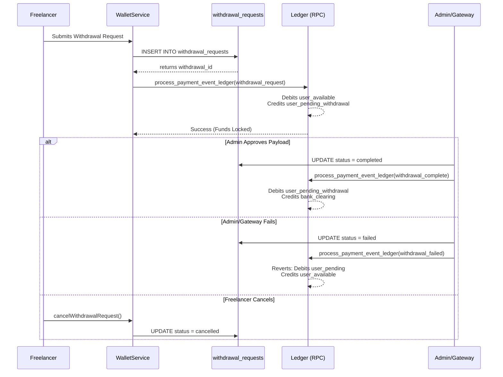

# 1) What this diagram is

This flowchart details the step-by-step process of a user requesting to cash out their available earnings, and how the funds are safely locked until an administrator or payment gateway completes the transfer.

# 2) Why it exists

- Prevents users from spending money they have already requested to withdraw.
- Ensures double-entry consistency for all money leaving the platform.
- Outlines the exact triggers needed for a gateway callback to complete the payout.
- Maps the cancellation flow if a user changes their mind.

# 3) Where it lives in the product

## App entry points (screens)

- Wallet Balance UI
- Withdrawal Request Modal

## Service / Repository layer

- `WalletService` (Specifically methods `requestWithdrawal` and `cancelWithdrawalRequest`)

## Supabase objects

- tables/views: `withdrawal_requests`, `journal_entries`
- enums: `payment_event_type_enum`
- functions/RPC: `process_payment_event_ledger()`
- triggers: N/A
- policies: Inserts allowed by owner
- realtime: N/A
- storage: N/A

# 4) Diagram (Mermaid)

# 5) Step-by-step explanation (Easy English)

- **Freelancer → WalletService**: The user requests taking money out.
- **WalletService → Database**: A new record is created in the `withdrawal_requests` table to track this request.
- **WalletService → Ledger**: The app immediately calls `process_payment_event_ledger` with the `withdrawal_request` event type. This moves the money from the user's spending balance into a locked "pending" bucket.
- **Admin/Gateway → Database & Ledger (Complete)**: The payment provider successfully sends the money. System updates the status to complete and runs the ledger `withdrawal_complete` event to move the funds out completely.
- **Admin/Gateway → Database & Ledger (Fail)**: The transfer bounces. The system updates the status and runs `withdrawal_failed` to return the locked money back to the user's balance.
- **Freelancer → WalletService (Cancel)**: If the payment isn't processing yet, the user can cancel the request, changing the status.

# 6) Evidence Table (Mandatory)

| Diagram Element (node/edge)                       | Code Evidence                             | DB Evidence                              | Verified? (Y/N) |
| ------------------------------------------------- | ----------------------------------------- | ---------------------------------------- | --------------- |
| INSERT INTO withdrawal_requests                   | `WalletService.requestWithdrawal()`       | `withdrawal_requests` table              | Y               |
| process_payment_event_ledger(withdrawal_request)  | `WalletService.requestWithdrawal()`       | `payment_event_type_enum`                | Y               |
| Funds locked to pending                           | `WalletService` comments                  | `process_payment_event_ledger` signature | Y               |
| process_payment_event_ledger(withdrawal_complete) | Gateway handler (Admin bound)             | `payment_event_type_enum`                | Y               |
| process_payment_event_ledger(withdrawal_failed)   | Gateway handler (Admin bound)             | `payment_event_type_enum`                | Y               |
| UPDATE status = cancelled                         | `WalletService.cancelWithdrawalRequest()` | `withdrawal_requests` table              | Y               |

# 7) Verification Verdict

- Verdict: VERIFIED
- What is missing to reach VERIFIED: N/A

# 8) Open Questions / Missing Evidence (Only if needed)

- The Gateway webhook/Admin execution of `withdrawal_complete` and `withdrawal_failed` lives on the backend layer. While the DB Enum completely supports these actions, the exact edge-function doing the DB update was not extracted in the app scan since it executes outside the Flutter application.

## Diff Summary

- What changed: Created new diagram 20_withdrawals-lifecycle to satisfy a critical missing financial flow.
- What was removed due to lack of evidence: None.
- What is still missing: N/A.
