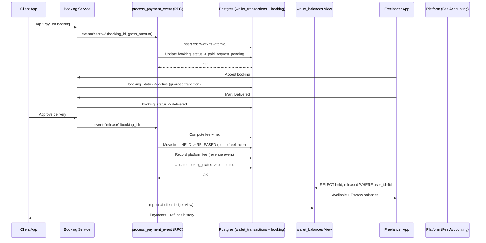
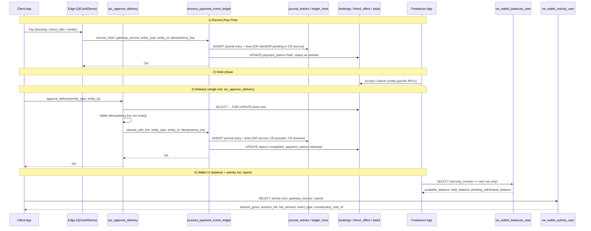

# 21 — Wallet System (Escrow + Available Balances)

---

## Diagram Title + Version

| Field | Value |
|-------|--------|
| **Diagram name (exact)** | 21_Wallet_System_Escrow_Available_balances |
| **Version** | v2 (final) — 2026-03-07 |
| **Owner/author** | SLine team / Finance & Ledger |
| **Previous version** | v1 (OLD) — legacy `wallet_transactions` + `process_payment_event`; see § OLD Diagram below. |

---

## Purpose

- **What this diagram is showing:** One paragraph: How SLine’s **Wallet System** works: money is held in **Escrow** after pay-first (booking, direct offer, or task/tender) via `escrow_hold` or **gateway_escrow** (QiCard); then **released** to the freelancer’s **Available** balance (minus platform fee) when the client approves delivery through the single RPC **rpc_approve_delivery**. Refunds return funds to the client. All money moves go through the **double-entry ledger** and release has a **single exit point**: `rpc_approve_delivery`. User-facing **balance** and **activity** (including client “spent” from gateway payments) come from `vw_wallet_balances_user` and `vw_wallet_activity_user`.
- **What problem it solves:** Eliminates money ambiguity and non-atomic updates; ensures one source of truth (Held vs Available), no client-side balance math, idempotent escrow release under retry, and transparent activity (including spent/gateway_escrow) so users see a complete money story.

---

## Scope

- **What’s included:** Pay-first flows (booking, direct_offer, task/tender); escrow_hold and **gateway_escrow** (QiCard); release_with_fee, refund; `process_payment_event_ledger`; `rpc_approve_delivery` for task, booking, direct_offer; user-facing balance/activity views (`vw_wallet_balances_user`, `vw_wallet_activity_user` — activity includes **spent** transactions, i.e. user_available DEBIT and user_pending_withdrawal DEBIT for gateway_escrow per migration `20260307160000_wallet_activity_include_spent`); Wallet UI and service layer.
- **What’s explicitly excluded:** **Withdraw** (pending withdrawal, gateway payout) — documented as **Upcoming feature**; legacy `wallet_transactions` (frozen, read-only).
- **Assumptions:** Payments are finalised only via webhook/recovery (QiCard) or demo path; app never writes ledger lines directly. Escrow is append-only: all moves go through `process_payment_event_ledger` (release only via `rpc_approve_delivery`). Currency is IQD for MVP. Idempotency key for release is deterministic (entity_id + status + payment_status, no `now()`); duplicate calls do not double-release. RLS and RPC enforce ownership; client can only approve delivery for entities they own (client_id).

---

## Glossary (Human-Readable)

Define every key term used in the diagram:

| Term | Definition |
|------|-------------|
| **booking** | Entity type: client–provider agreement for a task package; has `payment_status` (e.g. held, released) and `status` (e.g. delivered, completed). |
| **task_request** | Entity type: freelancer offer on a task; can be awarded and paid (tender flow); has `payment_status`. |
| **direct_offer** | Entity type: offer created from chat (no task); client pays from dashboard; has `payment_status` and `status` (e.g. delivered, completed). |
| **dispute** | Out-of-scope for this diagram; handled elsewhere. |
| **active** | Work in progress (e.g. booking status after accept). |
| **delivered** | Work submitted; client can approve. |
| **completed** | Work approved; escrow released (when payment was held). |
| **disputed** | In dispute (out of scope for this diagram). |
| **refunded** | Money returned to client (e.g. decline, cancel, dispute outcome). |
| **escrow_hold** | Money event: DEBIT user (client) available, CREDIT platform_escrow. |
| **gateway_escrow** | Money event (QiCard path): DEBIT user_pending_withdrawal, CREDIT platform_escrow; appears in activity as client “spent”. |
| **release_with_fee** | Money event: DEBIT platform_escrow, CREDIT user (provider) available, CREDIT platform_revenue (fee). |
| **refund** | Money event: DEBIT platform_escrow, CREDIT user (client) available. |
| **RPC** | Remote procedure call (Supabase/Postgres function). |
| **RLS** | Row-Level Security: user sees only rows they are allowed to see. |
| **TTL** | Time-to-live; e.g. review window, payment deadline. |
| **idempotency** | Same request applied twice produces the same result (one ledger entry); key is deterministic. |
| **FOR UPDATE** | Row lock in RPC so concurrent approve calls do not race. |

---

## Legend: What Each Symbol Means

- **What each node/shape represents:** Participant boxes = Client App, Freelancer App, Edge (QiCard/Demo), RPC (`rpc_approve_delivery`, `process_payment_event_ledger`), DB (journal_entries, ledger_lines, bookings, direct_offers, tasks), Views (`vw_wallet_balances_user`, `vw_wallet_activity_user`). Actor = user or system role; service = backend RPC/edge; DB table = entity or ledger storage; trigger = webhook or user action; gateway = QiCard/payment provider.
- **What each arrow means:** Solid arrow = sync call (e.g. App → RPC); dashed back = response; internal RPC → ledger = sync write; Edge → Ledger = webhook or server-side call (gateway_escrow / escrow_hold).
- **What colours/labels (if used) represent:** In Mermaid sequence diagrams here we use no specific colour coding; “note over” blocks label phases (Escrow, Work phase, Release, Wallet UI). In flowcharts elsewhere, neutral/amber = held, green = credit/release, red = debit/spent only where appropriate (escrow_hold is “moved to escrow”, not red deduction).
- **What “guards” look like (conditions vs transitions):** Guards are **conditions** (e.g. “if payment_status=held”, “if status=delivered”, “if client_id = auth.uid()”) checked before a transition. In the diagram they appear as RPC validation steps; the **transition** is the resulting DB/ledger write. Source of truth for guards is RPC/DB (not UI). Forbidden transitions (e.g. freelancer approving, or approve when not delivered) are enforced by RPC and return an error.

---

## Actors and Responsibilities

| Actor | Allowed | Forbidden |
|-------|---------|-----------|
| **Client** | Pay (via QiCard/Demo), approve delivery for own booking/direct_offer/task, view own wallet/activity. | Release escrow without owning entity; approve when not delivered; write to ledger or journal_entries. |
| **Freelancer** | Accept booking, submit delivery, view own wallet/activity, request withdrawal (when feature exists). | Approve delivery (client-only); release escrow; write to ledger. |
| **Admin** | (Diagram scope: no direct actions; admin views/forensics in Observability.) | Direct ledger writes outside RPC. |
| **System/Cron** | Run `rpc_finalize_auto_approval`, expiry/refund flows; webhook calls into ledger. | Double-release; use non-deterministic idempotency keys. |
| **Payment Gateway (QiCard)** | Webhook to edge → `process_payment_event_ledger` (escrow_hold / gateway_escrow) with verified payload. | Spoof client; release funds. |

---

## System Components (Where It Lives)

- **App entry points:** Wallet screen (balance + activity); Work item detail → “Approve delivery” (booking); Direct offer detail → “Approve & release” (direct_offer). Dashboard wallet snapshot.
- **Service layer / ViewModel / Repository:** `lib/features/wallet/services/wallet_service.dart`, `lib/features/wallet/viewmodels/wallet_view_model.dart`; booking approve: `lib/features/work/services/work_management_service.dart`; direct offer approve: `lib/features/direct_offers/services/direct_offers_service.dart` (calls `rpc_approve_delivery(entity_type: 'direct_offer', entity_id)`).
- **Database objects involved:**
  - **Tables:** `accounts`, `journal_entries`, `ledger_lines`; `bookings`, `direct_offers`, `tasks`, `task_requests`.
  - **Views:** `vw_wallet_balances_user`, `vw_wallet_activity_user` (security_invoker; activity includes spent via user_available and user_pending_withdrawal DEBIT — migration `20260307160000_wallet_activity_include_spent.sql`).
  - **RPC functions:** `process_payment_event_ledger`, `rpc_approve_delivery`.
  - **Triggers:** e.g. `fn_wallet_transactions_freeze` on legacy table.
  - **Policies (RLS):** On all ledger and entity tables (user sees only own data; RPC runs as definer).

---

## OLD Diagram (v1 — Legacy)

This was the pre-ledger, pre–single-exit view. Kept for reference.

- **Entry point:** `process_payment_event` (legacy); balance from `wallet_balances` view over `wallet_transactions`.
- **Limitations:** No double-entry ledger; no direct_offer in approve flow; no single RPC for release; `wallet_transactions` since frozen.

---

## NEW / Implemented Diagram (v2 — 2026-03-07)

- **Entry points:** Escrow: QiCard/Demo → Edge → `process_payment_event_ledger` (escrow_hold or **gateway_escrow**). Release: **single exit** — `rpc_approve_delivery(entity_type, entity_id)` for `task`, `booking`, or `direct_offer`.
- **Balance/activity:** `vw_wallet_balances_user`; `vw_wallet_activity_user` includes **spent** (user_available DEBIT and user_pending_withdrawal DEBIT for gateway_escrow) so clients see full money story.

---

## Step-by-Step Flow ("Human Story")

### Happy path (e.g. booking)

1. **Trigger:** Client taps Pay on booking → QiCard/Demo flow; webhook or recovery completes.
2. **Validation:** Edge validates payment; builds idempotency key; calls `process_payment_event_ledger(escrow_hold` or `gateway_escrow`, `booking`, id, ...).
3. **DB write:** Ledger inserts journal entry + balanced lines; updates booking `payment_status=held`, status as needed.
4. **External:** None for release (client action only).
5. **Release trigger:** Client opens delivered work → Approve delivery. App calls `rpc_approve_delivery('booking', booking_id)`.
6. **RPC:** Locks booking row (FOR UPDATE), computes stable idempotency key, calls `process_payment_event_ledger('release_with_fee', 'booking', id, key, ...)`.
7. **Final state:** Booking completed; freelancer available balance increased; client sees success. Wallet activity shows escrow_hold/gateway_escrow (spent) and release_with_fee (credit) as applicable.

### Direct offer (implemented 2026-03-07)

1. Client opens delivered direct offer → "Approve & release". App calls `rpc_approve_delivery('direct_offer', offer_id)`.
2. RPC locks `direct_offers` row, validates `client_id = auth.uid()`, stable key, `process_payment_event_ledger('release_with_fee', 'direct_offer', id, ...)`.
3. `direct_offers` updated to `status='completed'`, `payment_status='released'`.

### Most common failure path(s)

- **Duplicate approve (double-tap):** Same entity_id + state → same idempotency key → ledger returns "already processed" or no second insert; no double release (idempotent).
- **Not client:** RPC checks ownership → "Not authorized".
- **Not delivered:** RPC checks status → error; no ledger call.
- **Missing metadata / invalid entity:** RPC validates entity exists, status, payment_status; returns error.

---

## State Machine Explanation

- **Booking:** pending → paid_request_pending (escrow_hold/gateway_escrow) → active (accept) → delivered (submit_delivery) → completed (approve_delivery + release_with_fee when held). Refunded via decline/refund flow.
- **Direct offer:** sent → accepted → (payment) → active → delivered → completed (approve_delivery + release when held).
- **Task (tender):** accepted → payment_status held → in_progress → delivered → completed (approve_delivery for task; no ledger if no held payment).

**Allowed transitions for release:** Only from delivered + payment_status=held; only client (owner) can call `rpc_approve_delivery`.  
**Forbidden transitions:** Freelancer approving; approving when not delivered; releasing without FOR UPDATE and stable key (enforced in RPC).

---

## Invariants (Must-Always-Be-True Rules)

- Every journal entry has balanced lines (SUM(DEBITS) = SUM(CREDITS)).
- Escrow release happens only once per entity (idempotent); key is deterministic from entity_id + status + payment_status (no `now()`).
- User can only see rows where they are a participant (RLS); wallet views are security invoker (own user_id only).
- No direct INSERT/UPDATE/DELETE on `journal_entries`/`ledger_lines` from app; only via `process_payment_event_ledger` (and release only via `rpc_approve_delivery`).
- `wallet_transactions` is frozen; any write raises and points to `process_payment_event_ledger`.
- Activity view includes both credits to user (available/pending) and debits (spent: user_available DEBIT, user_pending_withdrawal DEBIT for gateway_escrow) so the “money story” is complete.

---

## Guards & Validation Rules

| Guard | Where it runs | Source of truth |
|-------|----------------|------------------|
| Caller is client (owner) for entity | RPC `rpc_approve_delivery` | DB (auth.uid() = bookings.client_id / direct_offers.client_id / tasks.owner_id) |
| Entity status = delivered | RPC | DB |
| payment_status = held (for release) | RPC | DB |
| Idempotency key unique | DB (journal_entries.idempotency_key UNIQUE) | DB |
| Row lock (FOR UPDATE) before release | RPC | DB |

Client-side: UI disables Approve when not delivered or not client; **server-side RPC is the source of truth**.

---

## Failure Modes (What Can Go Wrong)

| Failure | What the system should do |
|---------|----------------------------|
| App crash mid-step | RPC is atomic; either full release or none; retry uses same key → idempotent. |
| Duplicate webhook | Idempotency key per payment event; duplicate key → already_processed. |
| Retry causing duplicates | Stable key (no now()) → same key → one ledger entry. |
| Two users approve at once | FOR UPDATE serialises; second waits then sees already completed or same key. |
| Missing metadata | RPC validates entity exists, status, payment_status; returns error. |
| Timeout / TTL expiry | Review window / auto-approve handled by `rpc_finalize_auto_approval`; payment deadline for tender by cron. |

---

## Security & Abuse Scenarios

- **Spoofing identity:** RPC uses `auth.uid()`; no client-supplied user_id for ownership.
- **Unauthorised state change:** Only RPC can update ledger and entity status; guards enforce client and delivered + held.
- **Paying without owning entity:** Escrow is created by gateway/edge with server-validated entity; client cannot create escrow for another’s entity.
- **Escrow trapped forever:** Auto-approve and dispute/refund flows (separate) handle timeouts and disputes.
- **User seeing another’s data:** RLS and security-invoker views restrict to own user_id.

---

## Data Model Mapping

| Diagram concept | DB / field |
|-----------------|------------|
| Held (escrow) | Sum of credits to `platform_escrow` linked to user’s entities; `vw_wallet_balances_user.held_balance`. |
| Available | Sum of credits to `user_available:{user_id}`; `vw_wallet_balances_user.available_balance`. |
| Pending withdrawal | `user_pending_withdrawal:{user_id}`; `vw_wallet_balances_user.pending_withdrawal_balance` (withdraw = upcoming). |
| delivered | booking: `status = 'delivered'`; direct_offer: `status = 'delivered'`. |
| completed | booking/direct_offer: `status = 'completed'`; payment_status = 'released' when was held. |
| review window | `review_expires_at` (booking/task). |
| Idempotency key | `journal_entries.idempotency_key` (UNIQUE); for release = digest(entity_id \|\| ':release_with_fee:' \|\| status \|\| payment_status). |
| Activity “spent” | Events where user’s account is debited: user_available DEBIT, or user_pending_withdrawal DEBIT (e.g. gateway_escrow); `vw_wallet_activity_user` includes these (migration `20260307160000_wallet_activity_include_spent`). |

Required: UNIQUE on `journal_entries.idempotency_key`; CHECK on ledger line amounts > 0; balanced entry constraint.

---

## Observability & Forensics

- **What logs/audit events are written:** AppLogger in `DirectOffersService.completeOffer` (start, validation, error, success); `WalletService.getWalletBalance` on error (tag: Wallet / DirectOffers). Ledger writes to `journal_entries` / `ledger_lines`; `p_meta` can carry session_id / request_id (see 09 ledger-event-flow contract).
- **What admin views exist:** Platform metrics view `vw_financial_metrics_realtime`; trace “money story” via journal_entries by entity_id and idempotency_key.
- **How to identify an orphan event and where it appears:** Duplicate key or already_processed response indicates replay; no orphan release if key is stable and FOR UPDATE used. Orphan journal_entry (e.g. entity rolled back) would still appear in `journal_entries`; reconciliation by `related_entity_id` and `event_type`. In activity view, user sees only journals that touch their accounts (user_ledger_lines join); orphan lines would show in admin query over `journal_entries` + `ledger_lines`.

---

## Verification Checklist

- **Unit tests required:** e.g. `flutter test test/unit/wallet/` (wallet_service_test, ledger_service_test).
- **Integration tests required:** Approve booking and direct offer in app; confirm single release and balance update; activity shows escrow_hold/gateway_escrow and release_with_fee as expected.
- **DB tests (RLS/trigger/constraint):** `flutter test test/rls/ledger_rls_test.dart test/rls/view_security_test.dart` (canonical views: `vw_wallet_balances_user`, `vw_wallet_activity_user`).
- **Concurrency tests:** Double-tap approve → only one ledger release (idempotency); FOR UPDATE prevents double release under race; duplicate webhook → same idempotency key → no double escrow.

---

## Dependencies

- **What this diagram depends on:** 09 Ledger Event Flow (contract, forensics, runbook); Auth (auth.uid()); Booking/Direct offer/Task lifecycle (status, payment_status); QiCard/Demo edge and webhook.
- **What depends on this diagram:** Wallet UI; Dashboard snapshot; Withdraw (upcoming); reporting/metrics.
- **Ordering:** Ledger and `rpc_approve_delivery` must be in place before direct_offer release (done 2026-03-07). Wallet activity “include spent” (migration `20260307160000`) applies after ledger and views exist.

---

## Open Questions / Missing Evidence

- Withdraw flow and gateway payout (documented as upcoming); exact runbook for withdrawal orphan handling in 09 folder.
- Fee source (e.g. system_config.platform_fee_bps) and zero-fee behaviour (revenue line omitted) documented in SUPABASE_SETUP and Wallet_Feature; naming vs diagram 22 (platform_settings.fee_rate_default_bps) to be aligned.
- All RPC and RLS SQL are in repo and SUPABASE_SETUP; LIVE_SCAN and CONTRACT in 21 folder.

---

## Final Status

| Item | Value |
|------|--------|
| **Verdict** | **PASS** |
| **Production ready?** | **YES** for escrow + release (booking, direct_offer, task). Single exit point and idempotency implemented; activity view includes spent (gateway_escrow); Withdraw explicitly out of scope. |
| **Next actions** | (1) Implement Withdraw when in scope; (2) Keep DOCS_SYNC and CONTRACT in sync with any RPC/ledger changes; (3) Run verification checklist on each release. |

---

**Contract:** `.TODO/improvement_the_system/Done/21_Wallet_System_Escrow_Available_balances/CONTRACT_rpc_approve_delivery.md`  
**Execution log:** `.TODO/improvement_the_system/Done/21_Wallet_System_Escrow_Available_balances/EXECUTION_LOG_PLAN_WalletEscrowAvailableBalances_2026-03-07.md`  
**Checklist & summary:** `.TODO/improvement_the_system/Done/21_Wallet_System_Escrow_Available_balances/CHECKLIST_AND_SUMMARY_2026-03-07.md`  
**Wallet activity migration:** `supabase/migrations/20260307160000_wallet_activity_include_spent.sql`
