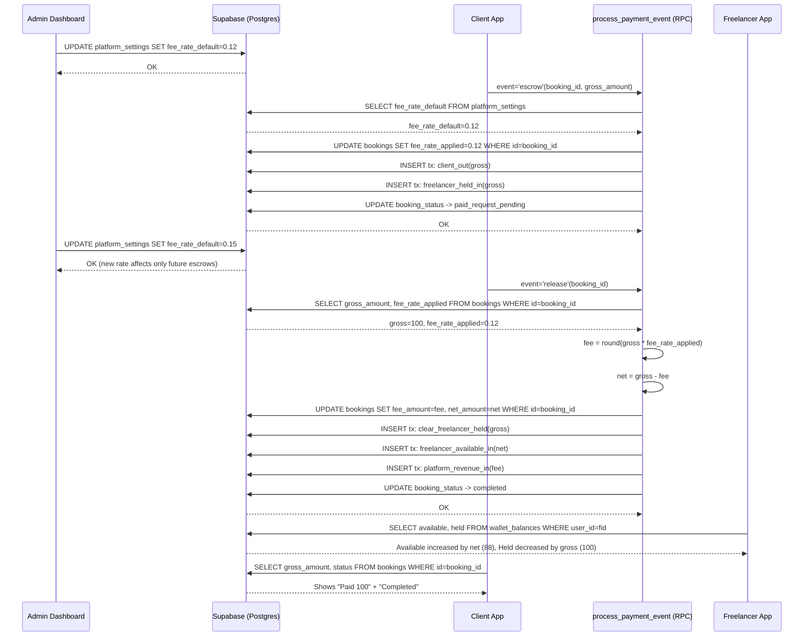
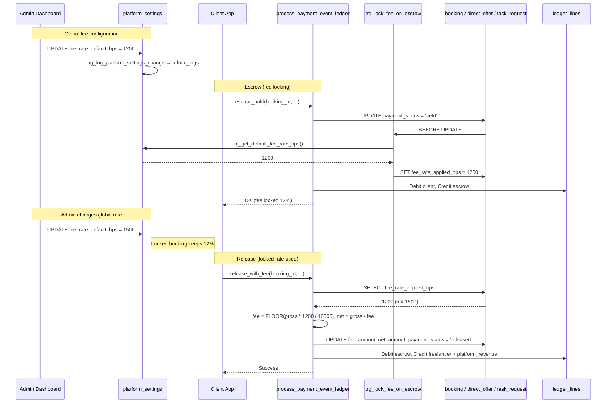

# 22 Dynamic Platform Fee — Diagram Document

---

# OLD DIAGRAM (Pre-Implementation, v1)

**Version**: v1 (Original)  
**Status**: Superseded by v2.0 Implementation

---

## **A) Dynamic Platform Fee (Commission) Flow — Option 2: Lock at ESCROW**

### **1) What this diagram is**

Shows how SLine calculates the platform commission using a **dashboard-controlled fee rate**, then **locks that rate at the moment of escrow** (payment).

Later, when the booking is approved, the system releases funds using the **locked fee**, even if the admin changes the global rate after that.

---

### **2) Why it exists**

- Admin must be able to change the fee rate anytime from the dashboard.
- Users must not get punished or surprised mid-booking.
- Financial history must remain immutable and auditable:
    - "This booking used 12%" should stay true forever.

So the fee rate becomes a **snapshot** stored on the booking at escrow time.

---

### **3) Where it lives in the product**

- **Admin Dashboard**: "Fees & Revenue" settings page updates platform_settings.fee_rate_default.
- **Backend (Supabase RPC)**: process_payment_event(..., 'escrow') / process_payment_event(..., 'release').
- **App UI**: Client sees Paid gross + status; Freelancer sees Held gross, then Available net + fee breakdown.

---

### **4) OLD Diagram (Mermaid)**

---

### **5) OLD Evidence Table**

| **Element** | **Code Evidence** | **DB Evidence** | **Verified** |
| --- | --- | --- | --- |
| Fee rate editable from dashboard | TBD | platform_settings.fee_rate_default | TBD |
| Fee rate locked at escrow | TBD | bookings.fee_rate_applied | TBD |
| Release uses locked fee | TBD | process_payment_event reads from bookings | TBD |
| Fee + net persisted | TBD | bookings.fee_amount, bookings.net_amount | TBD |

---

# NEW DIAGRAM (Implemented, v2.0 Final)

---

## • Diagram Title + Version

- **Diagram Title**: Dynamic Platform Fee System — Lock at Escrow (Implemented)
- **Diagram name (exact)**: `22_Dynamic_Platform_Fee`
- **Version**: v2.0 (final)
- **Date**: 2026-03-06
- **Owner/author**: @Executor with @Supabase_Ops, @Architect

---

## • Purpose

- **What this diagram is showing, in one paragraph.**  
  The end-to-end flow from global fee configuration through escrow (where the fee rate is locked to the entity), optional global rate change, and release (where the locked rate is used to compute fee and net). It includes actors (Admin, Client, Freelancer), database objects (platform_settings, bookings/direct_offers/task_requests, ledger), triggers (auto-lock on escrow, immutability), and RPC/helper usage.

- **What problem it solves (why it exists).**  
  Ensures admins can change the platform fee rate without affecting in-flight bookings; guarantees price stability for users and auditability (each transaction has a locked rate); prevents client spoofing of fee rates; and keeps financial invariants (gross = fee + net, double-entry balance).

---

## • Scope

- **What’s included (features/entities covered).**  
  platform_settings table; fee columns (fee_rate_applied_bps, fee_amount, net_amount) on bookings, direct_offers, task_requests; immutability and auto-lock triggers; RPC/helper fee logic; feature flag fee_locking_enabled; RLS on platform_settings; admin_logs for settings changes; LedgerService and fee breakdown UI; error code mapping; E2E tests.

- **What’s explicitly excluded (out of scope).**  
  Admin Dashboard UI (admin updates via SQL); fee change notifications; historical fee analytics; multi-currency fees; tiered/volume-based fee structures; UI that calculates fee (UI only displays stored values).

- **Assumptions.**  
  Payments are finalized only via process_payment_event_ledger (or equivalent RPC); escrow/ledger is append-only; fee rates are stored in basis points (1000 = 10%); fee calculation uses FLOOR(); admin identity is via admin_users table; feature flag fee_locking_enabled controls activation.

---

## • Glossary (Human-readable)

- **Entity names**: booking (client-scheduled session), task_request (bid/proposal on tender), direct_offer (chat-initiated work offer), platform_settings (global config table), ledger_lines (double-entry lines).
- **Status names**: unpaid, held, released, refunded, completed, paid_request_pending.
- **Money events**: escrow_hold (lock funds and lock fee rate), release_with_fee (release using locked rate), refund (return gross to client).
- **Abbreviations**: RPC = Remote Procedure Call; RLS = Row Level Security; bps = basis points (100 bps = 1%); IQD = Iraqi Dinar; idempotency = same request can be replayed safely (same result).

---

## • Legend: what each symbol means

- **Node/shape**: Actor (Admin, Client, Freelancer), Service (RPC, LedgerService), DB table (platform_settings, bookings, etc.), Trigger (trg_lock_fee_on_escrow_*, trg_protect_fee_rate_applied_*), Gateway (process_payment_event_ledger).
- **Arrows**: Solid arrow = synchronous call (e.g. Client → RPC); dashed = async/event; DB read/write shown as arrows to/from DB.
- **Guards**: Written as conditions (e.g. “fee_rate_applied_bps IS NOT NULL”) or “only if fee_locking_enabled”; transitions allowed/forbidden in state machine section.

---

## • Actors and Responsibilities

- **Client**: Allowed — View platform_settings (read); initiate escrow_hold (locks fee); initiate release_with_fee. Forbidden — Modify platform_settings; change locked fee_rate_applied_bps; override fee via p_meta.
- **Freelancer**: Allowed — View own bookings/offers and fee breakdown. Forbidden — Modify any fee fields; see other users’ fees.
- **Admin**: Allowed — Modify platform_settings; override fee via p_meta (when in admin_users). Forbidden — Change locked fee_rate_applied_bps on entity (trigger blocks).
- **System/Cron**: Allowed — Execute helper functions; write audit logs. No direct user-facing actions in this diagram.
- **Payment Gateway**: Out of scope for this diagram (payment capture triggers escrow path).

---

## • System Components (Where it lives)

- **App entry points**: PaymentCheckoutScreen (client pays → escrow); BookingDetailsScreen / approval flow (client approves → release); EarningsScreen (freelancer sees net + breakdown).
- **Service/ViewModel/Repository**: LedgerService (`lib/features/wallet/services/ledger_service.dart`); FeeBreakdownCard / FeeBreakdownCompact (`lib/core/widgets/fee_breakdown_card.dart`); FeeLockingErrorMapper (`lib/core/utils/fee_locking_error_mapper.dart`).
- **Database**: **Tables** — platform_settings, bookings, direct_offers, task_requests, journal_entries, ledger_lines, admin_logs. **Views** — wallet_balances (for display). **RPC** — process_payment_event_ledger. **Triggers** — trg_lock_fee_on_escrow_* (auto-lock on payment_status → held), trg_protect_fee_rate_applied_* (immutability), trg_log_platform_settings_change (audit). **Policies (RLS)** — platform_settings read (authenticated), write (admin only), no anon.

---

## • Step-by-step Flow (“Human Story”)

**Happy path**

1. **Trigger**: Admin sets fee_rate_default_bps in platform_settings (e.g. 1200 = 12%).
2. **Validation**: RLS ensures only admin can write; optional max_fee_rate_bps check.
3. **DB write**: platform_settings updated; trg_log_platform_settings_change writes to admin_logs.
4. **Client pays**: Client initiates payment; app calls process_payment_event_ledger('escrow_hold', ...) or equivalent flow that sets payment_status to 'held'.
5. **Auto-lock**: Trigger trg_lock_fee_on_escrow_* runs; if fee_rate_applied_bps IS NULL, set it from fn_get_default_fee_rate_bps().
6. **Optional**: Admin changes fee_rate_default_bps again (e.g. to 1500). Existing locked bookings keep 1200.
7. **Release**: Client approves work; app calls process_payment_event_ledger('release_with_fee', ...). RPC/helper reads fee_rate_applied_bps from entity (ignore p_meta for non-admin).
8. **Validation**: If fee_rate_applied_bps IS NULL, return ERR_FEE_RATE_NOT_LOCKED.
9. **Calculation**: fee_amount = FLOOR(gross * fee_rate_applied_bps / 10000), net_amount = gross - fee_amount.
10. **DB write**: Update entity with fee_amount, net_amount; insert ledger_lines (double-entry); update payment_status to 'released', status to 'completed'.
11. **User sees**: Client sees “Paid [gross]”, “Completed”; Freelancer sees “You receive [net]” and fee breakdown (from stored values).

**Most common failure paths**

- **Fee not locked**: Release called before escrow completed → ERR_FEE_RATE_NOT_LOCKED; user told to complete payment first.
- **Duplicate/retry**: Idempotency key ensures same event not applied twice; safe to retry.
- **Client spoof**: p_meta fee_rate_bps ignored for non-admin; locked rate used.

---

## • State Machine Explanation

- **States**: unpaid (fee_rate_applied_bps NULL), held (fee_rate_applied_bps set, immutable), released (fee_amount, net_amount set), refunded.
- **Allowed transitions**: unpaid → held (escrow_hold + trigger lock); held → released (release_with_fee); held → refunded (refund). Admin can override rate only at release (via p_meta), not change stored locked value.
- **Forbidden**: held → held with different fee_rate_applied_bps (trigger raises); released → held; any transition that violates RLS.

---

## • Invariants (Must-always-be-true rules)

- Once fee_rate_applied_bps is set, it never changes (enforced by trigger).
- fee_amount + net_amount = gross (when both stored); calculation uses FLOOR so no penny drift.
- Sum of ledger_lines for a journal_entry = 0 (double-entry).
- Release uses only entity’s fee_rate_applied_bps (and optional admin override), never untrusted client p_meta for fee rate.
- Only admin can update platform_settings (RLS).
- User can only see rows where they are participant (RLS on bookings/direct_offers/task_requests).

---

## • Guards & Validation Rules

- **Ownership**: Caller is client for escrow/release (existing RPC checks).
- **Role**: Admin for platform_settings write and for p_meta fee override (fn_is_admin).
- **Status**: Entity in correct state for escrow_hold (e.g. unpaid) or release_with_fee (e.g. held).
- **Fee lock**: On release, fee_rate_applied_bps must be NOT NULL (ERR_FEE_RATE_NOT_LOCKED).
- **Max fee**: fn_get_default_fee_rate_bps() caps at max_fee_rate_bps.
- **Feature flag**: fn_get_feature_flag('fee_locking_enabled') gates new behavior.
- **Immutability**: Trigger trg_protect_fee_rate_applied_* blocks UPDATE of fee_rate_applied_bps when OLD is not null and NEW differs.
- **Source of truth**: DB and RPC; UI only displays stored values.

---

## • Failure Modes (What can go wrong)

- **App crash mid-step**: Idempotency key allows safe retry; no double charge if release already applied.
- **Duplicate webhook/retry**: Idempotency prevents duplicate ledger entries.
- **Race (two users act at once)**: RPC and triggers run inside transaction; locking (e.g. FOR UPDATE) prevents inconsistent state.
- **Missing metadata**: If fee_rate_applied_bps NULL on release, RPC returns ERR_FEE_RATE_NOT_LOCKED; user told to complete payment.
- **Timeout/TTL**: Handled by existing payment/escrow logic; fee lock does not add new timeout.
- **Client sends p_meta fee 0**: Ignored; locked rate used (no spoof).

---

## • Security & Abuse Scenarios

- **Spoofing identities**: RLS + auth.uid(); only client can escrow/release own booking.
- **Unauthorized state changes**: RPC validates status and actor; trigger blocks fee_rate_applied_bps change.
- **Paying without owning entity**: Existing RPC checks (client_id match).
- **Escrow trapped forever**: Refund path and release path remain; fee lock does not remove them.
- **User seeing another’s data**: RLS on bookings/direct_offers/task_requests (existing).
- **Admin override abuse**: Logged in admin_logs; override only at release and capped by max fee where applied.

---

## • Data Model Mapping

- **“Fee locked at 12%”** → fee_rate_applied_bps = 1200 on entity.
- **“Platform fee”** → fee_amount (stored after release).
- **“Net to freelancer”** → net_amount.
- **“Global rate”** → platform_settings.fee_rate_default_bps (value in JSONB).
- **“Feature on”** → platform_settings.fee_locking_enabled = true.
- **“Held”** → payment_status = 'held'; **“Released”** → payment_status = 'released'.

Indexes: Primary keys on all tables; no additional indexes required for fee locking queries.

---

## • Observability & Forensics

- **Logs/audit**: admin_logs on platform_settings change; journal_entries.meta can store fee_rate_applied_bps and amounts; AppLogger in LedgerService and widgets.
- **Admin views**: admin_logs table; platform_settings; bookings/direct_offers/task_requests with fee columns.
- **Orphan**: Query entities where payment_status IN ('held','released') AND fee_rate_applied_bps IS NULL; should be 0 after backfill and with triggers on.

---

## • Verification Checklist

- **Unit tests**: Fee calculation edge cases (e.g. 99 @ 12% = 11); error code mapping.
- **Integration tests**: Escrow locks rate; release uses locked rate; fee change does not affect locked; client spoof ignored (test/integration/fee_locking_test.dart, fee_locking_e2e_test.dart).
- **DB tests**: RLS (platform_settings read/write); trigger immutability (attempt UPDATE fee_rate_applied_bps); trigger auto-lock (payment_status → held sets fee_rate_applied_bps).
- **Concurrency**: Idempotency; double release prevented; duplicate webhook safe.

---

## • Dependencies

- **Depends on**: Ledger (accounts, journal_entries, ledger_lines); Escrow/state machine (payment_status, booking status); Auth (auth.uid(), admin_users).
- **Depended on by**: Admin Dashboard (finance settings); Payment linking (if diagram 24 uses fee).
- **Ordering**: Schema and triggers must be applied before enabling feature flag; backfill before release.

---

## • Open Questions / Missing Evidence

- All core behaviour implemented and verified. Optional: stress test under high concurrency; optional UI wiring in every booking/offer screen (widgets exist).

---

## • Final Status

- **Verdict**: PASS
- **Production Ready?** YES. Schema applied, backfill done, triggers and helpers active, UI and error mapping implemented, E2E tests added.
- **Next actions**: (1) Wire FeeBreakdownCard into booking/offer detail screens where needed. (2) Monitor immutability and auto-lock triggers in production. (3) Optional: add more E2E cases (e.g. direct_offer, task_request).

---

## • NEW Implemented Diagram (Mermaid)

---

**Document status**: Complete and aligned with implemented behaviour.  
**Last updated**: 2026-03-06.
