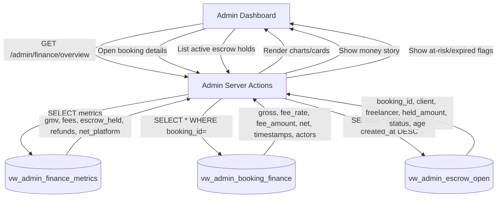

Admin Dashboard Wallet/Finance Diagram

1. What this diagram is

Shows how the Admin Dashboard has a “platform wallet view” that is different from client/freelancer:
•	Tracks platform revenue (fees)
•	Tracks escrow liabilities
•	Tracks GMV (total volume processed)
•	Supports auditing: “which booking produced which fee?”

1. Why it exists

Admins need:
•	A truthful “what we earned” number
•	A truthful “how much we owe (escrow)” number
•	A traceable ledger for disputes, refunds, and accounting later

1. Where it lives in the product
•	Admin Dashboard pages:
•	Finance Overview
•	Escrow Monitor
•	Revenue (Fees) Report
•	Transaction Explorer (by booking/user)
•	DB side:
•	Best practice: a platform finance view that aggregates events
2. Diagram (Mermaid)

sequenceDiagram
participant Admin as Admin Dashboard
participant API as Admin Server Actions (service role)
participant DB as Supabase (Postgres)

Data model you need for the Admin Wallet view (minimal but strong)

1. Fee configuration

Table: platform_settings
•	fee_rate_default (numeric, ex: 0.12)
•	updated_at
•	updated_by_admin_id

Optional advanced:
Table: fee_schedule
•	scope (global / category / user_tier)
•	rate
•	effective_from
•	effective_to

1. Lock applied fee per booking (recommended)

In bookings:
•	gross_amount
•	fee_rate_applied (locked snapshot)
•	fee_amount
•	net_amount

1. Admin views (read-only)
•	vw_admin_finance_metrics
•	gmv_total
•	fees_total
•	escrow_open_total
•	refunds_total
•	vw_admin_booking_finance
•	vw_admin_escrow_open

⸻

E) Evidence Table (template)

I’m marking this as a template because we haven’t extracted your exact SQL definitions in this chat.

Element	Code Evidence	DB Evidence	Verified
Fee settings editable from dashboard	TBD	platform_settings exists	TBD
Fee rate locked per booking	TBD	bookings.fee_rate_applied exists	TBD
Release computes fee via RPC	TBD	process_payment_event reads settings	TBD
Admin finance views exist	TBD	vw_admin_finance_metrics exists	TBD