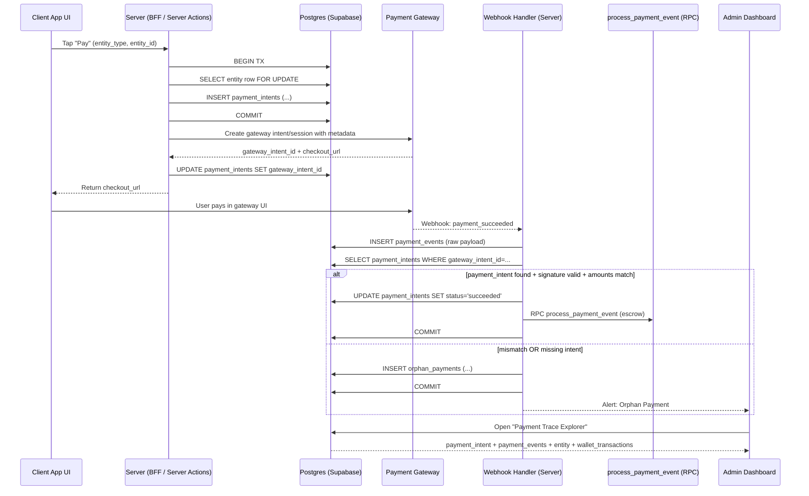
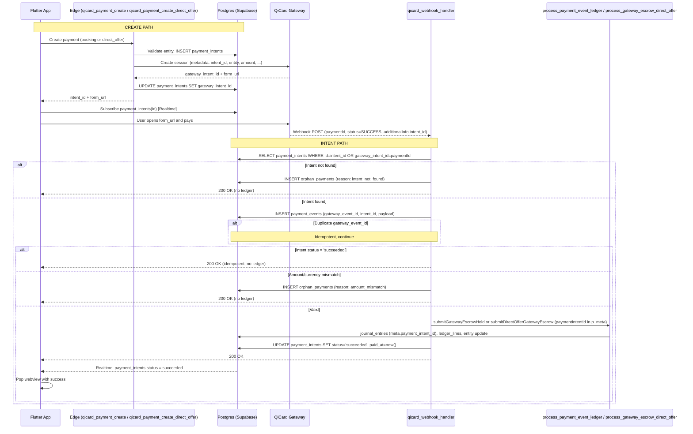

# 24 — Hardened Payment Linking System

**Diagram name (exact):** `24_hardened_paymentLinking_system.md`  
**Document version:** v3 (Implemented + Transactional QA Recovery update)
**Date:** 2026-05-14
**Owner:** @DocsKeeper / Backend + Flutter

---

# OLD DIAGRAM (Pre-Implementation Reference)

*The following sections are preserved as the original design. The implemented system is documented in the "NEW — Implemented Diagram" section below.*

---

## OLD — 1) What this diagram is

A **hardened payment-linking system** that guarantees every payment attempt is:

- created from a **known entity** (booking / tender / task / direct offer)
- bound to **client user_id**
- bound to **freelancer user_id** (when applicable)
- bound to **exact entity_id + entity_type**
- processed **only** through server-side controlled flows
- recorded even if the app crashes mid-payment
- never "free-floating" or untraceable

It also includes an **Orphan/Unmatched Payment quarantine** for the "this must never happen, but if it did we can prove who/why" requirement.

---

## OLD — 2) Why it exists

Because the worst-case scenario is: user reaches payment gateway and pays, but the platform can't prove who paid, what they paid for, which entity it belongs to, what state transition to apply. So we enforce: No direct gateway access; Server-created Payment Intent only; Signed binding; Webhook-only finalization; Quarantine if binding fails.

---

## OLD — 3) Where it lives (original design)

- **App:** Pay on Booking checkout, Tender awarded checkout, Task accepted checkout, Direct offer accepted.
- **Backend:** create_payment_intent, finalize_payment_webhook, reconcile_orphans_job.
- **DB:** payment_intents, payment_events, wallet_transactions, audit_logs, entity tables; admin views vw_admin_payment_health, vw_admin_orphan_payments, vw_admin_entity_payment_trace.

---

## OLD — 4) Diagram (Mermaid) — End-to-end hardened flow

---

## OLD — 5) The "100% prevention" rules

Rule 1: No client creates gateway intents. Rule 2: Every payment must reference payment_intent_id. Rule 3: Signed binding in gateway metadata (HMAC). Rule 4: Amount + currency must match exactly. Rule 5: Webhook-only finalization. Rule 6: Idempotency everywhere. Rule 7: Quarantine path exists.

---

## OLD — 6) How we can ALWAYS answer "Who did this payment and why?"

payment_intents → payer/receiver/entity/amount; payment_events → raw gateway evidence; wallet_transactions → escrow/release/refund; orphan_payments.metadata → hints + reason.

---

## OLD — 7) Evidence Table (template)

| Element | Code Evidence | DB Evidence | Verified |
|---------|---------------|-------------|----------|
| Server-only create intent | create_payment_intent exists | N/A | TBD |
| payment_intents contract | N/A | table + idempotency | ✅ |
| Webhook writes payment_events | handler inserts | policy + trigger append-only | ✅ |
| Orphan quarantine | webhook inserts orphan_payments | table + reason | ✅ |

---

## OLD — 8) Verification result

- Verdict: **SYSTEM DESIGN FINAL (hardened, crash-proof, traceable)**
- Implemented 2026-03-08: see NEW section below.

---

# NEW — Implemented Diagram and Checklist

---

## Diagram Title + Version

- **Title:** Hardened Payment Linking System (Implemented)
- **Diagram name (exact):** `24_hardened_paymentLinking_system.md`
- **Version:** v3 (implemented + Transactional QA Recovery update) + date 2026-05-14
- **Owner/author:** Backend (Edge) + Flutter team; doc owner @DocsKeeper

---

## Purpose

- **What this diagram is showing, in one paragraph:**  
  The implemented flow where the Flutter app creates a payment via Edge (booking or direct offer), the user pays at the gateway, and the QiCard webhook is handled by `qicard_webhook_handler`. When the payload contains `additionalInfo.intent_id`, the handler looks up the intent, appends one row to `payment_events`, validates amount/currency, calls the ledger RPC with `payment_intent_id` in `p_meta` (stored in `journal_entries.meta`), and updates `payment_intents`. Unmatched or amount-mismatch events go to `orphan_payments` only. The app can resolve success via Realtime when create returns `intent_id`; customer-facing finish URLs stay sanitized and recovery uses trusted app-held pending/widget state for entity correlation.

- **What problem it solves (why it exists):**  
  It guarantees every gateway payment is tied to a known entity and payer, is auditable (payment_events + journal meta), is idempotent (no double ledger), and supports "pay and see success without refresh" when the create edge returns an intent id.

---

## Scope

- **What's included:**  
  Booking payment (draft → create → webview/Realtime/sanitized callback → recovery); direct offer payment (accepted unpaid → create → webview/Realtime/sanitized callback → recovery); webhook intent path (lookup intent, payment_events insert, amount check, ledger with payment_intent_id, payment_intents update); orphan path (intent_not_found, amount_mismatch); RLS and append-only trigger on payment_events; ledger meta payment_intent_id (process_payment_event_ledger gateway_escrow, process_gateway_escrow_direct_offer); customer-safe finish URL contract.

- **What's explicitly excluded:**  
  Tender (task_request) payment flow (separate edge/RPC); Admin Orphan Queue UI and Payment Trace UI (planned); HMAC in create edge and webhook signature verification (deferred; PAYMENT_HMAC_SECRET); `create_payment_intent` as single canonical create (current create = `qicard_payment_create` / `qicard_payment_create_direct_offer`).

- **Assumptions:**  
  Payments are finalised only via webhook (or recovery). Escrow is append-only via `process_payment_event_ledger` / `process_gateway_escrow_direct_offer`. QiCard sends webhook with `paymentId`, `status`, `amount`, `currency`, and optionally `additionalInfo.intent_id`. Realtime is enabled for `payment_intents`. Edge uses Supabase `service_role` for payment_intents and payment_events writes. Customer-facing finish URLs do not need booking/entity/correlation IDs because the app holds trusted pending context.

---

## Glossary (Human-readable)

| Term | Definition |
|------|------------|
| **booking** | Entity type for a session booking; table `bookings`. |
| **direct_offer** | Entity type for a chat-originated offer; table `direct_offers`. |
| **task_request** | Entity type for a tender bid; table `task_requests`. |
| **payment_intent** | A row in `payment_intents`: binding between payer, entity, amount, currency, and gateway. |
| **payment_event** | A row in `payment_events`: one gateway event linked to an intent (append-only). |
| **orphan_payment** | A row in `orphan_payments`: gateway event that could not be linked to a valid intent (intent_not_found or amount_mismatch). |
| **intent_id** | UUID of the payment_intent; returned by create edge; used for Realtime and webhook lookup. It should not be displayed in customer UI. |
| **gateway_intent_id** | Gateway-provided id (e.g. QiCard paymentId); stored on payment_intents, used for webhook lookup. |
| **gateway_escrow** | Ledger event type: funds locked after gateway payment (user paid at gateway; platform records escrow). |
| **escrow_hold** | Ledger event type: funds held from user balance (wallet flow). |
| **release_with_fee** | Ledger event type: release from escrow to provider after delivery approval. |
| **refund** | Ledger event type: return from escrow to client. |
| **RPC** | Remote procedure call (Postgres function). |
| **RLS** | Row-Level Security (Postgres policies). |
| **idempotency** | Same request/event processed multiple times has the same effect as once (no double ledger). |
| **p_meta** | JSONB parameter passed to ledger RPC; can include `payment_intent_id` for audit. |
| **sanitized finish URL** | Customer-facing return URL with safe status/return params only. Technical payment identifiers stay in gateway `additionalInfo`, app pending state, logs, and support tooling. |

---

## Legend: what each symbol means

- **Actor (box):** Client App, Freelancer App, QiCard Gateway, Edge (Supabase Functions), DB (Postgres).
- **Arrow →:** Synchronous call (e.g. app → Edge, Edge → DB/RPC).
- **Arrow ⇢:** Async event (e.g. gateway → webhook).
- **DB table:** payment_intents, payment_events, orphan_payments, journal_entries, ledger_lines, bookings, direct_offers.
- **Guard:** Condition that must hold (e.g. intent found, amount match, status not succeeded).
- **Colours/labels:** Not used in Mermaid; guards written in `alt`/`else` text.

---

## Actors and Responsibilities

| Actor | Allowed | Forbidden |
|-------|--------|-----------|
| **Client (App)** | Tap Pay on owned booking/direct offer; open webview; receive Realtime status when intent_id present; call recovery on return using trusted pending/widget state. | Create gateway sessions directly; INSERT/UPDATE payment_intents or payment_events; see other users' intents (RLS); expose raw payment IDs in customer UI. |
| **Freelancer (App)** | View own work; no direct role in payment create. | Create or finalise payments for bookings/direct offers. |
| **Admin** | (Planned) View orphan queue and payment trace; mark investigated. | Finalise payments; bypass RLS (uses service_role only via Edge). |
| **System / Edge** | Create payment intent (create edge); INSERT/UPDATE payment_intents, INSERT payment_events, INSERT orphan_payments; call ledger RPC with p_meta. | Omit payment_intent_id when intent is known; finalise without amount check. |
| **Payment Gateway (QiCard)** | Send webhook with paymentId, status, amount, additionalInfo. | N/A (external). |

---

## System Components (Where it lives)

- **App entry points:**  
  Booking: `PaymentCheckoutScreen` (from booking flow) → `PaymentWebViewScreen` / `PaymentReturnScreen`. Direct offer: `DirectOfferDetailsScreen` → "Pay with card" → `PaymentWebViewScreen`.

- **Service / ViewModel / Repository:**  
  `lib/core/services/qicard_payment_service.dart` (create for booking/direct offer, parse intent_id, streamPaymentIntentStatus); `lib/core/services/payment_service.dart` (interface, QiCardDirectOfferPaymentResult.intentId); `lib/core/services/payment_pending_store.dart` (trusted web pending context); `lib/core/models/payment_return_args.dart` (sanitized route result); `lib/features/booking/viewmodels/booking_view_model.dart` (createPaymentForBooking, streamPaymentIntentStatus, recoverBookingPaymentWithRetries); `lib/features/direct_offers/viewmodels/direct_offer_details_view_model.dart` (createPaymentForCard, streamPaymentIntentStatus).

- **Database objects:**  
  **Tables:** payment_intents (signature, currency, paid_at, gateway_intent_id, status, entity_type, entity_id, payer_id, receiver_id, gross_amount, etc.); payment_events (gateway_event_id UNIQUE, intent_id NOT NULL, event_type, payload); orphan_payments (gateway_event_id, error_reason, payload, investigated); journal_entries (meta includes payment_intent_id when provided in p_meta). **Views:** (admin trace/orphan views planned). **RPC:** process_payment_event_ledger (gateway_escrow branch), process_gateway_escrow_direct_offer. **Triggers:** trg_payment_events_append_only (BEFORE UPDATE OR DELETE on payment_events). **Policies (RLS):** payment_intents SELECT for payer, service_role_all_payment_intents; payment_events service_role_insert_payment_events only.

- **Edge:**  
  `supabase/functions/qicard_payment_create/`, `create_payment_intent/`, `qicard_payment_create_direct_offer/`, `qicard_webhook_handler/`, `_shared/booking_payment.ts` (submitGatewayEscrowHold, submitDirectOfferGatewayEscrow with optional paymentIntentId).

---

## Step-by-step Flow ("Human Story")

### Happy path (intent path)

1. **Trigger:** User taps Pay on a booking checkout or an accepted direct offer.
2. **Create:** App calls Edge `qicard_payment_create` or `qicard_payment_create_direct_offer`. Edge creates/validates entity, INSERTs payment_intents, calls gateway with technical IDs in `additionalInfo`, UPDATEs payment_intents with gateway_intent_id, returns intent_id + form_url while keeping finish URL params customer-safe.
3. **Subscribe (if intent_id):** App subscribes to payment_intents(id) via streamPaymentIntentStatus and opens form_url in webview with trusted expected entity/correlation state.
4. **User pays** at gateway.
5. **Webhook:** QiCard POSTs to qicard_webhook_handler with status=SUCCESS and additionalInfo.intent_id.
6. **Verify:** Edge verifies QiCard RSA signature (existing).
7. **Intent path:** Handler reads intent_id, SELECTs payment_intents by id or gateway_intent_id; if not found → INSERT orphan_payments (intent_not_found), return 200.
8. **Audit:** INSERT payment_events (gateway_event_id, intent_id, event_type, payload); on duplicate, treat as idempotent.
9. **Idempotency:** If intent.status = 'succeeded', return 200.
10. **Amount:** If intent.gross_amount != webhook amount or currency mismatch → INSERT orphan_payments (amount_mismatch), return 200.
11. **Ledger:** Call submitGatewayEscrowHold (booking) or submitDirectOfferGatewayEscrow (direct offer) with paymentIntentId; RPC writes journal_entries with meta.payment_intent_id.
12. **Update intent:** UPDATE payment_intents SET status='succeeded', paid_at=now().
13. **Realtime:** Client receives status update and pops webview with sanitized success args.
14. **Recovery/UI refresh:** Booking return/checkout code calls recovery, refreshes booking and dashboard lists, and shows success/pending/retry state instead of raw gateway metadata.

### Most common failure paths

- **Intent not found:** Webhook inserts orphan_payments (intent_not_found), returns 200; no ledger; user may need recovery or support.
- **Amount mismatch:** Webhook inserts orphan_payments (amount_mismatch), returns 200; no ledger.
- **Duplicate webhook:** Second request hits idempotency (intent already succeeded or duplicate payment_events gateway_event_id); returns 200, no second ledger.
- **App crash after pay:** Webhook still runs; intent and ledger updated; user sees success on next open or via recovery/callback.
- **Sanitized callback without IDs:** App resolves entity/correlation through `PaymentPendingStore` or widget-held state, then runs recovery.
- **Gateway branch not executed in QA:** Treat app recovery/dashboard success as unproven until the final gateway Pay action and return path are replayed.

---

## State Machine Explanation

- **payment_intents.status:** created → gateway_processing (or similar) → succeeded | failed. Allowed: Edge updates to succeeded when webhook validates. Forbidden: Client or anon updating status; reverting succeeded to created.
- **Entity (booking/direct_offer):** booking: payment_status unpaid → held after ledger. direct_offer: payment_status unpaid → held, status accepted → active after ledger. Transitions triggered only by Edge/webhook or approved RPCs.

---

## Invariants (Must-always-be-true rules)

- A ledger escrow/gateway_escrow for a hardened flow must have a matching payment_intent (lookup by intent_id or gateway_intent_id).
- intent.gross_amount must equal webhook amount (and currency) before calling ledger.
- payment_events is append-only (no UPDATE/DELETE; RLS + trigger).
- Same gateway_event_id never causes two ledger entries (idempotency: intent.status=succeeded early return; RPC idempotency_key).
- Only service_role can INSERT/UPDATE payment_intents and INSERT payment_events.
- Every webhook hit that has a valid intent produces one payment_events row (or one orphan_payments row if intent missing or amount mismatch).

---

## Guards & Validation Rules

| Guard | Where | Source of truth |
|-------|--------|------------------|
| Payer owns entity (client_id / payer) | Create edge (DB read) | DB + Edge |
| Entity in payable state (e.g. pending, unpaid) | Create edge | DB |
| QiCard webhook signature valid | Webhook handler | Edge (RSA verify) |
| Intent found by id or gateway_intent_id | Webhook handler | DB |
| intent.status != 'succeeded' (idempotency) | Webhook handler | DB |
| intent.gross_amount == webhook amount, currency match | Webhook handler | DB |
| payment_events INSERT service_role only | RLS | DB |
| payment_events no UPDATE/DELETE | Trigger | DB |

---

## Failure Modes (What can go wrong)

| Failure | System behaviour |
|---------|-------------------|
| App crash mid-payment | Webhook finalises; intent and ledger updated; user can recover or see success on next open. |
| Duplicate webhook delivery | Idempotency: intent already succeeded or duplicate gateway_event_id; return 200, no second ledger. |
| Retry causing duplicate | Same as above; payment_events unique on gateway_event_id; ledger RPC idempotency_key. |
| Intent not found (metadata stripped) | INSERT orphan_payments (intent_not_found), return 200; no ledger. |
| Amount/currency mismatch | INSERT orphan_payments (amount_mismatch), return 200; no ledger. |
| payment_events insert fails | Webhook returns 5xx; gateway may retry. |

---

## Security & Abuse Scenarios

- **Spoofing identity:** Create edge validates entity ownership; RLS ensures client sees only own payment_intents.
- **Unauthorised state changes:** Only service_role writes to payment_intents/payment_events; client cannot UPDATE.
- **Paying without owning entity:** Create path validates payer; webhook matches intent (entity_id, payer) before ledger.
- **Escrow trapped forever:** Release via rpc_approve_delivery / normal flow; disputes and admin refunds per other diagrams.
- **User seeing another's data:** RLS on payment_intents (SELECT where payer_id = auth.uid()).

---

## Data Model Mapping

| Diagram "thing" | DB / field |
|-----------------|------------|
| Intent created | payment_intents.status IN ('created','gateway_processing'); row exists. |
| Intent succeeded | payment_intents.status = 'succeeded', paid_at IS NOT NULL. |
| Gateway event recorded | payment_events.gateway_event_id = paymentId, intent_id = intent.id. |
| Orphan | orphan_payments.error_reason IN ('intent_not_found','amount_mismatch'). |
| Ledger audit link | journal_entries.meta->>'payment_intent_id' = intent.id (for gateway_escrow / direct_offer). |
| Idempotency | payment_events.gateway_event_id UNIQUE; intent.status check before ledger. |

---

## Observability & Forensics

- **Logs:** Flutter AppLogger (tag Payment): intent_id, correlation_id; no PII/amount. Edge: structured JSON event `intent_path_processed` (intent_id, gateway_event_id, entity_type) or `intent_path_orphan` (gateway_event_id, reason); no amount/PII.
- **Admin views:** Orphan Queue and Payment Trace (planned); today: query payment_intents, payment_events, orphan_payments, journal_entries where meta->>'payment_intent_id' for trace.
- **Orphan:** Rows in orphan_payments with error_reason; can be queried for manual review.

---

## Verification Checklist

- **Unit tests:** Payment service parsing intent_id; ViewModel stream delegation (as needed).
- **Integration tests:** Webhook intent path (mock payload with intent_id); amount mismatch → orphan.
- **DB tests:** RLS: authenticated INSERT payment_events fails; trigger: UPDATE payment_events raises.
- **Concurrency:** Duplicate webhook (same paymentId) → single ledger row, idempotent 200.

---

## Dependencies

- **Depends on:** Ledger (process_payment_event_ledger, process_gateway_escrow_direct_offer); booking/direct_offer entity lifecycle; QiCard gateway contract; Realtime for payment_intents.
- **Depended on by:** Booking lifecycle, Direct offer flow, Wallet/ledger forensics. No strict ordering beyond "ledger and entity tables exist".

---

## Open Questions / Missing Evidence

- HMAC in create edge and webhook verification not yet implemented (PAYMENT_HMAC_SECRET).
- Admin Orphan Queue and Payment Trace UI not yet implemented.
- Tender (task_request) payment not in scope for this intent path; may be added later.

---

## Final Status

- **Verdict:** PASS (implemented and documented).
- **Production ready?** YES for booking and direct offer intent path, with caveats: HMAC verification deferred; admin tooling planned.
- **Next actions:** (1) Optional: implement HMAC in create edge and webhook. (2) Optional: Admin Orphan Queue and Payment Trace. (3) Keep docs and diagram in sync with any future tender intent path.

---

## NEW — Implemented Mermaid Diagram

---

*End of document. OLD diagram retained for reference; NEW section reflects implemented system as of 2026-03-08.*
