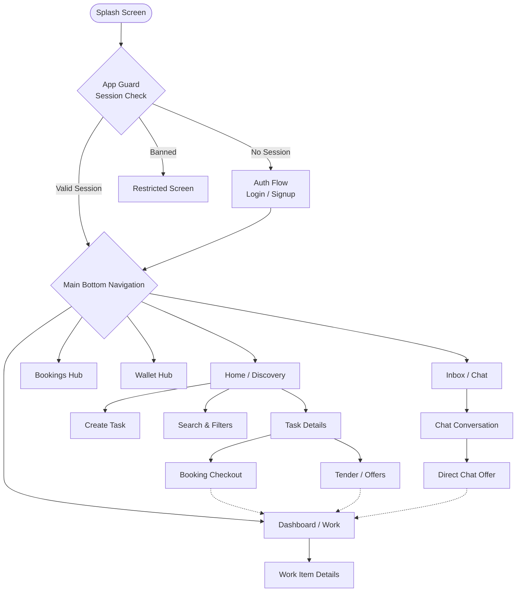

# 1. Document Header

- **Diagram Name**: SLine App Master UI Sequence Specification
- **Version**: 1.0 (Aligns with SLine v2.20.1)
- **Date**: 2026-03-11
- **Owner / Author**: Planner (@Architect & @DocsKeeper proxy)
- **Scope**: Entire Flutter Application (Client & Freelancer roles)
- **Status**: Production-Ready / Implementation Alignment

# 2. Purpose

This document serves as the master specification for the SLine app's UI flow, transitions, and state management.
It exists to bridge the gap between backend architecture (MVVM, Supabase RPCs, Triggers) and user experience.
Developers should use this to implement screens and navigation logic, designers should use this to verify all necessary states are accounted for, and management should use this to track missing or incomplete UI flows.

# 3. Reading Rules

- **[Screen Node]**: A full-screen route pushed to the navigation stack.
- **((Decision Node))**: Logic evaluated by a ViewModel or App Router (e.g., auth check).
- **[[Modal/Sheet]]**: A bottom sheet or dialog overlay.
- **> Action Arrow**: A user interaction (tap, submit) or system redirect.
- **-- Async/Loading --**: A background operation that surfaces a loading overlay or skeleton.
- **Success/Failure Paths**: Explicitly marked with status text on the transition arrow.

_(Note: Detailed feature sequences are split into documents 02 through 08 in this directory.)_

# 4. App Scope Covered

This UI sequence specification covers the following major app areas:

- Splash / App Start & Session Restore
- Authentication (Login, Signup)
- Role / Profile Readiness (Client vs Freelancer toggle)
- Main Navigation (Bottom Tab Bar)
- Home, Search, Discovery
- Task Details & Create Task
- Tender Flow (Proposals, Awards)
- Booking Flow (Slot selection, Payment Checkout)
- Orders / Work Management (Unified Dashboard)
- Chat / Conversations (Inbox, DMs, Direct Offers)
- Notifications (Push, In-App stream)
- Wallet (Ledger, Withdrawals)
- Profile (Settings, Role Switch)
- Saved / Favorites
- Portfolio / Public Profile Preview
- Error / Empty / Loading States

# 5. Feature Inventory Table

| Feature       | Entry Screen   | Key Child Screens          | Main User Actions         | Depends On          | Status      | Notes                         |
| ------------- | -------------- | -------------------------- | ------------------------- | ------------------- | ----------- | ----------------------------- |
| **App Shell** | `Splash`       | `MainNavigationScreen`     | Boot, Restore Session     | Auth State          | Implemented | Uses AppGuard                 |
| **Auth**      | `Login`        | `Signup`, `ForgotPassword` | Login, Register           | Supabase Auth       | Implemented | Session caching               |
| **Home**      | `HomeTab`      | `Search`, `Filters`        | Browse, Filter            | Categories, Profile | Implemented | Feed depends on `active_role` |
| **Tasks**     | `TaskDetails`  | `CreateTask`, `EditTask`   | Create, View, Save        | TaskService         | Implemented |                               |
| **Tenders**   | `RequestsList` | `SubmitProposalSheet`      | Bid, Award, Pay           | Tasks               | Implemented | Award locks price             |
| **Bookings**  | `BookingsTab`  | `PaymentCheckout`          | Pick slot, Pay            | Availability, Tasks | Implemented | QiCard integration            |
| **Chat**      | `InboxTab`     | `ChatScreen`               | Message, Direct Offer     | Favorites (for DM)  | Implemented | Realtime presence             |
| **Work/Dash** | `DashboardTab` | `WorkItemDetails`          | Review, Dispute, Complete | Ledger, Tasks, Auth | Implemented | Unified 4-branch view         |
| **Wallet**    | `WalletTab`    | `TransactionHistory`       | View Balance, Withdraw    | Ledger              | Partial     | Withdraw is "Coming Soon"     |
| **Profile**   | `ProfileTab`   | `Settings`, `Portfolio`    | Edit Profile, Switch Role | Auth, Storage       | Implemented | Atomic toggle                 |

# 6. Global Navigation Model

1. **App Start Decision**: The app boots and checks for a cached session. If expired/invalid, redirect to Auth Gate. AppGuard checks if user is suspended/banned.
2. **Auth Gate**: Users log in or sign up. Upon success, navigate to Main App.
3. **Session & Role Gate**: The app fetches the `public.profiles` row to determine the `active_role` (Client vs Freelancer) which dictates the Home feed and Dashboard capabilities.
4. **Main Bottom Navigation** (`MainNavigationScreen`):
   - **Home/Discovery**: Browsing tasks/freelancers.
   - **Bookings**: Client bookings / Freelancer schedule.
   - **Dashboard (Work)**: Active orders, unified view.
   - **Wallet**: Balances and transactions.
   - **Inbox**: Chat conversations.
5. **Modal Flows**: Heavy standalone actions (like Payment Checkout or Submit Proposal) often use full-screen modals or bottom sheets to preserve the background context.

# 7. Complete App UI Flow Map

# 8. Detailed Feature-by-Feature UI Sequences

_See files `02_auth_ui_sequence.md` through `08_profile_ui_sequence.md`._

# 9. Screen Registry

| Screen Name             | Feature   | Purpose                  | Opened From        | Can Open To                   |
| ----------------------- | --------- | ------------------------ | ------------------ | ----------------------------- |
| `MainNavigationScreen`  | App Shell | Tab container            | Splash, Auth       | All Tabs                      |
| `DashboardScreen`       | Workspace | Unified work hub         | MainNav            | `WorkItemDetails`             |
| `WorkItemDetailsScreen` | Workspace | Review contract, dispute | Dashboard          | `ChatScreen`, `DisputeDialog` |
| `PaymentCheckoutScreen` | Booking   | Pay via QiCard           | TaskDetails        | `PaymentWebViewScreen`        |
| `ChatScreen`            | Chat      | Messaging & Offers       | Inbox, TaskDetails | `ProfilePreview`              |
| `ProfileScreen`         | Profile   | Settings, Role switch    | MainNav            | `PortfolioManage`             |

# 10. UI State Contracts

- **Loading**: Entire screen utilizes a skeleton loader when fetching base data.
- **Inline Loading**: Buttons show progressive spinners (Material 3 standard) during async mutations.
- **Empty State**: Friendly illustration + descriptive text + CTA (e.g., "No tasks found. Create one!").
- **Error / No Network**: Snackbar pattern (`colorScheme.danger`) using `ErrorMapper` to translate PostgREST/Socket errors. Refresh/Retry button on main feeds.
- **Destructive Actions**: Always wrapped in a confirmation dialog (e.g., "Cancel Booking", "Delete Portfolio").

# 11. Transition Rules

- **Push**: For drilling down (e.g., Home → Task Details).
- **Replace**: For terminal/dead-end state changes (e.g., Splash → Login, Login → MainNav).
- **Pop**: To return from a success state (e.g., Submit Proposal success → Pop to Task Details).
- **Modal Bottom Sheet**: For quick contextual data entry (e.g., Add Portfolio Item, Fill Proposal Form).
- **Loading Overlay**: `LoadingHandle.show()` used only for critical blocking mutations (e.g., executing a payment).

# 12. Cross-Feature Dependencies

- **Task → Offers**: Submitting an offer links to the task.
- **Inbox → Payments**: Paying for a direct offer routes through the `qicard_payment_service` but returns to the Dashboard.
- **Favorites → Chat**: Starting a DM requires the freelancer to be in the client's favorites list. (Enforced by UI and DB Triggers).
- **Wallet → Work**: Releasing escrow from Work Details immediately reflects in Wallet balances.

# 13. UX Risk Review

- **Auth Race Conditions**: Handled by `AuthSessionViewModel` + `RoleSwitchCoordinator` to flush all caches upon role/auth change.
- **Dead Ends**: Modals must always have a definitive `close`/`dismiss` path. Payment return screens must actively route to Dashboard upon completion.
- **Missing Empty States**: Search and Wallet Activity must properly indicate an empty array instead of loading infinitely.

# 14. Implementation Alignment Review

- The flows documented here align exactly with the current `lib/features/` folder structure.
- **Unified Dashboard**: Completely implemented using the 4-branch `vw_unified_work_items` view.
- **Role Switching**: Safely implemented atomically natively across all ViewModels by the `RoleSwitchCoordinator`.

# 15. Missing Diagrams / Recommended Extra Docs

- The detailed flows are broken down into:
  - `02_auth_ui_sequence.md`
  - `03_home_discovery_ui_sequence.md`
  - `04_task_tender_ui_sequence.md`
  - `05_booking_ui_sequence.md`
  - `06_chat_ui_sequence.md`
  - `07_wallet_ui_sequence.md`
  - `08_profile_ui_sequence.md`

# 16. Final Summary

This specification, in conjunction with the detailed sequence diagrams (files 02-08), proves that SLine has a fully interconnected, MVVM-backed UI architecture. The most mature flows are Tasks, Tenders, Bookings, and Dashboard. Aspects requiring continued UX verification include edge-case payment failure states and upcoming Wallet Withdrawal screens.
