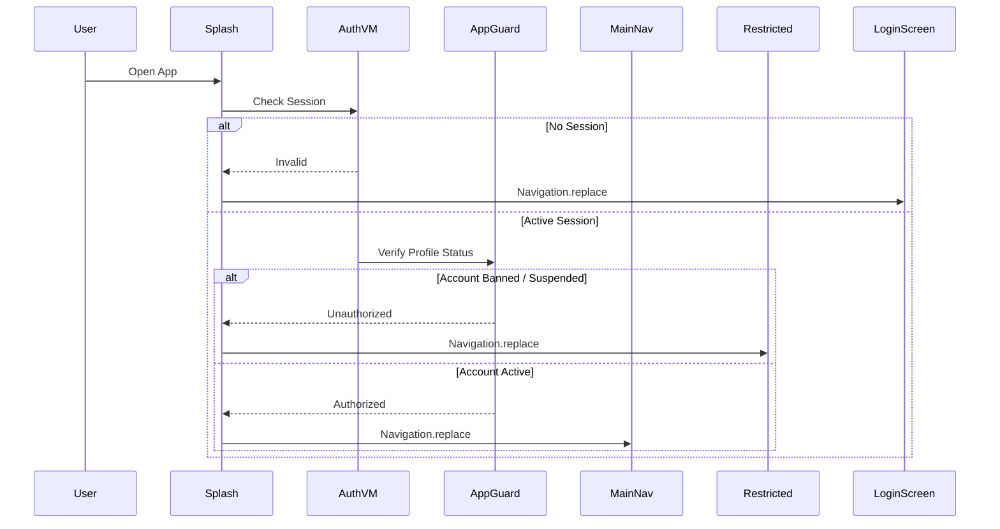
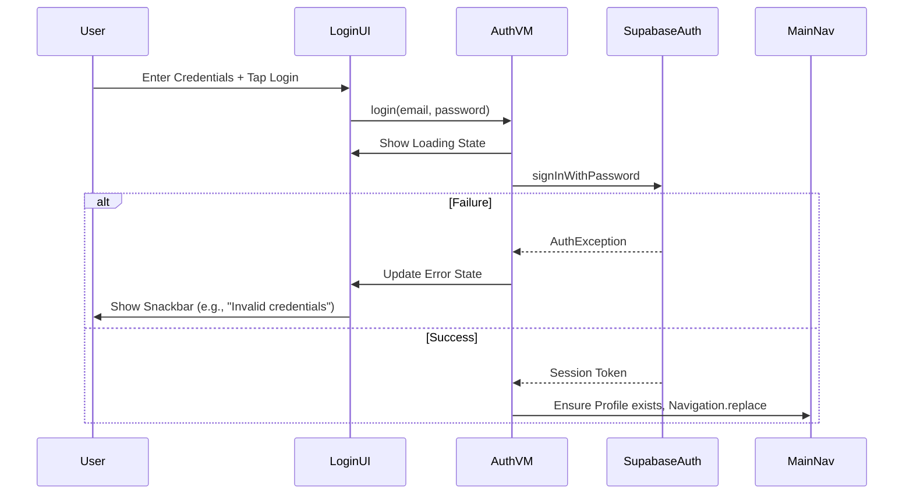

# 8.1 App Start / Session Restore

# 8.2 Authentication Flow

## Purpose

Handles session restoration on cold boot, logging in, signing up, password recovery, and the AppGuard which checks for suspensions or bans.

## Entry Points

- `SplashScreen` (Cold boot)
- `LoginScreen`

## Sequences

### App Start & AppGuard Sequence

### Login / Sign Up Sequence

## Screen Details

- **Login / Signup View**: Uses standard `AppTextField` and `AppButton`. Errors mapped via `ErrorMapper`.
- **Restricted Screen**: Shows contact support UI if `profiles.force_logout_after` triggers a ban.

## Dependency on Backend

- Supabase Auth for sessions.
- `public.profiles` for `active_role` resolution upon successful login.
