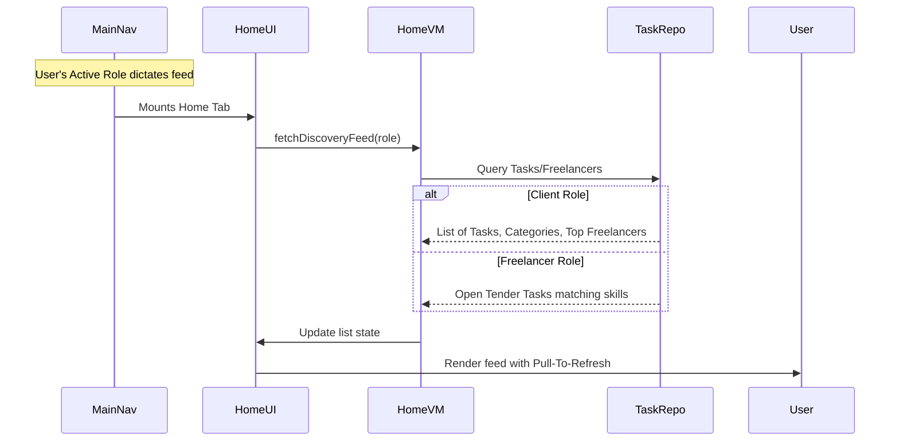
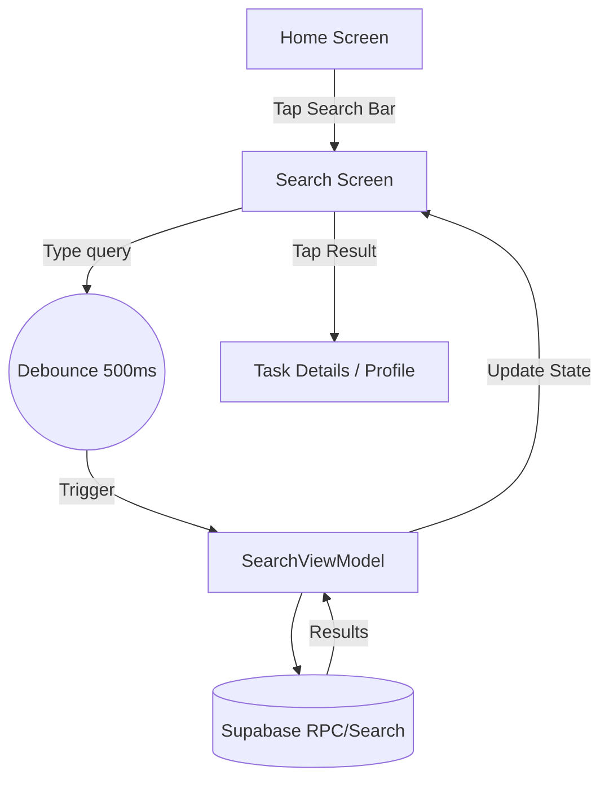

# 8.3 Main Navigation Flow

# 8.4 Home / Discovery Flow

# 8.5 Search Flow

## Purpose

Handles the core navigation shell of the app, dynamic content feeds based on the user's active role (Client vs Freelancer), category exploration, and executing searches.

## Sequences

### Main App Shell & Home Discovery

### Search Flow

## Screen Details

- **Main Navigation Screen**: A standard Flutter `Scaffold` with a `BottomNavigationBar`. Preserves state for 5 tabs.
- **Home UI**: Features vertical scrolling with horizontal categorizations. Pull-to-refresh resets pagination cursors.
- **Search Screen**: Maintains an empty state, a loading state, a results state, and a "no results" state.

## State rules

- Feed uses time-based cursors for lazy loading infinite scroll.
- Changing roles via Profile triggers a complete teardown of the HomeVM and forces a reload.
