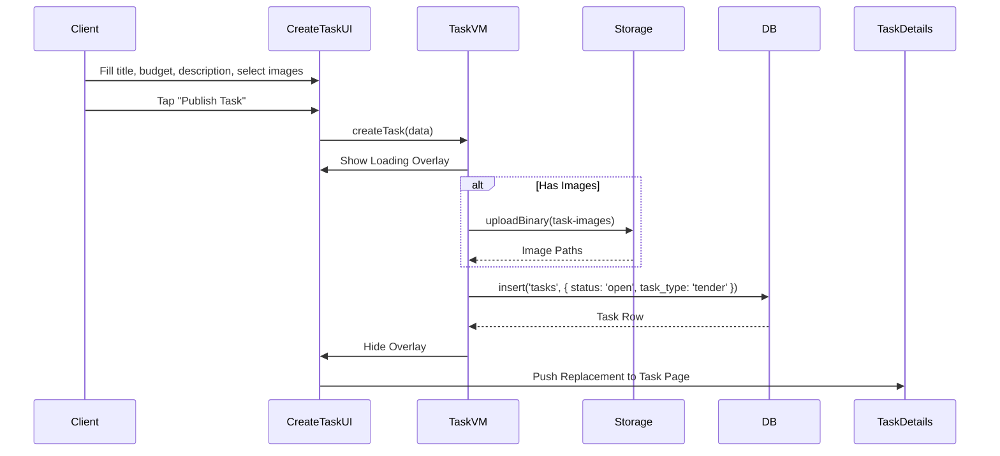
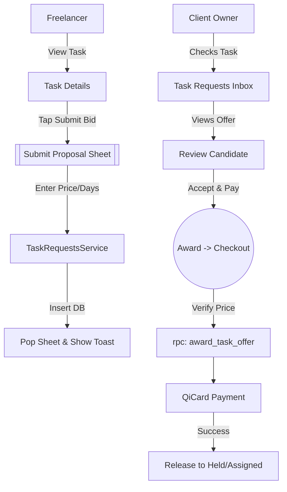

# 8.6 Task Details Flow

# 8.7 Create / Edit Task Flow

# 8.8 Tender Requests / Offer Flow

## Purpose

Managing the core tender task lifecycle: A client creates a task, freelancers submit price/day proposals, and the client awards/pays for one proposal.

## Sequences

### Create Task Sequence

### Submit Proposal & Award Flow (Tender)

## Implementation Alignment

- **Award locks price**: `award_task_offer` uses an optimistic price lock (`expectedPriceCents`). If the freelancer changed the price right before the award, it fails safely, showing `PriceMismatchException` to the client.
- **Auto-Expiration**: Unpaid awards expire. Countdown is shown via `AwardExpirationMonitor` on the Dashboard and Task details.

## Screen Details

- **Task Details Screen**: Analyzes whether viewer is Owner, Bidder, or Unrelated to resolve the main Call to Action (CTA) button state.
