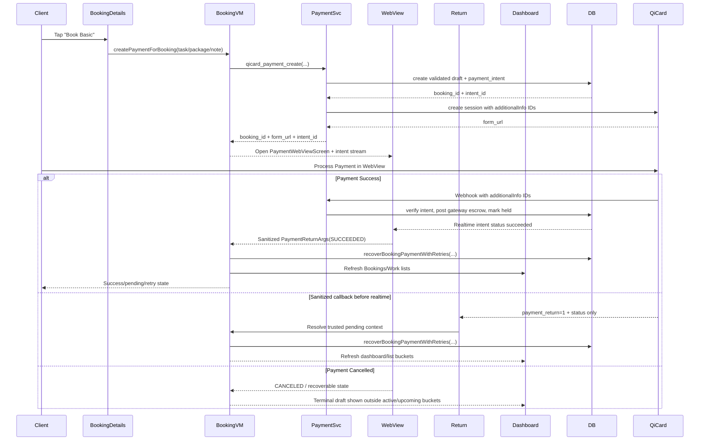

# 8.9 Booking Flow

## Purpose

Clients browsing a freelancer's availability and checking out a booking slot. The flow uses the server-backed QiCard booking draft, sanitized return URLs, app-held pending context, payment-intent realtime where available, and dashboard/list refresh after recovery.

## Sequences

### Booking & Checkout Flow

## State Rules

- Overlapping bookings logically blocked via `fn_reject_overlapping_slots` GiST indexes in DB.
- Payment intents explicitly tracked in `payment_intents` and `orphan_payments` for hardened ledger sync.
- Booking Status Transitions: `pending` -> `paid_request_pending` -> `active` -> `delivered` -> `completed` / `disputed`. Enforced by DB Trigger `fn_booking_guard`.
- Customer-facing payment return URLs must not expose booking, payer, entity, intent, or correlation metadata. Technical identifiers stay in Edge `additionalInfo`, logs, and support tooling.
- Success, pending, failed, canceled, retry, and recovery paths must refresh the source route plus Dashboard Bookings/Work buckets. Terminal drafts must not appear as active/upcoming bookings unless the lifecycle contract explicitly allows it.

## Screen Details

- **PaymentWebViewScreen**: Acts as a secure wrapper for QiCard, trusted callback validation, realtime intent completion, retry/back behavior, and sanitized return arguments.
- **PaymentReturnScreen**: Resolves sanitized web callbacks by using `PaymentPendingStore` or trusted app-held state, then triggers recovery.
- **Dashboard Bookings / Work**: Must be refreshed after held recovery and checked during QA for success, pending, failed, canceled, retry, and recovery states.
