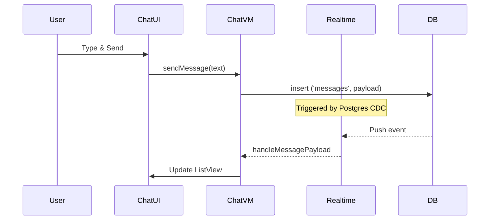
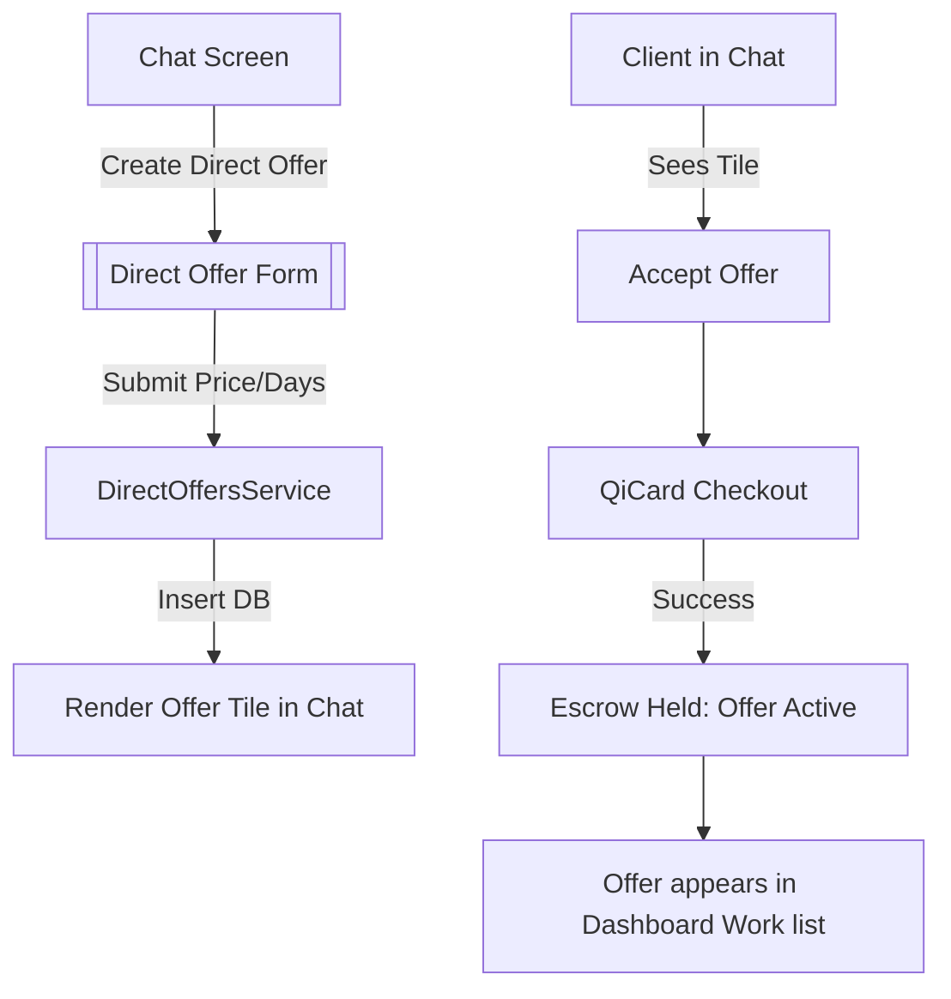
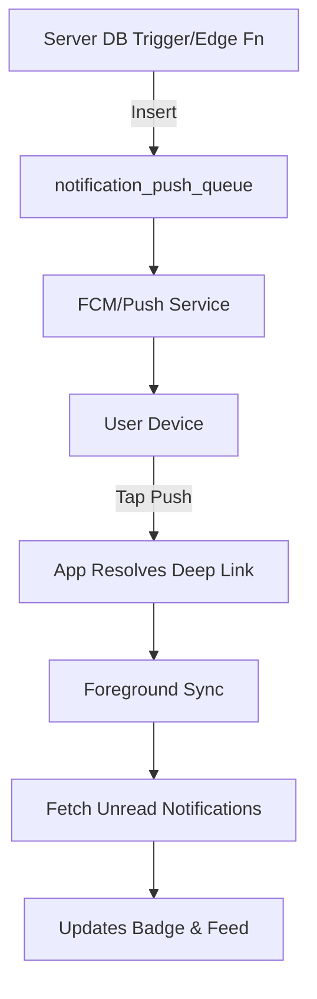

# 8.11 Chat / Conversation Flow

# 8.12 Notifications Flow

## Purpose

Showcases the realtime messaging streams, DM creation logic (gated by Favorites), Direct Chat Offers, and system Notifications.

## Sequences

### Sending a Message & Realtime

### Direct Chat Offer Flow

### Notifications Flow

## State Rules

- **Chat Realtime Integration**: Inbox syncs based on the `messages` stream to avoid N+1 queries on conversations. Typing presence has a 15s TTL.
- **Direct Offers**: Requires payment to activate. No work starts until the payment executes from the chat.
- **Favorites Gate**: Clients can only start direct chats out of nowhere with a Freelancer if the Freelancer is recorded in the `favorites` table. Atomic RPC `start_direct_conversation_v1` is used.
