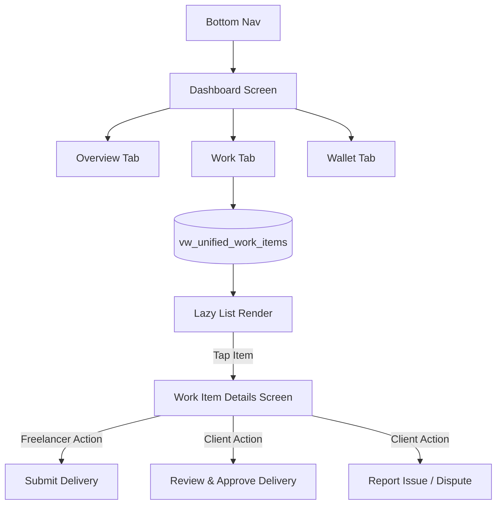
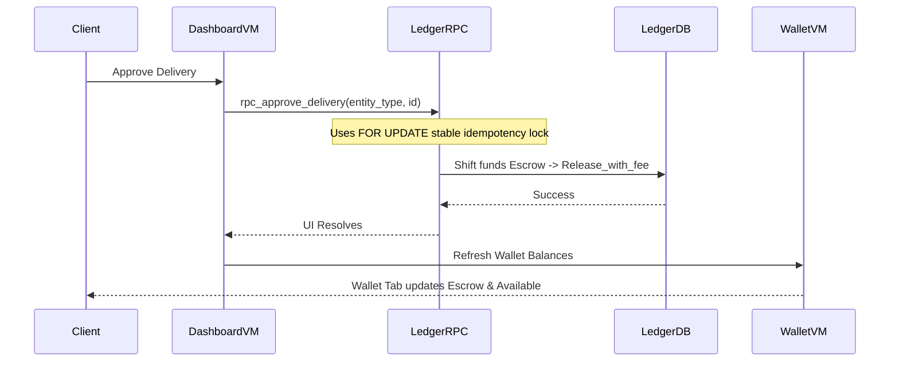

# 8.10 Orders / Work Management Flow

# 8.13 Wallet Flow

## Purpose

Unified tracking and administration of Work (Tasks, Bookings, Direct Offers) and the Ledger (Wallet Balances, Escrow logic).

## Sequences

### Unified Dashboard Flow

### Approving Delivery & Wallet Ledger Updates

## UI State Contracts

- `vw_unified_work_items` guarantees 4 branches of tasks always map back cleanly into the `WorkItemDetails` UI safely. Fallbacks do not exist. If the DB doesn't return the row, the UI shows "Work item not found".
- Escrow actions implement strict Loading Overlays securely resolving against the ledger.
- Wallet "Withdraw" functions are marked "Coming Soon".
