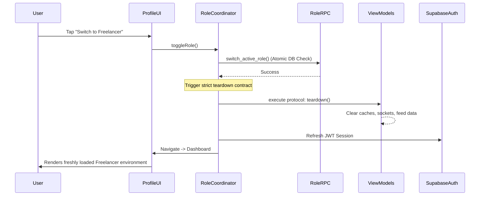
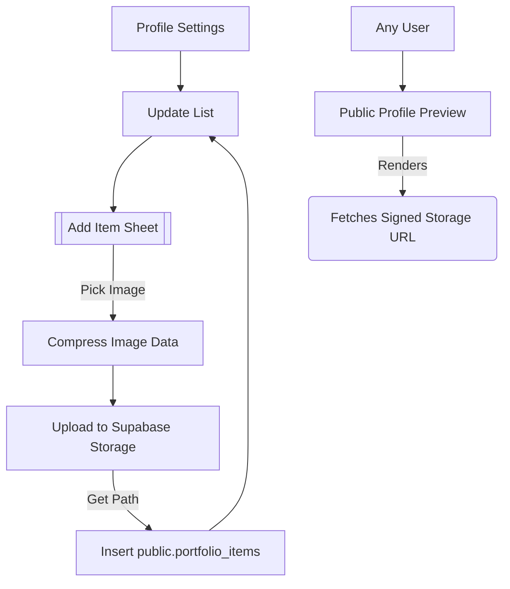

# 8.14 Profile Flow

# 8.15 Settings Flow

# 8.16 Saved Tasks / Favorites Flow

# 8.17 Portfolio / Public Profile Preview Flow

## Purpose

Governs user profile configuration, atomic role switching, viewing portfolios, tracking saved tasks and favorite freelancers.

## Sequences

### Atomic Role Switch Flow

### Portfolio Management

## Screen Details

- **Role Switching**: Rate limited (max 3/min) on both Client and Server. Fully tears down local Provider dependencies.
- **Favorites & Saved**: Favorites exist heavily to enable direct DMs `ux_convo_pair_direct`. Saved tasks live purely for tracking purposes under the profile tab.
- **Portfolio Options**: Handled as an inline list on the public profile preview, expanding to full-screen views on interaction.
