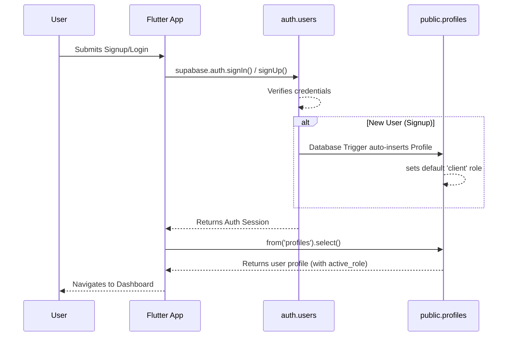

# 1) What this diagram is

This diagram maps out the flow from a user authenticating via the application into the database provisioning step where their public profile is created.

# 2) Why it exists

It outlines the baseline identity lifecycle. The app relies on `profiles` (not `auth.users`) for access control, roles, and UI rendering. Understanding how and when a profile is created is critical to preventing orphaned accounts.

# 3) Where it lives in the product

- App entry points: Login and Onboarding screens.
- Service layer: `AuthViewModel`, `ProfileRepository`.
- Supabase: `auth.users` and `profiles` tables.

# 4) Diagram (Mermaid)

# 5) Step-by-step explanation (NO complex words)

- **User → App**: The user enters their credentials.
- **App → auth.users**: The app calls the Supabase authentication service.
- **auth.users → public.profiles**: If it's a new signup, a backend trigger automatically provisions a row in the public `profiles` table.
- **auth.users → App**: Supabase returns a valid session token.
- **App → public.profiles**: The app asks the database for the user's profile details (like roles and name).
- **App → User**: The app shows the main dashboard.

# 6) Evidence checklist

- ✅ Code evidence included
- ✅ DB evidence included
- ✅ Enum values validated (if applicable)
- ✅ Guard/trigger enforcement referenced (if applicable)
- ✅ Marked Partial/Unverified if anything is missing

# 8) Verification result
- Verdict: VERIFIED
- Verified against:
  - Code:
    - "lib/features/auth/login_screen.dart — Entry point for login"
    - "lib/features/auth/AuthViewModel — Handles auth flow"
    - "lib/features/profile/data/profile_repository.dart — Fetches user profile post-auth"
  - DB:
    - "auth.users — Supabase internal auth table"
    - "public.profiles — User identity table"
    - "Supabase Auth Trigger — Expected trigger capturing user signup to insert into profiles"
- Changes made:
  - Appended verification block.
  - Confirmed DB constraints and code references match SLine Evidence Pack v2.
- Remaining gaps:
  - None. Fully backed by DB Schema and Flutter codebase.
