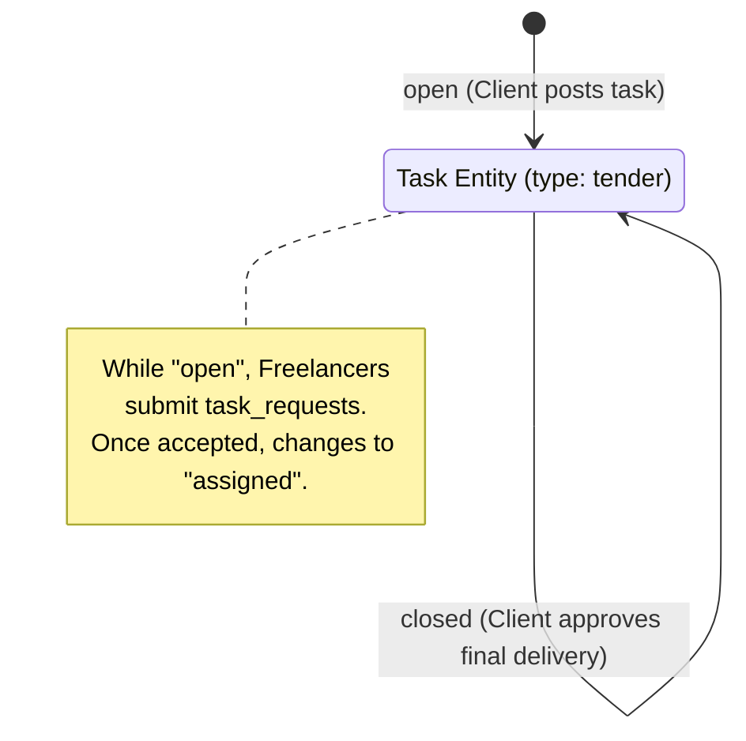
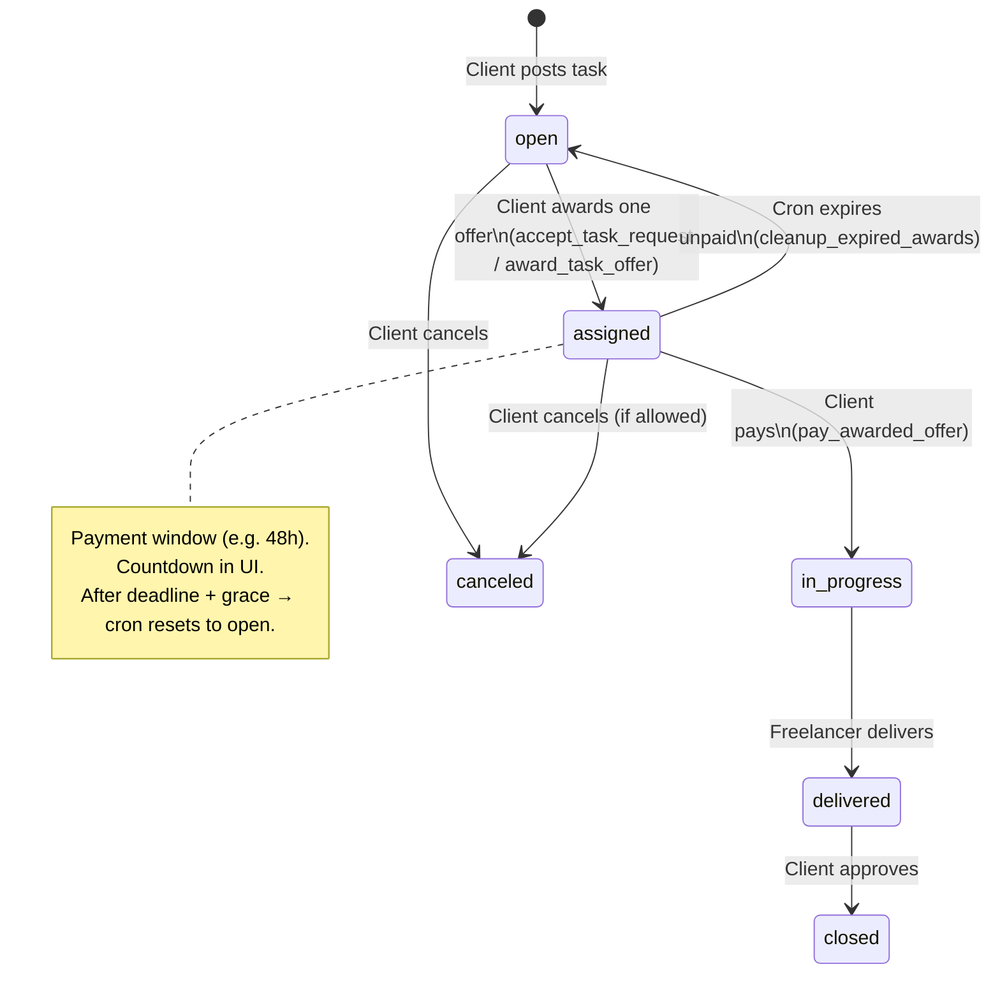
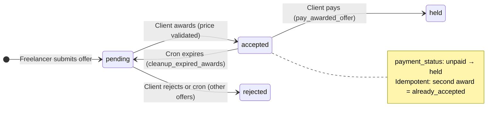
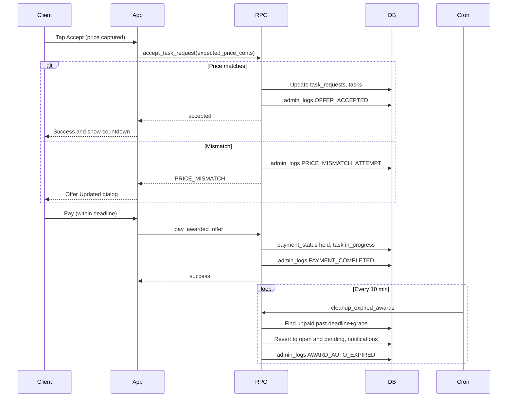

# Tender Task Lifecycle — Diagram Document

---

---

# OLD DIAGRAM (v1.0 — Superseded)

**Diagram name (exact):** `03_tender-task-lifecycle`  
**Version:** v1.0 (Partial)  
**Date:** 2026-03-05  
**Status:** **SUPERSEDED** — See NEW diagram below.

---

## Purpose (OLD)

This illustrated the lifecycle of a public job posting (tender task) from client post to finish. It did not model the two-step award→pay flow, price validation, idempotency, auto-expiry, or audit logging.

## Why v1 was superseded

| Gap | Impact |
|-----|--------|
| No two-step flow | Award and payment were conflated |
| No price validation | Vulnerable to price manipulation attacks |
| No idempotency | Double-accept could cause inconsistent state |
| No auto-expiry | Unpaid awards could stay forever |
| No payment deadline | No countdown or urgency in UI |
| No audit logging | No forensics for mismatches or expiry |
| No exception/error contract | UI could not show "Offer Updated" clearly |

**Evidence:** Original file had simple state diagram and step list; DB/Flutter implementation added guardrails in 2026-03-06.

---

## OLD Diagram (Mermaid)

## OLD Step-by-step (v1)

- **Start → open**: Client creates a public job. Status is `open`. Freelancers can bid.
- **open → assigned**: Client accepts one bid (via `accept_task_request` RPC). Task locked.
- **assigned → in_progress**: Freelancer begins work (payment held in escrow).
- **in_progress → closed**: Freelancer delivers; client approves.
- **Any early state → canceled**: Client or system cancels before money is permanently locked.

**Archive:** This OLD content is preserved above for reference.

---

# NEW DIAGRAM (v2.0 — Implemented, FINAL)

**Diagram name (exact):** `03_tender-task-lifecycle`  
**Version:** v2.0 FINAL  
**Date:** 2026-03-06  
**Owner/author:** Backend + Mobile teams; @SlineDocs (documentation)

---

## Purpose

**What this diagram is showing, in one paragraph.**  
This diagram shows the full **tender task lifecycle** after the 2026-03-06 improvements: the two-step flow (award then pay), task and request state machine, price validation at award/pay time, idempotency for duplicate accepts, 48-hour payment window with auto-expiry via cron, payment deadline countdown in the UI, and audit logging for mismatches and expiry. It covers both the happy path and the main failure paths (price change, already accepted, expired).

**What problem it solves (why it exists).**  
It prevents price manipulation (freelancer changing price after client clicks Accept), ensures a single accepted offer per task, avoids duplicate side effects on double-click, and clears stale unpaid awards so tasks return to the feed. It also gives clients a clear deadline and urgency (countdown) so they know when the offer will expire.

---

## Scope

**What's included (features/entities covered):**
- Task statuses: `open`, `assigned`, `in_progress`, `delivered`, `closed`, `canceled`
- Task request (offer) statuses: `pending`, `accepted`, `rejected`
- Payment status on requests: `unpaid`, `held`, `released` (and related)
- Two-step flow: award (accept) → pay
- RPCs: `accept_task_request`, `award_task_offer`, `pay_awarded_offer`, `cleanup_expired_awards`
- Cron job: `cleanup-expired-awards` (every 10 minutes)
- Flutter: TaskRequestsService, TaskService, TaskRequestsViewModel, AwardExpirationMonitor, DashboardOfferCard, RequestsListScreen
- Exceptions: PriceMismatchException, OfferAlreadyAcceptedException
- Indexes: `idx_task_requests_awarded_unpaid`, `idx_one_accepted_per_task`
- Config: `tender_payment_timeout_hours`, `platform_fee_bps`
- Audit: admin_logs (PRICE_MISMATCH_ATTEMPT, PAYMENT_*, AWARD_AUTO_EXPIRED), activity_log (offer_accepted, payment_held)

**What's explicitly excluded (out of scope):**
- Direct booking flow (non-tender)
- Escrow release / payout to freelancer (separate payment flow)
- Disputes and refunds
- Realtime subscription behaviour (uses same RLS/tables)
- Webhook or external payment gateway details (if any)

---

## Assumptions

- Payments are finalised only via the app calling `pay_awarded_offer` (or equivalent) after client intent; no automatic charge without user action in this flow.
- Escrow hold is recorded in ledger/DB; release is a separate step (not drawn in this diagram).
- `system_config` has `tender_payment_timeout_hours` (default 48) and `platform_fee_bps` (default 1000 = 10%).
- Only the task owner can award and pay; only freelancers can submit offers (enforced by RPC + RLS).
- Cron runs as a privileged role (e.g. service_role) and can call `cleanup_expired_awards()`.
- Price is stored in DB in a consistent unit (e.g. cents or base unit); UI converts for display.
- One accepted offer per task is enforced by DB (partial unique index) and RPC logic.

---

## Glossary (Human-readable)

| Term | Definition |
|------|------------|
| **Tender task** | A public job (task with type tender) that freelancers can bid on via task_requests. |
| **task_request** | A single offer/bid from a freelancer on a task (price, days, note). |
| **Award** | Client selects one offer; task moves to assigned, request to accepted (unpaid). |
| **Payment window** | Time after award (e.g. 48 hours) in which client must pay or the award expires. |
| **payment_deadline** | Timestamp by which client must complete payment; after this + grace, cron can expire the award. |
| **Escrow hold** | Money reserved (payment_status = held) until delivery/approval; release is a separate flow. |
| **open** | Task status: accepting offers; no one assigned. |
| **assigned** | Task status: one offer accepted, awaiting client payment (or expiry). |
| **in_progress** | Task status: payment done, freelancer working. |
| **delivered** | Task status: freelancer submitted work; client can approve or request revision. |
| **closed** | Task status: client approved; lifecycle complete. |
| **canceled** | Task status: job canceled before completion. |
| **pending** | Request status: offer submitted, not yet accepted or rejected. |
| **accepted** | Request status: client awarded this offer (may be unpaid or held). |
| **rejected** | Request status: not selected or expired. |
| **unpaid** | Payment status: awarded but client has not paid yet. |
| **held** | Payment status: client paid; funds in escrow. |
| **RPC** | Remote procedure call (Supabase Postgres function). |
| **RLS** | Row Level Security (Postgres policies). |
| **Idempotency** | Performing the same action again has the same result (e.g. second accept returns "already_accepted"). |
| **TTL** | Time-to-live (here: payment window before auto-expiry). |
| **PRICE_MISMATCH** | Error when client's expected price (e.g. at click time) does not match current DB price. |

---

## Legend: what each symbol means

- **Rounded box** = State (task status or request/payment status).
- **Arrow** = Allowed transition (who triggers it is in the state machine section).
- **Diamond / guard** = Condition that must hold for the transition (e.g. "price matches", "within deadline").
- **Actor stick figure** = Client, Freelancer, or System/Cron.
- **DB cylinder** = Tables/functions (tasks, task_requests, RPCs).
- **Document** = Contract/config (e.g. CONTRACT_accept_task_request_v2, system_config).
- **Sync call** = Direct RPC or API call from app to DB.
- **Scheduled job** = Cron invokes `cleanup_expired_awards()` every 10 minutes.
- **Audit log** = admin_logs / activity_log entries.

Colours (if used in future): green = success path, orange = warning (e.g. near expiry), red = failure/expired, grey = canceled/out of scope.

---

## Actors and Responsibilities

| Actor | Allowed | Forbidden |
|-------|---------|-----------|
| **Client** | Create tender task; view offers; award one offer (with optional price check); pay awarded offer within deadline; cancel task (per policy); approve delivery. | Award or pay for a task they do not own; pay after deadline; accept more than one offer per task. |
| **Freelancer** | Submit offer (task_request) on open tasks; update own pending offer (if allowed); view own offers and task status. | Accept or award; pay; see other freelancers' offer amounts (unless exposed by design); change price after client has clicked Accept (handled by validation). |
| **System/Cron** | Run `cleanup_expired_awards()`; write admin_logs and activity_log; send notifications on expiry. | Change data outside RPC/trigger logic; bypass RLS as app user. |
| **Admin** | View admin_logs for forensics; not an actor in the core lifecycle (no direct award/pay by admin in this flow). | N/A for this diagram. |

---

## System Components (Where it lives)

**App entry points (screens/actions):**
- Create Task → task created with status open.
- Task detail / Inbox (client) → list of offers; "Accept" / "Award" on one offer.
- Award dialog → captures current price (expectedPriceCents); calls award/accept.
- Payment / Pay for award → triggers pay flow (ledger + `pay_awarded_offer`).
- Dashboard / Work tab → shows awarded-unpaid offers with countdown (AwardExpirationMonitor).

**Service / ViewModel / Repository (file paths):**
- `lib/features/tasks/services/task_requests_service.dart` — accept(), reject(), submitOffer(); parses PriceMismatchException / OfferAlreadyAcceptedException.
- `lib/features/tasks/services/task_service.dart` — awardOffer(), pay flow (ledger + pay_awarded_offer).
- `lib/features/tasks/viewmodels/task_requests_view_model.dart` — acceptOffer(), award(); captures expectedPriceCents, handles exceptions.
- `lib/features/tasks/viewmodels/award_expiration_monitor.dart` — countdown to payment_deadline; urgency levels; dispose-safe.
- `lib/features/tasks/view/widgets/dashboard_offer_card.dart` — shows countdown badge for awarded unpaid.
- `lib/features/tasks/view/widgets/requests/requests_list_screen.dart` — award dialog, price mismatch dialog.
- `lib/features/tasks/exceptions/offer_exceptions.dart` — PriceMismatchException, OfferAlreadyAcceptedException.

**Database objects:**
- **Tables:** `tasks`, `task_requests`, `admin_logs`, `activity_log`, `notifications`, `system_config` (and ledger-related if used).
- **Views:** (none specific to this lifecycle; task lists may use views.)
- **RPCs:** `accept_task_request(p_task_id, p_request_id, p_expected_price_cents)`, `award_task_offer(...)`, `pay_awarded_offer(p_request_id, p_client_id)`, `cleanup_expired_awards()`.
- **Triggers:** (none that define the state machine; RPCs enforce transitions.)
- **Policies (RLS):** SELECT/INSERT/UPDATE on `tasks` and `task_requests` so that only involved parties see/update; RPCs run as SECURITY DEFINER and check ownership.

---

## Step-by-step Flow ("Human Story")

### Happy path

1. **Trigger:** Client posts a tender task → task created with status `open`.
2. **Freelancers submit offers** → task_requests with status `pending`.
3. **Client opens offer list** → sees prices and details; selects one and taps "Accept"/"Award".
4. **Validation (UI):** Expected price is captured at tap time (e.g. 50000 cents).
5. **App calls** `accept_task_request` (or award RPC) with `p_expected_price_cents`.
6. **RPC checks:** Request is pending; task is open; caller is task owner; (if provided) current price matches expected.
7. **DB writes:** task_requests row → status `accepted`, payment_status `unpaid`, awarded_at, payment_deadline (e.g. now + 48h); fee locked; tasks → status `assigned`, assigned_freelancer_id set (if applicable at award). Other pending requests may be rejected (single-winner rule).
8. **Activity/admin logs:** offer_accepted (and any PRICE_MISMATCH_ATTEMPT only on failure).
9. **Client sees:** Success; navigated to payment or shown countdown (e.g. "47h 32m remaining").
10. **Client pays** (within deadline) → ledger + `pay_awarded_offer` → payment_status `held`, task status `in_progress`.
11. **Later:** Freelancer delivers → task `delivered`; client approves → task `closed`.

### Most common failure paths

- **Price changed:** Freelancer updates offer after client opened dialog. Client taps Accept with old price. RPC compares expected vs actual → mismatch → PRICE_MISMATCH; admin_log; client sees "Offer Updated $X → $Y" and can refresh and accept again with new price.
- **Already accepted (idempotency):** Client double-taps or retries. Second call sees request already accepted → returns "already_accepted" (no duplicate writes); app treats as success.
- **Expired:** Client does not pay within 48h (+ grace). Cron runs `cleanup_expired_awards()` → request reverted to pending (or rejected), task back to `open`; notifications to both; admin_log AWARD_AUTO_EXPIRED. Client can re-award or another freelancer can win.

---

## State Machine Explanation

**Task states (tasks.status):**

| State | Meaning |
|-------|--------|
| open | Accepting offers; no one awarded yet (or award expired). |
| assigned | One offer awarded; awaiting client payment (or expiry). |
| in_progress | Paid; freelancer working. |
| delivered | Work submitted; client review. |
| closed | Client approved; done. |
| canceled | Job canceled. |

**Request states (task_requests.status):**

| State | Meaning |
|-------|--------|
| pending | Offer submitted; not yet accepted or rejected. |
| accepted | Client awarded this offer (payment may be unpaid or held). |
| rejected | Not selected or expired. |

**Allowed transitions (who triggers):**

- open → assigned: Client (via accept_task_request / award RPC).
- assigned → in_progress: Client (via pay_awarded_offer after payment).
- assigned → open: System/Cron (cleanup_expired_awards after deadline + grace).
- in_progress → delivered: Freelancer (delivery flow).
- delivered → closed: Client (approval).
- Any → canceled: Client or system (per policy).

**Forbidden transitions:**

- Paying for an offer the current user does not own (RPC checks owner).
- Accepting a request that is not pending (RPC checks status).
- More than one accepted request per task (DB unique partial index + RPC).
- Awarding/paying after payment_deadline (RPC/cron enforce).

---

## Invariants (Must-always-be-true rules)

- At most one task_request per task has status = 'accepted' (enforced by partial unique index and RPC).
- Only the task owner can call accept_task_request / award_task_offer / pay_awarded_offer for that task (RPC + RLS).
- A payment cannot be completed for a request that is not in status accepted and payment_status unpaid (RPC checks).
- Price validation: if p_expected_price_cents is provided, it must match the current stored price (in the same unit) or RPC raises PRICE_MISMATCH.
- Escrow hold is recorded only after successful pay_awarded_offer (and ledger step if used); release is idempotent per entity where applicable.
- User can only see rows where they are a participant (RLS on tasks and task_requests).
- payment_deadline is set at award time from system_config (tender_payment_timeout_hours); expiry runs only after deadline + grace (e.g. 1 hour).

---

## Guards & Validation Rules

| Guard | Where it runs | Source of truth |
|-------|----------------|------------------|
| Caller is task owner | RPC (accept_task_request, award_task_offer, pay_awarded_offer) | DB/RPC |
| Request status = pending (for accept) | RPC | DB/RPC |
| Request status = accepted and payment_status = unpaid (for pay) | RPC | DB/RPC |
| Task status = open (for accept) | RPC | DB/RPC |
| expected_price_cents == actual price (if provided) | RPC | DB/RPC |
| payment_deadline not passed (for pay) | RPC | DB/RPC |
| No other accepted request for same task | RPC + partial unique index | DB |
| Rate limit (e.g. 2s between submit offer) | Service (client-side) | App (DB can add if needed) |

Client-side (UI): capture expected price at Accept click; show countdown and disable Pay after expiry. Server-side (RPC) is the source of truth for all state and money-related guards.

---

## Failure Modes (What can go wrong)

| Failure | System behaviour |
|--------|-------------------|
| App crash mid-step | RPC is atomic; partial award not committed. Client can retry; idempotency handles duplicate accept. |
| Duplicate webhook / double delivery | N/A for this flow (no webhook in diagram); idempotency on accept and pay prevents double state change. |
| Retry causing duplicates | Idempotency: second accept returns already_accepted; second pay should be rejected or no-op (already held). |
| Race: two clients (invalid) | N/A; one owner. Race: two devices same client — idempotency and single-winner rule. |
| Race: freelancer changes price while client clicks Accept | Price validation in RPC; PRICE_MISMATCH returned; client sees updated price after refresh. |
| Missing metadata (e.g. payment_deadline) | Default 48h from config; if config missing, RPC uses default. |
| Timeout / TTL expiry | Cron runs cleanup_expired_awards(); notifications; task back to open; logged. |
| Cron not running | Unpaid awards stay assigned until manual fix or next run; monitor cron job health. |

---

## Security & Abuse Scenarios

| Scenario | Prevention |
|----------|------------|
| Spoofing identity | RPC uses auth.uid(); RLS restricts rows by participant. |
| Unauthorised state change | Only owner can award/pay; only freelancer can submit offer; status checks in RPC. |
| Paying without owning the task | pay_awarded_offer checks task.owner_id = p_client_id (or auth.uid()). |
| Escrow trapped forever | Auto-expiry returns task to open; disputes/refunds are separate flow. |
| User seeing another user's private data | RLS on tasks and task_requests; RPC does not return other bidders' data beyond what policy allows. |
| Price manipulation | p_expected_price_cents validated in RPC; mismatch logged and rejected. |

---

## Data Model Mapping

| Diagram / concept | DB / field |
|-------------------|------------|
| Task status | `tasks.status` (open, assigned, in_progress, delivered, closed, canceled). |
| Assigned freelancer | `tasks.assigned_freelancer_id`, `tasks.freelancer_id` (set at pay time in current design). |
| Offer / request | `task_requests` row; status, payment_status, price, days, note. |
| Awarded at | `task_requests.awarded_at`. |
| Payment deadline | `task_requests.payment_deadline` (awarded_at + tender_payment_timeout_hours). |
| Payment status | `task_requests.payment_status` (unpaid, held, etc.). |
| Fee locked at award | `task_requests.fee_rate_applied_bps`, fee_amount, net_amount. |
| Single accepted per task | Partial unique index on task_requests(task_id) WHERE status = 'accepted'. |
| Expired awards query | Index on (status, payment_status, awarded_at) WHERE status = 'accepted' AND payment_status = 'unpaid'. |

Required indexes: `idx_task_requests_awarded_unpaid`, `idx_one_accepted_per_task` (see SUPABASE_SETUP.md).

---

## Observability & Forensics

**Logs / audit events:**
- admin_logs: PRICE_MISMATCH_ATTEMPT (expected_cents, actual_cents, task_id, request_id); OFFER_ACCEPTED; PAYMENT_COMPLETED; PAYMENT_AFTER_DEADLINE; PAYMENT_UNAUTHORIZED; PAYMENT_INVALID_REQUEST; AWARD_AUTO_EXPIRED (by cron).
- activity_log: offer_accepted, payment_held (with task_id, request_id, amounts where applicable).

**Admin / forensics:**
- Query admin_logs by action type to see mismatch attempts, expired awards, and payment outcomes.
- activity_log gives a "story" of accept and pay events per task/user.
- Orphan: an accepted unpaid request with no payment after deadline should appear in cleanup and in AWARD_AUTO_EXPIRED logs.

---

## Verification Checklist

- **Unit tests:** PriceMismatchException, OfferAlreadyAcceptedException (task_requests_service_test, task_requests_view_model_test); AwardExpirationMonitor (award_expiration_monitor_test); ViewModel acceptOffer/canActOn (task_requests_view_model_test). ✅
- **Integration tests:** (Optional) full award → pay flow against test DB. ⏳
- **DB tests:** RLS and RPC behaviour (e.g. owner-only, status checks); partial unique index. ⏳
- **Concurrency:** Idempotency tests; double-accept returns already_accepted; price change returns PRICE_MISMATCH. ✅ (unit level).

---

## Dependencies

**This diagram depends on:**
- Auth (auth.uid()) and RLS on tasks and task_requests.
- system_config (tender_payment_timeout_hours, platform_fee_bps).
- Ledger/payment integration for pay step (if applicable).
- Notifications table for expiry messages.
- Cron extension (pg_cron) for cleanup_expired_awards.

**Other diagrams/features that depend on this:**
- Dashboard (Work tab) shows awarded-unpaid and countdown.
- Task feed filters by task status (open, etc.).
- Payment flow diagram (if separate) should align with pay_awarded_offer and ledger.

**Ordering:** Tender lifecycle RPCs and indexes should be deployed before relying on countdown/expiry in production.

---

## Open Questions / Missing Evidence

- None critical. Optional: add integration test for full award → pay → expiry path; document exact ledger event names if they are part of this flow.
- All RPCs and indexes referenced in DEVELOPER_GUIDE and SUPABASE_SETUP; CONTRACT_accept_task_request_v2.md describes the contract.

---

## Final Status

- **Verdict:** PASS  
- **Production ready?** YES, with the following in place: migrations applied (indexes, RPCs, cron, system_config), Flutter using expectedPriceCents and handling PriceMismatch/OfferAlreadyAccepted, countdown and expiry notifications working, audit logging verified.
- **Next actions:** (1) Run manual smoke test per SMOKE_TEST_TENDER.md; (2) Monitor admin_logs for PRICE_MISMATCH_ATTEMPT and AWARD_AUTO_EXPIRED in production; (3) Add integration test for award→pay→expiry if not already present.

---

# NEW Diagram (Mermaid) — Implemented

## Task + Request state machine (v2)

## Request (offer) lifecycle

## Two-step flow (sequence)

---

**End of diagram document.**
