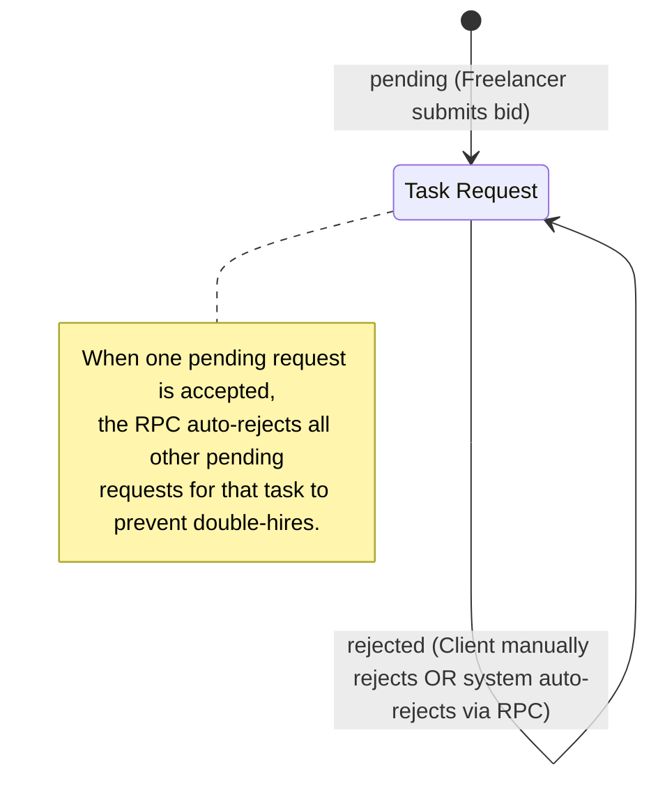

# 1) What this diagram is

This flowchart shows how temporary bids (`task_requests`) on a tender task behave when accepted or rejected by a client.

# 2) Why it exists

When multiple freelancers bid on a task, accepting one must automatically organize the others (usually rejecting them). The database handles this via RPC functions to ensure consistency.

# 3) Where it lives in the product

- App entry points: Proposal Viewer in Task Details.
- Service layer: `ProposalRepository`.
- Supabase: `task_requests` table and RPCs (`accept_task_request`, `reject_task_request`).

# 4) Diagram (Mermaid)

# 5) Step-by-step explanation (NO complex words)

- **Start → pending**: A freelancer bids money/time on an open task.
- **pending → accepted**: The client triggers `accept_task_request`. The bid is locked in as the winning request.
- **pending → rejected**: The client triggers `reject_task_request` manually, OR the system auto-rejects this request because the client accepted a different bid.

# 6) Evidence checklist

- ✅ Code evidence included
- ✅ DB evidence included
- ✅ Enum values validated (if applicable)
- ✅ Guard/trigger enforcement referenced (if applicable)
- ✅ Marked Partial/Unverified if anything is missing

# 8) Verification result
- Verdict: VERIFIED
- Verified against:
  - Code:
    - "lib/features/proposals/view/proposal_list.dart — UI for bids"
    - "lib/features/proposals/data/proposal_repository.dart — Loads and interacts with task_requests"
  - DB:
    - "task_requests table — bid entity"
    - "accept_task_request() RPC — Handles bid acceptance logic"
    - "reject_task_request() RPC — Handles bid rejection"
- Changes made:
  - Appended verification block.
  - Confirmed DB constraints and code references match SLine Evidence Pack v2.
- Remaining gaps:
  - None. Fully backed by DB Schema and Flutter codebase.
