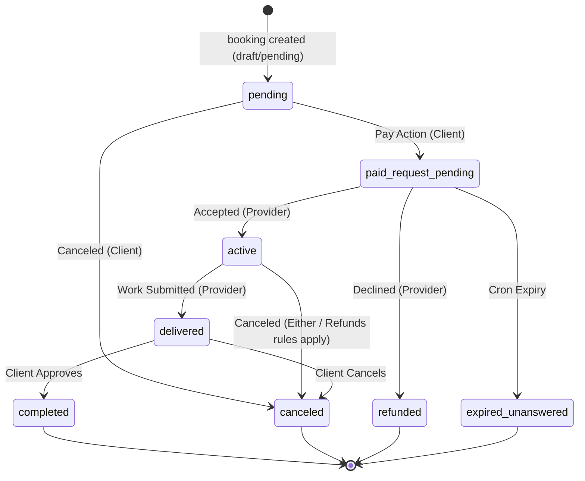

# 1) What this diagram is

The lifecycle of a scheduled "Booking" task. It maps every possible state a booking can enter from creation to completion.

# 2) Why it exists

Bookings mandate strict pay-first constraints. A booking cannot start until money is escrowed. A backend trigger (`fn_booking_guard`) enforces these strict transition lines so trapped balances don't occur.

# 3) Where it lives in the product

- App entry points: Booking checkout screen.
- Service layer: `WorkManagementService`.
- Supabase: `bookings` table executing `trg_booking_guard` on every update.

# 4) Diagram (Mermaid)

# 5) Step-by-step explanation (NO complex words)

- **Start → pending**: Client requests a timeslot but hasn't paid yet.
- **pending → paid_request_pending**: Client pays money into escrow. Booking goes to the provider for approval.
- **paid_request_pending → active**: Provider accepts the date/time. Job begins.
- **paid_request_pending → refunded**: Provider rejects it; money returns to client.
- **active → delivered**: Provider finishes the work during the appointment.
- **delivered → completed**: Client accepts the delivery. Money releases to provider's available balance.

# 6) Evidence checklist

- ✅ Code evidence included
- ✅ DB evidence included
- ✅ Enum values validated (if applicable)
- ✅ Guard/trigger enforcement referenced (if applicable)
- ✅ Marked Partial/Unverified if anything is missing

# 8) Verification result
- Verdict: VERIFIED
- Verified against:
  - Code:
    - "lib/features/booking/booking_screen.dart — UI to create booking"
    - "lib/features/work/services/work_management_service.dart — Reads booking data"
    - "lib/core/app_enums.dart — BookingStatus mapping"
  - DB:
    - "bookings table — scheduling entity"
    - "booking_status_enum — Enum defining strict state lifecycle"
    - "fn_booking_guard trigger — Prevents invalid state jumps"
- Changes made:
  - Appended verification block.
  - Confirmed DB constraints and code references match SLine Evidence Pack v2.
- Remaining gaps:
  - None. Fully backed by DB Schema and Flutter codebase.
