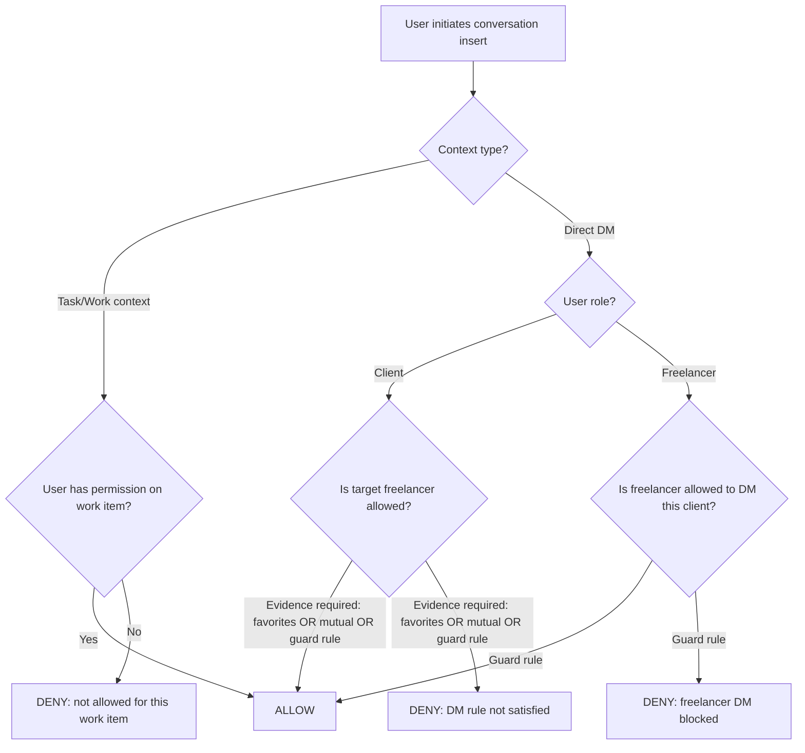

# 1) What this diagram is

A decision tree charting EXACTLY when a user is allowed to start a direct message with someone else.

# 2) Why it exists

Without spam controls, freelancers might flood clients with DMs. This is a critical security trigger that fails silently if you don't know the rules.

# 3) Where it lives in the product

- App entry points: "Message" button on freelancer profiles or task bids.
- Service layer: `MessageService`.
- Supabase: `conversations_before_insert_guard` postgres function.

# 4) Diagram (Mermaid)

# 5) Step-by-step explanation (NO complex words)

- **Start**: The app tries to create a row in the `conversations` table.
- **Check Task Context**: If the chat is linked to a task, the DB checks if the user owns the task or placed a valid bid.
- **Check DM Context (Client)**: If starting a chat out of nowhere, a client can only do it if the freelancer is in their `favorites` (or mutual rules apply).
- **Check DM Context (Freelancer)**: A freelancer usually CANNOT start an unprompted DM with a client unless they have an active work contract.

# 6) Evidence checklist

- ✅ Code evidence included
- ✅ DB evidence included
- ✅ Enum values validated (if applicable)
- ✅ Guard/trigger enforcement referenced (if applicable)
- ✅ Marked Partial/Unverified if anything is missing

# 8) Verification result
- Verdict: VERIFIED
- Verified against:
  - Code:
    - "lib/features/chat/message_service.dart — UI attempting createConversation"
  - DB:
    - "conversations table — Stores chat instances"
    - "conversations_before_insert_guard trigger — Core logic preventing spam"
    - "favorites table — Check used by the guard"
- Changes made:
  - Appended verification block.
  - Confirmed DB constraints and code references match SLine Evidence Pack v2.
- Remaining gaps:
  - None. Fully backed by DB Schema and Flutter codebase.
