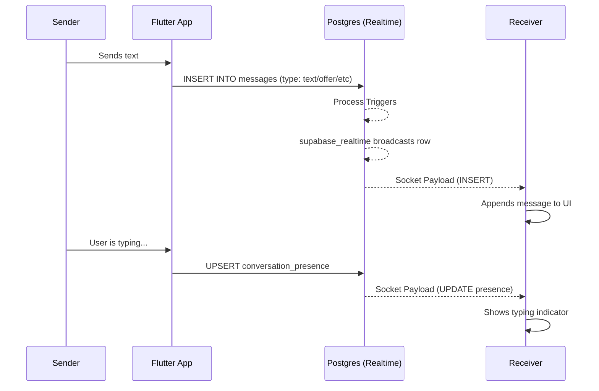

# 1) What this diagram is

This shows the topology and process flow of socket-based communication. How messages bounce from a user to the DB and out to another user in milliseconds.

# 2) Why it exists

Realtime features behave differently than standard REST calls. It involves listening to sockets. The frontend needs to understand how `messages` and `presence` sync.

# 3) Where it lives in the product

- App entry points: Active Chat Screen.
- Service layer: `MessageService`.
- Supabase: Realtime engine configured on `public.messages`.

# 4) Diagram (Mermaid)

# 5) Step-by-step explanation (NO complex words)

- **Sender → App**: A user clicks send.
- **App → DB**: The app inserts a row into `messages`.
- **DB → Realtime Engine**: Because `messages` is on the publication list, Supabase catches the insert.
- **Realtime → Receiver**: A WebSocket pushes the new row directly to the listening phone.
- **Presence Tracking**: A similar loop happens with `conversation_presence` to show "Typing...".

# 6) Evidence checklist

- ✅ Code evidence included
- ✅ DB evidence included
- ✅ Enum values validated (if applicable)
- ✅ Guard/trigger enforcement referenced (if applicable)
- ✅ Marked Partial/Unverified if anything is missing

# 8) Verification result
- Verdict: VERIFIED
- Verified against:
  - Code:
    - "lib/features/chat/message_service.dart — Instantiates .stream() channels"
  - DB:
    - "supabase_realtime publication — messages table exposed"
    - "conversation_presence table — Controls 'typing' or 'online' states"
    - "message_type_enum — Validates UI rendering types"
- Changes made:
  - Appended verification block.
  - Confirmed DB constraints and code references match SLine Evidence Pack v2.
- Remaining gaps:
  - None. Fully backed by DB Schema and Flutter codebase.
