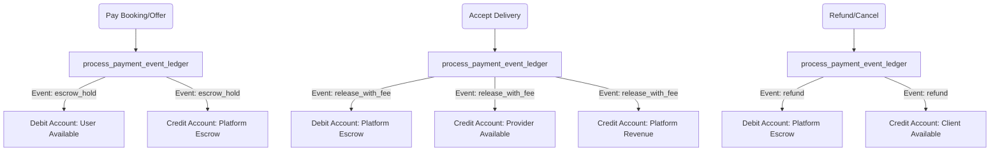

# Ledger Event Flow — Diagram Document

This document satisfies the **diagram document standard**. It includes:

- **Diagram Title + Version** — Name, version, date, owner
- **Purpose** — What it shows; what problem it solves
- **Scope** — Included / excluded
- **Assumptions** — e.g. payments via webhook, escrow append-only
- **Glossary** — Entity names, status names, money events, abbreviations
- **Legend** — Nodes, arrows, colours, guards
- **Actors and Responsibilities** — Who may do what; forbidden actions
- **System Components** — App entry points, services, DB objects
- **Step-by-step Flow** — Happy path + main failure paths
- **State Machine Explanation** — States and allowed/forbidden transitions
- **Invariants** — Must-always-be-true rules
- **Guards & Validation Rules** — Where each guard runs; source of truth
- **Failure Modes** — What can go wrong and system behaviour
- **Security & Abuse Scenarios** — How the diagram prevents abuse
- **Data Model Mapping** — Diagram “things” to DB fields
- **Observability & Forensics** — Logs, audit, admin views
- **Verification Checklist** — Unit, integration, RLS, concurrency tests
- **Dependencies** — What this depends on; what depends on this
- **Open Questions / Missing Evidence** — Unverified assumptions; TODOs
- **Final Status** — Verdict, production ready?, next actions

---

## Diagram Title + Version

- **Diagram name (exact):** Ledger Event Flow
- **Version:** v2 (Final / Implemented)
- **Date:** 2026-03-08
- **Owner/author:** Backend + Mobile; @APIContract; SlineDocs

---

## Purpose

- **What this diagram is showing, in one paragraph.**  
  It shows how a single user or system action (pay booking, approve delivery, refund, withdraw) triggers the **single** ledger engine RPC `process_payment_event_ledger`, which performs gate checks, creates one journal entry, and posts double-entry ledger lines so that every transaction balances (sum of debits = sum of credits). App-side idempotency key generation and forensics (session_id, request_id) are shown as the client-side prelude to the RPC.

- **What problem it solves (why it exists).**  
  Financial integrity and auditability: SLine uses an immutable double-entry ledger instead of updating a single balance column. The diagram traces how money moves from User Available → Platform Escrow, then (on approval) from Escrow → Provider Available + Platform Revenue, and how refunds and withdrawals are handled, with one source of truth (the RPC) and no direct app writes to ledger tables.

---

## Scope

- **What’s included (features/entities covered).**
  - Event types: `escrow_hold`, `release_with_fee`, `refund`, `withdrawal_request`, `deposit`, `withdrawal_complete`, `withdrawal_failed`, `gateway_escrow`.
  - Entity types: `booking`, `task_request`, `withdrawal_request`, `direct_offer`.
  - App entry points: Pay Booking/Offer, Accept Delivery (approve), Refund/Cancel, Withdraw Funds, QiCard webhook (gateway_escrow).
  - Ledger engine: `process_payment_event_ledger` RPC; tables `accounts`, `journal_entries`, `ledger_lines`; views `vw_wallet_balances_user`, `vw_wallet_activity_user`.
  - App forensics: `lib/core/utils/ledger_forensics.dart`, `LedgerService`, idempotency key (UUIDv5).

- **What’s explicitly excluded (out of scope).**
  - `admin_adjustment` event type (enum exists; RPC branch not implemented; no app or authenticated user may call it until a dedicated migration and contract).
  - Direct INSERT into `ledger_lines` or `journal_entries` by the app (forbidden by RLS).
  - Legacy `wallet_transactions` table (frozen; read-only).
  - Payment gateway UI flows (QiCard screens); only the fact that webhook/edge function can call the ledger is in scope.

---

## Assumptions

- All ledger writes go through `process_payment_event_ledger`; no other path creates journal entries or ledger lines for app users.
- Payments are finalised via gateway (e.g. QiCard) and/or webhook; the app or edge function then calls the RPC with the appropriate event type.
- Escrow is append-only: we add ledger lines; we do not update or delete them (voids handled by status, not line deletion).
- Idempotency key is deterministic (UUIDv5 from entity_id + event_type) so retries produce the same key and do not duplicate entries.
- Withdrawal is two-phase: (1) insert `withdrawal_requests` row, (2) call RPC with `withdrawal_request`; if RPC fails, app marks request as `failed`.
- Currency is IQD for MVP; RPC enforces `p_currency = 'IQD'`.
- Forensics (`session_id`, `request_id`) are injected by the app into `p_meta` for every call; RPC stores them in `journal_entries.meta`.

---

## Glossary (Human-Readable)

- **Entity names:**
  - **booking** — A pay-first booking (client pays, funds held in escrow until delivery approved).
  - **task_request** — A tender offer (task request) that can be awarded and paid; escrow holds payment until release.
  - **direct_offer** — A direct chat offer (create → accept → pay → deliver → approve); same escrow/release pattern as booking.
  - **withdrawal_request** — A user’s request to withdraw available balance; two-phase (row + ledger event).

- **Status names (entity-level, not ledger):**
  - **active / in_progress** — Work in progress.
  - **delivered** — Provider marked delivery; client can approve.
  - **completed** — Delivery approved; escrow released.
  - **disputed / refunded** — Dispute path or refund; escrow debited, client credited.
  - **held / released / unpaid** — Payment status on booking/direct_offer/task_request (e.g. `payment_status = 'held'` → funds in escrow).

- **Money events (payment_event_type_enum):**
  - **escrow_hold** — Move funds from user available to platform escrow (pay booking/offer).
  - **release_with_fee** — Move from escrow to provider available + platform revenue (approve delivery).
  - **refund** — Move from escrow back to client available.
  - **withdrawal_request** — Move from user available to user pending withdrawal.
  - **deposit / withdrawal_complete / withdrawal_failed** — Deposit or withdrawal lifecycle (bank/gateway side).
  - **gateway_escrow** — Gateway (e.g. QiCard) confirmed payment; escrow hold recorded by edge function.

- **Abbreviations:**
  - **RPC** — Remote procedure call (Supabase Postgres function).
  - **RLS** — Row-Level Security (Postgres policies).
  - **DR** — Debit; **CR** — Credit.
  - **Idempotency** — Same key + same event produces at most one journal entry (replay safe).
  - **p_meta** — JSONB parameter passed to the RPC and stored in `journal_entries.meta` (forensics, fee info, etc.).

---

## Legend (What Each Symbol Means)

- **Nodes/shapes:**
  - **Rounded rectangle** — Process or step (e.g. “Generate Idempotency Key”, “process_payment_event_ledger”).
  - **Diamond** — Decision / gate (e.g. “Gate Validation”, “Auth/RLS Check”, “Double-Entry Check”).
  - **Subgraph “TriggerSources”** — App or webhook actions that start the flow.
  - **Subgraph “ClientLogic”** — Client-side logic (idempotency key, forensics merge).
  - **Subgraph “Engine”** — Ledger RPC and internal steps.
  - **Subgraph “Accounts”** — Ledger account types (User Available, Platform Escrow, Platform Revenue, Provider Available, Pending Withdrawal).

- **Arrows:**
  - **Solid arrow (→)** — Synchronous call or sequential step (e.g. App → Idem → RPC).
  - **Dashed (-.->)** — Logical flow into double-entry balance check (DR/CR lines contributing to balance).
  - **Labels on arrows** — Event type (e.g. `escrow_hold`, `release_with_fee`) or outcome (Success / Fail).

- **Colours/labels:**
  - **DR** — Debit. **CR** — Credit.
  - **Gate / Auth** — Validation steps that must pass before creating a journal entry.

- **Guards:**
  - Conditions (e.g. “Status? Balance?”) are evaluated inside the RPC; failure returns `ok: false` with an ERR_* code. Transitions (e.g. from “held” to “released”) are enforced by the RPC and entity updates, not by a separate drawn state machine in this diagram.

---

## Actors and Responsibilities

| Actor | Allowed | Forbidden |
|-------|--------|-----------|
| **Client** | Pay booking/offer (triggers escrow_hold); approve delivery (triggers release_with_fee via app); request refund/cancel (triggers refund). | Direct INSERT into `journal_entries` / `ledger_lines`; calling RPC with another user’s entity; approving delivery for a booking/offer they do not own. |
| **Freelancer / Provider** | Receive released funds (result of release_with_fee); request withdrawal (triggers withdrawal_request). | Releasing escrow (only client can approve delivery); direct ledger writes. |
| **Admin** | Not an actor in this flow. `admin_adjustment` is out of scope. | Calling RPC with `admin_adjustment` from the app. |
| **System / Cron** | N/A for this diagram (withdrawal completion may be backend later). | — |
| **Payment Gateway (QiCard) / Edge function** | Webhook or recovery flow calls RPC with `gateway_escrow` or `escrow_hold` (service role or server-side). | Client cannot spoof gateway; only server-side code may use gateway_escrow with validated payment. |

---

## System Components (Where It Lives)

- **App entry points (screens/actions):**
  - Wallet Balance UI (reads only; triggers no ledger write).
  - Checkout / Pay Booking or Pay Offer (booking, direct_offer, task_request).
  - Approve Delivery (booking or direct_offer) — e.g. work item details, review delivery modal.
  - Refund/Cancel flows (booking/direct_offer).
  - Withdraw Funds (wallet).

- **Service layer / ViewModel / Repository (file paths):**
  - `lib/core/utils/ledger_forensics.dart` — Builds `session_id` and `request_id` for `p_meta`.
  - `lib/features/wallet/services/ledger_service.dart` — Generates idempotency key, merges forensics, calls `process_payment_event_ledger`.
  - `lib/features/wallet/services/wallet_service.dart` — Reads balance (vw_wallet_balances_user); may call LedgerService for withdrawal_request.
  - `lib/features/booking/services/booking_service.dart` — Calls LedgerService for escrow_hold (and related flows).
  - `lib/features/tasks/services/task_service.dart` — Calls LedgerService for task_request escrow/release.
  - `lib/features/direct_offers/services/direct_offers_service.dart` — Uses LedgerService; release is via `rpc_approve_delivery` (single exit), not direct LedgerService for release_with_fee.
  - ViewModels: e.g. wallet, booking, work item details — trigger service methods; no direct Supabase RPC.

- **Database objects:**
  - **Tables:** `accounts`, `journal_entries`, `ledger_lines`; `withdrawal_requests`; `bookings`, `task_requests`, `direct_offers` (entities).
  - **Views:** `vw_wallet_balances_user`, `vw_wallet_activity_user`.
  - **RPC:** `process_payment_event_ledger`; `rpc_approve_delivery` (approve delivery for booking/direct_offer, which internally calls ledger).
  - **Triggers:** None on ledger tables that create lines; RPC is the only writer.
  - **Policies (RLS):** Authenticated users cannot INSERT into `ledger_lines` or `journal_entries`; read access for balances/activity is user-scoped.

---

## Step-by-Step Flow (“Human Story”)

**Happy path (e.g. Pay Booking → Approve Delivery):**

1. **Trigger:** Client taps “Pay” on a booking (or completes QiCard flow).
2. **Validation (app):** Amount, entity state; then LedgerService generates idempotency key (UUIDv5) and merges forensics (session_id, request_id) into `p_meta`.
3. **Call RPC:** `process_payment_event_ledger('escrow_hold', 'booking', booking_id, idempotency_key, amount, 'IQD', p_meta)`.
4. **RPC:** Gate checks (entity exists, status/payment_status allow escrow_hold); auth/RLS; create one journal entry; post ledger lines (DR user_available, CR platform_escrow); double-entry check (sum = 0); commit.
5. **Final state:** Client sees “Paid”; provider sees “Held”. Balance view shows escrow increased.

**Approve delivery (release):**

1. **Trigger:** Client taps “Approve delivery” (e.g. in work item details / review modal).
2. **App** calls `rpc_approve_delivery(entity_type, entity_id)` (booking or direct_offer).
3. **RPC:** Locks entity row (FOR UPDATE); validates client; stable idempotency key; calls `process_payment_event_ledger('release_with_fee', ...)`; updates entity status/payment_status.
4. **Ledger:** DR platform_escrow; CR provider available; CR platform_revenue (if fee > 0).
5. **Final state:** Provider available balance increases; client sees “Completed”.

**Most common failure paths:**

- **Insufficient funds:** RPC returns `ERR_INSUFFICIENT_FUNDS`; app shows user-friendly message; no journal entry.
- **Wrong status (gate):** RPC returns `ERR_GATE_NOT_ALLOWED`; app shows “Event not allowed for current status.”
- **Idempotency replay:** Same key sent again; RPC returns success (same journal) or ERR_IDEMPOTENCY_REPLAY; app treats as “already processed”.
- **Withdrawal RPC fails:** App marks `withdrawal_requests` row as `failed`; user can retry; orphan runbook exists for stuck `requested` rows.

---

## State Machine Explanation (If States Exist)

- **Ledger entries do not have a state machine** in the sense of status transitions; each journal entry is “posted” and immutable.
- **Entity states** (booking, direct_offer, task_request) drive **which event types** the RPC allows (e.g. only “held” can be released).
- **Allowed transitions (conceptual):**
  - unpaid → held (escrow_hold / gateway_escrow).
  - held → released (release_with_fee after approve delivery).
  - held → refunded (refund).
- **Forbidden:** Releasing when not held; holding twice for the same entity without a new payment; direct INSERT into ledger tables by app.

---

## Invariants (Must-Always-Be-True Rules)

- Every journal entry has ledger lines that sum to zero (debits = credits).
- No duplicate journal entry for the same (entity_id, event_type) idempotency key (enforced by unique constraint / RPC logic).
- Escrow release happens only once per entity (idempotent approve delivery; stable key + FOR UPDATE).
- User can only see balance and ledger data for their own accounts (RLS on views/tables).
- Ledger lines have `amount > 0` (constraint `ck_ledger_lines_amount_positive`).
- All app-originated RPC calls include forensics (session_id, and request_id) in `p_meta` for audit.

---

## Guards & Validation Rules

| Guard | Where it runs | Source of truth |
|-------|----------------|-----------------|
| Entity exists | RPC | DB |
| Entity status / payment_status allows event (e.g. held for release_with_fee) | RPC | DB |
| Sufficient available balance for escrow_hold / withdrawal_request | RPC | DB |
| Idempotency key present and unique (or replay) | RPC | DB |
| Currency = IQD | RPC | DB |
| Amount > 0, valid withdrawal amount | RPC | DB |
| Client is owner of booking/direct_offer for approve delivery | RPC (rpc_approve_delivery) | DB |
| No direct INSERT into ledger_lines / journal_entries by app | RLS | DB |

---

## Failure Modes (What Can Go Wrong)

| Failure | System behaviour |
|---------|------------------|
| App crash mid-step | No journal entry if RPC not called; retry uses same idempotency key (safe). |
| Duplicate webhook delivery | Same idempotency key or gateway id; RPC returns replay/success once. |
| Retry causing duplicates | Idempotency key (UUIDv5) identical; RPC deduplicates. |
| Race (two users act at once) | Approve delivery uses FOR UPDATE on entity row; only one release. |
| Missing metadata (forensics) | App injects session_id/request_id in LedgerService; optional request_id for correlation. |
| Timeout / TTL expiry | User retries; idempotency prevents double post. Withdrawal orphan runbook for stuck “requested” rows. |

---

## Security & Abuse Scenarios

- **Spoofing identities:** RPC runs in DB with `auth.uid()`; RLS and RPC checks ensure user only affects own accounts or entities they own (e.g. client for approve delivery).
- **Unauthorised state changes:** Gate checks in RPC allow only valid status transitions; no app-side override.
- **Paying without owning the entity:** Entity ownership and payment_status are checked in RPC.
- **Escrow trapped forever:** Approve delivery and refund paths are implemented; runbook for orphan withdrawals.
- **User seeing another user’s data:** `vw_wallet_balances_user` and activity views are RLS-filtered by `auth.uid()`.

---

## Data Model Mapping

- **Journal entry “posted”** — `journal_entries.status = 'posted'`; one row per event.
- **Debit/Credit** — `ledger_lines.direction` ('DEBIT'/'CREDIT'), `ledger_lines.amount` > 0.
- **Account types** — `accounts.account_code` e.g. `user_available:uuid`, `platform_escrow`, `platform_revenue`, `user_pending_withdrawal:uuid`.
- **Forensics** — `journal_entries.meta->>'session_id'`, `meta->>'request_id'`.
- **Idempotency** — `journal_entries.idempotency_key` unique; LedgerService uses UUIDv5(entity_id, event_type).
- **Required:** Unique on (idempotency_key); check constraint that ledger lines per journal sum to zero (or equivalent in RPC); RLS blocking INSERT on ledger_lines/journal_entries for authenticated role.

---

## Observability & Forensics

- **Logs:** AppLogger in LedgerService (tag `LedgerService`): start (event type, entity type, entity id, request_id); success; error (with request_id when present). No full `p_meta` or PII in logs.
- **Audit:** `journal_entries.meta` stores session_id and request_id; support can correlate with auth user and log lines.
- **Admin:** Unbalanced journal query and “forensics sample” query in SMOKE_CHECKLIST_AND_RUNBOOK; orphan withdrawal query for withdrawal_requests in `requested` with no matching journal entry.
- **Orphan event:** Withdrawal requests stuck in `requested` with no journal — see runbook; mark `failed` and log.

---

## Verification Checklist

- **Unit tests:** `LedgerService.generateIdempotencyKey` (deterministic); `WalletService.getWalletBalance` (e.g. null user → zero). Paths: `test/unit/wallet/ledger_service_test.dart`, `wallet_service_test.dart`.
- **RLS tests:** `assertCannotInsert` for `ledger_lines` and `journal_entries`. Path: `test/rls/ledger_rls_test.dart`.
- **Integration/DB:** Double-entry balance check (sum = 0 per journal); idempotency replay; insufficient funds. See `04_TEST_PLAN.md` and smoke checklist.
- **Concurrency:** Approve delivery uses FOR UPDATE; idempotency key prevents duplicate ledger posts on retry.

---

## Dependencies

- **Depends on:** Ledger schema (accounts, journal_entries, ledger_lines), `process_payment_event_ledger`, `payment_event_type_enum`; booking/direct_offer/task_request entity lifecycles and status enums; RLS on ledger tables and wallet views.
- **Depended on by:** Diagram 16 (Escrow invariants / idempotency), Diagram 21 (Wallet / Escrow / Available balances), booking lifecycle, developer guide “Finance & Payment Ledger”, Wallet_Feature.md.
- **Ordering:** Ledger schema and RPC must be in place before app uses LedgerService; approve delivery (rpc_approve_delivery) must use stable idempotency and FOR UPDATE (diagram 16).

---

## Open Questions / Missing Evidence

- None for current scope. admin_adjustment and migration path for it are explicitly out of scope.
- Optional: formal concurrency test (two clients approve same delivery at once) in CI.

---

## Final Status

- **Verdict:** PASS (Implemented)
- **Production ready?** YES, with conditions: (1) Withdrawal is two-phase; orphan runbook must be used if cleanup fails. (2) No admin_adjustment from app. (3) All ledger writes via RPC; RLS and tests confirm no direct INSERT.
- **Next actions:** Run smoke checklist before release; run unit + RLS tests (`flutter test test/unit/wallet/ test/rls/ledger_rls_test.dart`); optional: add ledger_event metrics later if product needs dashboards.

---

# OLD Diagram (Pre-2026-03-07)

Kept for reference. Replaced by the Implemented diagram below.

- **Version:** v1
- **Last verified:** 2026-03-05

**What it showed:** Simple flow from three triggers to the RPC and then to DR/CR accounts. No forensics, no idempotency key, no withdrawal, no gateway_escrow, no gate/auth nodes.



---

# Implemented Diagram (v2 Final) — 2026-03-08

**Diagram name (exact):** Ledger Event Flow (Implemented)  
**Version:** v2 (Final)  
**Date:** 2026-03-08

This diagram reflects the improvements from the 09_ledger-event-flow work: idempotency key (UUIDv5), forensics (session_id, request_id), gate validation, auth/RLS, withdrawal and gateway triggers, and double-entry check with commit/rollback.

```mermaid
flowchart TD
    subgraph TriggerSources [Triggers & Actions]
        T1(App: Pay Booking)
        T2(App: Accept Delivery)
        T3(App: Refund/Cancel)
        T4(App: Withdraw Funds)
        T5(Webhook: QiCard Paid)
    end

    subgraph ClientLogic [Client-Side Logic]
        Idem[Generate Idempotency Key\nUUIDv5(entity + type)]
        Forensics[Merge Forensics\nsession_id + request_id]
    end

    subgraph Engine [Ledger Engine (RPC)]
        direction TB
        RPC[process_payment_event_ledger]
        Gate{Gate Validation\nStatus? Balance?}
        Auth{Auth/RLS Check}
        Journal[Create Journal Entry]
        Balance[Double-Entry Check\nSum == 0]
    end

    subgraph Accounts [Ledger Accounts]
        UA[User: Available]
        PE[Platform: Escrow]
        PR[Platform: Revenue]
        PA[Provider: Available]
        PW[User: Pending Withdrawal]
    end

    T1 & T5 --> Idem
    Idem --> Forensics --> RPC
    RPC --> Auth --> Gate --> Journal
    Journal -->|escrow_hold| UA -. DR .-> Balance
    Journal -->|escrow_hold| PE -. CR .-> Balance

    T2 --> Idem
    Journal -->|release_with_fee| PE -. DR .-> Balance
    Journal -->|release_with_fee| PA -. CR .-> Balance
    Journal -->|release_with_fee| PR -. CR (if fee > 0) .-> Balance

    T3 --> Idem
    Journal -->|refund| PE -. DR .-> Balance
    Journal -->|refund| UA -. CR .-> Balance

    T4 --> Idem
    Journal -->|withdrawal_request| UA -. DR .-> Balance
    Journal -->|withdrawal_request| PW -. CR .-> Balance

    Balance -->|Success| Committed[Committed & Notified]
    Balance -->|Fail| Rollback[Transaction Rollback]
```

**References:**

- Contract: `.TODO/improvement_the_system/Done/09_ledger-event-flow/CONTRACT_ledger_event_flow.md`
- Risk register: `.TODO/improvement_the_system/Done/09_ledger-event-flow/03_RISK_REGISTER.md`
- Smoke & runbook: `.TODO/improvement_the_system/Done/09_ledger-event-flow/SMOKE_CHECKLIST_AND_RUNBOOK.md`
- Tests: `test/unit/wallet/`, `test/rls/ledger_rls_test.dart`
- Code: `lib/core/utils/ledger_forensics.dart`, `lib/features/wallet/services/ledger_service.dart`
