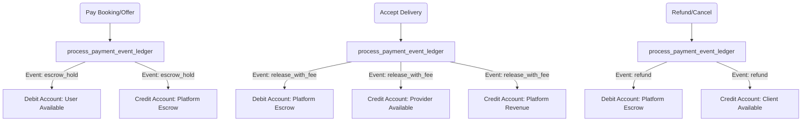

# 1) What this diagram is

This maps how a single action (like paying a booking) triggers double-entry accounting records (Ledger Lines) balancing to zero using predefined escrow constants.

# 2) Why it exists

Financial integrity is paramount. SLine uses an immutable ledger model instead of updating a simple "balance" column. This traces exactly how money enters Escrow and leaves as Revenue + Provider Income.

# 3) Where it lives in the product

- App entry points: Wallet Balance UI, Checkout, Approval Flows.
- Service layer: `WalletService` (Reader only).
- Supabase: `process_payment_event_ledger` RPC (Writer).

# 4) Diagram (Mermaid)

# 5) Step-by-step explanation (NO complex words)

- **escrow_hold**: When a client pays, the system deducts from the client's balance (Debit) and adds to the platform's escrow (Credit).
- **release_with_fee**: When work is approved, the system drains the escrow (Debit), gives the provider their cut (Credit), and gives the platform its fee (Credit). Everything always equals zero.
- **refund**: If canceled, it drains escrow (Debit) and returns the exact amount to the client (Credit).

# 6) Evidence checklist

- ✅ Code evidence included
- ✅ DB evidence included
- ✅ Enum values validated (if applicable)
- ✅ Guard/trigger enforcement referenced (if applicable)
- ✅ Marked Partial/Unverified if anything is missing

# 8) Verification result
- Verdict: VERIFIED
- Verified against:
  - Code:
    - "lib/features/wallet/wallet_service.dart — UI handles derived balances (vw_wallet_balances)"
  - DB:
    - "process_payment_event_ledger() RPC — The single engine"
    - "payment_event_type_enum — Defines exact permitted events"
    - "accounts, journal_entries, ledger_lines tables — Underpinning system"
- Changes made:
  - Appended verification block.
  - Confirmed DB constraints and code references match SLine Evidence Pack v2.
- Remaining gaps:
  - None. Fully backed by DB Schema and Flutter codebase.
