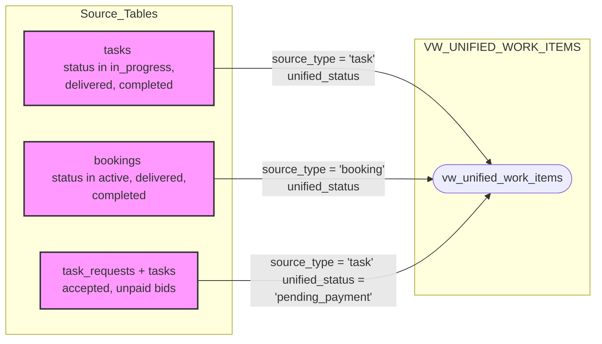
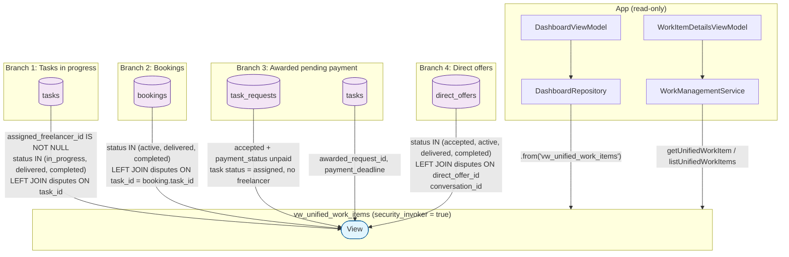

# Unified Work View

---

## What every diagram document must include (bullet checklist)

- [x] Diagram Title + Version
- [x] Diagram name (exact)
- [x] Version (v1/v2/final) + date
- [x] Owner/author (team or role)
- [x] Purpose
- [x] What this diagram is showing, in one paragraph
- [x] What problem it solves (why it exists)
- [x] Scope (included / excluded)
- [x] Assumptions
- [x] Glossary (human-readable)
- [x] Legend (symbols, arrows, colours, guards)
- [x] Actors and Responsibilities
- [x] System Components (Where it lives)
- [x] Step-by-step Flow ("Human Story")
- [x] State Machine Explanation (if states exist)
- [x] Invariants (Must-always-be-true rules)
- [x] Guards & Validation Rules
- [x] Failure Modes (What can go wrong)
- [x] Security & Abuse Scenarios
- [x] Data Model Mapping
- [x] Observability & Forensics
- [x] Verification Checklist
- [x] Dependencies
- [x] Open Questions / Missing Evidence
- [x] Final Status

---

## Diagram identity

| Field | Value |
|-------|--------|
| **Diagram name (exact)** | Unified Work View |
| **Version** | v2 (final) |
| **Date** | 2026-03-08 |
| **Owner/author** | Backend + App (SlineDocs / Plan 12) |
| **Plan / contract** | `.TODO/PLAN_UnifiedWorkView_2026-03-08_CRITIC.md`, `.TODO/contract_vw_unified_work_items.md` |

---

## Purpose

**What this diagram is showing, in one paragraph:**  
A single Postgres view (`vw_unified_work_items`) unions four kinds of work—tasks in progress, bookings, awarded tasks pending payment, and direct offers—into one normalized row set. The Flutter app reads only from this view for the Work list (dashboard) and Work detail; there are no fallback mappers. Disputes are joined per branch; when an open/active dispute exists, `unified_status` is overridden to `disputed`. The view runs with `security_invoker = true` so RLS on the underlying tables restricts rows to the current user as client or freelancer.

**What problem it solves (why it exists):**  
The app needs one "My Work" feed and one detail path. Without a unified view, the app would query tasks, bookings, task_requests, and direct_offers separately and merge in code, with duplicated logic and risk of inconsistency. The view centralizes status normalization, dispute override, and column shape so the UI has a single contract.

---

## Scope

- **Included:** View definition (four branches); columns and types; dispute JOIN and `unified_status = 'disputed'` rule; app entry points (dashboard Work tab, work detail screen); `WorkManagementService`, `DashboardRepository`, `WorkItemDetailsViewModel`; RLS and `security_invoker`; direct_offer `conversation_id` for deep link.
- **Excluded:** How tasks/bookings/direct_offers are created or how disputes are submitted (see diagrams 14, 14a, 19); payment flow for awarded pending (see tender/payment diagrams); delivery/approval/revision RPCs (see work contract diagrams).

---

## Assumptions

- Payments for awarded offers are finalized only via webhook/ledger RPC; the view only reflects `task_requests.payment_status` and task `status`/`assigned_freelancer_id`.
- Escrow and ledger are append-only / idempotent per their contracts; the view does not write.
- `disputes.status` is `dispute_status_enum` ('open','active','resolved','canceled'); "open dispute" means `status IN ('open','active')`.
- The app never writes to `vw_unified_work_items`; it is read-only. All mutations go through RPCs on underlying tables.
- Work list and detail have no fallback when the view returns no row; the app shows "Work item not found".

---

## Glossary (human-readable)

| Term | Meaning |
|------|--------|
| **booking** | A confirmed booking (slot or slotless) for a booking task; has its own lifecycle (active, delivered, completed). |
| **task** | A tender task or booking task; can be in progress (assigned freelancer) or awarded but unpaid. |
| **task_request** | A freelancer’s bid on a task; when accepted and unpaid, the task appears in branch 3 (awarded pending payment). |
| **direct_offer** | An offer created in chat (direct_offers table); statuses accepted, active, delivered, completed. |
| **dispute** | A reported issue linked to a task (task_id) or direct_offer (direct_offer_id); status open, active, resolved, or canceled. |
| **unified_status** | Normalized status from the view: active, delivered, completed, pending_payment, disputed, canceled, request_pending, paid_request_pending, etc. |
| **source_type** | Which branch the row came from: `task`, `booking`, or `direct_offer`. |
| **work_item_id** | Composite key string: `task:<uuid>`, `booking:<uuid>`, or `direct_offer:<uuid>` for navigation. |
| **conversation_id** | Set only for direct_offer rows; used to open the correct chat from Work. |
| **RLS** | Row-Level Security; Postgres policies that restrict SELECT/INSERT/UPDATE/DELETE by user. |
| **security_invoker** | View option so the view runs with the permissions of the querying user; RLS on base tables applies. |
| **idempotency** | Operation safe to retry; same outcome (e.g. escrow release once per entity). |

---

## Legend

- **Nodes:**  
  - **Rounded rectangle** = Postgres view or logical “bucket” of rows.  
  - **Table shape** = Base table (tasks, bookings, task_requests, direct_offers, disputes).  
  - **Actor** = User role (Client, Freelancer).
- **Arrows:**  
  - **Solid →** = Data flow into the view (UNION ALL branch).  
  - **Dashed →** = App reads from view (sync query).
- **Guards:**  
  - Conditions (e.g. `status IN (...)`) are written next to the branch; dispute override is “if linked dispute with status IN ('open','active') then unified_status := 'disputed'”.

---

## OLD diagram (pre–Plan 12, 3 branches + awarded pending)

*Kept for history. Before 2026-03-08 the view had no direct_offers branch and the app used fallback mappers when the view had no row.*

### OLD — What it showed

Entity Relationship mapping of work (Tenders, Bookings, Awarded Unpaid) into one Work Feed via `vw_unified_work_items`. No direct_offers branch; no `conversation_id`.

### OLD — Where it lived

- App: Home Feed, My Work Dashboard; `WorkManagementService`.
- DB: `vw_unified_work_items` (3 branches + awarded pending).

### OLD — Diagram (Mermaid)

- Tables → View: `tasks`, `bookings`, and `task_requests` (unpaid accepted) merged with UNION ALL.
- Normalization: same column shape (`unified_status`) for the Flutter `UnifiedWorkItem` model.

### OLD — Verification (at time of writing)

- Verdict: VERIFIED for 3 branches + awarded pending.
- Remaining gaps (later addressed in Plan 12): No direct_offers; app had fallback mappers; disputed condition later tightened to enum `IN ('open','active')`.

---

## NEW / Implemented diagram (v2, 2026-03-08)

Four-branch view including direct_offers; single source of truth in app; no fallback mappers; dispute override via `dispute_status_enum`; `security_invoker = true`.

### What the new diagram shows

One view, four UNION ALL branches, each with optional dispute LEFT JOIN. App reads only this view for list and detail; when the view returns no row for an id/type, the app shows "Work item not found".

### New diagram (Mermaid)

- **Branches 1–4** feed the view; dispute JOIN per branch overrides `unified_status` to `disputed` when `d.status IN ('open','active')`.
- **App** queries the view only; no fallback mappers.

### Data flow (high level)

1. User opens Dashboard → Work tab (or Work detail by id/type).
2. App calls `DashboardRepository.fetchWorkItems(role)` or `WorkManagementService.getUnifiedWorkItem(id, type)`.
3. Repository/Service queries `vw_unified_work_items` filtered by `client_id` or `freelancer_id` (from session / role).
4. View runs with invoker’s identity; RLS on `tasks`, `bookings`, `task_requests`, `direct_offers` limits rows.
5. Rows mapped to `UnifiedWorkItemModel` / `WorkItem`; UI shows list or detail. If no row, app shows "Work item not found".

---

## Actors and responsibilities

| Actor | Allowed | Forbidden |
|-------|--------|-----------|
| **Client** | See rows where `client_id = auth.uid()`; open list and detail; act via RPCs (approve, pay, dispute) on entities they own. | See other clients’ work; change view definition; write to the view. |
| **Freelancer** | See rows where `freelancer_id = auth.uid()`; open list and detail; act via RPCs on entities they are assigned to. | See other freelancers’ work; change view; write to the view. |
| **System / Cron** | Not a direct actor for this view; ledger/cron act on base tables. | N/A. |
| **Admin** | No special role in this view; admin uses other views/tables. | N/A. |

---

## System components (where it lives)

- **App entry points:** Dashboard (Work tab), Work detail screen (by `work_item_id` or id + type). Navigation from notifications or deep link into a work item.
- **Service / ViewModel / Repository:**
  - `lib/features/work/services/work_management_service.dart` — `getUnifiedWorkItem`, `listUnifiedWorkItems` (view only).
  - `lib/features/dashboard/data/dashboard_repository.dart` — `fetchWorkItems(role)` (single view query); `_mapUnifiedToWorkItem` (task, booking, direct_offer, conversation_id).
  - `lib/features/work/viewmodels/work_item_details_view_model.dart` — `loadData` uses `_workService.getUnifiedWorkItem(id, type)`; no fallback; on null, sets error "Work item not found".
  - `lib/features/dashboard/viewmodels/dashboard_view_model.dart` — calls `_repository.fetchWorkItems(_currentRole)` for Work tab.
- **Database:**
  - **View:** `public.vw_unified_work_items` (four branches, dispute override, `security_invoker = true`). Migration: `20260308110000_upgrade_unified_work_view.sql`; rollback: `20260308100000_rollback_unified_work_view.sql`. Recreated in `20260308150000` (enum-safe disputed), `20260308190000` (disputed only for open/active).
  - **Tables:** `tasks`, `bookings`, `task_requests`, `direct_offers`, `disputes`.
  - **RPCs:** None for reading the view; mutations use existing RPCs on tasks/bookings/direct_offers/disputes.
  - **Triggers:** None on the view; triggers on base tables only.
  - **Policies (RLS):** RLS on `tasks`, `bookings`, `task_requests`, `direct_offers`; view uses `security_invoker = true` so these apply when the app queries the view.

---

## Step-by-step flow ("human story")

### Happy path — Work list

1. User (client or freelancer) opens app and goes to Dashboard → Work tab.
2. `DashboardViewModel` calls `DashboardRepository.fetchWorkItems(role)`.
3. Repository builds one query to `vw_unified_work_items` with `.eq('client_id', uid)` or `.eq('freelancer_id', uid)`, orders by `deadline`.
4. Supabase returns rows; RLS has already filtered by auth.
5. Repository maps each row to `WorkItem` (including `WorkItemType.directOffer` and `conversationId` when `source_type == 'direct_offer'`).
6. User sees a single list of tasks, bookings, awarded-pending, and direct offers.

### Happy path — Work detail

1. User taps an item (e.g. direct offer); app has `id` and `type` (or `work_item_id`).
2. `WorkItemDetailsViewModel.loadData()` calls `WorkManagementService.getUnifiedWorkItem(id, type)`.
3. Service queries `vw_unified_work_items` with `.eq('id', id)` (and optional type filter).
4. If one row returns, service maps to `UnifiedWorkItemModel`; ViewModel stores it and loads booking/contract/extensions in parallel as needed.
5. User sees detail screen; for direct offer, "Message" or "Open chat" uses `conversation_id`.

### Most common failure path — Not found

1. User opens a link to a work item that was removed, or to an id they are not allowed to see.
2. `getUnifiedWorkItem(id, type)` returns no row (view returns empty).
3. ViewModel sets `_error = 'Work item not found'` and logs (tag `WorkDetails`); no fallback.
4. User sees "Work item not found" (no wrong data, no booking fallback).

---

## State machine explanation

- **View does not own state;** it reflects state from base tables. Relevant states:
  - **Task:** assigned, in_progress, delivered, completed; or assigned with no freelancer (awarded pending payment).
  - **Booking:** active, delivered, completed.
  - **Direct offer:** accepted, active, delivered, completed.
  - **Dispute:** open, active, resolved, canceled (when open/active, view overrides `unified_status` to `disputed`).
- **Transitions** are defined in diagrams for tasks, bookings, direct offers, and disputes; this diagram only consumes them for read.
- **Forbidden:** App must not transition state by writing to the view; all transitions go through RPCs on base tables.

---

## Invariants (must-always-be-true rules)

- A row in the view corresponds to exactly one source row (one task, one booking, one task for awarded branch, one direct_offer); `id` is the PK of that source row.
- `work_item_id` is unique per row and of the form `task:<uuid>`, `booking:<uuid>`, or `direct_offer:<uuid>`.
- `conversation_id` is non-null only when `source_type = 'direct_offer'`.
- User can only see rows where they are participant: `client_id = auth.uid()` OR `freelancer_id = auth.uid()` (enforced by RLS on base tables and `security_invoker`).
- `unified_status = 'disputed'` only when a linked dispute has `status IN ('open','active')` (enum; no 'closed').
- The view is read-only; no INSERT/UPDATE/DELETE on the view.

---

## Guards & validation rules

| Guard | Where | Source of truth |
|-------|--------|------------------|
| Row visible to user | RLS on tasks, bookings, task_requests, direct_offers | DB (security_invoker) |
| Branch 1: task in progress | `assigned_freelancer_id IS NOT NULL`, `status IN ('in_progress','delivered','completed')` | View SQL |
| Branch 2: booking active/done | `status IN ('active','delivered','completed')` | View SQL |
| Branch 3: awarded unpaid | Task `status = 'assigned'`, no freelancer; task_request accepted and unpaid | View SQL |
| Branch 4: direct_offer | `status IN ('accepted','active','delivered','completed')` | View SQL |
| Dispute override | `d.id IS NOT NULL AND d.status IN ('open','active')` → `unified_status = 'disputed'` | View SQL |
| Detail "not found" | View returns no row → app shows error, no fallback | App (ViewModel) |

---

## Failure modes (what can go wrong)

| Failure | System behavior |
|---------|-----------------|
| View returns no row for valid id | User sees "Work item not found"; no fallback; logged with tag WorkDetails. |
| RLS blocks row user should see | Same as above; fix RLS or permissions, not app fallback. |
| Duplicate rows for same entity | Should not occur (view is UNION of disjoint branches by id/source). If it does, investigate view definition. |
| Stale view after RPC (e.g. pay, approve) | App refetches list/detail on resume or after action; no client-side merge. |
| App crash mid-step | On next open, app refetches from view; no local "pending write" to the view. |
| Wrong role (client vs freelancer) | Filter uses `client_id` or `freelancer_id`; role must be correct in session/profile. |

---

## Security & abuse scenarios

- **Spoofing identity:** View runs as invoker; RLS uses `auth.uid()`. No way to see another user’s work by tampering with client-only state.
- **Unauthorised state changes:** View is read-only; state changes only via RPCs that enforce ownership and status guards.
- **Paying without owning entity:** Payment RPCs check ownership and status; view only reflects outcome.
- **Escrow trapped forever:** Handled by ledger/approval flows; view only shows status.
- **Seeing another user’s private data:** RLS on base tables restricts rows; view does not add rows, only unions and normalizes.

---

## Data model mapping

| Diagram / UI concept | DB / view |
|----------------------|-----------|
| Work item id | `id` (uuid) = source row PK |
| Type (task / booking / direct offer) | `source_type` |
| Normalized status | `unified_status` |
| "Needs review" (delivered, not yet approved) | `needs_review` (raw from view); UI must combine with role for who can review. |
| Review window | `review_expires_at` |
| Delivered at | `delivered_at` |
| Awarded pending payment | Branch 3: `awarded_request_id`, `payment_deadline` |
| Open chat for direct offer | `conversation_id` (non-null for direct_offer only) |
| Disputed | `unified_status = 'disputed'` when linked dispute `status IN ('open','active')` |

Required: view must have `security_invoker = true`. Indexes on base tables (e.g. tasks(client_id), tasks(assigned_freelancer_id), disputes(task_id), disputes(direct_offer_id)) support RLS and joins; see SUPABASE_SETUP.

---

## Observability & forensics

- **Logs:** `WorkManagementService`: list/detail load success with tag `WorkManagement` (e.g. count); errors logged. `WorkItemDetailsViewModel`: detail load success with tag `WorkDetails`; "view returned no row" with tag `WorkDetails`. `DashboardRepository`: fetch start/success/error.
- **Admin / money story:** This view is for app Work UI only. Admin/money story use other views (e.g. admin direct offer views, ledger, disputes).
- **Orphan / missing row:** If a row is expected but missing, check RLS and branch conditions (status, freelancer_id, payment_status); check dispute join; no app-side fallback to "infer" row.

---

## Verification checklist

- **Unit tests:** `UnifiedWorkItemModel.fromJson` for task, booking, direct_offer, pending_payment, conversation_id (e.g. `test/unit/work/unified_work_item_view_contract_test.dart`, `test/unit/models/unified_work_item_model_test.dart`).
- **Integration:** Dashboard loads work list; work detail loads by id/type; direct offer shows and opens conversation; "not found" when view returns no row.
- **DB:** View definition in migration; RLS on base tables; `security_invoker = true`; dispute condition `d.status IN ('open','active')`.
- **Concurrency:** No write to view; double-fetch is safe; duplicate webhook handled in payment/ledger, not in this view.

---

## Dependencies

- **Depends on:** Task lifecycle, booking lifecycle, direct_offer lifecycle, dispute lifecycle (diagrams 14, 14a, 19); tender payment (awarded branch); RLS on tasks, bookings, task_requests, direct_offers.
- **Depended on by:** Dashboard Work tab, Work detail screen, any feature that lists or opens "my work" by id/type.
- **Ordering:** View upgrade (20260308110000) after direct_offers and dispute schema; app removal of fallbacks in same release (Plan 12).

---

## Open questions / missing evidence

- None for current implementation. Contract and migrations are frozen; disputed condition aligned with `dispute_status_enum` (open/active only).

---

## Final status

| Item | Value |
|------|--------|
| **Verdict** | PASS |
| **Production ready?** | YES. View is 4-branch with security_invoker; app uses single source of truth and shows "not found" when view returns no row; Plan 12 executed and documented. |
| **Next actions** | None for this diagram. Keep in sync with any future view column or branch change and with DEVELOPER_GUIDE / SUPABASE_SETUP §6.4. |
