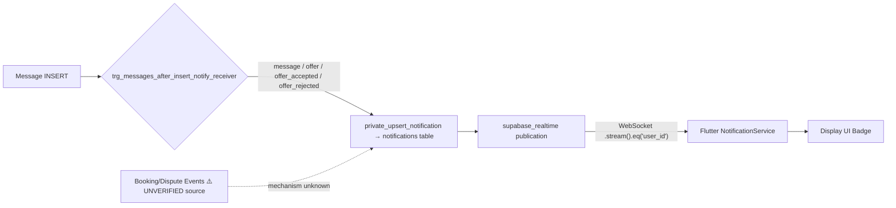

# 1) What this diagram is

Flowchart showing how database changes push notifications to users' phones in realtime.

# 2) Why it exists

Notifications are strictly backend-driven via DB triggers + Realtime, so no client can spoof or miss an event.

# 3) Where it lives in the product

- App entry points: Top Bar Bell Icon, Notification Center.
- Service layer: `notification_service.dart` (`.stream()` subscription).
- Supabase: `AFTER INSERT` trigger on `messages` inserts to `notifications`. Booking/dispute notifications via other mechanisms (unverified).

# 4) Diagram (Mermaid)

# 5) Evidence Table

| Element                                      | Code Evidence                                         | DB Evidence                                                                                 | Verified |
| -------------------------------------------- | ----------------------------------------------------- | ------------------------------------------------------------------------------------------- | -------- |
| Trigger on `messages`                        | N/A                                                   | ✅ `trg_messages_after_insert_notify_receiver` confirmed                                    | Y        |
| Inserts `message`/`offer` type notifications | N/A                                                   | ✅ Full body: `messages_after_insert_notify_receiver()` calls `private_upsert_notification` | Y        |
| Booking paid → notification                  | ❌ No Flutter or DB trigger found                     | ❌ No trigger body inserts booking notifications                                            | N        |
| Dispute update → notification                | ❌ No Flutter or DB trigger found                     | ❌ No trigger found for dispute notifications                                               | N        |
| Flutter `.stream().eq('user_id')`            | ✅ `notification_service.dart` — exact call confirmed | ✅ `notifications_select_own` RLS                                                           | Y        |
| Realtime broadcast                           | N/A                                                   | ✅ supabase_realtime publication exists                                                     | Y        |

# 6) Evidence checklist

- ✅ Message/offer notifications: trigger body confirmed
- ❌ Booking/dispute notifications: NO trigger or Edge Function found
- ✅ Flutter stream subscription: `.stream().eq('user_id', userId).limit(50)` confirmed
- ✅ RLS on notifications: `notifications_select_own`, `notifications_update_own`

# 7) Open questions / Missing evidence

- What triggers notifications for: `Booking Paid`, `Booking Confirmed`, `Dispute Update`, `Bid Accepted`?  
  The `messages_after_insert_notify_receiver` trigger handles **only** `message`, `offer`, `offer_accepted`, `offer_rejected` types.  
  All other notification sources are **UNVERIFIED** — likely handled by backend Edge Functions not in scope of this flutter codebase scan.

# 8) Verification result

- Verdict: **PARTIALLY VERIFIED**
- Date: 2026-03-05
- Verified:
  - DB: `trg_messages_after_insert_notify_receiver` + full `messages_after_insert_notify_receiver()` body
  - Code: `notification_service.dart` `.stream().eq('user_id', userId).limit(50)`
- Unverified:
  - Booking/Dispute notification insert source
- Changes made:
  - Added Evidence Table per element
  - Dotted (`-.->`) unverified edges in Mermaid
  - Added exact trigger body summary to sources
