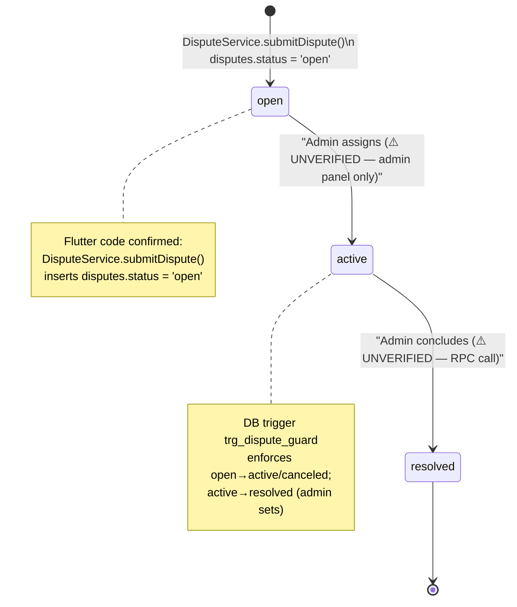
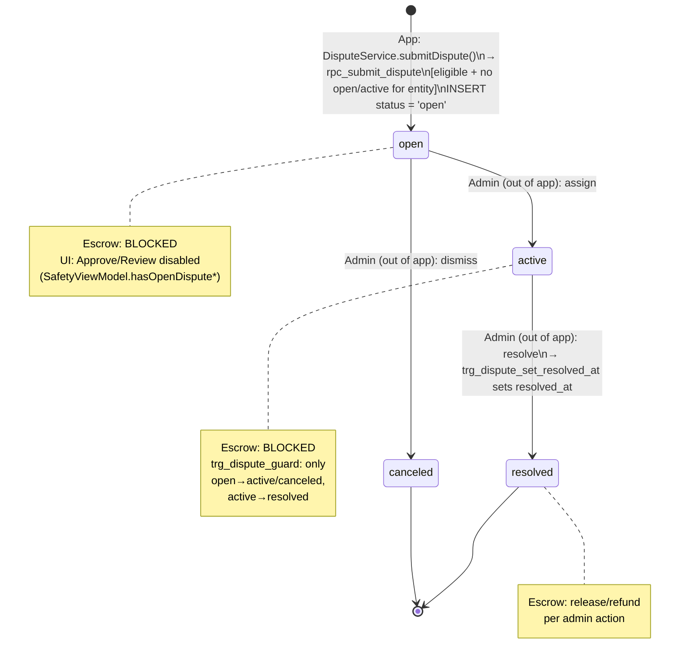

# 14 — Dispute Lifecycle

---

## What every diagram document must include (bullet checklist)

### • Diagram Title + Version

| Field | Value |
|-------|--------|
| **Diagram name (exact)** | 14_dispute-lifecycle |
| **Version** | v2 (implemented) — 2026-03-08 |
| **Owner/author** | SLine architecture / system auditor |
| **Last verified** | 2026-03-08 |

---

### • Purpose

- **What this diagram is showing:** The dispute lifecycle from creation (submit) through states open → active → resolved/canceled, and how it blocks escrow release and gates Approve/Review in the app.
- **What problem it solves:** Disputes prevent trapped escrow and deadlocks; the platform needs a structured lifecycle so escrow is never released while a dispute is open or active, and admins (out-of-app) can resolve via status transitions enforced in the DB.

---

### • Scope

- **What’s included:** Dispute state machine (open, active, resolved, canceled); submit via `rpc_submit_dispute` (task + direct_offer, eligibility + single open/active per entity); escrow guard in `rpc_approve_delivery` and `rpc_finalize_auto_approval`; RLS (deny UPDATE/DELETE on disputes, participant-only on dispute_messages/dispute_evidence); UI gates (Approve/Review disabled when open dispute); `vw_unified_work_items` disputed override; triggers (transition guard, resolved_at).
- **What’s explicitly excluded:** Admin UI to assign/resolve disputes (admin panel only, out of app); split refunds; realtime dispute thread; eligibility for booking-only (handled via task_id); diagram 14a “Frozen” guards on submit_delivery/request_revision (see 14a for proposed).
- **Assumptions:** Payments are finalised only via RPC (release_with_fee); escrow release is blocked when dispute status is open or active; status changes to active/resolved/canceled are done by admin (SECURITY DEFINER or service_role), not by app users; `rpc_finalize_auto_approval` handles task and booking only (no direct_offer in that RPC).

---

### • Glossary (Human-readable)

| Term | Definition |
|------|-------------|
| **booking** | A session linked to a task; has client_id, provider_id, task_id, status (e.g. active, delivered). |
| **task** | A job with status (in_progress, delivered, completed, etc.); can have task_requests and bookings. |
| **direct_offer** | A direct offer from client to freelancer; status (active, delivered, completed), payment_status (held, released). |
| **dispute** | A row in `disputes`: complainant, defendant, reason, status (dispute_status_enum), linked by task_id and/or direct_offer_id. |
| **task_request** | A bid on a task; status accepted + payment_status unpaid → “pending payment” in unified view. |
| **open** | Dispute status: newly submitted; escrow blocked. |
| **active** | Dispute status: admin has accepted/assigned; escrow still blocked. |
| **resolved** | Dispute status: admin concluded; resolved_at set; escrow can be released/refunded per admin action. |
| **canceled** | Dispute status: dismissed without resolution. |
| **delivered** | Entity status: work submitted, awaiting client approval. |
| **completed** | Entity status: work approved and (for paid entities) released. |
| **disputed** | unified_status in vw_unified_work_items when a dispute is open or active for that entity. |
| **escrow_hold** | Funds held for the entity (booking/direct_offer payment_status = held). |
| **release_with_fee** | Ledger event: release escrow to freelancer (and platform fee); triggered by rpc_approve_delivery / completion. |
| **refund** | Ledger event: return funds to client (e.g. admin_refund_direct_offer). |
| **RPC** | Remote procedure call (Postgres function); e.g. rpc_approve_delivery, rpc_finalize_auto_approval, rpc_submit_dispute. |
| **RLS** | Row-Level Security; policies restrict SELECT/INSERT/UPDATE/DELETE by role and condition. |
| **TTL** | Time-to-live (e.g. review window: review_expires_at). |
| **idempotency** | Release/refund keyed so duplicate calls do not double-release (e.g. idempotency_key in process_payment_event_ledger). |

---

### • Legend: what each symbol means

- **State (rounded box):** Dispute status: open, active, resolved, canceled.
- **Arrow (→):** Allowed transition; label = who/action (e.g. “App: rpc_submit_dispute”, “Admin: assign”, “Admin: resolve”).
- **Guard (condition):** Shown as “[ condition ]” on transition or in RPC/trigger description; e.g. “[ no open/active dispute ]” for approve.
- **Actor:** Client (complainant), Freelancer (defendant), Admin (out-of-app), System/Cron (rpc_finalize_auto_approval).
- **Sync call:** App → Supabase RPC or table call (e.g. submitDispute → rpc_submit_dispute).
- **DB trigger:** Runs in DB on UPDATE of disputes.status; enforces allowed transitions and sets resolved_at.
- **Colours/labels:** “open”/“active” = escrow blocked; “resolved”/“canceled” = terminal; red guard = “block release”.

---

### • Actors and Responsibilities

| Actor | Allowed | Forbidden |
|-------|--------|-----------|
| **Client** | Submit dispute (via app, rpc_submit_dispute) when entity eligible; view own disputes/messages/evidence; see Approve disabled when dispute open. | UPDATE/DELETE disputes; release escrow when dispute open/active; see other users’ private dispute data. |
| **Freelancer** | View disputes where they are defendant; add messages/evidence (participant RLS). | UPDATE/DELETE disputes; release escrow; submit dispute (current app: client-only on booking; product may extend). |
| **Admin** | Change dispute status (open→active, open→canceled, active→resolved) via dashboard/service_role or DEFINER RPC; trigger release/refund after resolve. | Not constrained by app RLS; must use defined transitions (trigger enforces). |
| **System/Cron** | Call rpc_finalize_auto_approval when review_expires_at passed; auto-approval does not run if dispute open/active (guard). | Cannot release escrow when dispute open/active. |

---

### • System Components (Where it lives)

- **App entry points:** Safety & Help; “Report Issue” / submit dispute on **Booking details** (via task_id); Approve & Release gated on **Booking details**, **Work item details** (Review), **Direct offer details**; dashboard “Submit Evidence” for disputed items → Work item details with disputed banner.
- **Service / ViewModel / Repository:**
  - `lib/features/safety/services/dispute_service.dart` — submitDispute (rpc_submit_dispute), hasOpenDisputeForTask, hasOpenDisputeForBooking, hasOpenDisputeForDirectOffer.
  - `lib/features/safety/viewmodels/safety_view_model.dart` — exposes hasOpenDispute* and submitDispute to UI.
  - Dashboard: `lib/features/dashboard/data/dashboard_repository.dart` — unified work from vw_unified_work_items (disputed bucket).
- **Database objects:**
  - **Tables:** `disputes` (status dispute_status_enum, complainant_id, defendant_id, task_id, direct_offer_id, reason, resolved_at); `dispute_messages`; `dispute_evidence`.
  - **Views:** `vw_unified_work_items` (LEFT JOIN disputes; unified_status = 'disputed' when dispute open/active).
  - **RPCs:** `rpc_submit_dispute(p_task_id, p_direct_offer_id, p_reason, p_defendant_id)` — eligibility + one open/active per entity, INSERT status='open'; `rpc_approve_delivery(entity_type, entity_id)` — guard at start of task/booking/direct_offer branch; `rpc_finalize_auto_approval(entity_type, entity_id)` — guard for task and booking.
  - **Triggers:** `trg_dispute_guard` (BEFORE UPDATE OF status, fn_dispute_guard — only open→active/canceled, active→resolved); `trg_dispute_set_resolved_at` (sets resolved_at when status → resolved).
  - **Policies (RLS):** disputes: SELECT party-only, INSERT own (or via RPC); `disputes_deny_update`, `disputes_deny_delete` (authenticated); dispute_messages: participant-only SELECT/INSERT; dispute_evidence: participant-only SELECT, INSERT with uploader_id = auth.uid().

---

### • Step-by-step Flow (“Human Story”)

**Happy path**

1. **Trigger:** Client opens Booking details (delivered), taps “Report Issue”, enters reason, submits.
2. **Validation:** App calls `rpc_submit_dispute(p_task_id: booking.taskId, p_reason, …)`. RPC checks auth, exactly one of task_id/direct_offer_id, non-empty reason; task branch: task in_progress/delivered OR any booking for that task active/delivered; no existing open/active dispute for that task.
3. **DB write:** INSERT into `disputes` (complainant_id, task_id, reason, status='open', defendant_id). RETURNING id.
4. **UI:** “Approve & Release Funds” is disabled (SafetyViewModel.hasOpenDisputeForBooking(booking.id) → true); work item details show “Review” disabled and disputed banner when opened from dashboard “Submit Evidence”.
5. **Admin (out of app):** Assigns dispute (open → active). Later resolves (active → resolved); trigger sets resolved_at. Admin may then trigger release or refund via existing RPCs.
6. **Final state:** Dispute resolved; escrow can be released/refunded per admin; user no longer sees Approve disabled for that entity.

**Common failure path**

1. Client submits dispute; RPC fails with “Entity not eligible for dispute” (e.g. task not in_progress/delivered and no active/delivered booking) → user sees error; no row inserted.
2. Client submits second dispute for same task while first is open → RPC raises “An open or active dispute already exists for this task” → no duplicate row.
3. App or client tries to approve delivery while dispute open → `rpc_approve_delivery` raises “Cannot approve delivery: dispute in progress” → no ledger release.
4. Cron calls rpc_finalize_auto_approval for a booking with open dispute → function returns current status without updating; no auto-release.

---

### • State Machine Explanation

- **States:** open, active, resolved, canceled.
- **Meaning:** open = just created; active = admin assigned; resolved = admin concluded (resolved_at set); canceled = dismissed.
- **Allowed transitions:** [*] → open (rpc_submit_dispute); open → active (admin); open → canceled (admin); active → resolved (admin); resolved/canceled → [*] (terminal).
- **Forbidden transitions:** open → resolved (must go via active); active → open or canceled; any UPDATE by authenticated user (RLS deny); any transition not listed (enforced by trg_dispute_guard).
- **Who triggers:** open: App (rpc_submit_dispute); active/canceled/resolved: Admin only (no app RPC).

---

### • Invariants (Must-always-be-true rules)

- Escrow is never released (release_with_fee) while a dispute exists for that entity with status in ('open', 'active'). Enforced by guard at start of rpc_approve_delivery and rpc_finalize_auto_approval.
- Authenticated users cannot UPDATE or DELETE disputes. Enforced by disputes_deny_update and disputes_deny_delete.
- Status transitions are only open→active, open→canceled, active→resolved. Enforced by trg_dispute_guard.
- When status becomes resolved, resolved_at is set. Enforced by trg_dispute_set_resolved_at.
- Only dispute participants can SELECT/INSERT dispute_messages and dispute_evidence. Enforced by RLS.
- At most one open or active dispute per task and per direct_offer at any time. Enforced by rpc_submit_dispute (and optionally by partial unique index in 14a).

---

### • Guards & Validation Rules

| Guard | Where | Source of truth |
|-------|--------|------------------|
| Auth, exactly one of task_id/direct_offer_id, non-empty reason | rpc_submit_dispute | RPC (server) |
| Task: in_progress or delivered OR any booking for task active/delivered | rpc_submit_dispute | RPC (server) |
| Direct offer: active or delivered | rpc_submit_dispute | RPC (server) |
| No existing open/active dispute for same task/direct_offer | rpc_submit_dispute | RPC (server) |
| No release when dispute open/active for entity | rpc_approve_delivery, rpc_finalize_auto_approval | RPC (server) |
| Valid status transition | trg_dispute_guard | DB trigger |
| Participant-only messages/evidence | RLS dispute_messages_*, dispute_evidence_* | DB (RLS) |
| Approve/Review disabled when dispute open | UI | App (SafetyViewModel → DisputeService); server is source of truth for actual release. |

---

### • Failure Modes (What can go wrong)

| Failure | System behaviour |
|---------|------------------|
| App crash mid-submit | No INSERT if RPC not completed; user can retry; idempotency: one open/active per entity so duplicate submit rejected. |
| Duplicate webhook / retry causing double release | N/A (no webhook for dispute submit); release is RPC-only and guarded by dispute check. |
| Race: two users approve at once | RPC runs sequentially; first wins; second fails “dispute in progress” or “Not authorized” / “Work not delivered”. |
| Missing task_id on booking | hasOpenDisputeForBooking(booking.id) resolves task_id from bookings; if null, returns false so Approve not blocked (safe; no dispute link). |
| review_expires_at passed with open dispute | rpc_finalize_auto_approval returns current status without updating; no auto-release. |
| Admin sets invalid status | trg_dispute_guard raises; UPDATE rejected. |

---

### • Security & Abuse Scenarios

- **Spoofing identities:** Auth.uid() in RPC and RLS; complainant_id set from auth.uid() in rpc_submit_dispute.
- **Unauthorised state changes:** Authenticated cannot UPDATE disputes (deny policy); only admin/DEFINER can set active/resolved/canceled.
- **Paying without owning the entity:** rpc_approve_delivery checks client_id = auth.uid() and dispute guard before any ledger call.
- **Escrow trapped forever:** Admin path exists to resolve and then release/refund; app does not implement admin UI.
- **User seeing another user’s private data:** RLS: disputes SELECT party-only; dispute_messages and dispute_evidence participant-only.

---

### • Data Model Mapping

| Diagram / UX term | DB / field |
|--------------------|------------|
| “Dispute open” | disputes.status IN ('open', 'active') |
| “Disputed” (unified_status) | vw_unified_work_items: LEFT JOIN disputes, WHEN d.id IS NOT NULL AND d.status IN ('open','active') THEN 'disputed' |
| “Resolved” | disputes.status = 'resolved', resolved_at IS NOT NULL |
| “Review window” | review_expires_at on task/booking |
| “Has open dispute” (UI guard) | DisputeService query: disputes WHERE task_id/direct_offer_id/booking→task_id AND status IN ('open','active') LIMIT 1 |
| Escrow release blocked | RPC: EXISTS (SELECT 1 FROM disputes WHERE … AND status IN ('open','active')) THEN RAISE / RETURN |

Indexes: idx_disputes_task_id, idx_disputes_direct_offer_id, idx_disputes_status (migration 20260308140000).

---

### • Observability & Forensics

- **Logs:** AppLogger in DisputeService: submit success `event_name: safety_dispute_submitted`, task_id/direct_offer_id; submit failure in SafetyViewModel `event_name: safety_dispute_submit_failed`, task_id; hasOpenDispute* errors include task_id, booking_id, or direct_offer_id in json.
- **Admin views:** No app-side admin queue; admin uses DB/dashboard to list disputes and trace “money story” via ledger/journal.
- **Orphan event:** If dispute created but admin never resolves, dispute remains open/active and blocks release until admin acts.

---

### • Verification Checklist

- **Unit tests:** `test/unit/safety/dispute_service_test.dart` — submitDispute (insert status open, task_id, complainant_id, defendant_id; empty reason throws; not signed in throws); run: `flutter test test/unit/safety/`.
- **Integration / behaviour:** With open dispute, Approve/Review disabled on booking, work item, direct offer details; rpc_approve_delivery / rpc_finalize_auto_approval raise or return without release when dispute open/active.
- **DB tests:** RLS: authenticated UPDATE/DELETE on disputes denied; non-participant cannot INSERT dispute_messages; trigger: UPDATE disputes SET status = 'resolved' WHERE status = 'open' → exception.
- **Concurrency:** Double submit for same entity → second fails “open or active dispute already exists”; double approve with dispute → second fails “dispute in progress”.

---

### • Dependencies

- **Depends on:** Diagram 05 (booking lifecycle), 03 (tender-task), 19 (direct-offers work contract), 12 (unified work view), 16 (escrow invariants & idempotency); disputes table and dispute_status_enum; rpc_approve_delivery, rpc_finalize_auto_approval, process_payment_event_ledger.
- **Depended on by:** 14a (dispute–entity–freeze integration); dashboard and work item details (disputed bucket, Submit Evidence, Approve/Review gates).
- **Ordering:** Escrow guard and RLS migrations (20260308140000, 20260308150000) must be applied before relying on “no release when disputed”; rpc_submit_dispute (20260308170000 / 14a migration) for eligibility and single-open enforcement.

---

### • Open Questions / Missing Evidence

- **Resolved (2026-03-08):** dispute_status_enum, trg_dispute_guard, trg_dispute_set_resolved_at, RLS, escrow guard in RPCs, UI gates and single source (SafetyViewModel + vw_unified_work_items) verified.
- **Out of scope / missing in app:** Admin UI to list disputes, assign (open→active), resolve (active→resolved), or cancel; explicit audit log for admin dispute actions; Frozen guards in rpc_submit_delivery and rpc_request_revision (see 14a).
- **TODO:** Optional: entity id in all hasOpenDispute* error logs (done); optional: cache dispute check in SafetyViewModel with short TTL; optional: shared DisputeAwareActionButton.

---

### • Final Status

- **Verdict:** PASS (implemented and verified 2026-03-08).
- **Production ready?** YES for current scope: escrow never released while dispute open/active; RLS and triggers enforce transitions and participant access; UI gates and rpc_submit_dispute with eligibility and single-open per entity in place. Admin resolution remains out-of-app.
- **Next actions:** (1) Keep docs (SUPABASE_SETUP, DEVELOPER_GUIDE, STRUCTURE, MVP_ROADMAP, Sline_Log) aligned with this diagram. (2) Optional: observability (entity ids in logs — done). (3) 14a: Frozen guards on submit_delivery/request_revision and partial unique index if product adopts.

---

## OLD Diagram (pre-implementation / partial)

This is the previous diagram kept for reference. It did not show rpc_submit_dispute, eligibility, or the full escrow guard and RLS evidence.

---

## NEW / Implemented Diagram (v2 — 2026-03-08)

This reflects the current implementation: submit via rpc_submit_dispute (eligibility + one open/active per entity), escrow guard in approve and auto-approval, RLS and triggers, UI gates.

**Escrow and RPC guard (no Mermaid):**

- **rpc_approve_delivery:** At start of task branch: `IF EXISTS (SELECT 1 FROM disputes WHERE task_id = entity_id AND status IN ('open','active')) THEN RAISE`. Booking branch: get task_id from bookings, same EXISTS. Direct_offer branch: EXISTS on direct_offer_id. On guard: RAISE 'Cannot approve delivery: dispute in progress'.
- **rpc_finalize_auto_approval:** Same EXISTS check for task and for booking (via task_id); if dispute exists, return current status without updating.

**UI flow (summary):**

- Booking details: _ApproveWithDisputeGuard → hasOpenDisputeForBooking(booking.id) → disable “Approve & Release Funds” when true.
- Work item details: _ReviewWithDisputeGuard → hasOpenDisputeForTask/ForBooking/ForDirectOffer by sourceType → disable “Review”; _buildDisputedBanner when unified_status == disputed.
- Direct offer details: _ApproveWithDisputeGuard → hasOpenDisputeForDirectOffer(offerId) → disable “Approve & release payment”.

---

## Evidence Table (implemented)

| Element | Code evidence | DB evidence | Verified |
|--------|----------------|--------------|----------|
| Submit dispute, status='open' | DisputeService.submitDispute → rpc_submit_dispute | disputes.status dispute_status_enum default 'open'; rpc_submit_dispute INSERT | Y |
| Eligibility + one open/active per entity | submitDispute calls rpc_submit_dispute | rpc_submit_dispute (20260308170000 / 14a): task in_progress/delivered OR booking active/delivered; direct_offer active/delivered; EXISTS check before INSERT | Y |
| reason, complainant_id, defendant_id | dispute_service.dart params → RPC | disputes.reason, complainant_id, defendant_id | Y |
| open→active, open→canceled, active→resolved | No Flutter (admin only) | trg_dispute_guard (fn_dispute_guard); trg_dispute_set_resolved_at | Y |
| Escrow blocked when dispute open/active | SafetyViewModel.hasOpenDispute* gates Approve/Review | rpc_approve_delivery, rpc_finalize_auto_approval: EXISTS then RAISE / return | Y |
| Authenticated cannot UPDATE/DELETE disputes | — | disputes_deny_update, disputes_deny_delete | Y |
| Participant-only dispute_messages / dispute_evidence | — | dispute_messages_select_participant, _insert_participant; dispute_evidence_select_participant, _insert_participant (uploader_id = auth.uid()) | Y |
| vw_unified_work_items disputed | Dashboard, work item details | View LEFT JOIN disputes; unified_status = 'disputed' when d.status IN ('open','active') | Y |

---

## References

- Plan: `.TODO/PLAN_DisputeLifecycle_2026-03-08.md`
- Execution log: `.TODO/EXECUTION_LOG_DisputeLifecycle_2026-03-08.md`
- Master report: `.TODO/MASTER_REPORT_2026-03-08_DisputeLifecycle.md`
- Checklist: `.TODO/CHECKLIST_DisputeLifecycle_AppVerification.md`
- RLS matrix: `.TODO/improvement_the_system/ImplementReady/14_dispute-lifecycle/RLS_CHECK_MATRIX.md`
- Integration (14a): `Sline_everything/AppDigram/All_Diagrams/14a_dispute-entity-freeze-integration.md`
- Migrations: `supabase/migrations/20260308140000_dispute_lifecycle_escrow_guard_rls.sql`, `20260308150000_dispute_enum_guard_resolved_at.sql`, `20260308170000_rpc_submit_dispute_booking_eligible.sql`, `20260308160000_14a_dispute_extension_frozen_guards.sql` (rpc_submit_dispute)
