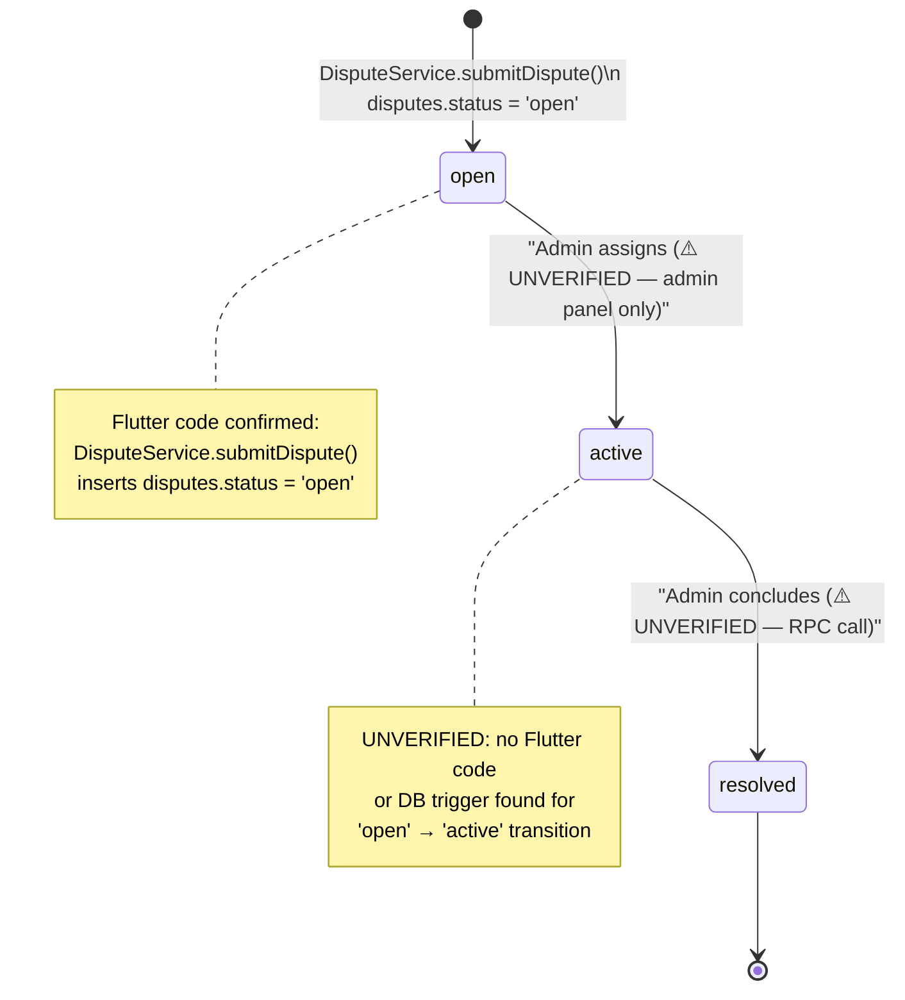

# 1) What this diagram is

Models the escalation process when a client and freelancer cannot agree on a job delivery.

# 2) Why it exists

Disputes are how the platform handles trapped Escrow funds. Admins require a structured lifecycle to resolve deadlocks and trigger the appropriate RPC for refund or release.

# 3) Where it lives in the product

- App entry points: Safety & Help centers.
- Service layer: `lib/features/safety/services/dispute_service.dart` — `submitDispute()`.
- Supabase: `disputes` table (plain-text `status` column). No DB trigger. Status transitions managed in application or admin layer.

# 4) Diagram (Mermaid)

# 5) Evidence Table

| Element                                       | Code Evidence                                            | DB Evidence                                           | Verified |
| --------------------------------------------- | -------------------------------------------------------- | ----------------------------------------------------- | -------- |
| Insert `status='open'`                        | ✅ `dispute_service.dart` line: `'status': 'open'`       | ✅ `disputes.status` column (text)                    | Y        |
| `reason` field                                | ✅ `dispute_service.dart`: `'reason': reason.trim()`     | ✅ `disputes.reason` TEXT column                      | Y        |
| `complainant_id`                              | ✅ `dispute_service.dart`: `uid` from `auth.currentUser` | ✅ `disputes.complainant_id` UUID                     | Y        |
| `defendant_id`                                | ✅ `dispute_service.dart`: optional param                | ✅ `disputes.defendant_id` UUID                       | Y        |
| `open → active` transition                    | ❌ No Flutter code                                       | ❌ No DB trigger                                      | N        |
| `active → resolved` transition                | ❌ No Flutter code                                       | ❌ No DB trigger                                      | N        |
| `process_payment_event_ledger` for resolution | ❌ Not called from Flutter safety feature                | ✅ RPC exists and handles `refund`/`release_with_fee` | PARTIAL  |

# 6) Evidence checklist

- ✅ Code evidence: `DisputeService.submitDispute()` confirmed
- ✅ DB: `disputes` table schema confirmed (text status, no enum)
- ❌ No DB trigger or RPC on disputes for status transitions
- ❌ `open → active → resolved` transitions: admin-only, **UNVERIFIED**

# 7) Open questions / Missing evidence

- What sets `disputes.status = 'active'`? No Flutter code or DB trigger found. Likely admin dashboard.
- What sets `disputes.status = 'resolved'`? No Flutter code or DB trigger found. Likely calls `process_payment_event_ledger` with `refund` or `release_with_fee`.
- Is `dispute_status_enum` defined anywhere? Not found — DB uses plain `text`.

# 8) Verification result

- Verdict: **PARTIALLY VERIFIED**
- Date: 2026-03-05
- Verified:
  - Code: `dispute_service.dart` — `submitDispute()` inserts to `disputes` with `status='open'`
  - DB: `disputes` table columns confirmed via `information_schema.columns`
- Unverified:
  - All transitions after `open` — admin-layer only, out of scope
- Changes made:
  - Replaced `pending` with `open` (actual DB value confirmed in code)
  - Added Evidence Table
  - Tagged unverified transitions in Mermaid with ⚠️
