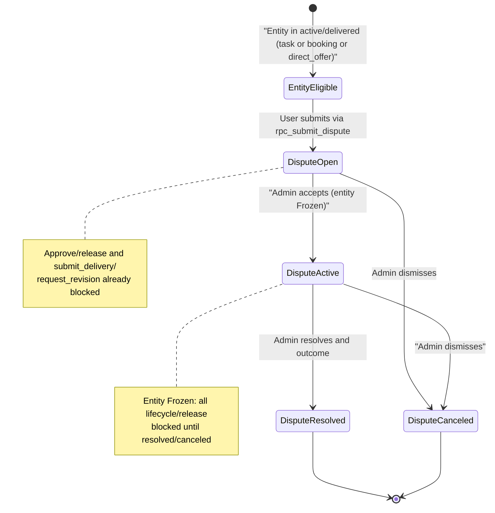
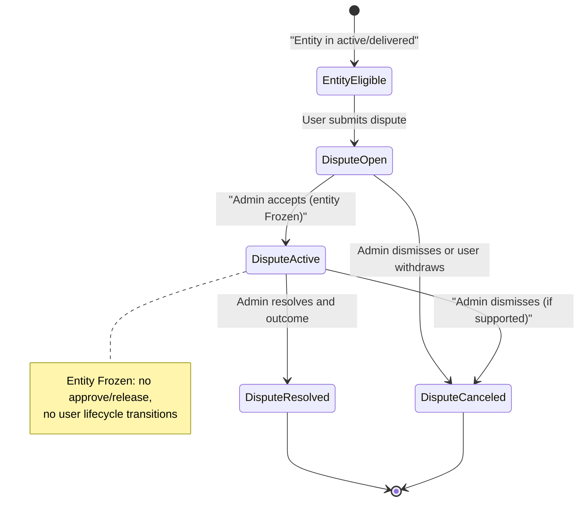

# 14a — Dispute–Entity–Freeze Integration

---

## Diagram Title + Version

| Field | Value |
|-------|--------|
| **Diagram name (exact)** | 14a_dispute-entity-freeze-integration |
| **Version** | v2 / final — 2026-03-08 |
| **Owner/author** | SLine architecture / system auditor |
| **Related diagrams** | 14 (dispute lifecycle), 05 (booking lifecycle), 03 (tender-task lifecycle), 19 (direct-offers work contract), 12 (unified work view), 16 (escrow invariants & idempotency), 10 (work contract revisions) |

---

## Purpose

- **What this diagram is showing:** How disputes attach to work entities (booking, task, direct_offer), when entities are treated as "Frozen" (no approve/release, no submit_delivery/request_revision), and how the unified work view and escrow/release flows respect dispute status. It shows the full path from user "Report Issue" through RPC guards, view semantics, and (where implemented) admin workflow.
- **What problem it solves:** Single reference for eligibility rules, Frozen behaviour, one-open/active-per-entity rule, and UI/DB/RPC alignment so implementation and audits don’t rely on guesswork. It also documents what is implemented vs still missing (e.g. admin UI).

---

## Scope

- **What’s included:** Dispute submit (task, direct_offer, booking via task_id); eligibility (task in_progress/delivered or any booking for task active/delivered; direct_offer active/delivered); single open/active per task and per direct_offer (DB + RPC); Frozen guards in rpc_submit_delivery, rpc_request_revision, rpc_approve_delivery, rpc_finalize_auto_approval; vw_unified_work_items disputed only when dispute.status IN ('open','active'); Report Issue on booking details, work item details (task/booking/direct_offer), direct offer details; dispute banners and disabled Approve/Review.
- **What’s explicitly excluded:** Admin dashboard UI and admin-only RPCs (accept/resolve/cancel dispute); dispute_messages/dispute_evidence UI; chat behaviour during dispute; split/partial payout outcomes.
- **Assumptions:** Escrow release is blocked when a dispute is open or active; payments are finalised only via defined RPCs; "Frozen" is guard-only (no `frozen` column on entities); RPC is source of truth for eligibility and single-open/active.

---

## Glossary (Human-readable)

| Term | Definition |
|------|-------------|
| **booking** | A session-based work entity; has `task_id`, `status` (e.g. active, delivered), `provider_id`, `client_id`. Disputes for bookings are stored with `task_id` (one dispute per task can affect all bookings for that task in the view). |
| **task** | Tender or assigned task; `status` in_progress, delivered, etc. Can be linked to disputes via `disputes.task_id`. |
| **task_request** | Tender offer (bid); links task to freelancer; status pending/accepted; payment_status unpaid/held/released. |
| **direct_offer** | Direct work contract (non-tender); has `direct_offer_id` on disputes. |
| **dispute** | Row in `disputes` with complainant_id, defendant_id, reason, status (open, active, resolved, canceled), and exactly one of task_id or direct_offer_id. |
| **Entity (in this doc)** | A work unit that can be disputed: task, direct_offer, or booking (booking uses task_id for dispute link). |
| **active (entity)** | Task in_progress; booking/direct_offer status active (work in progress). |
| **delivered** | Work submitted for review; entity status delivered; review window (e.g. review_expires_at) applies. |
| **completed** | Work approved and closed; funds released. |
| **disputed** | In vw_unified_work_items: unified_status = 'disputed' when a linked dispute has status IN ('open', 'active'). |
| **open (dispute)** | Dispute submitted; awaiting admin; approve/release and submit_delivery/request_revision are already blocked. |
| **active (dispute)** | Admin accepted dispute; entity is Frozen (all lifecycle/release actions blocked). |
| **resolved** | Dispute closed with outcome; entity unfrozen. |
| **canceled** | Dispute dismissed; entity unfrozen. |
| **Frozen** | Behaviour contract: when dispute is open or active, entity cannot be approved/released, submit_delivery or request_revision are blocked; no user-triggered lifecycle transition or auto-approval. |
| **escrow_hold** | Funds held against the entity; release only via approve_delivery or equivalent. |
| **release_with_fee** | Escrow release to freelancer (minus platform fee). |
| **refund** | Escrow return to client (e.g. admin_refund_direct_offer). |
| **RPC** | Remote procedure call (Supabase/Postgres function); SECURITY DEFINER; source of truth for guards. |
| **RLS** | Row-Level Security; restricts SELECT/INSERT/UPDATE/DELETE by policy. |
| **idempotency** | Duplicate calls (e.g. double submit) do not create duplicate side effects; e.g. one open/active dispute per entity. |

---

## Legend (What each symbol means)

- **Node/shape:** **Actor** = Client, Freelancer, Admin, System/Cron. **Service** = Flutter ViewModel/Service calling Supabase. **DB** = tables/views/RPCs/triggers. **Gateway** = RPC that checks guards and then performs state change.
- **Arrows:** **Sync call** = Flutter → Supabase RPC or REST. **Async event** = e.g. cron job. **Webhook** = not used in dispute flow. **Scheduled job** = e.g. auto-release cron (must respect dispute check).
- **Colours/labels:** In tables we use **Implemented** / **Missing** / **Proposed** to show current state.
- **Guards:** Drawn as conditions at RPC entry: "entity status eligible?", "no open/active dispute for this entity?". Transition allowed only if guard passes; otherwise RPC raises exception.

---

## Actors and Responsibilities

| Actor | Allowed | Forbidden |
|-------|--------|-----------|
| **Client** | Open dispute when entity (task/booking/direct_offer) is eligible and no open/active dispute; view own work items and dispute status; approve/review when no open/active dispute. | Approve delivery or request revision when dispute open/active; create second dispute for same entity while one is open/active. |
| **Freelancer** | Submit delivery / request revision only when no open/active dispute for that entity; view work and dispute status. | Submit delivery or request revision when entity Frozen; spoof complainant. |
| **Admin** | (Intended) List open/active disputes; accept (open→active); resolve (active→resolved) with outcome; cancel. **Missing in app:** No admin UI in repo; DB trigger allows transitions. | N/A in current app. |
| **System/Cron** | rpc_finalize_auto_approval and auto-release crons run only when no open/active dispute for the entity. | Release funds when dispute open/active. |
| **Payment gateway** | Not in dispute path; payment flow is separate (tender/booking/direct_offer pay RPCs). | N/A. |

---

## System Components (Where it lives)

- **App entry points:** Booking details screen (Report Issue when booking active/delivered, no open dispute); Work item details screen (Report Issue when task, booking, or direct_offer eligible; action row scrollable); Direct offer details screen (Report Issue when direct_offer active/delivered). Approve/Review/Submit work/Request revision on same screens are disabled when hasOpenDispute* is true.
- **Service / ViewModel / Repository:**  
  - `lib/features/safety/services/dispute_service.dart` — submitDispute(taskId, directOfferId, reason, defendantId).  
  - `lib/features/safety/viewmodels/safety_view_model.dart` — submitDispute, hasOpenDisputeForTask, hasOpenDisputeForBooking, hasOpenDisputeForDirectOffer, getDisputeStatusForTask/Booking/DirectOffer.  
  - `lib/features/work/view/work_item_details_screen.dart` — _canShowReportIssue, _ReportIssueGuard, _showDisputeDialog (task, direct_offer, booking).  
  - `lib/features/booking/view/booking_details_screen.dart` — _ReportIssueGuardBooking, _showDisputeDialog.  
  - `lib/features/direct_offers/view/direct_offer_details_screen.dart` — _ReportIssueGuardDirectOffer, _showDisputeDialog.
- **Database:**  
  - **Tables:** disputes (task_id, direct_offer_id, complainant_id, defendant_id, reason, status, resolved_at); tasks; bookings; direct_offers.  
  - **Views:** vw_unified_work_items (LEFT JOIN disputes; unified_status = 'disputed' only when d.status::text IN ('open','active')).  
  - **RPCs:** rpc_submit_dispute (task branch: eligible if task in_progress/delivered OR any booking for task active/delivered; direct_offer: active/delivered; enforces one open/active per entity); rpc_submit_delivery (Frozen guard task/booking); rpc_request_revision (Frozen guard task/booking); rpc_approve_delivery, rpc_finalize_auto_approval (block release when open/active dispute).  
  - **Triggers:** trg_dispute_guard (status transitions), trg_dispute_set_resolved_at.  
  - **Policies (RLS):** disputes_deny_update, disputes_deny_delete for authenticated; dispute_messages/dispute_evidence participant-only as per schema.  
  - **Indexes:** uq_disputes_one_open_active_per_task, uq_disputes_one_open_active_per_direct_offer (partial unique).

---

## Step-by-step Flow ("Human Story")

### Happy path — User reports from work item (task)

1. User opens Work tab → work item (task) in_progress or delivered.
2. User taps Report Issue (visible when _canShowReportIssue true: task in_progress/delivered, no open dispute).
3. Dialog: reason + optional defendant; submit.
4. Flutter calls SafetyViewModel.submitDispute(taskId: id, …) → DisputeService → rpc_submit_dispute(p_task_id, NULL, reason, defendant_id).
5. RPC checks: auth; exactly one of task_id/direct_offer_id; reason non-empty; task exists; task in_progress/delivered OR any booking for task active/delivered; no existing open/active dispute for this task. INSERT disputes (task_id, status=open). Return dispute_id.
6. UI: confirmation; Approve/Review disabled (hasOpenDisputeForTask true); banner "Dispute under review" (open) or "Work frozen — in dispute" (active).

### Happy path — User reports from booking

1. User opens booking (active or delivered) from Booking details or Work item (when work item is booking).
2. Report Issue shown when no open dispute for that booking (hasOpenDisputeForBooking(booking.id) checks dispute by task_id for that booking’s task).
3. Submit: app calls submitDispute(taskId: booking.taskId!, …). Same RPC task branch; eligibility includes "any booking for task active/delivered" (migration 20260308170000).
4. Dispute created with task_id; booking appears as disputed in vw_unified (JOIN on d.task_id = b.task_id, d.status IN ('open','active')).

### Failure path — Entity not eligible

1. User tries to report from a task that is still "assigned" (no payment yet) or "open".
2. RPC: task status not in (in_progress, delivered) and no booking for that task is active/delivered → raise "Entity not eligible for dispute: task must be in progress or delivered".
3. UI shows error; no row inserted.

### Failure path — Duplicate dispute

1. User A opens dispute; then User B (or same user from another device) tries to open another for same task.
2. RPC: EXISTS (open/active for task_id) → raise "An open or active dispute already exists for this task". Alternatively unique index uq_disputes_one_open_active_per_task causes constraint violation.
3. Second insert fails.

### Failure path — Submit delivery while disputed

1. Freelancer taps Submit work while dispute is open or active for that task/booking.
2. rpc_submit_delivery checks: dispute exists for entity (task or booking’s task) with status IN ('open','active') → raise "Cannot submit delivery: dispute in progress".
3. No state change.

---

## State Machine Explanation

- **Dispute status (dispute_status_enum):** open → active (admin accept); open → canceled (admin dismiss); active → resolved (admin resolve + outcome); active → canceled (admin dismiss). Resolved and canceled are terminal for display; entity unfrozen.
- **Entity status:** Unchanged by dispute; task stays in_progress/delivered, booking stays active/delivered. "Frozen" is not an entity state but a guard condition: dispute.status IN ('open','active').
- **Allowed transitions (dispute):** open→active (admin); open→canceled (admin); active→resolved (admin); active→canceled (admin). Trigger trg_dispute_guard enforces valid transitions.
- **Forbidden:** User or app cannot set dispute to active or resolved (admin-only in intended design). Direct INSERT into disputes is only via rpc_submit_dispute (status=open). Escrow release and submit_delivery/request_revision are forbidden when dispute open/active.

---

## Invariants (Must-always-be-true rules)

- At most one dispute with status IN ('open','active') per task_id (enforced by uq_disputes_one_open_active_per_task and rpc_submit_dispute).
- At most one dispute with status IN ('open','active') per direct_offer_id (enforced by uq_disputes_one_open_active_per_direct_offer and rpc_submit_dispute).
- Escrow release (approve_delivery, finalize_auto_approval) does not run when a dispute for that entity has status IN ('open','active').
- submit_delivery and request_revision do not run when the entity (task or booking’s task) has a dispute with status IN ('open','active').
- vw_unified_work_items shows unified_status = 'disputed' only when the joined dispute has status IN ('open','active') (not resolved/canceled).
- User can only see disputes and work items where they are participant (RLS / app filters).

---

## Guards & Validation Rules

| Guard | Where | Source of truth |
|-------|--------|------------------|
| Authenticated | All RPCs | auth.uid() IS NOT NULL in RPC |
| Exactly one of task_id / direct_offer_id | rpc_submit_dispute | RPC |
| Reason non-empty | rpc_submit_dispute | RPC |
| Task exists and (task in_progress/delivered OR any booking for task active/delivered) | rpc_submit_dispute task branch | RPC (migration 20260308170000) |
| Direct offer exists and status active/delivered | rpc_submit_dispute direct_offer branch | RPC |
| No existing open/active dispute for this task_id | rpc_submit_dispute + uq_disputes_one_open_active_per_task | DB + RPC |
| No existing open/active dispute for this direct_offer_id | rpc_submit_dispute + uq_disputes_one_open_active_per_direct_offer | DB + RPC |
| No open/active dispute for entity when submitting delivery | rpc_submit_delivery (task, booking) | RPC |
| No open/active dispute for entity when requesting revision | rpc_request_revision (task, booking) | RPC |
| No open/active dispute when approving delivery / auto-approval | rpc_approve_delivery, rpc_finalize_auto_approval | RPC |
| Report Issue button visibility | _canShowReportIssue, hasOpenDispute* | App (ViewModel); RPC enforces on submit |

---

## Failure Modes (What can go wrong)

| Failure | System behaviour |
|---------|------------------|
| App crash mid-submit | No dispute row if RPC not reached; if RPC committed, dispute exists and UI can refresh. |
| Double tap Submit dispute | RPC + unique index prevent second row; second call returns error. |
| Race: two users open dispute for same task | First INSERT succeeds; second fails (unique index or EXISTS check in RPC). |
| Entity status changes between UI load and submit | RPC re-checks eligibility; rejects if no longer eligible. |
| Cron auto-release runs while dispute open | rpc_finalize_auto_approval must check dispute; block release when open/active. |
| View showed "disputed" for canceled dispute | Fixed in 20260308190000: view uses IN ('open','active') only; canceled no longer shows as disputed. |

---

## Security & Abuse Scenarios

- **Spoofing identity:** All RPCs use auth.uid(); complainant_id set from _uid in rpc_submit_dispute. No client-supplied complainant_id.
- **Unauthorised state change:** Dispute status transitions enforced by trigger; only admin (or service_role) can set active/resolved/canceled; app only calls rpc_submit_dispute (insert open).
- **Paying without owning entity:** Payment flows are separate; release blocked when dispute open/active.
- **Escrow trapped forever:** Admin can resolve or cancel dispute; then normal release/refund paths apply. (Admin UI missing in app; DB allows transitions.)
- **User seeing another user’s dispute:** RLS and participant checks; dispute_messages/dispute_evidence restricted; vw_unified filtered by app to user’s work items.

---

## Data Model Mapping

| Diagram term | DB / field |
|--------------|------------|
| Entity eligible (task) | task.status IN ('in_progress','delivered') OR EXISTS booking for task with status IN ('active','delivered') |
| Entity eligible (direct_offer) | direct_offers.status IN ('active','delivered') |
| Disputed (unified view) | d.status::text IN ('open','active') in vw_unified_work_items |
| Frozen | No column; derived: EXISTS dispute for entity WITH status IN ('open','active') |
| Review window | review_expires_at on task/booking/direct_offer |
| One open/active per task | disputes.task_id + partial unique index WHERE status IN ('open','active') |
| One open/active per direct_offer | disputes.direct_offer_id + partial unique index WHERE status IN ('open','active') |

---

## Observability & Forensics

- **Logs/audit:** Admin actions (accept/resolve/cancel) are not yet written to admin_logs by app (missing). RPC errors (e.g. "Entity not eligible", "An open or active dispute already exists") are visible in client/Supabase logs.
- **Admin views:** No admin dispute queue in repo; DB has disputes table queryable by status for support.
- **Orphan event:** If a dispute is canceled, vw_unified_work_items no longer shows item as disputed (20260308190000). No orphan "stuck disputed" from resolved/canceled.

---

## Verification Checklist

- **Unit tests:** SafetyViewModel submitDispute and hasOpenDispute* behaviour; error mapping from RPC exceptions.
- **Integration tests:** Submit dispute from app for task and direct_offer (and booking via task_id); confirm Approve/Review disabled; confirm second submit fails.
- **DB tests:** RLS on disputes (deny update/delete); partial unique index prevents second open/active per task and per direct_offer; rpc_submit_dispute rejects ineligible entity and duplicate.
- **Concurrency:** Double submit dispute (same entity); submit_delivery while dispute open (must fail).

---

## Dependencies

- **Depends on:** Diagram 14 (dispute lifecycle), 05 (booking), 03 (tender task), 19 (direct offer), 12 (vw_unified_work_items), 16 (escrow guards). Migrations: 20260308160000 (Frozen guards, partial indexes, rpc_submit_dispute), 20260308170000 (booking-eligible task branch), 20260308190000 (vw_unified disputed open/active only).
- **Depended on by:** DEVELOPER_GUIDE dispute section; SUPABASE_SETUP §9; any admin dashboard that will list/accept/resolve disputes.

---

## Open Questions / Missing Evidence

- **Admin UI:** No Flutter or dashboard to list open/active disputes, accept (open→active), resolve (active→resolved with outcome), or cancel. DB trigger allows transitions; caller is out of scope.
- **Admin audit logging:** Not implemented; recommended for accept/resolve/cancel.
- **Chat during dispute:** Product decision: fully usable vs read-only vs evidence-only.
- **New dispute after resolved/canceled:** Product decision whether same entity can have a new dispute after prior one closed.
- **direct_offer branch in rpc_submit_delivery / rpc_request_revision:** Currently only task and booking; direct_offer delivery/revision may be in other RPCs—confirm and add Frozen guard if needed.

---

## Final Status

- **Verdict:** PARTIAL — Implemented: eligibility (task + booking-eligible), single open/active per task/direct_offer (DB + RPC), Frozen guards in submit_delivery/request_revision (task/booking), escrow block, vw_unified disputed only open/active, Report Issue on booking/work item/direct_offer, banners. Missing: admin UI and admin RPC callers, audit logging, optional direct_offer Frozen in delivery/revision.
- **Production ready?** YES for user-facing submit and guards; NO for full admin resolution workflow until admin UI and audit exist.
- **Next actions:** (1) Add admin dispute queue and accept/resolve/cancel with audit logging; (2) Add Frozen guard for direct_offer in delivery/revision if applicable; (3) Close product decisions (chat, new dispute after resolved).

---

## Implemented Diagrams (v2)

### Diagram A — Entity lifecycle integration with dispute states



### Diagram B — Sequence: submit → RPC guards → open dispute

```mermaid
sequenceDiagram
    participant User_App
    participant Flutter_App
    participant SafetyVM
    participant Supabase_DB

    User_App->>Flutter_App: Report Issue (task / booking / direct_offer)
    Flutter_App->>SafetyVM: submitDispute(taskId or directOfferId, reason, defendantId)
    SafetyVM->>Supabase_DB: rpc_submit_dispute(...)
    Supabase_DB->>Supabase_DB: Check auth, eligibility, one open/active per entity
    alt Eligible & no open dispute
        Supabase_DB->>Supabase_DB: INSERT disputes (status=open)
        Supabase_DB-->>SafetyVM: dispute_id
        SafetyVM-->>Flutter_App: success
        Flutter_App->>User_App: Confirm; disable Approve/Review; show banner
    else Not eligible or duplicate
        Supabase_DB-->>SafetyVM: Exception
        SafetyVM-->>Flutter_App: error message
    end
```

### Diagram C — vw_unified_work_items disputed condition

```mermaid
flowchart LR
    A[task / booking / direct_offer row] --> B{LEFT JOIN disputes}
    B --> C{d.status IN ('open','active')?}
    C -->|Yes| D[unified_status = 'disputed']
    C -->|No or no row| E[unified_status = entity status]
```

---

# ——— OLD DIAGRAM (v1) ———

*The following is the original 14a document (v1, 2026-03-08) kept for reference. Superseded by the sections above.*

---

## 1. Diagram title + version (OLD)

| Field | Value |
|-------|--------|
| **Diagram name (exact)** | 14a_dispute-entity-freeze-integration |
| **Version** | v1 — 2026-03-08 |
| **Owner/author** | SLine architecture / system auditor |
| **Related diagrams** | 14 (dispute lifecycle), 05 (booking lifecycle), 03 (tender-task lifecycle), 19 (direct-offers work contract), 12 (unified work view), 16 (escrow invariants & idempotency), 10 (work contract revisions) |

This document is a **standalone integration specification**. It does not replace diagram 14 (dispute lifecycle); it specifies how disputes integrate with entity lifecycles, unified work view, escrow guards, and admin workflow.

---

## 2. Purpose (OLD)

- **What this document is:** A production-grade architecture/lifecycle specification for how disputes attach to work entities (booking, task, direct_offer), when entities are considered "Frozen," and how the admin review and resolution workflow integrates with escrow and lifecycle transitions.
- **Why it exists:** To give engineers, product owners, and dashboard developers a single reference for current behaviour, proposed behaviour, and missing pieces—so that implementation and review can proceed without guesswork.
- **How it relates to other artefacts:**
  - **Booking lifecycle (05):** Dispute eligibility and Frozen behaviour apply when a booking is in eligible status (e.g. active, delivered).
  - **Task lifecycle (03):** Same for tasks (e.g. in_progress, delivered).
  - **Direct-offer lifecycle (19):** Same for direct_offer (e.g. active, delivered).
  - **Unified work view (12):** The view exposes `unified_status = 'disputed'` when a dispute is open or active; 14a must align with the dispute JOIN and status override.
  - **Escrow/release guards (16):** Release and auto-approval are blocked when a dispute is open or active; 14a documents this and any additional guards (e.g. submit_delivery, request_revision).
  - **Admin workflow:** 14a defines the intended admin flow (queue, accept, resolve, cancel) and what is existing vs proposed vs missing.

---

## 3. Related diagrams reviewed (OLD)

Phase 1 audit: the following seven artefacts were reviewed. The table below serves as the diagram audit (id, path, relevance, and one-line existing/proposed/missing note per diagram).

| Id | Path | Relevance to dispute integration | Audit note (existing / proposed / missing) |
|----|------|----------------------------------|--------------------------------------------|
| 14 | `Sline_everything/AppDigram/All_Diagrams/14_dispute-lifecycle.md` | Dispute FSM (open, active, resolved, canceled), triggers, RLS, escrow guard. | **Existing:** submit open, hasOpenDispute* gates, RPC block on release. **Missing:** Admin accept/resolve in app; explicit Frozen semantics in doc. |
| 05 | `Sline_everything/AppDigram/All_Diagrams/05_booking-lifecycle.md` | booking_status_enum (pending, active, delivered, completed, etc.), fn_booking_guard. | **Existing:** States and guard. **Proposed:** Dispute eligibility limited to active \| delivered; Frozen blocks transitions. |
| 03 | `Sline_everything/AppDigram/All_Diagrams/03_tender-task-lifecycle.md` | Task statuses (open, assigned, in_progress, delivered, closed, canceled). | **Existing:** States. **Proposed:** Dispute eligibility in_progress \| delivered; Frozen blocks submit_delivery/approve. |
| 19 | `Sline_everything/AppDigram/All_Diagrams/19_direct-offers-work-contract.md` | direct_offer statuses (sent, accepted, active, delivered, completed), rpc_approve_delivery, admin_refund_direct_offer. | **Existing:** Release and refund RPCs; dispute blocks release. **Proposed:** Dispute eligibility active \| delivered; Frozen blocks mark_delivered/approve. |
| 12 | `Sline_everything/AppDigram/All_Diagrams/12_unified-work-view.md` | vw_unified_work_items, unified_status (including disputed). | **Existing:** View contract; dispute JOIN and 'disputed' override (see contract_vw_unified_work_items.md). **Missing:** No change to view required by 14a. |
| 16 | `Sline_everything/AppDigram/All_Diagrams/16_escrow-invariants-idempotency.md` | rpc_approve_delivery, rpc_finalize_auto_approval, dispute guard. | **Existing:** RPCs block release when open/active dispute exists. **Proposed:** Document as part of Frozen behaviour; no RPC change in 14a. |
| 10 | `Sline_everything/AppDigram/All_Diagrams/10_work-contract-revisions.md` | rpc_submit_delivery, rpc_request_revision. | **Existing:** RPCs exist. **Missing:** Guards to block submit_delivery and request_revision when entity is Frozen (dispute active). |

**Alignment:** This document aligns with `.TODO/contract_vw_unified_work_items.md` (dispute JOIN and open-dispute condition). It does not contradict that contract.

---

## 4. Current system reality vs proposed design (OLD)

### 4.1 What exists today

| Area | Current state |
|------|----------------|
| **Dispute submit** | Flutter: DisputeService.submitDispute(taskId, reason, defendantId) inserts into `disputes` with status='open'. Booking details screen submits via booking.taskId (task_id). No dedicated booking_id or direct_offer_id in app submit flow for direct_offer. |
| **Dispute table** | `disputes` has dispute_status_enum ('open','active','resolved','canceled'); reason, complainant_id, defendant_id; task_id; direct_offer_id and/or booking_id per schema. Triggers: trg_dispute_guard (transitions), trg_dispute_set_resolved_at. |
| **RLS** | disputes_deny_update, disputes_deny_delete for authenticated users; dispute_messages and dispute_evidence participant-only SELECT/INSERT. |
| **Escrow block** | rpc_approve_delivery and rpc_finalize_auto_approval check for open/active dispute and block release. |
| **UI gates** | SafetyViewModel.hasOpenDisputeForTask/ForBooking/ForDirectOffer used to disable Approve/Review on booking details, work item details, direct offer details. |
| **Unified work view** | vw_unified_work_items LEFT JOINs disputes; when d.id IS NOT NULL AND d.status NOT IN ('resolved','closed'), unified_status overridden to 'disputed'. |
| **Dispute button** | Shown on booking details when booking is delivered (and task_id present); not shown on task details or direct-offer details in same form (task/direct_offer dispute entry may be partial or missing). |

### 4.2 What this document proposes

- **Eligibility policy:** Only entities in certain states may have a dispute raised: booking (active \| delivered), task (in_progress \| delivered), direct_offer (active \| delivered).
- **Frozen behaviour contract:** When dispute status is `active`, the entity is "Frozen": no approve/release, no user-triggered lifecycle transitions (submit_delivery, request_revision, user cancel), no automatic/cron approval; optional: chat read-only or evidence-only rules.
- **Single active dispute rule:** At most one dispute in status open or active per entity at any time.
- **Admin workflow:** Accept (open → active), Resolve (active → resolved with outcome), Cancel/dismiss (open/active → canceled); admin sees queue and detail before acting.
- **Backend guards:** RPC-level or trigger-level guards to block submit_delivery and request_revision when the entity has an open or active dispute (proposed).

### 4.3 What is missing (must be implemented later)

- **Admin UI:** No Flutter or dashboard app to list open/active disputes, open dispute detail, or call Accept/Resolve/Cancel (admin layer is out of app scope today).
- **Admin RPCs:** No app-callable RPC documented for "accept dispute" (set status to active) or "resolve dispute" (set status to resolved and apply outcome); DB trigger allows transitions but who invokes them is out of scope.
- **Submit dispute for task and direct_offer:** DisputeService.submitDispute currently takes only taskId; booking uses task_id; direct_offer submit path (direct_offer_id) may be missing or partial in UI/service.
- **Lifecycle guards when Frozen:** rpc_submit_delivery and rpc_request_revision do not yet check for open/active dispute; they should block when entity is Frozen (proposed).
- **Explicit entity frozen flag:** No dedicated `frozen` column on bookings/tasks/direct_offers; "Frozen" is derived from dispute.status = 'active' and entity link (guard-only model).
- **Audit logging:** No explicit requirement for admin dispute actions (accept, resolve, cancel) to be written to admin_logs or equivalent; recommended as missing until implemented.
- **Description field:** disputes table has `reason`; a longer `description` or evidence blob is not specified here (optional future).

---

## 5–16. [OLD sections 5–16]

*Content of sections 5 (Eligibility policy) through 16 (Open decisions) from the original v1 document is omitted here to avoid duplication; the v2 sections above (Purpose, Scope, Glossary, Legend, Actors, System Components, Step-by-step Flow, State Machine, Invariants, Guards, Failure Modes, Security, Data Model, Observability, Verification, Dependencies, Open Questions, Final Status) supersede them. For full v1 wording of eligibility, Frozen contract, UI contract, admin workflow, single active dispute, resolution outcomes, backend contract, risks, and open decisions, see the first version of this file in version control (2026-03-08).*

---

## 9. Final diagrams (OLD)

### Diagram A — Entity lifecycle integration with dispute states



### Diagram B — Sequence: user submit → admin accept → frozen → admin resolve

```mermaid
sequenceDiagram
    participant User_App
    participant Flutter_App
    participant Supabase_DB
    participant Admin_Dashboard
    participant Admin_RPCs

    User_App->>Flutter_App: Open dispute
    Flutter_App->>Supabase_DB: INSERT disputes (status=open)
    Supabase_DB-->>Flutter_App: OK

    Admin_Dashboard->>Supabase_DB: List open disputes
    Admin_Dashboard->>Admin_RPCs: Accept dispute
    Admin_RPCs->>Supabase_DB: UPDATE disputes SET status=active
    note over Supabase_DB: Entity now Frozen

    Admin_Dashboard->>Admin_RPCs: Resolve dispute (outcome)
    Admin_RPCs->>Supabase_DB: UPDATE disputes SET status=resolved; apply outcome; unfreeze
    Supabase_DB-->>Admin_Dashboard: OK
```

---

**End of OLD 14a (v1). See v2 sections above for current specification and implemented state.**
