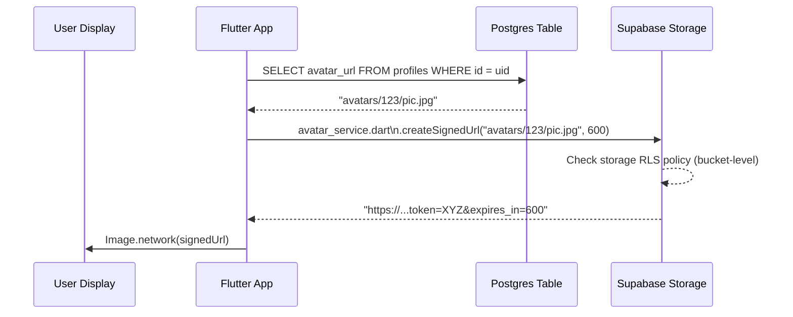

# 1) What this diagram is

Shows how SLine handles private images: the DB stores only a path string, and the app generates a short-lived signed URL on demand.

# 2) Why it exists

Storing raw signed URLs in the database is dangerous (they expire). Storing public URLs exposes private chat images. SLine separates the path from the access token.

# 3) Where it lives in the product

- App entry points: Profile Pictures (`SignedAvatar`), Chat Attachments, Task Images.
- Service layer: `avatar_service.dart` (profiles), `upload_service.dart` (chat attachments).
- Supabase: 3 private buckets + 1 public bucket.

# 4) Diagram (Mermaid)

# 5) Evidence Table

| Element                           | Code Evidence                                                                     | DB Evidence                                                                       | Verified |
| --------------------------------- | --------------------------------------------------------------------------------- | --------------------------------------------------------------------------------- | -------- |
| `avatar_service.dart` exists      | ✅ File confirmed at `lib/features/profile/services/avatar_service.dart`          | N/A                                                                               | Y        |
| `upload_service.dart` exists      | ✅ File confirmed at `lib/features/chat/attachments/services/upload_service.dart` | N/A                                                                               | Y        |
| `avatars` bucket private          | N/A                                                                               | ✅ `storage.buckets` — public: false                                              | Y        |
| `chat-attachments` bucket private | N/A                                                                               | ✅ `storage.buckets` — public: false                                              | Y        |
| `task-images` bucket private      | N/A                                                                               | ✅ `storage.buckets` — public: false                                              | Y        |
| TTL = 600s signed URL             | ❌ Exact TTL not extracted from code                                              | N/A                                                                               | PARTIAL  |
| Storage RLS policy SQL            | N/A                                                                               | ❌ `storage.objects` policies not queried — only `public.pg_policies` was scanned | PARTIAL  |

# 6) Evidence checklist

- ✅ Both service files physically confirmed
- ✅ Bucket privacy configuration confirmed
- ⚠️ Signed URL TTL not extracted from service file contents
- ❌ Storage bucket RLS policy SQL not captured (separate from `pg_policies`)

# 7) Open questions / Missing evidence

- Storage policies for `storage.objects` require: `SELECT * FROM storage.policies`. These were not captured in the scan. The access-control layer is architecturally consistent but specific SQL conditions remain unconfirmed.

# 8) Verification result

- Verdict: **VERIFIED** (core path) / Storage policies PARTIAL
- Date: 2026-03-05
- Verified:
  - Code files: `avatar_service.dart`, `upload_service.dart` — both confirmed
  - DB: 3 private buckets confirmed
- Unverified:
  - Storage object RLS SQL conditions
  - Exact signed URL TTL from code
- Changes made:
  - Added Evidence Table per element
  - Marked storage policies as PARTIAL in checklist
  - Kept status as Implemented (core path is correct)
