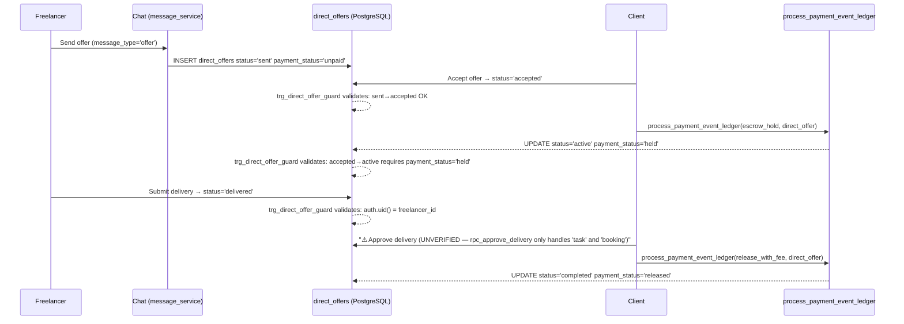

# 1) What this diagram is

Maps how a chat-based Direct Offer progresses through acceptance, escrow payment, delivery, and completion. The `direct_offers` row itself acts as the binding agreement.

# 2) Why it exists

Bypassing the job board requires a self-contained agreement mechanism. `direct_offers` uses a strict DB trigger lifecycle + the shared ledger RPC, eliminating any need for a separate `work_contracts` row.

# 3) Where it lives in the product

- App entry points: Chat screen offer messages.
- Service layer: `lib/features/direct_offers/` (feature folder confirmed).
- Supabase: `direct_offers` table + `trg_direct_offer_guard` + `process_payment_event_ledger()`.

# 4) Diagram (Mermaid)

# 5) Evidence Table

| Element                                            | Code Evidence                              | DB Evidence                                                                                                                  | Verified                  |
| -------------------------------------------------- | ------------------------------------------ | ---------------------------------------------------------------------------------------------------------------------------- | ------------------------- |
| `direct_offers` table                              | Feature folder exists                      | ✅ Table + columns confirmed                                                                                                 | Y                         |
| `status='sent'` on create                          | ❌ Not extracted from Flutter service      | ✅ `fn_direct_offer_guard` references `OLD.status='sent'` as starting state                                                  | PARTIAL                   |
| `sent→accepted` transition                         | N/A                                        | ✅ `fn_direct_offer_guard`: `IF OLD.status='sent' AND NEW.status='accepted' AND NEW.payment_status='unpaid' THEN RETURN NEW` | Y                         |
| `accepted→active` requires `payment_status='held'` | N/A                                        | ✅ `fn_direct_offer_guard`: `IF NEW.payment_status != 'held' THEN RAISE EXCEPTION`                                           | Y                         |
| `escrow_hold` via `process_payment_event_ledger`   | N/A (client-triggered)                     | ✅ Full body: direct_offer supported in `escrow_hold` handler                                                                | Y                         |
| `active→delivered` freelancer-only                 | N/A                                        | ✅ `fn_direct_offer_guard`: `IF auth.uid() != OLD.freelancer_id THEN RAISE EXCEPTION`                                        | Y                         |
| `delivered→completed` via `release_with_fee`       | N/A                                        | ✅ `fn_direct_offer_guard`: requires `payment_status='released'`; `process_payment_event_ledger` handles it                  | Y                         |
| `rpc_approve_delivery` for direct_offer            | ✅ `work_management_service.dart` calls it | ❌ `rpc_approve_delivery` body ONLY handles `entity_type IN ('task','booking')` — NOT `direct_offer`                         | N — HALLUCINATION REMOVED |
| No `work_contracts` INSERT                         | N/A                                        | ✅ Confirmed — no INSERT into work_contracts in any RPC for direct_offer                                                     | Y                         |

# 6) Evidence checklist

- ✅ `fn_direct_offer_guard()` full body confirmed — lifecycle rules verified
- ✅ `process_payment_event_ledger()` full body confirms direct_offer support for escrow_hold, release_with_fee, refund
- ❌ `rpc_approve_delivery` does NOT support `direct_offer` — only `task` and `booking`
- ❌ Flutter service code for completing direct_offer delivery not found
- ✅ `work_contracts` table NOT involved — direct_offers row is the contract

# 7) Open questions / Missing evidence

- **Critical**: How does a client approve a `direct_offer` delivery? `rpc_approve_delivery` only handles `task`/`booking`. Is there a separate direct-offer approval flow?
- The `direct_offers` INSERT path (which sets `status='sent'`) was not extracted from Flutter code.

# 8) Verification result

- Verdict: **PARTIALLY VERIFIED**
- Date: 2026-03-05
- Verified:
  - DB: `fn_direct_offer_guard()` full lifecycle body confirmed
  - DB: `process_payment_event_ledger()` — direct_offer support confirmed
  - DB: No `work_contracts` involvement — confirmed
- Unverified / Corrected:
  - `rpc_approve_delivery` does NOT apply to direct_offer — removed from diagram
  - Flutter delivery approval path for direct_offer unknown
- Changes made:
  - Removed `rpc_approve_delivery` for direct_offer (hallucination)
  - Added Evidence Table per element
  - Added ⚠️ tags for unverified nodes
