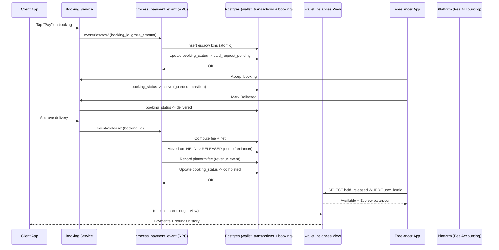

---

# **1) What this diagram is**

Shows how SLine’s **Wallet System (Escrow + Available balances)** works during the **Pay-First Booking Flow**:

- Client pays first
- Money is held in **Escrow (Held)**
- After delivery + approval, funds are **Released** to the freelancer’s **Available** balance (minus platform fee)
- If something fails (decline/cancel/expire/dispute outcome), money is **Refunded** to the client

Withdraw is explicitly **out of scope** (no implementation right now).

---

# **2) Why it exists**

Because marketplaces die from two things: **money ambiguity** and **non-atomic updates**.

This system exists to ensure:

- No “he said / she said” about who owns what money
- The app never does fragile client-side math
- All money state changes happen through **one atomic backend entry point**: process_payment_event
- Both parties always see the truth as: **Held vs Available**

---

# **3) Where it lives in the product**

**User-facing**

- Wallet screen shows:
    - **Available** (released)
    - **Escrow/Held** (money reserved for active work)
    - Transaction history

**Service/Logic layer**

- WalletService uses the DB view to compute balances (no client-side aggregation).
- Booking flow methods call the RPC for escrow/release/refund transitions.

**Database (Supabase/Postgres)**

- wallet_transactions table (with RLS)
- wallet_balances view aggregates **released vs held**
- process_payment_event RPC performs **atomic** Escrow/Release/Refund and updates booking state

---

# **4) Diagram (Mermaid)**

---

# **5) Evidence Table**

> Evidence below is based on your
> 
> 
> **current plan state**
> 

| **Element** | **Code Evidence** | **DB Evidence** | **Verified** |
| --- | --- | --- | --- |
| Wallet foundation exists | Logged: WalletService, WalletViewModel, WalletScreen added | Logged: wallet_transactions created with RLS | PARTIAL |
| Balance aggregation via DB view | Logged: wallet_balances view aggregates released vs held | Logged: view exists | PARTIAL |
| Atomic money changes via RPC | Logged: process_payment_event handles Escrow/Release/Refund atomically | Logged: RPC exists | PARTIAL |
| Booking lifecycle supports pay-first | Logged: booking_status_enum includes pending → paid_request_pending → active → delivered → completed | Logged: enum updated + guard trigger enforces transitions | PARTIAL |
| Withdraw excluded | Not implemented by design | Not in current scope | YES (by requirement) |

---

# **6) Evidence checklist**

- ✅ Wallet System Foundation recorded as complete (table + RPC + UI + VM)
- ✅ Wallet balances aggregated in DB (wallet_balances view) recorded as complete
- ✅ Booking pay-first lifecycle recorded as complete and guarded
- ⚠️ Exact schema columns for wallet_transactions not extracted here
- ⚠️ Exact fee formula + storage location (config/table/constant) not confirmed here
- ❌ RLS SQL policies and RPC SQL body not captured here (needs DB query/export)

---

# **7) Open questions / Missing evidence**

To make this “100% production-hard” (without building withdraw), we still need to confirm:

- wallet_transactions schema:
    - Does it store direction, entity linkage, fee breakdown, counterparty?
- Fee source of truth:
    - fixed rate? per-category? per-user tier?
- The actual RPC internals:
    - idempotency?
    - double-spend protection?
    - booking ownership checks?
- RLS policies:
    - ensure users only read their own wallet rows
    - ensure only RPC can insert transitions (no client inserts)

---

# **8) Verification result**

- Verdict: **PARTIAL VERIFIED** (architecture + components exist, details not fully extracted)
- Date: **2026-03-06**
- Verified (by project log):
    - Wallet foundation (table + RPC + UI + VM)
    - DB view aggregation (Held vs Released)
    - Booking pay-first lifecycle integration
- Unverified (needs extraction):
    - exact SQL definitions (table/view/RPC)
    - fee calculation specifics
    - RLS policy text + edge-case protections

---