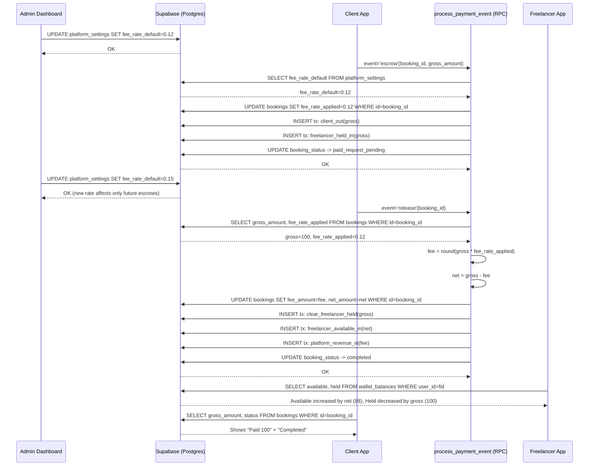

# **A) Dynamic Platform Fee (Commission) Flow —**

# **Option 2: Lock at ESCROW**

## **1) What this diagram is**

Shows how SLine calculates the platform commission using a **dashboard-controlled fee rate**, then **locks that rate at the moment of escrow** (payment).

Later, when the booking is approved, the system releases funds using the **locked fee**, even if the admin changes the global rate after that.

---

## **2) Why it exists**

- Admin must be able to change the fee rate anytime from the dashboard.
- Users must not get punished or surprised mid-booking.
- Financial history must remain immutable and auditable:
    - “This booking used 12%” should stay true forever.

So the fee rate becomes a **snapshot** stored on the booking at escrow time.

---

## **3) Where it lives in the product**

### **Admin Dashboard**

- “Fees & Revenue” settings page updates platform_settings.fee_rate_default.

### **Backend (Supabase RPC)**

- process_payment_event(..., 'escrow')
    - reads current fee rate from DB
    - stores it on the booking as fee_rate_applied
- process_payment_event(..., 'release')
    - reads bookings.fee_rate_applied
    - calculates fee_amount and net_amount from that locked rate

### **App UI**

- Client sees: Paid gross + booking status
- Freelancer sees: Held gross, then Available net + fee breakdown

---

## **4) Diagram (Mermaid)**

---

## **5) How final money appears (clean UI rules)**

### **Client (simple)**

- Paid: **Gross**
- Status: Completed / Refunded
- (Optional) show: “Platform commission is deducted from provider earnings” (info-only)

### **Freelancer (clear breakdown)**

- Held: **Gross** while active
- Available: **Net** after release
- Breakdown on transaction details:
    - Gross: 100
    - Fee rate (locked): 12%
    - Fee: 12
    - Net earned: 88

**Important:** UI never calculates fee itself. It reads stored values:

- gross_amount
- fee_rate_applied
- fee_amount
- net_amount

---

## **6) Evidence Table (template)**

| **Element** | **Code Evidence** | **DB Evidence** | **Verified** |
| --- | --- | --- | --- |
| Fee rate editable from dashboard | TBD | platform_settings.fee_rate_default | TBD |
| Fee rate locked at escrow | TBD | bookings.fee_rate_applied | TBD |
| Release uses locked fee | TBD | process_payment_event reads from bookings | TBD |
| Fee + net persisted | TBD | bookings.fee_amount, bookings.net_amount | TBD |

---

## **7) Verification result**

- Verdict: **ARCHITECTURALLY FINAL (Option 2 chosen)**
- Next needed to mark **VERIFIED**:
    - confirm booking columns exist
    - confirm RPC actually writes fee_rate_applied during escrow and reads it during release

---

I

# **How final money appears to the Client and Freelancer**

## **Client (simple, no confusion)**

- **You paid:** gross_amount
- **Status:** Paid (Escrow) → Completed / Refunded
- Optional (if you want transparency): show “Platform fee” as an informational line, but do NOT imply it’s deducted from the client (it’s deducted from what the freelancer receives).

Client Receipt example:

- Paid: $100
- Status: Completed
- (Optional) Platform commission: $12 (charged to provider earnings)

## **Freelancer (money reality)**

- **Held:** gross_amount while work is active
- **Available (earnings):** net_amount after release
- Show breakdown:
    - Gross: $100
    - Fee (12%): $12
    - Net earned: $88

To make this bulletproof, store in DB for each completed booking:

- gross_amount
- fee_rate_applied
- fee_amount
- net_amount

No UI math. UI only displays stored values.