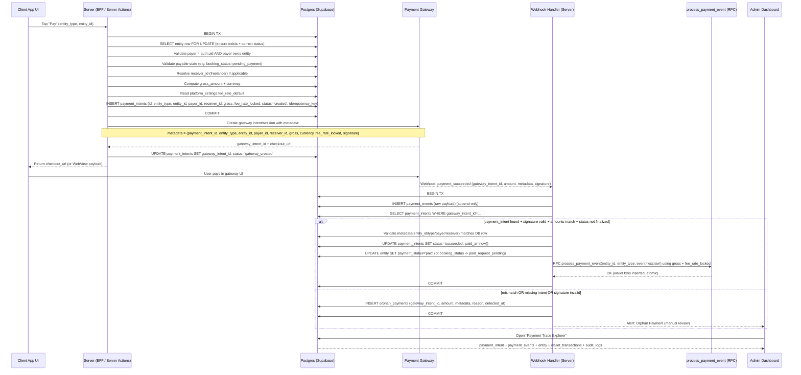

---

# **1) What this diagram is**

A **hardened payment-linking system** that guarantees every payment attempt is:

- created from a **known entity** (booking / tender / task / direct offer)
- bound to **client user_id**
- bound to **freelancer user_id** (when applicable)
- bound to **exact entity_id + entity_type**
- processed **only** through server-side controlled flows
- recorded even if the app crashes mid-payment
- never “free-floating” or untraceable

It also includes an **Orphan/Unmatched Payment quarantine** for the “this must never happen, but if it did we can prove who/why” requirement.

---

# **2) Why it exists**

Because the worst-case scenario is: user reaches payment gateway and pays, but the platform can’t prove:

- who paid
- what they paid for
- which entity it belongs to
- what state transition to apply

So we enforce:

- **No direct gateway access** (no “random pay”)
- **Server-created Payment Intent only**
- **Signed binding** between (payer, entity, amount, currency, fee snapshot)
- **Webhook-only finalization**
- **Quarantine** if binding fails

---

# **3) Where it lives in the product**

## **App (Client)**

- “Pay” buttons exist only on:
    - Booking checkout
    - Tender awarded checkout
    - Task accepted checkout
    - Direct offer accepted checkout (chat)

## **Backend (Next.js server actions or FastAPI)**

- create_payment_intent(...) (server-only)
- finalize_payment_webhook(...) (server-only)
- reconcile_orphans_job(...) (admin + ops)

## **Database (Supabase/Postgres)**

Core tables (minimum strong set):

- payment_intents (the binding contract)
- payment_events (raw gateway events, append-only)
- wallet_transactions (escrow/release/refund, append-only)
- audit_logs (admin + system actions)
- entity tables: bookings, tasks, tenders, chat_offers

Admin views:

- vw_admin_payment_health
- vw_admin_orphan_payments
- vw_admin_entity_payment_trace

---

# **4) Diagram (Mermaid) —**

# **End-to-end hardened flow**

---

# **5) The “100% prevention” rules (non-negotiable)**

These are the locks that make “random pay” effectively impossible:

## **Rule 1: No client creates gateway intents**

Only server creates gateway sessions.

If the client can hit the gateway directly, you already lost.

## **Rule 2: Payment requires a**

## **payment_intent_id**

Every payment must reference a row in payment_intents.

No intent = no valid payment.

## **Rule 3: Signed binding in gateway metadata**

The gateway payload must include:

- payment_intent_id
- entity_type
- entity_id
- payer_id
- receiver_id
- gross_amount, currency
- fee_rate_locked
- signature

Where signature = HMAC(server_secret, all_fields_above)

Webhook must verify signature before finalizing.

## **Rule 4: Amount + currency must match exactly**

If gateway returns amount != expected gross, quarantine it.

## **Rule 5: Webhook-only finalization (app crash proof)**

The app can die after payment. Doesn’t matter.

The webhook finalizes, writes escrow, updates entity status.

## **Rule 6: Idempotency everywhere**

Both:

- create_payment_intent uses idempotency_key (client can retry safely)
- webhook finalization checks if already processed

## **Rule 7: Quarantine path exists (for the “impossible”)**

If a payment arrives but can’t be matched, it is not lost.

It becomes an **orphan record** with a reason and full payload for tracing.

---

# **6) How we can ALWAYS answer: “Who did this payment and why?”**

If everything is correct:

- payment_intents gives you payer/receiver/entity/amount/fee snapshot
- payment_events gives you raw gateway evidence
- wallet_transactions shows what escrow/release/refund happened
- audit_logs shows admin/system actions around it

If something goes wrong (orphan):

- orphan_payments.metadata still contains payer_id/entity hints
- and signature mismatch reason tells you if it was tampered or misrouted

So you can always answer:

- payer = X
- receiver = Y
- for entity = (type, id)
- amount = A currency = C
- created by intent = Z
- finalized by webhook event = E
- wallet impact = T

---

# **7) Evidence Table (template)**

| **Element** | **Code Evidence** | **DB Evidence** | **Verified** |
| --- | --- | --- | --- |
| Server-only create intent | create_payment_intent exists, no client gateway keys | N/A | TBD |
| payment_intents contract exists | N/A | table exists + unique idempotency | TBD |
| Webhook verifies signature | verifySignature() in webhook handler | N/A | TBD |
| Webhook writes payment_events append-only | handler inserts raw event | table policy “no update/delete” | TBD |
| Finalization triggers escrow via RPC | webhook calls process_payment_event('escrow') | RPC exists | TBD |
| Orphan quarantine exists | webhook inserts orphan_payments | table exists + admin view | TBD |
| Admin trace explorer view exists | UI page + server action | vw_admin_entity_payment_trace | TBD |

---

# **8) Verification result**

- Verdict: **SYSTEM DESIGN FINAL (hardened, crash-proof, traceable)**
- To mark as **VERIFIED**, we need extraction of:
    - exact DB schema for payment_intents, payment_events, orphan_payments
    - webhook handler implementation
    - RLS / policies for “append-only”
    - RPC process_payment_event parameters and checks

---

## **One blunt note (because you asked for 100%):**

You can’t guarantee “it never happens” without a quarantine path.

Even if you lock everything, gateways can still send unexpected events or duplicates, or someone can attempt replay attacks. The real 100% system is:

- **Prevention by design**
- **Detection by webhook validation**
- **Containment via quarantine**
- **Provenance via append-only logs**