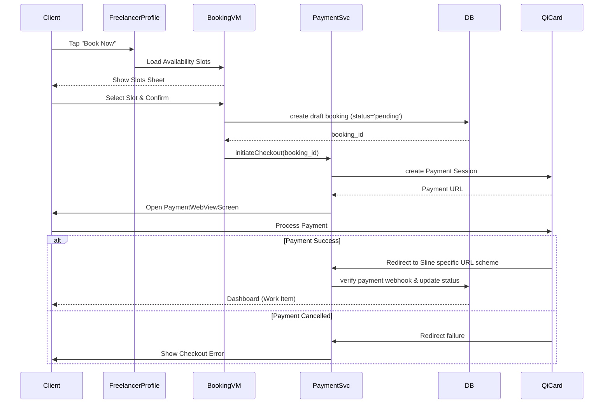

# 8.9 Booking Flow

## Purpose

Clients browsing a freelancer's availability and checking out a booking slot. Handled securely matching QiCard payment workflows.

## Sequences

### Booking & Checkout Flow

## State Rules

- Overlapping bookings logically blocked via `fn_reject_overlapping_slots` GiST indexes in DB.
- Payment intents explicitly tracked in `payment_intents` and `orphan_payments` for hardened ledger sync.
- Booking Status Transitions: `pending` -> `paid_request_pending` -> `active` -> `delivered` -> `completed` / `disputed`. Enforced by DB Trigger `fn_booking_guard`.

## Screen Details

- **PaymentWebViewScreen**: Acts as a secure wrapper handling the redirection events securely to return seamlessly back to the app routing state.
