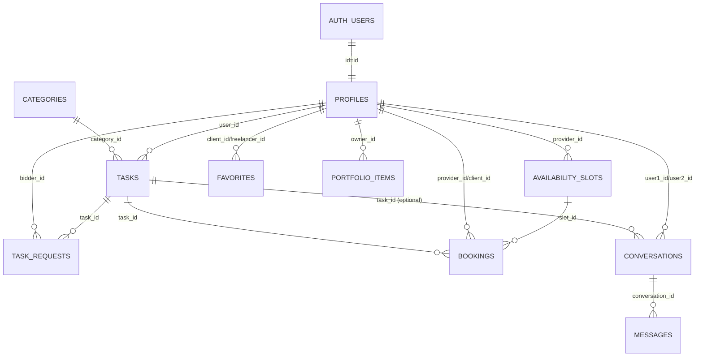
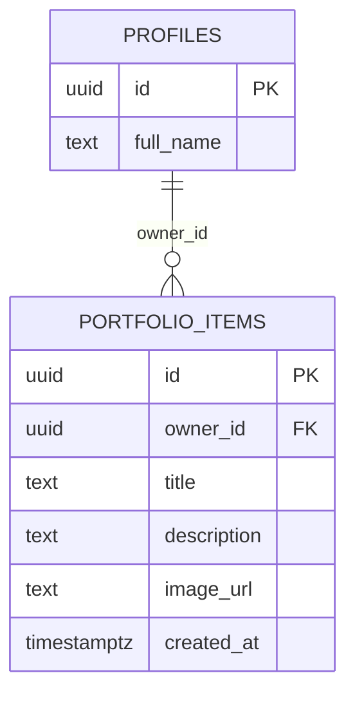
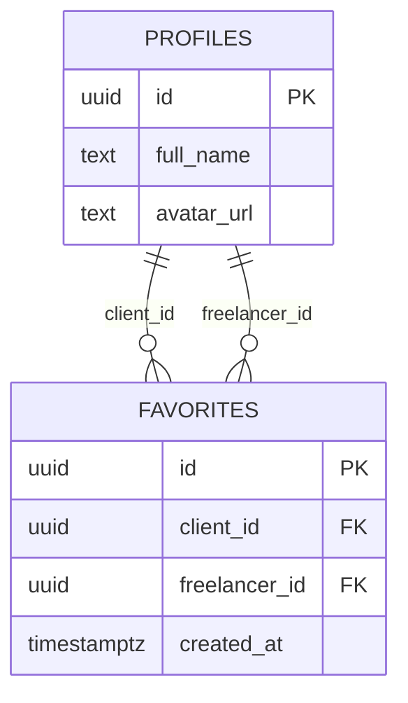
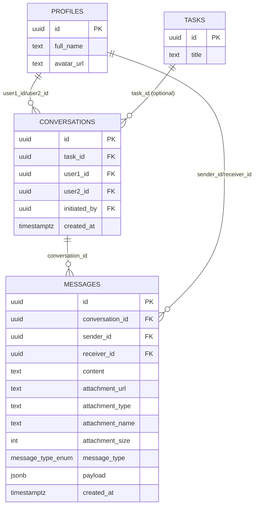
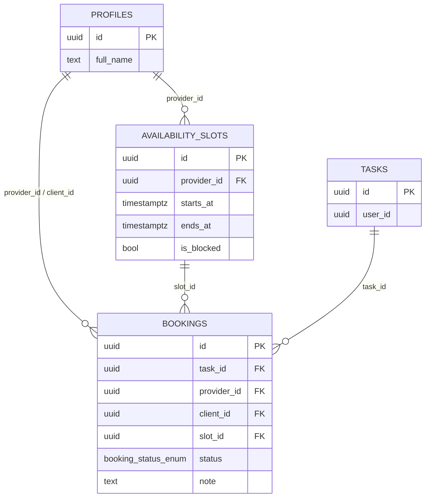

# 🗺️ SLine Developer Guide (Complete Reference)

**Version**: 2.0 (Consolidated from individual feature guides)
**Last Updated**: 2025-11-03

This comprehensive guide consolidates all feature-specific documentation into a single reference. It includes the system map, architecture overview, and deep-dives for every feature module.

---

## 📑 Table of Contents

### Part I: System Overview
1. [Project Overview](#1-project-overview)
2. [Runbook (Local Dev)](#2-runbook-local-dev)
3. [Architecture (MVVM)](#3-architecture-mvvm-per-feature)
4. [Data Model (Key Tables)](#4-data-model-key-tables)
5. [Feature Map](#5-feature-map-where-to-look)
6. [RLS/Policies](#6-rlspolicies-golden-rules)
7. [Storage (Buckets)](#7-storage-buckets)
8. [Error Mapping](#8-error-mapping-common)
9. [How to Add a New Feature](#9-how-to-add-a-new-feature-playbook)
10. [Testing & Quality](#10-testing--quality)
11. [Quick Links](#11-quick-links-deep-dives)
12. [Gotchas & Tips](#12-gotchas--tips)

### Part II: Feature Deep-Dives
- [Auth Feature](#auth-feature-reference)
- [Tasks Module](#tasks-module-addendum-mvvm--schema-sync)
- [Chat Feature](#chat-feature-reference)
- [Booking Feature](#booking-feature-reference)
- [Profile Feature](#profile-feature-reference)
- [Portfolio Feature](#portfolio-feature-reference)
- [Favorites Feature](#favorites-feature-reference)
- [Saved Feature](#saved-feature-reference)
- [Categories Feature](#categories-feature-reference)
- [Home Feature](#home-feature-reference)
- [Core Module](#core-module-reference)

---

# PART I: SYSTEM OVERVIEW

# 🗺️ SLine System Map (Executive Summary)

This section gives any new contributor a complete map of the SLine app: how it’s built, how data flows through Supabase, and how to safely extend it. Use this as your birds‑eye guide; each feature also has its own deep‑dive document under `Sline_everything/DEVELOPER_GUIDE/`.

## 1. Project Overview
- **Framework**: Flutter (Material 3)
- **Backend**: Supabase (Auth, Postgres, Storage, Realtime, RPC)
- **State Mgmt**: Provider + ChangeNotifier (MVVM per feature)
- **Structure**: `lib/features/<feature>/{view,viewmodels,services,models,data}`
- **Security**: Row Level Security (RLS) on all app tables; UI interacts through repositories/services only.

## 2. Runbook (Local Dev)
- **Prereqs**: Flutter SDK, Dart, Supabase project (URL + anon key)
- **Bootstrap Supabase**: ensure DDL/policies in `Sline_everything/SUPABASE_SETUP.md` are applied
- **Configure client**: initialize Supabase once (see `lib/core/services/supabase_config.dart`)
- **Run**: `flutter run -d <device>`

## 3. Architecture (MVVM, per feature)
- **View (`view/`)**: Widgets/screens, local state only (forms), Material 3. No direct backend calls.
- **ViewModel (`viewmodels/`)**: ChangeNotifier with business logic and UI state. Calls repository/service.
- **Repository/Service (`data/`, `services/`)**: Encapsulate Supabase queries, error mapping, and Storage ops.
- **Models (`models/`)**: Immutable data models mirroring DB rows (UTC timestamps).

Conventions
- **English code/comments** only. **Mounted** checks after async in widgets.
- Store **Storage paths** in DB, not signed URLs; generate signed URLs at render time (if bucket private).
- Use **time-based cursors** for paging (ISO timestamps); convert UTC → local for display.

## 4. Data Model (Key Tables)
| Area | Tables (FKs) | Notes |
| --- | --- | --- |
| Identity | `auth.users` → `public.profiles(id)` | App identity row per user; RLS owner-only update. |
| Tasks | `tasks(user_id → profiles.id)` | `task_type_enum` = `tender`/`booking`; `status` open/assigned/closed. |
| Requests | `task_requests(task_id, bidder_id → profiles.id)` | Tender only; unique pending per (task,bidder); guarded triggers. |
| Booking | `availability_slots(provider_id)` → `bookings(task_id, provider_id, client_id, slot_id)` | RLS enforces roles; status guard trigger. |
| Categories | `categories` → `tasks(category_id)` | DB‑first with unique lower(name). |
| Chat | `conversations(user1_id,user2_id,task_id,initiated_by)` → `messages(conversation_id)` | RLS: participants only; DM requires favorite. |
| Favorites | `favorites(client_id, freelancer_id)` | Unique per pair; used to allow DM creation. |
| Portfolio | `portfolio_items(owner_id)` | Public bucket by default; can switch to private + signed URLs. |

### Mini ERD


## 5. Feature Map (Where to look)
- **Core**: `lib/core/` – Supabase bootstrap, logging, theme, utils, shared widgets (signed avatar/image)
- **Auth**: `lib/features/auth/` – signup/login, session
- **Profile**: `lib/features/profile/` – profile edit, avatar upload, role switch, my tasks
- **Tasks**: `lib/features/tasks/` – create/list/details, images, requests (offers)
- **Booking**: `lib/features/booking/` – provider slots, client bookings
- **Chat**: `lib/features/chat/` – conversations/messages, attachments, realtime
- **Favorites**: `lib/features/favorites/` – client’s saved freelancers, enables DMs
- **Saved**: `lib/features/saved/` – saved (bookmarked) tasks per user
- **Portfolio**: `lib/features/portfolio/` – public gallery of freelancer work
- **Categories**: `lib/features/categories/` – read‑mostly, DB‑first

Each feature has a dedicated deep‑dive under `Sline_everything/DEVELOPER_GUIDE/<Feature>.md` with DB mapping, ERD, snippets, and testing.

## 6. RLS/Policies (Golden Rules)
- Always run under a valid **session**; otherwise every RLS‑protected query fails (42501).
- Insert/update checks use `auth.uid()`: set owner fields server‑side where possible (e.g., `provider_id`, `client_id`, `user_id`).
- Follow setup SQL in `SUPABASE_SETUP.md`: DDL, indexes, policies, and triggers (offers tender‑only, booking guard, slot overlap, DM guard via favorites).

## 7. Storage (Buckets)
| Bucket | Visibility | Used by | Access Pattern |
| --- | --- | --- | --- |
| `avatars` | Private | Profile avatars | Store path; create signed URL at render |
| `task-images` | Private | Task images | Store path; signed URL per image |
| `chat-attachments` | Private | Message attachments | Store path; short‑lived signed URLs |
| `portfolio` | Public (current) | Portfolio items | Store public URL (or switch to private + signed URLs) |

## 8. Error Mapping (Common)

**Centralized Utility**: Use `lib/core/utils/error_mapper.dart` for consistent error handling:

```dart
import 'package:sline_app/core/utils/error_mapper.dart';

try {
  await supabaseOperation();
} on PostgrestException catch (e, st) {
  AppLogger.e('Operation failed', tag: 'Service', error: e, stackTrace: st);
  throw Exception(ErrorMapper.map(e));  // Returns user-friendly message
}
```

| Area | Error | Map to |
| --- | --- | --- |
| Auth | `AuthException(Invalid login credentials)` | "Email or password is incorrect." |
| RLS | `Postgrest 42501` | "Session expired / Not allowed. Please sign in." |
| Unique | `23505` (duplicate) | "Already exists." (favorites, offers) |
| FK | `23503` | "Related item does not exist." |
| Storage | 404 | "File not available." |
| Storage | 413 | "File is too large. Please choose a smaller file." |
| Network | `SocketException` | "Cannot reach the server. Check your connection." |
| Chat | Trigger payload checks | "Offer requires price and days." |

**Reference**: See `.cursor/rules/error-handling.mdc` for complete error mapping conventions.

## 9. How to Add a New Feature (Playbook)
- **Schema**: add tables/columns in `SUPABASE_SETUP.md` (DDL, RLS, indexes, triggers). Apply to Supabase.
- **Module skeleton**: `lib/features/new_feature/{view,viewmodels,services,models,data}`.
- **Models**: mirror DB names; timestamps in UTC.
- **Service/Repo**: put all Supabase calls here; never from UI.
- **ViewModel**: ChangeNotifier with loading/error state; expose typed methods for UI.
- **UI**: Material 3, local form state, mounted checks after awaits.
- **Docs**: create `Sline_everything/DEVELOPER_GUIDE/New Feature.md` using the existing template (overview → DB mapping → inventory → ERD → snippets → errors → tests).

## 10. Testing & Quality
- **Unit**: services (mock Supabase), viewmodels state transitions.
- **Widget**: screen interactions (form validation, loading states, snackbars).
- **Integration**: happy‑paths against staging Supabase (auth, RLS, flows).
- **Checklists**: each feature doc ends with a testing checklist; follow it before merging.

## 11. Quick Links (Deep Dives)
- Core: `DEVELOPER_GUIDE/Core Module.md`
- Auth: `DEVELOPER_GUIDE/Auth Feature.md`
- Profile: `DEVELOPER_GUIDE/Profile Feature.md`
- Tasks: `DEVELOPER_GUIDE/Task Feature.md`
- Booking: `DEVELOPER_GUIDE/Booking Feature.md`
- Chat: `DEVELOPER_GUIDE/Chat Feature.md`
- Favorites: `DEVELOPER_GUIDE/Favorites Feature.md`
- Saved: `DEVELOPER_GUIDE/Saved Feature.md`
- Portfolio: `DEVELOPER_GUIDE/Protfolio Feature.md`
- Categories: `DEVELOPER_GUIDE/Categories Feature.md`

## 12. Gotchas & Tips
- **Offer flow**: only for `task_type='tender'`; unique pending per (task,bidder).
- **DMs**: client‑only; requires freelancer in **favorites**; enforced by triggers.
- **Signed URLs**: keep TTL short; regenerate on demand; never persist signed URLs in DB.
- **Cursors**: prefer time‑based (`created_at`, `starts_at`), not offset paging.
- **Localization**: profile `language` can power a global locale provider.

With this map and the linked deep‑dives, a new engineer can navigate, extend, and debug SLine safely and productively.


---

# PART II: FEATURE DEEP-DIVES

Each section below provides complete documentation for a specific feature module, including database mapping, ERD diagrams, code snippets, error handling, and testing checklists.

---


# Profile Feature Reference

## 1. Human Explanation
The Profile feature manages a user’s app identity beyond `auth.users`. It loads and edits `profiles` (name, bio, role, avatar path), changes email/password through Supabase Auth, and shows the user’s own tasks. MVVM flow:
- UI in `lib/features/profile/view/` renders the form and actions.
- `ProfileViewModel` orchestrates reads/writes, avatar upload, and navigation.
- `ProfileRepository` performs DB updates and delegates avatar upload to `AvatarService` (private storage + signed URLs).

## 2. Database & Supabase Mapping

### 2.1 `public.profiles`
| Column | Type | Purpose / Usage | Notes |
| --- | --- | --- | --- |
| `id` | `uuid` (PK, FK → `auth.users.id`) | Identity link to Supabase Auth | Primary join key across modules |
| `full_name` | `text` | Display name | Editable in Profile screen |
| `email` | `text` | Cached email for quick reads | Updated alongside Auth when changed |
| `bio` | `text` | Short description | Editable in Profile screen |
| `role` | `text` | `client` or `freelancer` | Toggles Home/Tasks UX |
| `avatar_url` | `text` | Private storage path in `avatars` bucket | Use signed URLs for display |
| `created_at` | `timestamptz` | Creation time (UTC) | Default `now()` |

RLS (summary): Users can `SELECT/UPDATE` only their row (`auth.uid() = id`). Any mutation requires a valid session.

### 2.2 Storage buckets (private)
| Bucket | Purpose | Used by | Notes |
| --- | --- | --- | --- |
| `avatars` | Profile images | `AvatarService` and `SignedAvatar` | Store path only; generate signed URL for display |

## 3. File Inventory
| File | Layer | Description |
| --- | --- | --- |
| `lib/features/profile/data/profile_repository.dart` | Repository | Wraps Supabase calls for profile load/update, email updates, role change, password reset, avatar upload, and my-tasks helpers. |
| `lib/features/profile/services/avatar_service.dart` | Service | Uploads avatar to `avatars` bucket and creates short-lived signed URLs. Stores only the storage path in DB. |
| `lib/features/profile/viewmodels/profile_view_model.dart` | ViewModel | `ChangeNotifier` that binds form controllers, updates profile, uploads avatar, handles logout/role change, and loads user tasks. |
| `lib/features/profile/view/profile_screen.dart` | View | Material 3 profile UI with form fields, avatar, role toggle, password reset, and sign out. |
| `lib/features/profile/view/widgets/profile_avatar_widget.dart` | Widget | Renders a profile avatar via a signed URL for a private storage path. |

## 4. ERD Diagram (Context)
```mermaid
erDiagram
  AUTH_USERS ||--|| PROFILES : "id = id"
  PROFILES ||--o{ TASKS : "user_id"
  PROFILES ||--o{ STORAGE_AVATARS : "avatar_url (path)"

  AUTH_USERS { uuid id PK, text email }
  PROFILES { uuid id PK/FK, text full_name, text email, text bio, text role, text avatar_url, timestamptz created_at }
  TASKS { uuid id PK, uuid user_id FK, text title }
  STORAGE_AVATARS { text path PK }
```

```text
auth.users (id, email)
   └── profiles (id=auth.users.id, full_name, email, bio, role, avatar_url)
            └──(path) avatars bucket (private, signed URLs)
   └── tasks (user_id → profiles.id)
```

## 5. Supabase Snippets

### 5.1 SQL (core operations)
```sql
-- Load my profile
select id, full_name, email, bio, role, avatar_url
from public.profiles
where id = auth.uid();

-- Update profile fields (RLS enforces id = auth.uid())
update public.profiles
set full_name = 'New Name', bio = 'About me', role = 'freelancer'
where id = auth.uid();

-- Change avatar path after upload
update public.profiles
set avatar_url = concat('avatars/', auth.uid(), '/', extract(epoch from now())::bigint, '.jpg')
where id = auth.uid();
```

### 5.2 Dart (supabase_flutter)
```dart
final supabase = Supabase.instance.client;

// Fetch profile (ProfileRepository.fetchProfile)
final me = supabase.auth.currentUser!.id;
final row = await supabase.from('profiles').select().eq('id', me).single();

// Update profile fields (ProfileRepository.updateProfileFields)
await supabase.from('profiles').update({
  'full_name': fullName,
  'bio': bio,
}).eq('id', me);

// Change auth email (ProfileRepository.updateUserEmail)
await supabase.auth.updateUser(UserAttributes(email: newEmail));

// Upload avatar via AvatarService and save path
final path = await AvatarService(supabase).uploadAvatar(
  userId: me,
  bytes: imageBytes,
  contentType: 'image/jpeg',
  fileExt: 'jpg',
);
await supabase.from('profiles').update({'avatar_url': path}).eq('id', me);

// Create signed URL for display
final signed = await AvatarService(supabase).createSignedUrl(path);
```

## 6. Error Handling
| Origin | Error | User-Facing Message | Mitigation |
| --- | --- | --- | --- |
| Profiles update | `42501` RLS denied | "Session expired. Please log in again." | Re-authenticate and retry. |
| Auth email change | `AuthException` | "Unable to change email right now." | Prompt to retry; ensure email is valid and unique. |
| Avatar upload | `StorageException` | "Upload failed. Please try again." | Validate file type/size; retry. |
| Signed URL | Expired URL | "Image link expired. Refreshing…" | Regenerate signed URL lazily. |
| IDs | `22P02` invalid UUID | "Invalid identifier." | Validate IDs before requests. |

## 7. Extra Notes & Testing Checklist
- **Store paths, not signed URLs** in `profiles.avatar_url`; generate signed URLs at render time.
- **UTC**: All timestamps are UTC; convert with `toLocal()` where needed.
- **Session required**: All RLS-protected queries require an active session.
- **Home/Tasks impact**: Updating `role` affects Home/Tasks UX next load.

Testing checklist:
- Load profile → fields populate in `ProfileViewModel` controllers.
- Update name/bio → persisted in `public.profiles` and reflected in UI.
- Upload avatar → path saved, signed URL generated, and image renders.
- Change email → Auth email updated; cached profile email optional sync.
- Change role → Home reflects the role after reload.
- Fetch my tasks → user’s tasks load and render; delete/update works.

# Portfolio Feature Reference

## 1. Human Explanation
The Portfolio feature lets freelancers showcase their work via items containing title, description, and an image. Items are owned by the profile (`owner_id`) and images are stored under the `portfolio` bucket. MVVM flow:
- UI in `lib/features/portfolio/view/` (screen + sheets + widgets).
- `PortfolioViewModel` orchestrates listing, add, edit, and delete.
- `PortfolioRepository` wraps `PortfolioService` (Storage + PostgREST) and exposes a stable API.

## 2. Database & Supabase Mapping

### 2.1 `public.portfolio_items`
| Column | Type | Purpose / Usage | Notes |
| --- | --- | --- | --- |
| `id` | `uuid` (PK) | Portfolio item id | Default `gen_random_uuid()` |
| `owner_id` | `uuid` (FK → `profiles.id`) | Owner profile id | `ON DELETE CASCADE` |
| `title` | `text` | Work title | Required |
| `description` | `text` | Details | Optional |
| `image_path` | `text` | Storage path (if private) | In schema: `image_path`; app currently uses `image_url` (public) |
| `created_at` | `timestamptz` | When created (UTC) | Default `now()` |

Indexes
- `idx_portfolio_owner_created (owner_id, created_at DESC)` for fast listing.

RLS Policies (Summary)
| Table | Action | Policy | Rule |
| --- | --- | --- | --- |
| `portfolio_items` | SELECT | `portfolio_select_owner_or_public` | `USING (true)` (public-readable) |
| `portfolio_items` | ALL | `portfolio_crud_owner` | `USING/CHECK (auth.uid() = owner_id)` |

### 2.2 Storage bucket
| Bucket | Visibility | Purpose | Notes |
| --- | --- | --- | --- |
| `portfolio` | Public | Host portfolio images | Service stores a public URL via `getPublicUrl()`; if switching to private, use signed URLs instead.

## 3. File Inventory
| File | Layer | Description |
| --- | --- | --- |
| `lib/features/portfolio/data/portfolio_repository.dart` | Repository | Wraps `PortfolioService` and exposes list/add/delete/update methods; surfaces `currentUser`. |
| `lib/features/portfolio/services/portfolio_service.dart` | Service | Uploads bytes to `portfolio` bucket, produces public URL, inserts/reads/deletes rows in `portfolio_items`. |
| `lib/features/portfolio/models/portfolio_item.dart` | Model | Immutable item with `id`, `owner_id`, `title`, `description`, `image_url`, `created_at`. |
| `lib/features/portfolio/viewmodels/portfolio_view_model.dart` | ViewModel | `ChangeNotifier` that manages paging cursor, adds/edits/deletes and updates the list. |
| `lib/features/portfolio/view/portfolio_screen.dart` | View | Grid/List of items with pull-to-refresh and load-more. |
| `lib/features/portfolio/view/sheets/add_portfolio_sheet.dart` | View | Form to pick image + enter title/description; calls ViewModel add. |
| `lib/features/portfolio/view/sheets/edit_portfolio_sheet.dart` | View | Form to edit title/description; calls ViewModel update. |
| `lib/features/portfolio/view/sheets/portfolio_details_sheet.dart` | View | Full-screen preview with details. |
| `lib/features/portfolio/view/widgets/portfolio_tile.dart` | Widget | Card per item (image + title). |

## 4. ERD Diagram


```text
profiles (id) ──< portfolio_items (owner_id)
```

## 5. Supabase Snippets

### 5.1 SQL
```sql
-- Insert a portfolio item (owner-only by RLS)
insert into public.portfolio_items (owner_id, title, description, image_url)
values (auth.uid(), 'Landing Page', 'A marketing website', '<public-url-or-path>')
returning *;

-- List items for a user
select id, title, description, image_url, created_at
from public.portfolio_items
where owner_id = '<profile_id>'
order by created_at desc
limit 30;

-- Update title/description (owner-only)
update public.portfolio_items
set title = 'New Title', description = null
where id = '<item_id>' and owner_id = auth.uid();

-- Delete an item (owner-only)
delete from public.portfolio_items
where id = '<item_id>' and owner_id = auth.uid();
```

### 5.2 Dart (supabase_flutter)
```dart
final supabase = Supabase.instance.client;

// Add item with uploaded image
Future<void> addPortfolioItem({
  required String title,
  String? description,
  required Uint8List imageBytes,
  required String filename,
}) async {
  final ownerId = supabase.auth.currentUser!.id;
  // Upload to Storage
  final path = '$ownerId/${DateTime.now().millisecondsSinceEpoch}_$filename';
  await supabase.storage.from('portfolio').uploadBinary(path, imageBytes,
      fileOptions: const FileOptions(upsert: false));
  final publicUrl = supabase.storage.from('portfolio').getPublicUrl(path);
  // Insert row
  await supabase.from('portfolio_items').insert({
    'owner_id': ownerId,
    'title': title,
    'description': description,
    'image_url': publicUrl,
  });
}

// List items with simple paging cursor
Future<List<Map<String, dynamic>>> listPortfolio({required String ownerId, String? cursorIso, int limit = 30}) async {
  final rows = await supabase
      .from('portfolio_items')
      .select()
      .eq('owner_id', ownerId)
      .order('created_at', ascending: false)
      .limit(limit);
  return (rows as List).cast<Map<String, dynamic>>();
}

// Delete item and optionally remove storage object
Future<void> deletePortfolioItem(String id, {String? publicUrl}) async {
  await supabase.from('portfolio_items').delete().eq('id', id);
  if (publicUrl != null) {
    final marker = '/object/public/portfolio/';
    final idx = publicUrl.indexOf(marker);
    if (idx != -1) {
      final storagePath = publicUrl.substring(idx + marker.length);
      await supabase.storage.from('portfolio').remove([storagePath]);
    }
  }
}
```

## 6. Error Handling
| Origin | Error | User-Facing Message | Mitigation |
| --- | --- | --- | --- |
| Upload | `StorageException` | "Upload failed. Please try again." | Validate file size/type; retry safely. |
| Insert/Update/Delete | `42501` RLS denied | "You can only manage your own portfolio." | Ensure session; check ownership. |
| Delete image | Storage 404 | "Image already removed." | Ignore silently to keep UX smooth. |
| IDs | `22P02` invalid UUID | "Invalid identifier." | Validate IDs before requests. |

## 7. Extra Notes & Testing Checklist
- **Public vs Private**: Current implementation stores a public URL; if privacy is required, store the path and generate signed URLs instead.
- **Paging**: Consider time-based cursors (`created_at`) on the server once SDK supports it.
- **UTC**: All timestamps are UTC; convert to local for display.

Testing checklist:
- Add item (upload + insert) → appears in grid and opens in details.
- Edit title/description → changes persist and reflect in list.
- Delete item → row removed; image cleanup attempted.
- Attempt to edit/delete other user’s item → denied by RLS.


# Favorites Feature Reference

## 1. Human Explanation
The Favorites feature lets a Client bookmark a Freelancer for quick access. It streamlines repeat collaborations and enables a shortcut to start a direct chat (DM) without creating a task first. The implementation follows MVVM:
- UI in `lib/features/favorites/view/` (screen + widgets) stays declarative.
- `FavoritesViewModel` handles list state, add/remove actions, and error surface.
- `FavoritesService` executes Supabase queries under RLS.

## 2. Database & Supabase Mapping

### 2.1 `public.favorites`
| Column | Type | Purpose / Usage | Notes |
| --- | --- | --- | --- |
| `id` | `uuid` (PK) | Favorite record id | Default `gen_random_uuid()` |
| `client_id` | `uuid` (FK → `profiles.id`) | Who favorites | Must equal `auth.uid()` under RLS |
| `freelancer_id` | `uuid` (FK → `profiles.id`) | Who is favorited | Used to gate DM creation |
| `created_at` | `timestamptz` | When the favorite was created (UTC) | Default `now()` |

Indexes & Constraints
- Unique `(client_id, freelancer_id)` to prevent duplicates.
- Indexes on `client_id` and `freelancer_id` for lookups (see `SUPABASE_SETUP.md`).

RLS Policies (Summary)
| Table | Action | Policy | Rule |
| --- | --- | --- | --- |
| `favorites` | SELECT | `favorites_select_own` | `client_id = auth.uid()` |
| `favorites` | INSERT | `favorites_insert_own` | `client_id = auth.uid()` |
| `favorites` | DELETE | `favorites_delete_own` | `client_id = auth.uid()` |

Related Policies
- Chat DM creation references `favorites` via `trg_conversations_guard`: only a client can start a non-task conversation with someone in their favorites.

## 3. File Inventory
| File | Layer | Description |
| --- | --- | --- |
| `lib/features/favorites/data/favorites_service.dart` | Service | CRUD for `favorites` with RLS-safe patterns; joins profiles for display. |
| `lib/features/favorites/models/favorite_model.dart` | Model | `FavoriteModel` and `FavoriteWithProfile` (joined row with freelancer profile). |
| `lib/features/favorites/viewmodels/favorites_view_model.dart` | ViewModel | `ChangeNotifier` holding list, loading state, and calling service methods. |
| `lib/features/favorites/view/favorites_screen.dart` | View | List of favorited freelancers with add/remove actions. |
| `lib/features/favorites/view/widgets/` | Widgets | Cards/widgets for rendering favorites (if present). |
| `lib/features/favorites/routes/favorites_routes.dart` | Routes | Navigation entry-points to favorites UI. |

## 4. ERD Diagram


```text
profiles (id) ──< favorites (client_id)
profiles (id) ──< favorites (freelancer_id)
```

## 5. Supabase Snippets

### 5.1 SQL
```sql
-- Add a favorite (RLS ensures client_id = auth.uid())
insert into public.favorites (client_id, freelancer_id)
values (auth.uid(), '<freelancer_id>');

-- List my favorites with freelancer profile
select f.created_at, p.id, p.full_name, p.avatar_url
from public.favorites f
join public.profiles p on p.id = f.freelancer_id
where f.client_id = auth.uid()
order by f.created_at desc;

-- Remove a favorite I own
delete from public.favorites
where client_id = auth.uid() and freelancer_id = '<freelancer_id>';
```

### 5.2 Dart (supabase_flutter)
```dart
final supabase = Supabase.instance.client;

// Add
Future<void> addFavorite(String freelancerId) async {
  await supabase.from('favorites').insert({
    'client_id': supabase.auth.currentUser!.id,
    'freelancer_id': freelancerId,
  });
}

// List (simple)
Future<List<Map<String, dynamic>>> listFavorites() async {
  final rows = await supabase
      .from('favorites')
      .select()
      .eq('client_id', supabase.auth.currentUser!.id)
      .order('created_at', ascending: false);
  return (rows as List).cast<Map<String, dynamic>>();
}

// List with profile fields
Future<List<Map<String, dynamic>>> listFavoritesWithProfile() async {
  final rows = await supabase
      .from('favorites')
      .select('created_at, freelancer:freelancer_id (id, full_name, avatar_url)')
      .eq('client_id', supabase.auth.currentUser!.id)
      .order('created_at', ascending: false);
  return (rows as List).cast<Map<String, dynamic>>();
}

// Remove
Future<void> removeFavorite(String freelancerId) async {
  await supabase.from('favorites')
      .delete()
      .eq('client_id', supabase.auth.currentUser!.id)
      .eq('freelancer_id', freelancerId);
}

// Friendly error mapping
Future<void> safeAddFavorite(String freelancerId) async {
  try {
    await addFavorite(freelancerId);
  } on PostgrestException catch (e) {
    if (e.code == '23505') {
      throw const FormatException('This freelancer is already in your favorites.');
    }
    if (e.code == '42501') {
      throw const FormatException('You can only manage your own favorites.');
    }
    rethrow;
  }
}
```

## 6. Error Handling
| Origin | Error | User-Facing Message | Mitigation |
| --- | --- | --- | --- |
| Add favorite | `23505` unique violation | "This freelancer is already in your favorites." | Disable button or show success state if already present. |
| Any CRUD | `42501` RLS denied | "You can only manage your own favorites." | Ensure session and use current `auth.uid()`. |
| Fetch join | Missing profile row | "Profile unavailable." | Render placeholder name/avatar. |

## 7. Extra Notes & Testing Checklist
- **DM integration**: Starting a non-task conversation requires the freelancer to be in the client’s favorites; enforced by triggers/policies in conversations.
- **UTC**: `created_at` is UTC; format with `formatUtcToLocal()` for display.
- **Performance**: Use the simple list for most screens; join with profiles only when fields are needed.

Testing checklist:
- Add → list shows the freelancer at top.
- Add same freelancer again → unique violation mapped to friendly copy.
- Remove → disappears from list and server.
- Attempt cross-user delete → denied by RLS.
- Start DM from a favorite → allowed by conversations guard.

# Saved Feature Reference

## 1. Human Explanation
The Saved feature lets an authenticated user bookmark tasks for quick access. It is private per-user and shows a list with navigation to task details. Architecture:
- UI in `lib/features/saved/view/` renders saved tasks and toggles.
- `SavedTasksViewModel` manages state (ids + full tasks), loading, and friendly errors.
- `SavedTasksService` performs PostgREST calls to `saved_tasks` and joins `tasks` when needed.

## 2. Database & Supabase Mapping

### 2.1 `public.saved_tasks`
| Column | Type | Purpose / Usage | Notes |
| --- | --- | --- | --- |
| `id` | `uuid` (PK) | Saved entry id | Default `gen_random_uuid()` |
| `user_id` | `uuid` (FK → `profiles.id`) | Owner of the bookmark | Must equal `auth.uid()` (RLS) |
| `task_id` | `uuid` (FK → `tasks.id`) | Bookmarked task | Unique with `user_id` |
| `created_at` | `timestamptz` | When saved (UTC) | Default `now()` |

Indexes & Constraints
- Unique `(user_id, task_id)` prevents duplicates.
- (Typical) index on `user_id` for listing performance.

RLS Policies (Summary)
| Table | Action | Policy | Rule |
| --- | --- | --- | --- |
| `saved_tasks` | SELECT | owner-only | `user_id = auth.uid()` |
| `saved_tasks` | INSERT | owner-only | `user_id = auth.uid()` |
| `saved_tasks` | DELETE | owner-only | `user_id = auth.uid()` |

## 3. File Inventory
| File | Layer | Description |
| --- | --- | --- |
| `lib/features/saved/data/saved_tasks_service.dart` | Service | CRUD: listMine, isSaved, add, remove, toggle, listMineWithDetails (join tasks). |
| `lib/features/saved/models/saved_task_model.dart` | Model | Maps `saved_tasks` rows; typed fields `id`, `user_id`, `task_id`, `created_at`. |
| `lib/features/saved/viewmodels/saved_tasks_view_model.dart` | ViewModel | Holds saved ids and full tasks; load/refresh/toggle with friendly error mapping. |
| `lib/features/saved/view/saved_tasks_screen.dart` | View | List UI with remove/open actions; uses ViewModel. |
| `lib/features/saved/view/widgets/saved_task_tile.dart` | Widget | Renders one saved task card/tile. |
| `lib/features/saved/routes/saved_routes.dart` | Routes | Navigation to Saved screen. |

## 4. ERD Diagram
```mermaid
erDiagram
  PROFILES ||--o{ SAVED_TASKS : "user_id"
  TASKS    ||--o{ SAVED_TASKS : "task_id"

  PROFILES { uuid id PK }
  TASKS { uuid id PK, text title }
  SAVED_TASKS { uuid id PK, uuid user_id FK, uuid task_id FK, timestamptz created_at }
```

```text
profiles (id) ──< saved_tasks (user_id)
tasks (id)    ──< saved_tasks (task_id)
```

## 5. Supabase Snippets

### 5.1 SQL
```sql
-- Save a task (owner-only by RLS)
insert into public.saved_tasks (user_id, task_id)
values (auth.uid(), '<task_id>');

-- Fetch my saved tasks
select * from public.saved_tasks
where user_id = auth.uid()
order by created_at desc;

-- Remove a saved task
delete from public.saved_tasks
where user_id = auth.uid() and task_id = '<task_id>';
```

### 5.2 Dart (supabase_flutter)
```dart
final supabase = Supabase.instance.client;

class SavedTasksService {
  Future<List<Map<String, dynamic>>> listMine() async {
    final rows = await supabase
        .from('saved_tasks')
        .select()
        .eq('user_id', supabase.auth.currentUser!.id)
        .order('created_at', ascending: false);
    return (rows as List).cast<Map<String, dynamic>>();
  }

  Future<bool> isSaved(String taskId) async {
    final row = await supabase
        .from('saved_tasks')
        .select('id')
        .eq('user_id', supabase.auth.currentUser!.id)
        .eq('task_id', taskId)
        .maybeSingle();
    return row != null;
  }

  Future<void> add(String taskId) async {
    await supabase.from('saved_tasks').insert({
      'user_id': supabase.auth.currentUser!.id,
      'task_id': taskId,
    });
  }

  Future<void> remove(String taskId) async {
    await supabase
        .from('saved_tasks')
        .delete()
        .eq('user_id', supabase.auth.currentUser!.id)
        .eq('task_id', taskId);
  }

  Future<bool> toggle(String taskId) async {
    final already = await isSaved(taskId);
    if (already) { await remove(taskId); return false; }
    try {
      await add(taskId); return true;
    } on PostgrestException catch (e) {
      if (e.code == '23505') return true; // unique violation → already saved
      rethrow;
    }
  }
}
```

## 6. Error Handling
| Origin | Error | User-Facing Message | Mitigation |
| --- | --- | --- | --- |
| Add duplicate | `23505` unique violation | "This task is already in your saved list." | Treat as success (already saved). |
| Any CRUD | `42501` RLS denied | "Please sign in to manage saved tasks." | Ensure session; map to friendly copy. |
| Join details | Missing task row | "This task is no longer available." | Hide card; allow cleanup removal. |

## 7. Extra Notes & Testing Checklist
- **Privacy**: Saved entries are per-user; never expose other users’ saved tasks.
- **UX**: Toggle should optimistically update the icon, with background refresh of full list.
- **UTC**: Use `formatUtcToLocal()` when displaying `created_at`.

Testing checklist:
- Save → appears in list; icon toggles immediately.
- Save the same task twice → duplicate is handled gracefully.
- Remove → disappears; toggle syncs across Home/Saved screens.
- Access when signed out → friendly prompt and no data leakage.
⸻

  ✅ That’s the full documentation for Categories.
 
 ⸻
 
 # Categories Feature Reference
 
 ## 1. Human Explanation
 The categories module provides a read-mostly catalog of service categories (e.g., "Design", "Development"). It powers dropdowns and filters in `tasks` creation and browsing. Admins seed and manage categories; regular users only read them. The feature is implemented with MVVM: `CategoriesViewModel` coordinates reads via `CategoriesRepository` → `CategoriesService`, and UI in `categories_screen.dart` remains declarative.
 
 ## 2. Database & Supabase Mapping
 
 ### 2.1 `public.categories`
 | Column | Type | Purpose / Usage | Notes |
 | --- | --- | --- | --- |
 | `id` | `uuid` (PK) | Category identifier | Default `gen_random_uuid()` |
 | `name` | `text` | Human-readable name | Unique (case-insensitive) via index on `lower(name)` |
 | `icon_url` | `text` | Optional icon path/URL | Nullable |
 | `created_at` | `timestamptz` | Created timestamp | Default `now()` (UTC) |
 
 ### 2.2 `public.tasks` (relevant FK)
 | Column | Type | Purpose / Usage | Notes |
 | --- | --- | --- | --- |
 | `category_id` | `uuid` (FK → `categories.id`) | Tasks link to a category | Indexed as `idx_tasks_category_id` |
 
 ### 2.3 Indexes & Constraints
 - `uq_categories_name`: `UNIQUE (lower(name))` prevents duplicates with different cases.
 - `idx_categories_name_lower`: index on `lower(name)` accelerates search/sort.
 - `idx_tasks_category_id`: speeds up task filtering by category.
 
 ### 2.4 RLS Policies (Summary)
 | Table | Action | Who | Rule / Notes |
 | --- | --- | --- | --- |
 | `public.categories` | SELECT | Authenticated | Read-only for app users |
 | `public.categories` | INSERT/UPDATE/DELETE | Admin/Service role | Managed via seeds/Dashboard (not by clients) |
 | `public.tasks` | SELECT | Authenticated | Standard app-wide policy |
 
 ## 3. File Inventory
 | File | Layer | Description |
 | --- | --- | --- |
 | `lib/features/categories/services/categories_service.dart` | Service | Executes PostgREST reads from `public.categories`, provides simple in-memory cache, and client-side search fallback. |
 | `lib/features/categories/data/categories_repository.dart` | Repository | Wraps the service, exposes `getAll`, `getById`, `getCachedOrFetch`, and surfaces `currentUser`. |
 | `lib/features/categories/viewmodels/categories_view_model.dart` | ViewModel | `ChangeNotifier` handling loading state, errors, search query, and list data. |
 | `lib/features/categories/view/categories_screen.dart` | View | Material 3 UI for listing/searching categories using the ViewModel. |
 | `lib/features/categories/models/category_model.dart` | Model | Immutable model mapping DB columns (`id`, `name`, `icon_url`, `created_at`) with UTC handling. |
 
 ## 4. ERD Diagram
 ```mermaid
 erDiagram
   CATEGORIES ||--o{ TASKS : "category_id"
 
   CATEGORIES {
     uuid id PK
     text name
     text icon_url
   }
 
   TASKS {
     uuid id PK
     uuid category_id FK
   }
 ```
 
 ```text
 categories (id, name, icon_url)
      │
      └──< tasks (category_id)
 ```
 
 ## 5. Supabase Snippets
 
 ### 5.1 SQL
 ```sql
 -- Read categories (app users)
 select id, name, icon_url from public.categories order by name asc;
 
 -- Insert a category (admin/service role only)
 insert into public.categories (name, icon_url) values ('Design', 'icons/design.png');
 
 -- Update a category name (admin only)
 update public.categories set name = 'UI/UX Design' where id = '...';
 
 -- Delete a category (admin only)
 delete from public.categories where id = '...';
 
 -- Tasks by category name
 select t.*
 from public.tasks t
 join public.categories c on c.id = t.category_id
 where lower(c.name) = lower('Design');
 ```
 
 ### 5.2 Dart (supabase_flutter)
 ```dart
 final supabase = Supabase.instance.client;
 
 // Fetch all categories ordered by name (matches CategoriesService.getAll)
 Future<List<CategoryModel>> fetchCategories({int limit = 200}) async {
   final rows = await supabase
       .from('categories')
       .select()
       .order('name', ascending: true)
       .limit(limit);
 
   return (rows as List<dynamic>)
       .map((e) => CategoryModel.fromJson(e as Map<String, dynamic>))
       .toList();
 }
 
 // Get a single category by id (may return null)
 Future<CategoryModel?> getCategoryById(String id) async {
   final row = await supabase
       .from('categories')
       .select()
       .eq('id', id)
       .maybeSingle();
   return row == null ? null : CategoryModel.fromJson(row as Map<String, dynamic>);
 }
 
 // Friendly error mapping example for a write (admin-only path)
 Future<void> adminRenameCategory(String id, String newName) async {
   try {
     await supabase
         .from('categories')
         .update({'name': newName})
         .eq('id', id);
   } on PostgrestException catch (e) {
     if (e.code == '23505') {
       throw const FormatException('A category with that name already exists.');
     }
     if (e.code == '42501') {
       throw const FormatException('You do not have permission to modify categories.');
     }
     rethrow;
   }
 }
 ```
 
 ## 6. Error Handling
 | Origin | Error | User Message | Mitigation |
 | --- | --- | --- | --- |
 | Read categories | Network/timeout | "Unable to fetch categories. Check your connection." | Retry with cached data if available. |
 | Admin writes | 23505 (unique violation) | "A category with that name already exists." | Suggest a different name. |
 | Admin writes | 42501 (RLS/permission denied) | "You do not have permission to modify categories." | Use service role/admin tools. |
 | Any | 22P02 (invalid input syntax) | "Invalid identifier provided." | Validate IDs before sending. |
 
 ## 7. Extra Notes & Testing Checklist
 - **Caching**: `CategoriesService` maintains a simple in-memory cache; call `clearCache()` to refresh.
 - **UTC**: `created_at` is UTC; no conversion needed for display beyond human formatting.
 - **Search**: Service performs client-side search when SDK lacks `.ilike`; consider server-side search later.
 - **Seeding**: See `SUPABASE_SETUP.md` for seed values and indexes (`uq_categories_name`, `idx_categories_name_lower`).
 
 Testing checklist:
 - **List**: Fetch categories and verify alphabetical ordering.
 - **Search**: Apply a search query and confirm client-side filter works.
 - **Cache**: Verify `getCachedOrFetch()` returns cached data after a first load.
 - **Tasks join**: Query tasks by `category_id` and ensure correct filtering.
 - **Permission**: Attempt a write with a user token and confirm RLS denial.


# Home Feature Reference

## 1. Human Explanation
The Home feature is the authenticated landing page. It shows a searchable, filterable feed of featured/open tasks and routes to other modules (create task, saved tasks, task details). It follows MVVM:
- UI in `lib/features/home/view/` renders search/filter controls and task list.
- `HomeViewModel` loads/refreshes featured tasks and updates `TaskFilterViewModel`.
- `TaskService` provides the Supabase reads for tasks and joins `profiles` for author display.

## 2. Database & Supabase Mapping
Home does not own tables; it reads from feature tables to populate the dashboard.

### 2.1 `public.tasks` (consumed)
| Column | Type | Purpose / Usage | Notes |
| --- | --- | --- | --- |
| `id` | `uuid` | Task id | Used for navigation/details |
| `title` | `text` | Headline | Shown in list cards |
| `description` | `text` | Summary | Displayed in `TaskCard` |
| `budget` | `numeric`/`bigint` | Price field | Formatted via `format_price.dart` |
| `user_id` | `uuid` (FK → `profiles.id`) | Author | Joined to display name/avatar |
| `status` | `text`/enum | Filters (e.g., `open`) | Home fetch uses `status = 'open'` |
| `task_type` | enum | Context | E.g., `tender` |
| `category_id` | `uuid` (FK) | Category filter | Joined to `categories(name)` |
| `created_at` | `timestamptz` | Sort by newest | UTC |
| `image_paths` | `text[]` | Thumbnails | Shown by `TaskCard` via signed images |

Related tables: `public.profiles` for author name/avatar, `public.categories` for name label.

RLS: Reads allowed for authenticated users; writes follow feature-specific policies in Tasks.

## 3. File Inventory
| File | Layer | Description |
| --- | --- | --- |
| `lib/features/home/view/home_screen.dart` | View | Dashboard UI with search, category filter, refresh, and navigation to details/create/saved tasks. |
| `lib/features/home/view/widgets/service_card.dart` | Widget | Reusable card (if used in home) for linking to modules. |
| `lib/features/home/viewmodels/home_view_model.dart` | ViewModel | `ChangeNotifier` that loads/refreshes featured tasks and passes them to `TaskFilterViewModel`. |
| `lib/features/tasks/viewmodels/task_filter_view_model.dart` | ViewModel | Holds filtered list, search text, and category filter state used by `HomeScreen`. |

## 4. ERD Diagram (Context)
```mermaid
erDiagram
  PROFILES ||--o{ TASKS : "user_id"
  CATEGORIES ||--o{ TASKS : "category_id"

  PROFILES { uuid id PK, text full_name, text avatar_url }
  CATEGORIES { uuid id PK, text name }
  TASKS { uuid id PK, uuid user_id FK, uuid category_id FK, text title, text description, timestamptz created_at }
```

```text
profiles (id) ──< tasks (user_id)
categories (id) ──< tasks (category_id)
```

## 5. Supabase Snippets

### 5.1 Dart (reads used by Home)
```dart
final supabase = Supabase.instance.client;

// Fetch open tasks with category name and author info (as in TaskService)
final rows = await supabase
  .from('tasks')
  .select('id, title, description, budget, user_id, status, task_type, category_id, category, created_at, deadline, skills, image_paths, categories(name)')
  .eq('status', 'open')
  .order('created_at', ascending: false);
```

### 5.2 Filter logic (ViewModel collaboration)
```dart
// HomeViewModel.loadFeaturedTasks(...) populates TaskFilterViewModel
await homeViewModel.loadFeaturedTasks(filterController: context.read<TaskFilterViewModel>());
```

## 6. Error Handling
| Origin | Error | User Message | Mitigation |
| --- | --- | --- | --- |
| Task fetch | Network/PostgREST | "Unable to load tasks." | Retry with pull-to-refresh; log via `AppLogger`. |
| Profile join | Missing profile | "Author profile unavailable." | Render placeholder name/avatar. |
| RLS | Permission denied | "Please sign in to view tasks." | Ensure valid session. |

## 7. Extra Notes & Testing Checklist
- **Performance**: Avoid N+1 joins in UI; TaskService already batches and hydrates author names/avatars.
- **UTC**: Times are UTC; convert with `formatUtcToLocal()` for display.
- **Saved tasks**: Home integrates with `SavedTasksViewModel` to sync bookmark icons after refresh.

Testing checklist:
- Home loads with featured open tasks on first display.
- Search and category filter update the list immediately.
- Pull-to-refresh reloads tasks and syncs saved-state icons.
- Navigate to task details and back; state is preserved.
- Create a new task → returning to Home refreshes and shows it if `open`.

# Core Module Reference

## 1. Human Explanation
The core module (`lib/core/`) provides shared infrastructure used across all features:
- **Supabase bootstrapping** via `supabase_config.dart`.
- **Global state** like navigation via `providers/`.
- **Cross-cutting utilities** (date/price formatting), **theme** constants, and **shared widgets** (signed images/avatars, bottom nav).
- **Lightweight models** reused across features (e.g., `UserProfile`).
This keeps feature modules small and focused while centralizing common concerns.

## 2. Database & Supabase Mapping
Core does not own tables, but it integrates with key Supabase resources used throughout the app.

### 2.1 `public.profiles` (consumed by core model/widgets)
| Column | Type | Purpose / Usage | Notes |
| --- | --- | --- | --- |
| `id` | `uuid` | User identity (FK → `auth.users.id`) | Mirrors Supabase Auth user id |
| `full_name` | `text` | Display name | Optional |
| `email` | `text` | Cached email for display | Should mirror `auth.users.email` |
| `avatar_url` | `text` | Private storage path to avatar | Used by `SignedAvatar` to create signed URL |
| `created_at` | `timestamptz` | Profile creation time (UTC) | Default `now()` |

RLS: Users can read/update only their own row (`auth.uid() = id`). This affects any profile reads from core helpers/widgets.

### 2.2 Storage buckets (private)
| Bucket | Purpose | Used by | Notes |
| --- | --- | --- | --- |
| `avatars` | Store profile avatars | `SignedAvatar` | Private; generate short-lived signed URLs before rendering |
| `task-images` | Store task images | `SignedImage` | Private; signed URL generation on demand |

Policies: Buckets are private; reads require signed URLs. Writes require authenticated user and policy compliance (feature-specific).

### 2.3 Supabase client (SDK)
- Core exposes a single configured client from `supabase_config.dart` for the rest of the app.
- All repositories/services import it to perform queries and to ensure consistent session handling for RLS.

## 3. File Inventory
| File | Layer | Description |
| --- | --- | --- |
| `lib/core/services/supabase_config.dart` | Service bootstrap | Initializes Supabase SDK once; exposes `Supabase.instance.client`. |
| `lib/core/services/logger_service.dart` | Utility | Centralized logging (`AppLogger`) with safe formatting. |
| `lib/core/providers/navigation_provider.dart` | Provider | App-wide bottom navigation state (`ChangeNotifier`). |
| `lib/core/utils/format_date.dart` | Utility | UTC-to-local formatting (`formatUtcToLocal`, `formatRangeUtcToLocal`). |
| `lib/core/utils/format_price.dart` | Utility | Integer-to-currency formatting for budgets/prices. |
| `lib/core/theme/app_colors.dart` | Theme | Material 3 color constants used across features. |
| `lib/core/widgets/custom_bottom_nav_bar.dart` | Widget | Bottom navigation bar bound to `NavigationProvider`. |
| `lib/core/widgets/signed_avatar.dart` | Widget | Renders a profile avatar from a private storage path via signed URL. |
| `lib/core/widgets/signed_image.dart` | Widget | Renders an image from a private storage path via signed URL. |
| `lib/core/models/user_profile.dart` | Model | Maps DB `profiles` row to a typed object used across features. |

## 4. ERD Diagram (context)
```mermaid
erDiagram
  AUTH_USERS ||--|| PROFILES : "id=id"
  PROFILES ||--o{ TASKS : "user_id"
  PROFILES ||--o{ STORAGE_AVATARS : "avatar_url (path)"

  AUTH_USERS { uuid id PK }
  PROFILES { uuid id PK/FK, text full_name, text email, text avatar_url }
  TASKS { uuid id PK, uuid user_id FK }
  STORAGE_AVATARS { text path PK }
```

```text
auth.users (id)
   └── profiles (id, full_name, email, avatar_url)
            └──(path) avatars bucket (private, signed URLs)
```

## 5. Supabase Snippets

### 5.1 Initialize Supabase client once
```dart
// lib/core/services/supabase_config.dart
import 'package:supabase_flutter/supabase_flutter.dart';

class SupabaseConfig {
  static Future<void> init({required String url, required String anonKey}) async {
    await Supabase.initialize(url: url, anonKey: anonKey);
  }
}

// Usage at app startup (e.g., main())
// await SupabaseConfig.init(url: kSupabaseUrl, anonKey: kSupabaseAnonKey);
final supabase = Supabase.instance.client;
```

### 5.2 Fetch profile for current user (RLS requires session)
```dart
final user = Supabase.instance.client.auth.currentUser;
if (user != null) {
  final row = await Supabase.instance.client
      .from('profiles')
      .select('id, full_name, email, avatar_url')
      .eq('id', user.id)
      .maybeSingle();
}
```

### 5.3 Create a signed URL for a private avatar path
```dart
// Given a storage path like 'avatars/<uid>/<file>.jpg'
final storage = Supabase.instance.client.storage.from('avatars');
final String signedUrl = await storage.createSignedUrl(path, 60 * 10); // 10 minutes
```

## 6. Error Handling
| Origin | Error | User Message | Mitigation |
| --- | --- | --- | --- |
| Profiles read | `42501` (RLS denied) | "Session expired. Please log in again." | Refresh session, re-authenticate. |
| Storage read | 404 (object missing) | "Image not available." | Show placeholder; allow re-upload. |
| Signed URL | Expired URL | "Session for image expired. Refreshing…" | Regenerate signed URL lazily. |
| Supabase init | Invalid URL/key | "App configuration error." | Validate env vars; avoid hardcoding secrets in code. |

## 7. Extra Notes & Testing Checklist
- **Secrets**: Do not hardcode the Supabase anon key in source for production. Prefer env/CI secrets.
- **UTC**: All timestamps are UTC; use `formatUtcToLocal()` for display.
- **Caching**: `SignedAvatar/SignedImage` may cache signed URLs for a short time to reduce churn.
- **RLS**: Ensure `auth.currentUser` is present before any RLS-protected fetch.

Testing checklist:
- Initialize Supabase on app start and verify a simple `select` from `profiles` works only when logged in.
- Render `SignedAvatar` with a valid private `avatar_url` path and confirm the image loads.
- Expire a signed URL and confirm the widget regenerates it and rerenders.
- Navigate tabs with `NavigationProvider` and confirm `CustomBottomNavBar` syncs state.
# Auth Feature Reference

## 1. Human Explanation
The authentication module gates the entire SLine marketplace. It lets prospective clients or freelancers sign up, seeds their `profiles` row, signs them into Supabase Auth, and exposes the active session to downstream features like tasks, chat, bookings, and profile management. Unauthenticated users are redirected to `LoginScreen`/`SignupScreen`; once `AuthViewModel` confirms credentials, navigation jumps to `MainNavigationScreen` and the rest of the app becomes accessible under RLS.

## 2. Database & Supabase Mapping
| Column | Type | Purpose / Usage | Notes |
| --- | --- | --- | --- |
| `auth.users.id` | `uuid` | Primary Supabase identity | Immutable; referenced by every feature table |
| `auth.users.email` | `text` | Login credential | Unique; Supabase handles verification/reset |
| `auth.users.created_at` | `timestamptz` | Account creation timestamp | Stored in UTC |
| `profiles.id` | `uuid` | FK → `auth.users.id`; local profile key | Inserted during signup to unlock features |
| `profiles.full_name` | `text` | Display name across UI | Captured at signup; editable later |
| `profiles.email` | `text` | Cached email for quick reads | Should mirror `auth.users.email` |
| `profiles.avatar_url` | `text` | Storage path for avatar | Signed URLs generated via `AvatarService` |
| `profiles.role` | `text` | Current persona (client/freelancer) | Can be changed in profile settings |
| `profiles.created_at` | `timestamptz` | Profile row creation | Default `now()` in UTC |
| `auth.sessions` | Built-in | Active session in SDK | Required for any RLS-protected query |

**RLS summary**
- `profiles` **SELECT/UPDATE/DELETE**: allowed only when `auth.uid() = id`.
- `profiles` **INSERT**: new row must satisfy `id = auth.uid()`.
- Supabase Auth APIs bypass RLS but depend on configured email templates, reset links, and security policies.

## 3. File Inventory
| File | Layer | Description |
| --- | --- | --- |
| `lib/features/auth/view/login_screen.dart` | View | Material 3 login form with validation, `ChangeNotifierProvider`, and call to `AuthViewModel.login()`.
| `lib/features/auth/view/signup_screen.dart` | View | Signup experience with password confirmation and call to `AuthViewModel.register()`.
| `lib/features/auth/viewmodels/auth_view_model.dart` | ViewModel | `ChangeNotifier` that toggles `isLoading`, invokes `AuthService`, emits snackbars, and routes to `MainNavigationScreen` or `/login`.
| `lib/features/auth/services/auth_service.dart` | Service | Central Supabase layer for signup/signin/signout, session verification, and `profiles` access with logging via `AppLogger`.
| `lib/features/auth/data/auth_repository.dart` | Repository | Optional abstraction mirroring service calls for future error mapping or caching; currently unused by the ViewModel.

## 4. ERD Diagram
```mermaid
erDiagram
    AUTH_USERS ||--|| PROFILES : "id = id"
    PROFILES ||--o{ USER_ROLES : "user_id"
    ROLES ||--o{ USER_ROLES : "role_id"
    PROFILES ||--o{ TASKS : "user_id"

    AUTH_USERS {
        uuid id PK
        text email
        timestamptz created_at
    }

    PROFILES {
        uuid id PK/FK
        text full_name
        text email
        text avatar_url
        text role
        timestamptz created_at
    }

    USER_ROLES {
        uuid user_id FK
        uuid role_id FK
    }

    ROLES {
        uuid id PK
        text name
    }

    TASKS {
        uuid id PK
        uuid user_id FK
        text title
        numeric budget
        text status
    }
```

```text
auth.users (id PK, email, created_at)
   │
   └── profiles (id PK/FK → auth.users.id, full_name, email, avatar_url, role, created_at)
          │
          ├──< user_roles (user_id FK → profiles.id, role_id FK → roles.id)
          │        └── roles (id PK, name)
          └──< tasks (user_id FK → profiles.id, title, budget, status, ...)
```

## 5. Supabase Snippets
```sql
-- Seed profile after a successful signup
insert into public.profiles (id, full_name, email)
values ('<auth_user_id>', '<Full Name>', '<email@example.com>');
-- RLS enforces auth.uid() = id.

-- Retrieve full profile for dashboard
select id, full_name, email, avatar_url, role
from public.profiles
where id = '<auth_user_id>';

-- Update display name
update public.profiles
set full_name = 'New Name'
where id = '<auth_user_id>';

-- Delete profile (rare client-side)
delete from public.profiles
where id = '<auth_user_id>';
```

```dart
final supabase = Supabase.instance.client;

/// Register a user and create the matching profile row.
Future<void> registerUser({
  required String email,
  required String password,
  required String fullName,
}) async {
  final response = await supabase.auth.signUp(email: email, password: password);

  // Ensure we hold a session so RLS checks pass on profile insert.
  final session = response.session ?? await supabase.auth.signInWithPassword(
    email: email,
    password: password,
  );

  if (session == null || supabase.auth.currentUser == null) {
    throw const AuthException('Sign-up succeeded but no session was created.');
  }

  await supabase.from('profiles').insert({
    'id': supabase.auth.currentUser!.id,
    'full_name': fullName,
    'email': email,
  });
}

/// Login with friendly error handling.
Future<void> loginUser(String email, String password) async {
  try {
    await supabase.auth.signInWithPassword(email: email, password: password);
  } on AuthException catch (error) {
    if (error.message.contains('Invalid login credentials')) {
      throw const FormatException('Email or password is incorrect.');
    }
    rethrow;
  }
}

/// Update profile name while respecting RLS.
Future<void> updateFullName(String fullName) async {
  final userId = supabase.auth.currentUser?.id;
  if (userId == null) throw const AuthException('Not signed in');

  await supabase.from('profiles').update({
    'full_name': fullName,
  }).eq('id', userId);
}

/// Sign out the current user.
Future<void> logoutUser() async {
  await supabase.auth.signOut();
}
```

## 6. Error Handling
| Origin | System Error | User-Facing Message | Mitigation |
| --- | --- | --- | --- |
| `supabase.auth.signUp` | `AuthException` (duplicate email / rate limit) | “An account with that email already exists. Try logging in.” | Prompt password reset |
| `supabase.auth.signInWithPassword` | `AuthException: Invalid login credentials` | “Email or password is incorrect.” | Keep fields intact for retry |
| `public.profiles` insert/update | `PostgrestException code=42501` (RLS) | “Session expired. Please log in again.” | Force re-authentication |
| `public.profiles` insert` | `PostgrestException code=23505` (duplicate PK)` | “Profile already initialized. Please log in.” | Skip insert, continue login |
| Network failure | `SocketException` / timeout | “Cannot reach the server. Check your connection and retry.” | Offer retry action |
| `supabase.auth.signOut` | `AuthException: Session not found` | Silent success | Navigation still returns to `/login` |

**Mapping tips**
- `23505` → Duplicate record; surface “already exists”.
- `42501` → Permission denied; prompt re-login.
- `AuthException` → Map library message to curated copy before showing to the user.

## 7. Extra Notes & Testing Checklist
- **Session-first logic**: Always verify `supabase.auth.currentUser` before inserting into `profiles`; RLS rejects anonymous inserts.
- **UTC timestamps**: Convert `auth.users.created_at` and `profiles.created_at` with `toLocal()` for presentation.
- **Logging**: `AuthService` uses `AppLogger`; avoid logging PII such as passwords or tokens.
- **Repository is optional**: `AuthRepository` mirrors `AuthService` and can be injected later for caching or analytics without refactoring UI.
- **Storage integration**: Avatar uploads are delegated to `AvatarService`; auth feature only stores the resulting path.

**Testing checklist**
- **Signup happy path**: Register user, confirm `profiles` row exists, navigate to `MainNavigationScreen`.
- **Duplicate signup**: Expect friendly duplicate email message and prompt to log in.
- **Login failure**: Buttons re-enable after error, snackbar shows mapped copy.
- **Logout flow**: Session cleared and navigation returns to `/login`.
- **Profile fetch post-login**: `AuthService.getCurrentUserProfile()` succeeds with current JWT and returns latest data.
# Tasks Module Addendum (MVVM + Schema Sync)

## 1. MVVM Alignment (current code)
- **ViewModels**: `lib/features/tasks/viewmodels/`
  - `task_view_model.dart` – orchestrates core task flows.
  - `task_requests_view_model.dart` – submit/update offers, list requests.
  - `task_filter_view_model.dart` – search and category filter used on Home/Tasks lists.
- **Services**: `lib/features/tasks/services/`
  - `task_service.dart` – CRUD for `tasks`, joins `profiles` for author.
  - `task_requests_service.dart` – CRUD for `task_requests` with policy-aware calls.
  - `task_image_service.dart` – uploads task images to Storage (signed URLs for display).
- **Models**: `lib/features/tasks/models/`
  - `task_model.dart`, `task_request_model.dart`.
- **Views**: `lib/features/tasks/view/` – create, details, request submit, cards/tiles.

## 2. Database & Supabase Mapping (from SUPABASE_SETUP.md)

### 2.1 `public.tasks`
| Column | Type | Purpose / Usage | Notes |
| --- | --- | --- | --- |
| `id` | `uuid` (PK) | Task id | Default `gen_random_uuid()` |
| `user_id` | `uuid` (FK → `auth.users.id`) | Task owner (client) | RLS owner-only write |
| `title` | `text` | Title | Required |
| `description` | `text` | Details | Required |
| `budget` | `numeric`/`bigint` | Price field | Render with `format_price.dart` |
| `deadline` | `timestamptz` | Optional due date | UTC |
| `category` | `text` (legacy) | Pre-FK category label | Kept for back-compat |
| `skills` | `text[]` | Tags/skills | Optional |
| `status` | `text` | `open`/`assigned`/`closed` | Drives visibility/flows |
| `task_type` | `task_type_enum` | `tender` or `booking` | Default `tender` |
| `session_price_bigint` | `bigint` | Booking pricing (opt) | Only for booking-type tasks |
| `hour_rate_bigint` | `bigint` | Booking hourly (opt) | Only for booking-type tasks |
| `assigned_freelancer_id` | `uuid` (FK → `profiles.id`, null) | Winner | Set on accept/assign |
| `category_id` | `uuid` (FK → `categories.id`, null) | Category FK | Indexed |
| `created_at` | `timestamptz` | Created (UTC) | Default `now()` |

Indexes
- `idx_tasks_category_id` on `(category_id)`

### 2.2 `public.task_requests`
| Column | Type | Purpose / Usage | Notes |
| --- | --- | --- | --- |
| `id` | `uuid` (PK) | Request id | Default `gen_random_uuid()` |
| `task_id` | `uuid` (FK → `tasks.id`) | Target task | Indexed with created_at |
| `bidder_id` | `uuid` (FK → `profiles.id`) | Freelancer | Must equal `auth.uid()` on insert |
| `price` | `bigint` | Offer price (cents) | Positive required (guard) |
| `days` | `int` | Delivery days | Positive required (guard) |
| `note` | `text` | Optional message | Optional |
| `status` | `text` | `pending`/`accepted`/`rejected` | Default `pending` |
| `created_at` | `timestamptz` | Created (UTC) | Default `now()` |

Indexes & Constraints
- `idx_task_requests_task_created (task_id, created_at DESC)`
- `uq_task_requests_unique_pending_per_user (task_id, bidder_id) WHERE status = 'pending'`

### 2.3 Enums
- `task_type_enum`: `tender`, `booking`

### 2.4 RLS (summary)
- **tasks**: RLS ON. Owner-only insert/update/delete (`auth.uid() = user_id`). Authenticated users may select/browse.
- **task_requests**: RLS ON. Policies:
  - Owner selects offers for their tasks (tender only).
  - Bidder selects own offers.
  - Bidder inserts own offer (tender only).
  - Owner updates offer status.

### 2.5 Triggers/Guards
- `trg_task_requests_only_for_tender` → rejects offers on `booking` tasks.
- (Optional) Guard for positive `price` and `days` (documented in setup notes).

## 3. ERD (Addendum)
```mermaid
erDiagram
  PROFILES ||--o{ TASKS : "user_id"
  CATEGORIES ||--o{ TASKS : "category_id"
  TASKS ||--o{ TASK_REQUESTS : "task_id"
  PROFILES ||--o{ TASK_REQUESTS : "bidder_id"

  PROFILES { uuid id PK }
  CATEGORIES { uuid id PK, text name }
  TASKS { uuid id PK, uuid user_id FK, text title, task_type_enum task_type, text status }
  TASK_REQUESTS { uuid id PK, uuid task_id FK, uuid bidder_id FK, bigint price, int days, text status }
```

```text
profiles (id) ──< tasks (user_id)
profiles (id) ──< task_requests (bidder_id)
categories (id) ──< tasks (category_id)
tasks (id) ──< task_requests (task_id)
```

## 4. Supabase Snippets (accurate to schema)
```sql
-- Create tender task (owner-only)
insert into public.tasks (user_id, title, description, budget, task_type, category_id)
values (auth.uid(), 'Design Logo', 'Modern logo for brand', 500000, 'tender', '<cat_id>')
returning *;

-- Submit offer (tender-only; unique pending per (task, bidder))
insert into public.task_requests (task_id, bidder_id, price, days, note)
values ('<task_id>', auth.uid(), 150000, 5, 'I can deliver fast');

-- Accept offer (owner-only)
update public.task_requests
set status = 'accepted'
where id = '<req_id>'
  and task_id in (select id from public.tasks where user_id = auth.uid());
```

```dart
final supabase = Supabase.instance.client;

// List open tasks with category name and author (as in TaskService)
final rows = await supabase
  .from('tasks')
  .select('id, title, description, budget, user_id, status, task_type, category_id, category, created_at, deadline, skills, image_paths, categories(name)')
  .eq('status', 'open')
  .order('created_at', ascending: false);

// Create task (owner)
await supabase.from('tasks').insert({
  'user_id': supabase.auth.currentUser!.id,
  'title': 'Build Website',
  'description': 'Flutter web app',
  'budget': 100000,
  'task_type': 'tender',
  'category_id': '<cat_id>',
});

// Submit request (bidder)
await supabase.from('task_requests').insert({
  'task_id': taskId,
  'bidder_id': supabase.auth.currentUser!.id,
  'price': 90000,
  'days': 7,
  'note': 'Includes revisions',
});
```

## 5. Error Handling (addendum)
| Origin | Error | User-Facing Message | Mitigation |
| --- | --- | --- | --- |
| task_requests insert | `uq_task_requests_unique_pending_per_user` | "You already have a pending offer for this task." | Disable duplicate submit while pending. |
| task_requests insert | Trigger (not tender) | "Offers are only allowed on tender tasks." | Check `task_type` before enabling submit. |
| tasks/task_requests | `42501` (RLS) | "You don’t have permission for this action." | Verify role/ownership and session. |
| FK violations | `23503` | "Task or category does not exist." | Validate IDs, guard deletes. |

## 6. Extra Notes & Testing
- **Task types**: UI should hide offer flow when `task_type = 'booking'`.
- **Indexes**: Keep category and request ordering snappy via provided indexes.
- **UTC**: Convert `created_at` to local when displaying.

Testing checklist:
- Create tender task → appears in open list.
- Submit offer → one pending per (task, bidder) enforced.
- Accept offer as owner → status updates; downstream chat/booking flows proceed.
- Try offer on booking task → rejected by trigger.
- Non-owner updates → denied by RLS.


?
# Chat Feature Reference

## 1. Human Explanation
The chat module provides one-to-one messaging between a client and a freelancer. Conversations may be tied to a `task` (job discussion) or be a client-initiated direct message (DM) to a favorite freelancer. The feature follows MVVM:
- UI in `lib/features/chat/view/` stays declarative.
- `ChatViewModel` orchestrates state, subscriptions, and actions.
- `ChatRepository` wraps `MessageService`, which performs Supabase queries, RPC calls, and Realtime streaming.

## 2. Database & Supabase Mapping

### 2.1 `public.conversations`
| Column | Type | Purpose / Usage | Notes |
| --- | --- | --- | --- |
| `id` | `uuid` (PK) | Conversation id | Generated on insert |
| `task_id` | `uuid` (FK → `tasks.id`, nullable) | Optional task context | Enables task-linked chats |
| `user1_id` | `uuid` (FK → `profiles.id`) | First participant | Used by RLS checks |
| `user2_id` | `uuid` (FK → `profiles.id`) | Second participant | Used by RLS checks |
| `initiated_by` | `uuid` (FK → `profiles.id`) | Who started the conversation | Used by guard trigger/policies |
| `created_at` | `timestamptz` | Creation timestamp (UTC) | Default `now()` |

Indexes/Constraints
- `uq_conversations_pair_task` on `(least(user1_id,user2_id), greatest(user1_id,user2_id), coalesce(task_id, '00000000-0000-0000-0000-000000000000'))` prevents duplicates for the same pair/task.
- `idx_conversations_task`, `idx_conversations_user1`, `idx_conversations_user2` for fast lookups.

### 2.2 `public.message_type_enum`
Values: `text`, `offer`, `offer_update`, `offer_accepted`, `offer_rejected`, `delivery_submitted`, `end_early_request`, `dispute_report`.

### 2.3 `public.messages`
| Column | Type | Purpose / Usage | Notes |
| --- | --- | --- | --- |
| `id` | `uuid` (PK) | Message id | Generated on insert |
| `conversation_id` | `uuid` (FK → `conversations.id`) | Parent conversation | Indexed |
| `sender_id` | `uuid` (FK → `profiles.id`) | Sender | Must equal `auth.uid()` on insert (RLS) |
| `receiver_id` | `uuid` (FK → `profiles.id`, nullable) | Receiver | Optional for some flows |
| `content` | `text` | Text body | May be empty for attachment-only |
| `attachment_url` | `text` | Storage path in private bucket | Generate signed URLs for reads |
| `attachment_type` | `text` | 'image' or 'file' | Optional |
| `attachment_name` | `text` | Original filename | Optional |
| `attachment_size` | `int` | Size in bytes | Optional |
| `message_type` | `message_type_enum` | Message semantics | Default `text` |
| `payload` | `jsonb` | Extra fields (e.g., `{price, days, note}`) | Default `{}` |
| `created_at` | `timestamptz` | Creation timestamp (UTC) | Default `now()` |

Index
- `idx_messages_convo_created` on `(conversation_id, created_at)`.

### 2.4 Storage (private)
- Bucket: `chat-attachments` (private). Store object path; create signed URLs on demand.

### 2.5 RLS Policies (Summary)
| Table | Action | Policy Summary | Notes |
| --- | --- | --- | --- |
| `conversations` | SELECT | Only participants can read | `auth.uid() = user1_id OR auth.uid() = user2_id` |
| `conversations` | INSERT | Client-only creation | Must be initiator and participant; task-linked requires task owner; DM requires freelancer in client favorites |
| `messages` | SELECT | Only participants can read | Checked via parent conversation |
| `messages` | INSERT | Only participants can send | `sender_id = auth.uid()`, plus guard for `offer_accepted/offer_rejected` (task owner or initiator) |

Triggers/Functions
- `trg_conversations_guard`: Only clients can start non-task DMs with favorites; task-linked requires task owner.
- `trg_messages_validate_payload`: Offer messages require `price` and `days` in `payload`.
- `trg_messages_offer_accepted`: On `offer_accepted`, sets `tasks.assigned_freelancer_id` and moves task `status = 'assigned'`.

## 3. File Inventory
| File | Layer | Description |
| --- | --- | --- |
| `lib/features/chat/data/chat_repository.dart` | Repository | Wraps `MessageService`; exposes conversation/message APIs, receipts, and Realtime streams. |
| `lib/features/chat/services/message_service.dart` | Service | PostgREST + Realtime for conversations/messages, RPCs for receipts and task chats. |
| `lib/features/chat/services/attachment_service.dart` | Service | Storage upload/delete/signed URL helpers for attachments. |
| `lib/features/chat/viewmodels/chat_view_model.dart` | ViewModel | `ChangeNotifier` managing conversation list, active conversation, message list, subscriptions, and receipts. |
| `lib/features/chat/view/messages_screen.dart` | View | Conversations list with previews via joined selects. |
| `lib/features/chat/view/chat_screen.dart` | View | Single conversation UI (messages + composer). |
| `lib/features/chat/models/conversation_model.dart` | Model | Conversation with display fields (other user name/avatar, last message). |
| `lib/features/chat/models/message_model.dart` | Model | Message with attachments, type, payload, and optional receipt fields. |
| `lib/features/chat/attachments/` | Submodule | Upload/compress/pick utils and widgets for attachment UX. |

## 4. ERD Diagram


```text
profiles (id)
  ├─< conversations (user1_id, user2_id, initiated_by)
  │       └─< messages (conversation_id, sender_id, receiver_id)
tasks (id) ──< conversations (task_id, optional)
```

## 5. Supabase Snippets

### 5.1 SQL
```sql
-- Create or fetch a DM conversation (server enforces initiator/participants via policies/triggers)
insert into public.conversations (user1_id, user2_id, initiated_by)
values (auth.uid(), '<other_user_id>', auth.uid())
on conflict do nothing
returning *;

-- Insert a message (participants only)
insert into public.messages (conversation_id, sender_id, receiver_id, content)
values ('<conv_id>', auth.uid(), '<other_user_id>', 'Hello');

-- Query messages ordered by time
select * from public.messages
where conversation_id = '<conv_id>'
order by created_at asc;
```

### 5.2 Dart (supabase_flutter)
```dart
final supabase = Supabase.instance.client;

// Send a message
Future<void> sendText({required String convId, required String receiverId, required String text}) async {
  await supabase.from('messages').insert({
    'conversation_id': convId,
    'sender_id': supabase.auth.currentUser!.id,
    'receiver_id': receiverId,
    'content': text,
  });
}

// Subscribe to messages in a conversation
Stream<Map<String, dynamic>?> streamMessages(String convId) {
  return supabase
      .from('messages')
      .stream(primaryKey: ['id'])
      .eq('conversation_id', convId)
      .order('created_at')
      .map((rows) => rows.isEmpty ? null : rows.last as Map<String, dynamic>);
}

// Upload attachment and send (store path; generate signed URL on read)
Future<void> sendImage({required String convId, required String receiverId, required List<int> bytes, required String mime}) async {
  final userId = supabase.auth.currentUser!.id;
  final path = 'convos/$convId/${DateTime.now().toUtc().toIso8601String()}';
  await supabase.storage.from('chat-attachments').uploadBinary(path, bytes, fileOptions: FileOptions(contentType: mime));
  await supabase.from('messages').insert({
    'conversation_id': convId,
    'sender_id': userId,
    'receiver_id': receiverId,
    'attachment_url': path,
    'attachment_type': 'image',
    'attachment_name': 'image.jpg',
  });
}
```

## 6. Error Handling
| Origin | Error | User-Facing Message | Mitigation |
| --- | --- | --- | --- |
| Start conversation | `23505` (unique `uq_conversations_pair_task`) | "Conversation already exists." | Fetch and open the existing conversation. |
| Insert conversation | RLS (client-only) / trigger guard | "You are not allowed to start this conversation." | Ensure initiator is the client and favorite/task owner checks pass. |
| Send message | `42501` (permission denied) | "You are not a participant in this conversation." | Verify membership and session. |
| Offer messages | Trigger validation | "Offer requires price and days." | Validate payload before sending. |
| Attachment | Storage error or expired signed URL | "Attachment unavailable. Please re-upload or refresh." | Recreate signed URL or re-upload. |
| IDs | `22P02` invalid UUID | "Invalid chat identifier." | Validate IDs before calling APIs. |

## 7. Extra Notes & Testing Checklist
- **Realtime**: Subscribe to `messages` and `conversations` streams for live updates.
- **Signed URLs**: Keep attachments private; generate signed URLs on demand and cache short-term.
- **Time zones**: `created_at` stored in UTC; format locally in UI.
- **Receipts**: RPCs `mark_conversation_delivered` and `mark_conversation_seen` update delivery/read states.
- **DM vs Task**: DM requires the freelancer to be in client's `favorites`; task chat requires task owner.

Testing checklist
- Create/fetch conversation (DM and task-linked) as allowed roles.
- Send/receive text; stream updates in UI.
- Upload attachment; confirm access via signed URLs when reading.
- Attempt non-participant send → denied by RLS.
- Send offer without required payload → trigger error; validate client-side.

# Booking Feature Reference

1) Human-Readable Overview

The Booking feature lets a client reserve a provider’s available time slot for a task.
It covers two flows:
	•	Provider flow: create/manage availability slots (open or blocked), see incoming bookings, confirm or complete work.
	•	Client flow: browse a provider’s available slots, request a booking for a specific task, and cancel if needed.

Key design choices:
	•	All timestamps are stored in UTC; UI always displays local time.
	•	A slot can be booked by at most one active booking (pending/confirmed) — enforced with a unique partial index.
	•	RLS ensures each party only sees/edits what they own (provider vs. client rules).

⸻

2) Supabase Mapping (Tables, Columns, Policies)

2.1 Tables & Columns

### availability_slots
| Column | Type | Purpose / Usage | Notes |
| --- | --- | --- | --- |
| `id` | `uuid` (PK) | Slot identifier | Default `gen_random_uuid()` |
| `provider_id` | `uuid` (FK → `profiles.id`) | Owner of the slot (freelancer) | RLS requires `auth.uid() = provider_id` for writes |
| `starts_at` | `timestamptz` | UTC start time | Convert local → UTC before insert |
| `ends_at` | `timestamptz` | UTC end time | `chk_slot_time` enforces `ends_at > starts_at` |
| `is_blocked` | `boolean` | Not bookable when true | Default `false` |
| `created_at` | `timestamptz` | Audit timestamp | Default `now()` (UTC) |

### bookings
| Column | Type | Purpose / Usage | Notes |
| --- | --- | --- | --- |
| `id` | `uuid` (PK) | Booking identifier | Default `gen_random_uuid()` |
| `task_id` | `uuid` (FK → `tasks.id`) | Linked task context | ON DELETE CASCADE |
| `provider_id` | `uuid` (FK → `profiles.id`) | Provider receiving the booking | Scopes provider views |
| `client_id` | `uuid` (FK → `profiles.id`) | Client making the booking | Must equal `auth.uid()` on insert (RLS) |
| `slot_id` | `uuid` (FK → `availability_slots.id`) | The reserved slot | Unique while status in ('pending','confirmed') |
| `status` | `booking_status_enum` | Lifecycle | Default `pending` |
| `note` | `text` | Optional message | Nullable |
| `created_at` | `timestamptz` | Audit timestamp | Default `now()` (UTC) |

2.2 Enums

| Enum | Values | Notes |
| --- | --- | --- |
| `booking_status_enum` | `pending`, `confirmed`, `canceled`, `completed` | Guarded by trigger `fn_booking_guard` for valid transitions |

2.3 Indexes & Constraints
	•	No double booking on the same slot:

CREATE UNIQUE INDEX IF NOT EXISTS uq_bookings_slot_active
  ON public.bookings (slot_id)
  WHERE status IN ('pending','confirmed');


	•	Performance indexes:
	•	idx_slots_provider_starts (provider_id, starts_at)
	•	idx_bookings_client_created (client_id, created_at desc)
	•	idx_bookings_provider_created (provider_id, created_at desc)

2.4 RLS Policies (Summary)

| Table | Policy | Who | Action | Rule |
| --- | --- | --- | --- | --- |
| `availability_slots` | `slots_select_all` | authenticated | SELECT | `true` |
| `availability_slots` | `slots_cud_owner` | authenticated | INSERT/UPDATE/DELETE | `provider_id = auth.uid()` |
| `bookings` | `bookings_select_owner_or_client` | authenticated | SELECT | `provider_id = auth.uid() OR client_id = auth.uid()` |
| `bookings` | `bookings_insert_client_only` | authenticated | INSERT | `client_id = auth.uid()` AND slot not already active |
| `bookings` | `bookings_update_roles` | authenticated | UPDATE | Provider can confirm/complete; Client can cancel |

2.5 Triggers / Business Guards
	•	No overlapping open slots for the same provider:
	•	Trigger: trg_no_overlap_slots → fn_reject_overlapping_slots
	•	Booking status transitions guard:
	•	Trigger: trg_booking_guard → fn_booking_guard
	•	Allowed:
	•	pending → confirmed (provider) / canceled (client)
	•	confirmed → completed (provider) / canceled (client)

⸻

3) File Inventory (Flutter)

File	Layer	Description
lib/features/booking/data/booking_repository.dart	Repository	Wraps BookingService and exposes methods for slots/bookings; surfaces current user.
lib/features/booking/services/booking_service.dart	Service	Executes PostgREST calls for `availability_slots` and `bookings` (list/create/update) and maps to models.
lib/features/booking/viewmodels/booking_view_model.dart	ViewModel	ChangeNotifier holding UI state, pagination cursors, optimistic updates, and friendly error mapping.
lib/features/booking/view/availability_screen.dart	View	Provider availability browser with pull-to-refresh, infinite scroll, and + button for `AddSlotSheet`.
lib/features/booking/view/add_slot_sheet.dart	View	Bottom sheet to pick local start/end, convert to UTC, and call `BookingViewModel.createSlot()`.
lib/features/booking/view/booking_sheet.dart	View	Client booking sheet with optional note; calls `BookingViewModel.bookSlot()`.
lib/features/booking/view/bookings_list_screen.dart	View	Dual-tab history (As Client / As Provider) with filters, pagination, and action buttons (future confirm/complete/cancel).

Convention: Service owns Supabase calls, ViewModel owns UI state + orchestration, UI is dumb (reads state, triggers ViewModel methods).

⸻

4) ERD (Mini)



ASCII (fallback)

profiles (id) ──< availability_slots (provider_id)
     │                     │
     │                     └─< bookings (slot_id, provider_id, client_id)
     │
tasks (id) ────────────────────────────────┘ (task_id)


⸻

5) Example SQL & Supabase Dart Snippets

5.1 Create Slot (Provider)

Dart (Service)

final insert = await supabase
  .from('availability_slots')
  .insert({
    'provider_id': providerId, // must equal auth.uid() under RLS
    'starts_at'  : startsUtc.toIso8601String(),
    'ends_at'    : endsUtc.toIso8601String(),
    'is_blocked' : isBlocked,
  })
  .select()
  .single();

5.2 List Provider Slots (Paged)

final rows = await supabase
  .from('availability_slots')
  .select()
  .eq('provider_id', providerId)
  .gte('starts_at', sinceUtc.toIso8601String())
  .order('starts_at')               // server-side sort
  .range(offset, offset + limit - 1);

5.3 Book a Slot (Client)

final row = await supabase
  .from('bookings')
  .insert({
    'task_id'    : taskId,
    'provider_id': providerId,
    'client_id'  : clientId,   // must equal auth.uid() under RLS
    'slot_id'    : slotId,
    'note'       : note,
  })
  .select()
  .single();

5.4 List My Bookings (As Client)

final rows = await supabase
  .from('bookings')
  .select("""
    *,
    availability_slots!inner(*)
  """)
  .eq('client_id', myId) // RLS also enforces this
  .order('created_at', ascending: false)
  .range(offset, offset + limit - 1);

5.5 Confirm / Complete (Provider) & Cancel (Client)

// Provider confirms
await supabase.from('bookings').update({'status': 'confirmed'}).eq('id', bookingId);

// Provider completes
await supabase.from('bookings').update({'status': 'completed'}).eq('id', bookingId);

// Client cancels
await supabase.from('bookings').update({'status': 'canceled'}).eq('id', bookingId);

The trigger (fn_booking_guard) and RLS (bookings_update_roles) jointly ensure only valid transitions by the authorized party.

⸻

6) Error Handling & Common Pitfalls

Client/ViewModel conventions
	•	Map Postgres error codes (e.g., 23505 unique violation) → user-friendly messages:
	•	“This time slot is already booked. Please choose another.”
	•	For overlap trigger errors on slot creation:
	•	“This slot overlaps with an existing one.”

Common pitfalls
	•	Timezone bugs: Always convert UI local → UTC before insert; and UTC → local for display.
	•	RLS denials:
	•	Creating a slot with mismatched provider_id (must be auth.uid()).
	•	Inserting a booking with client_id != auth.uid().
	•	Ordering + Pagination: Apply filters before `.order()`. Use `.limit()` with time-based cursors (e.g., `gt/lt` on `starts_at` or `created_at`) instead of client-side slicing.
	•	Double booking race: Unique partial index on bookings(slot_id) with active statuses prevents it.

⸻

7) Testing Checklist (Manual / Automated)
	•	Provider creates a non-overlapping open slot → appears in list.
	•	Provider tries overlapping slot → fails with friendly error.
	•	Client books an open slot → status pending.
	•	Provider confirms, then completes → allowed.
	•	Client cancels from pending/confirmed → allowed.
	•	Second client tries to book the same slot while active → fails.
	•	Lists (as Client / as Provider) show correct items with correct sorting & pagination.
	•	All date/times render in local timezone.

⸻

8) UI Flow (High-level)
	•	AvailabilityScreen (provider):
	•	FAB → AddSlotSheet → create open/blocked slot → refresh → list updates.
	•	TaskDetails → BookingSheet (client):
	•	Pick provider slot → submit booking (pending) → success SnackBar.
	•	BookingsListScreen:
	•	Tabs: As Client / As Provider → action chips (Confirm, Complete, Cancel).

⸻

9) Integration Notes
	•	Works alongside Tasks: A booking always references a task (task_id).
	•	Compatible with Chat: You can later notify participants on status changes with Realtime or Notifications.
	•	Plays well with Profile: Avatars, names, etc., pulled via joins or client caches.