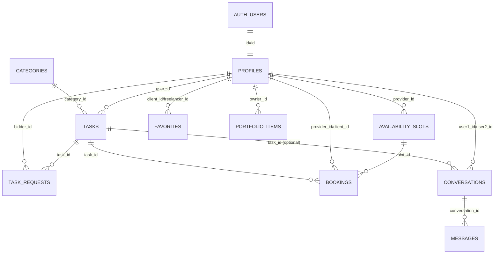
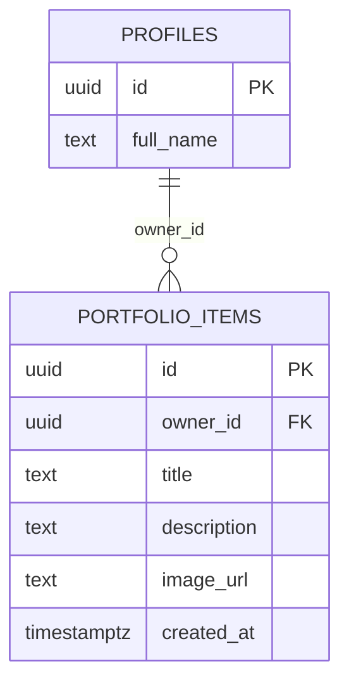
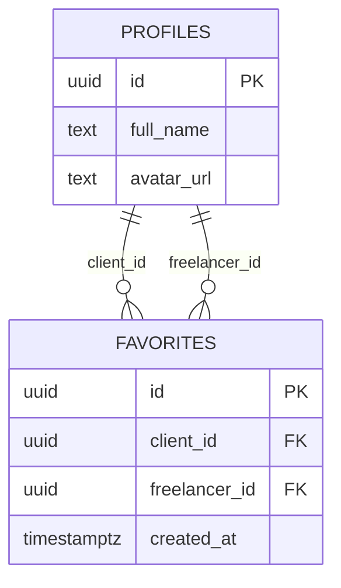
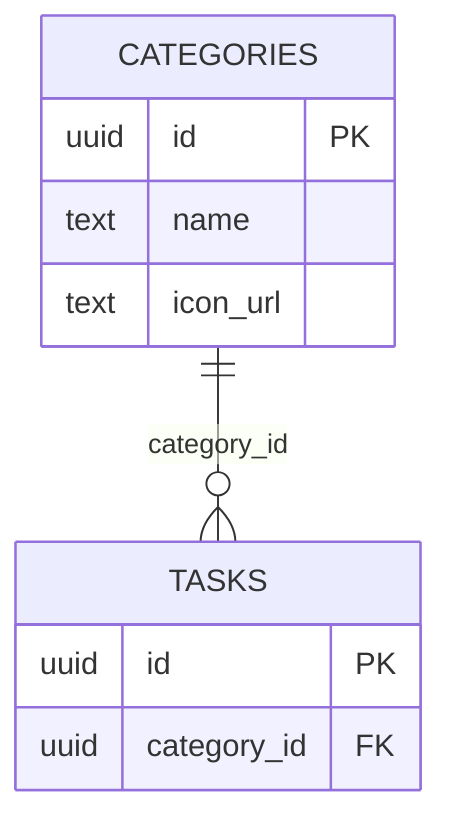
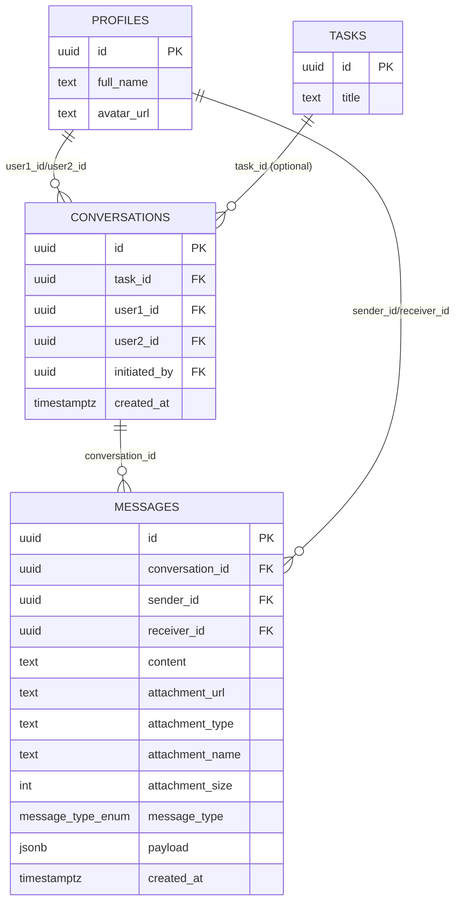

# 🗺️ SLine Developer Guide (Complete Reference)

**Version**: 2.16.7 (orders dashboard decommissioning + dashboard contract sync)
**Last Updated**: 2026-03-01

This comprehensive guide consolidates all feature-specific documentation into a single reference. It includes the system map, architecture overview, and deep-dives for every feature module.

---

## 📑 Table of Contents

- [Profile Feature Reference](#profile-feature-reference)
- [Portfolio Feature Reference](#portfolio-feature-reference)
- [Favorites Feature Reference](#favorites-feature-reference)
- [Saved Feature Reference](#saved-feature-reference)
- [Categories Feature Reference](#categories-feature-reference)
- [Home Feature Reference](#home-feature-reference)
- [Core Module Reference](#core-module-reference)
- [Auth Feature Reference](#auth-feature-reference)
- [Legacy Orders Dashboard (Decommissioned)](#legacy-orders-dashboard-decommissioned)
- [Chat Feature Reference](#chat-feature-reference)
- [Booking Feature Reference](#booking-feature-reference)
- [Order Management Feature Reference](DEVELOPER_GUIDE/Order_Management_Feature.md)
- [Wallet Feature Reference](DEVELOPER_GUIDE/Wallet_Feature.md)
- [Work Management (Unified Flow)](#work-management-unified-flow)
- [Finance & Payment Ledger Reference](#finance--payment-ledger-reference)

---

---

# PART I: SYSTEM OVERVIEW

# 🗺️ SLine System Map (Executive Summary)

This section gives any new contributor a complete map of the SLine app: how it’s built, how data flows through Supabase, and how to safely extend it. Use this as your birds‑eye guide; each feature also has its own deep‑dive document under `Sline_everything/DEVELOPER_GUIDE/`.

## 1. Project Overview

- **Framework**: Flutter (Material 3)
- **Backend**: Supabase (Auth, Postgres, Storage, Realtime, RPC)
- **State Mgmt**: Provider + ChangeNotifier (MVVM per feature)
- **Structure**: `lib/features/<feature>/{view,viewmodels,services,models,data}`
- **Security**: Row Level Security (RLS) on all app tables; UI interacts through repositories/services only.

## 2. Runbook (Local Dev)

- **Prereqs**: Flutter SDK, Dart, Supabase project (URL + anon key)
- **Bootstrap Supabase**: ensure DDL/policies in `Sline_everything/SUPABASE_SETUP.md` are applied
- **Configure client**: initialize Supabase once (see `lib/core/services/supabase_config.dart`)
- **Run**: `flutter run -d <device>`

## 3. Architecture (MVVM, per feature)

- **View (`view/`)**: Widgets/screens, local state only (forms), Material 3. **No direct backend calls** — views must not reference `Supabase.instance` or call `.from()`/`.rpc()`; obtain data via ViewModels and inject repositories/clients via `context.read<>()` (e.g. `SupabaseClient`, `ProfileRepository`, `CategoriesRepository` provided in `main.dart`).
- **ViewModel (`viewmodels/`)**: ChangeNotifier with business logic and UI state. Calls repository/service.
- **Repository/Service (`data/`, `services/`)**: Encapsulate Supabase queries, error mapping, and Storage ops.
- **Models (`models/`)**: Immutable data models mirroring DB rows (UTC timestamps).

**App-level providers** (in `lib/main.dart`): `Provider<SupabaseClient>`, `Provider<ProfileRepository>`, `Provider<CategoriesRepository>` so that views that need to construct ViewModels with a client or repository get them via `context.read<>()` instead of referencing Supabase directly.

Conventions

- **English code/comments** only. **Mounted** checks after async in widgets.
- Store **Storage paths** in DB, not signed URLs; generate signed URLs at render time (if bucket private).
- Use **time-based cursors** for paging (ISO timestamps); convert UTC → local for display.

## 4. Data Model (Key Tables)

| Area       | Tables (FKs)                                                                             | Notes                                                                 |
| ---------- | ---------------------------------------------------------------------------------------- | --------------------------------------------------------------------- |
| Identity   | `auth.users` → `public.profiles(id)`                                                     | App identity row per user; RLS owner-only update.                     |
| Tasks      | `tasks(owner_id, user_id, client_id → profiles.id)`                                      | `owner_id` is the generated canonical owner key; app code keeps compatibility reads on legacy `user_id`/`client_id`. |
| Requests   | `task_requests(task_id, bidder_id → profiles.id)`                                        | Tender only; unique pending per (task,bidder); guarded triggers.      |
| Booking    | `availability_slots(provider_id)` → `bookings(task_id, provider_id, client_id, slot_id)` | RLS enforces roles; status guard trigger.                             |
| Categories | `categories` → `tasks(category_id)`                                                      | DB‑first with unique lower(name).                                     |
| Chat       | `conversations(user1_id,user2_id,task_id,initiated_by)` → `messages(conversation_id)`    | RLS: participants only; DM requires favorite.                         |
| Favorites  | `favorites(client_id, freelancer_id)`                                                    | Unique per pair; used to allow DM creation.                           |
| Portfolio  | `portfolio_items(owner_id)`                                                              | Public bucket by default; can switch to private + signed URLs.        |

### Mini ERD



## 5. Feature Map (Where to look)

- **Core**: `lib/core/` – Supabase bootstrap, logging, theme, utils, shared widgets (signed avatar/image)
- **Auth**: `lib/features/auth/` – signup/login, session
- **Profile**: `lib/features/profile/` – profile edit, avatar upload, role switch, my tasks
- **Tasks**: `lib/features/tasks/` – create/list/details, images, requests (offers)
- **Booking**: `lib/features/booking/` – direct booking checkout, payment recovery, client/provider booking histories
- **Chat**: `lib/features/chat/` – conversations/messages, attachments, realtime
- **Favorites**: `lib/features/favorites/` – client’s saved freelancers, enables DMs
- **Saved**: `lib/features/saved/` – saved (bookmarked) tasks per user
- **Portfolio**: `lib/features/portfolio/` – public gallery of freelancer work
- **Categories**: `lib/features/categories/` – read‑mostly, DB‑first

Each feature has a dedicated deep‑dive under `Sline_everything/DEVELOPER_GUIDE/<Feature>.md` with DB mapping, ERD, snippets, and testing.

## 6. RLS/Policies (Golden Rules)

- Always run under a valid **session**; otherwise every RLS‑protected query fails (42501).
- Insert/update checks use `auth.uid()`: set owner fields server‑side where possible (e.g., `provider_id`, `client_id`, `user_id`).
- Follow setup SQL in `SUPABASE_SETUP.md`: DDL, indexes, policies, and triggers (offers tender‑only, booking guard, slot overlap, DM guard via favorites).

## 7. Storage (Buckets)

| Bucket             | Visibility       | Used by             | Access Pattern                                        |
| ------------------ | ---------------- | ------------------- | ----------------------------------------------------- |
| `avatars`          | Private          | Profile avatars     | Store path; create signed URL at render               |
| `task-images`      | Private          | Task images         | Store path; signed URL per image                      |
| `chat-attachments` | Private          | Message attachments | Store path; short‑lived signed URLs                   |
| `portfolio`        | Public (current) | Portfolio items     | Store public URL (or switch to private + signed URLs) |

## 8. Error Mapping (Common)

**Centralized Utility**: Use `lib/core/utils/error_mapper.dart` for consistent error handling:

```dart
import 'package:sline_app/core/utils/error_mapper.dart';

try {
  await supabaseOperation();
} on PostgrestException catch (e, st) {
  AppLogger.e('Operation failed', tag: 'Service', error: e, stackTrace: st);
  throw Exception(ErrorMapper.map(e));  // Returns user-friendly message
}
```

| Area    | Error                                      | Map to                                             |
| ------- | ------------------------------------------ | -------------------------------------------------- |
| Auth    | `AuthException(Invalid login credentials)` | "Email or password is incorrect."                  |
| RLS     | `Postgrest 42501`                          | "Session expired / Not allowed. Please sign in."   |
| Unique  | `23505` (duplicate)                        | "Already exists." (favorites, offers)              |
| FK      | `23503`                                    | "Related item does not exist."                     |
| Storage | 404                                        | "File not available."                              |
| Storage | 413                                        | "File is too large. Please choose a smaller file." |
| Network | `SocketException`                          | "Cannot reach the server. Check your connection."  |
| Chat    | Trigger payload checks                     | "Offer requires price and days."                   |

**Reference**: See `.cursor/rules/error-handling.mdc` for complete error mapping conventions.

## 9. How to Add a New Feature (Playbook)

- **Schema**: add tables/columns in `SUPABASE_SETUP.md` (DDL, RLS, indexes, triggers). Apply to Supabase.
- **Module skeleton**: `lib/features/new_feature/{view,viewmodels,services,models,data}`.
- **Models**: mirror DB names; timestamps in UTC.
- **Service/Repo**: put all Supabase calls here; never from UI.
- **ViewModel**: ChangeNotifier with loading/error state; expose typed methods for UI.
- **UI**: Material 3, local form state, mounted checks after awaits.
- **Docs**: create `Sline_everything/DEVELOPER_GUIDE/New Feature.md` using the existing template (overview → DB mapping → inventory → ERD → snippets → errors → tests).

## 10. Testing & Quality

- **Unit**: services (mock Supabase), viewmodels state transitions.
- **Widget**: screen interactions (form validation, loading states, snackbars).
- **Integration**: happy‑paths against staging Supabase (auth, RLS, flows).
- **Checklists**: each feature doc ends with a testing checklist; follow it before merging.

## 11. Observability (Crash & Error Tracking)

- **Crash Reporting**: `CrashReportingService` (lib/core/services/crash_reporting_service.dart) abstracts the backend (Sentry/Firebase).
- **Zoned Errors**: `main.dart` uses `runZonedGuarded` to catch concurrent async errors.
- **Flutter Errors**: `FlutterError.onError` is hooked to report UI crashes.
- **Logging**:
  - Use `AppLogger.e(message, error, stackTrace)` for handled exceptions.
  - Use `AppLogger.i/d/w` for standard logs.
  - **Avoid `print()`**: CI/CodeGuard will flag direct print usage.

## 11. Quick Links (Deep Dives)

- Core: `DEVELOPER_GUIDE/Core Module.md`
- Auth: `DEVELOPER_GUIDE/Auth Feature.md`
- Profile: `DEVELOPER_GUIDE/Profile Feature.md`
- Tasks: `DEVELOPER_GUIDE/Task Feature.md`
- Booking: `DEVELOPER_GUIDE/Booking Feature.md`
- Chat: `DEVELOPER_GUIDE/Chat Feature.md`
- Favorites: `DEVELOPER_GUIDE/Favorites Feature.md`
- Saved: `DEVELOPER_GUIDE/Saved Feature.md`
- Portfolio: `DEVELOPER_GUIDE/Portfolio Feature.md`
- Categories: `DEVELOPER_GUIDE/Categories Feature.md`
- Inventory: `DEVELOPER_GUIDE/Inventory Feature.md` (Planned)
- Order Management: `DEVELOPER_GUIDE/Order_Management_Feature.md`

## 12. Gotchas & Tips

- **Offer flow**: only for `task_type='tender'`; unique pending per (task,bidder).
- **DMs**: client‑only; requires freelancer in **favorites**; enforced by triggers.
- **Signed URLs**: keep TTL short; regenerate on demand; never persist signed URLs in DB.
- **Cursors**: prefer time‑based (`created_at`, `starts_at`), not offset paging.
- **Localization**: profile `language` can power a global locale provider.

With this map and the linked deep‑dives, a new engineer can navigate, extend, and debug SLine safely and productively.

---

# PART II: FEATURE DEEP-DIVES

Each section below provides complete documentation for a specific feature module, including database mapping, ERD diagrams, code snippets, error handling, and testing checklists.

---

# Profile Feature Reference

## 1. Human Explanation

The Profile feature manages a user’s app identity beyond `auth.users`. It loads and edits the current user’s `profiles` row, generates signed avatar URLs from the private `avatars` bucket, exposes a lightweight header-only load path for Home, and shows the user’s own tasks. MVVM flow:

- UI in `lib/features/profile/view/` renders the form and actions.
- `ProfileViewModel` orchestrates full profile loads for Profile screens and `loadHeaderProfile()` for Home/dashboard header usage.
- `ProfileRepository` performs self-only `profiles` reads/writes, delegates avatar upload to `AvatarService`, and delegates cross-user summary lookups to `ProfileSummaryService`.

## 2. Database & Supabase Mapping

### 2.1 `public.profiles`

| Column         | Type                              | Purpose / Usage                                    | Notes                                                  |
| -------------- | --------------------------------- | -------------------------------------------------- | ------------------------------------------------------ |
| `id`           | `uuid` (PK, FK → `auth.users.id`) | Identity link to Supabase Auth                     | Primary join key across modules                        |
| `full_name`    | `text`                            | Display name                                       | Editable in Profile screen                             |
| `email`        | `text`                            | Cached email for self-service settings             | Updated alongside Auth when changed                    |
| `bio`          | `text`                            | Short description                                  | Editable in Profile screen                             |
| `active_role`  | `text`                            | `client` or `freelancer`                           | Drives Home/Tasks UX                                   |
| `seller_level` | `seller_level_enum`               | `new_seller` / `level_1` / `level_2` / `top_rated` | Used by Home discovery filters and secure author cards |
| `avatar_url`   | `text`                            | Private storage path in `avatars` bucket           | Use signed URLs for display                            |
| `skills`       | `text[]`                          | Skill tags                                         | Included in summary RPC payload                        |
| `created_at`   | `timestamptz`                     | Creation time (UTC)                                | Default `now()`                                        |

RLS (summary): direct `public.profiles` reads are self-only (`auth.uid() = id`). Cross-user reads must use the authenticated server-side summary RPC `public.rpc_get_profile_summaries(uuid[])`.

### 2.2 Storage buckets (private)

| Bucket    | Purpose        | Used by                            | Notes                                            |
| --------- | -------------- | ---------------------------------- | ------------------------------------------------ |
| `avatars` | Profile images | `AvatarService` and `SignedAvatar` | Store path only; generate signed URL for display |

## 3. File Inventory

| File                                                           | Layer      | Description                                                                                                                      |
| -------------------------------------------------------------- | ---------- | -------------------------------------------------------------------------------------------------------------------------------- |
| `lib/features/profile/data/profile_repository.dart`            | Repository | Wraps self-only `profiles` reads/writes, email updates, role change, password reset, avatar upload, and my-tasks helpers.       |
| `lib/features/profile/services/avatar_service.dart`            | Service    | Uploads avatar to `avatars` bucket and creates short-lived signed URLs. Stores only the storage path in DB.                      |
| `lib/features/profile/services/profile_summary_service.dart`   | Service    | Calls `rpc_get_profile_summaries` and `search_profiles`; only safe summary fields are exposed cross-user.                        |
| `lib/features/profile/view/widgets/profile_preview_modal.dart` | Widget     | Helper `showProfilePreview(context, userId)` to launch public profile in a modal sheet.                                          |
| `lib/features/profile/viewmodels/profile_view_model.dart`      | ViewModel  | `ChangeNotifier` that binds form controllers, updates profile, uploads avatar, handles logout/role change, and exposes full/header load paths. |
| `lib/features/profile/view/profile_screen.dart`                | View       | Material 3 profile UI with form fields, avatar, role toggle, password reset, and sign out.                                       |
| `lib/features/profile/view/widgets/profile_avatar_widget.dart` | Widget     | Renders a profile avatar via a signed URL for a private storage path.                                                            |

## 4. ERD Diagram (Context)

```mermaid
erDiagram
  AUTH_USERS ||--|| PROFILES : "id = id"
  PROFILES ||--o{ TASKS : "user_id"
  PROFILES ||--o{ STORAGE_AVATARS : "avatar_url (path)"

  AUTH_USERS { uuid id PK, text email }
  PROFILES { uuid id PK/FK, text full_name, text email, text bio, text active_role, seller_level_enum seller_level, text avatar_url, timestamptz created_at }
  TASKS { uuid id PK, uuid user_id FK, text title }
  STORAGE_AVATARS { text path PK }
```

```text
auth.users (id, email)
   └── profiles (id=auth.users.id, full_name, email, bio, active_role, seller_level, avatar_url)
            └──(path) avatars bucket (private, signed URLs)
   └── tasks (user_id → profiles.id)
```

## 5. Supabase Snippets

### 5.1 SQL (core operations)

```sql
-- Load my profile
select id, full_name, email, bio, active_role, seller_level, avatar_url
from public.profiles
where id = auth.uid();

-- Update profile fields (RLS enforces id = auth.uid())
update public.profiles
set full_name = 'New Name', bio = 'About me', active_role = 'freelancer'
where id = auth.uid();

-- Change avatar path after upload
update public.profiles
set avatar_url = concat('avatars/', auth.uid(), '/', extract(epoch from now())::bigint, '.jpg')
where id = auth.uid();
```

### 5.2 Dart (supabase_flutter)

```dart
final supabase = Supabase.instance.client;

// Fetch full self profile (ProfileRepository.fetchProfile)
final me = supabase.auth.currentUser!.id;
final row = await supabase
  .from('profiles')
  .select('id, full_name, email, avatar_url, bio, active_role, skills, created_at, seller_level')
  .eq('id', me)
  .single();

// Update profile fields (ProfileRepository.updateProfileFields)
await supabase.from('profiles').update({
  'full_name': fullName,
  'bio': bio,
}).eq('id', me);

// Change auth email (ProfileRepository.updateUserEmail)
await supabase.auth.updateUser(UserAttributes(email: newEmail));

// Upload avatar via AvatarService and save path
final path = await AvatarService(supabase).uploadAvatar(
  userId: me,
  bytes: imageBytes,
  contentType: 'image/jpeg',
  fileExt: 'jpg',
);
await supabase.from('profiles').update({'avatar_url': path}).eq('id', me);

// Create signed URL for display
final signed = await AvatarService(supabase).createSignedUrl(path);

// Fetch safe summaries for task authors / public cards
final summaries = await supabase.rpc('rpc_get_profile_summaries', params: {
  'p_ids': [authorId, anotherAuthorId],
});
```

## 6. Error Handling

| Origin            | Error                | User-Facing Message                     | Mitigation                                         |
| ----------------- | -------------------- | --------------------------------------- | -------------------------------------------------- |
| Profiles update   | `42501` RLS denied   | "Session expired. Please log in again." | Re-authenticate and retry.                         |
| Auth email change | `AuthException`      | "Unable to change email right now."     | Prompt to retry; ensure email is valid and unique. |
| Avatar upload     | `StorageException`   | "Upload failed. Please try again."      | Validate file type/size; retry.                    |
| Signed URL        | Expired URL          | "Image link expired. Refreshing…"       | Regenerate signed URL lazily.                      |
| IDs               | `22P02` invalid UUID | "Invalid identifier."                   | Validate IDs before requests.                      |

## 7. Extra Notes & Testing Checklist

- **Store paths, not signed URLs** in `profiles.avatar_url`; generate signed URLs at render time.
- **UTC**: All timestamps are UTC; convert with `toLocal()` where needed.
- **Session required**: All RLS-protected queries require an active session.
- **Cross-user reads**: Do not query another user from base `profiles`; use `ProfileSummaryService` / `rpc_get_profile_summaries`.
- **Home/Tasks impact**: Updating `active_role` or `seller_level` affects Home/Tasks UX and discovery filters on next load.

Testing checklist:

- Load profile → fields populate in `ProfileViewModel` controllers.
- Update name/bio → persisted in `public.profiles` and reflected in UI.
- Upload avatar → path saved, signed URL generated, and image renders.
- Change email → Auth email updated; cached profile email optional sync.
- Change role → Home reflects the role after reload.
- Fetch my tasks → user’s tasks load and render; delete/update works.

# Portfolio Feature Reference

## 1. Human Explanation

The Portfolio feature lets freelancers showcase their work via items containing title, description, and an image. Items are owned by the profile (`owner_id`) and images are stored under the `portfolio` bucket.

**v2.4 Update (2025-12-16)**: Portfolio management is now also integrated into the Profile module:

- **UI**: `lib/features/profile/view/manage_portfolio_screen.dart` (accessible from Settings)
- **ViewModel**: `ProfileViewModel` handles portfolio CRUD via `fetchPortfolio()`, `addPortfolioItem()`, `updatePortfolioItem()`, `deletePortfolioItem()`
- **Repository**: `ProfileRepository` includes portfolio methods + `uploadPortfolioImage()`
- **Image Picker**: Uses `FilePicker` instead of `ImagePicker` for iOS stability, with `FlutterImageCompress` for optimization
- **Dialog Workaround**: After upload, dialog shows checkmark (not image preview) to avoid iOS native crash

Legacy MVVM flow (if using standalone module):

- UI in `lib/features/portfolio/view/` (screen + sheets + widgets).
- `PortfolioViewModel` orchestrates listing, add, edit, and delete.
- `PortfolioRepository` wraps `PortfolioService` (Storage + PostgREST) and exposes a stable API.

## 2. Database & Supabase Mapping

### 2.1 `public.portfolio_items`

| Column        | Type                        | Purpose / Usage           | Notes                                                            |
| ------------- | --------------------------- | ------------------------- | ---------------------------------------------------------------- |
| `id`          | `uuid` (PK)                 | Portfolio item id         | Default `gen_random_uuid()`                                      |
| `owner_id`    | `uuid` (FK → `profiles.id`) | Owner profile id          | `ON DELETE CASCADE`                                              |
| `title`       | `text`                      | Work title                | Required                                                         |
| `description` | `text`                      | Details                   | Optional                                                         |
| `image_path`  | `text`                      | Storage path (canonical)  | **Canonical**: Store path like `ownerId/filename.jpg`, resolve to signed URL at render |
| `image_url`   | `text`                      | Legacy public URL         | **Deprecated**: Legacy public URL (backwards compatibility only) |
| `created_at`  | `timestamptz`               | When created (UTC)        | Default `now()`                                                  |

Indexes

- `idx_portfolio_owner_created (owner_id, created_at DESC)` for fast listing.

RLS Policies (Summary)

| Table             | Action | Policy                             | Rule                                  |
| ----------------- | ------ | ---------------------------------- | ------------------------------------- |
| `portfolio_items` | SELECT | `portfolio_select_owner_or_public` | `USING (true)` (public-readable)      |
| `portfolio_items` | ALL    | `portfolio_crud_owner`             | `USING/CHECK (auth.uid() = owner_id)` |

### 2.2 Storage bucket

| Bucket      | Visibility | Purpose               | Notes                                                                                               |
| ----------- | ---------- | --------------------- | --------------------------------------------------------------------------------------------------- |
| `portfolio` | Public     | Host portfolio images | Service stores a public URL via `getPublicUrl()`; if switching to private, use signed URLs instead. |

## 3. File Inventory

| File                                                              | Layer      | Description                                                                                                |
| ----------------------------------------------------------------- | ---------- | ---------------------------------------------------------------------------------------------------------- |
| `lib/features/portfolio/data/portfolio_repository.dart`           | Repository | Wraps `PortfolioService` and exposes list/add/delete/update methods; surfaces `currentUser`.               |
| `lib/features/portfolio/services/portfolio_service.dart`          | Service    | Uploads bytes to `portfolio` bucket, produces public URL, inserts/reads/deletes rows in `portfolio_items`. |
| `lib/features/portfolio/models/portfolio_item.dart`               | Model      | Immutable item with `id`, `owner_id`, `title`, `description`, `image_url`, `created_at`.                   |
| `lib/features/portfolio/viewmodels/portfolio_view_model.dart`     | ViewModel  | `ChangeNotifier` that manages paging cursor, adds/edits/deletes and updates the list.                      |
| `lib/features/portfolio/view/portfolio_screen.dart`               | View       | Grid/List of items with pull-to-refresh and load-more.                                                     |
| `lib/features/portfolio/view/sheets/add_portfolio_sheet.dart`     | View       | Form to pick image + enter title/description; calls ViewModel add.                                         |
| `lib/features/portfolio/view/sheets/edit_portfolio_sheet.dart`    | View       | Form to edit title/description; calls ViewModel update.                                                    |
| `lib/features/portfolio/view/sheets/portfolio_details_sheet.dart` | View       | Full-screen preview with details.                                                                          |
| `lib/features/portfolio/view/widgets/portfolio_tile.dart`         | Widget     | Card per item (image + title).                                                                             |

## 4. ERD Diagram



```text
profiles (id) ──< portfolio_items (owner_id)
```

## 5. Supabase Snippets

### 5.1 SQL

```sql
-- Insert a portfolio item (owner-only by RLS)
insert into public.portfolio_items (owner_id, title, description, image_url)
values (auth.uid(), 'Landing Page', 'A marketing website', '<public-url-or-path>')
returning *;

-- List items for a user
select id, title, description, image_url, created_at
from public.portfolio_items
where owner_id = '<profile_id>'
order by created_at desc
limit 30;

-- Update title/description (owner-only)
update public.portfolio_items
set title = 'New Title', description = null
where id = '<item_id>' and owner_id = auth.uid();

-- Delete an item (owner-only)
delete from public.portfolio_items
where id = '<item_id>' and owner_id = auth.uid();
```

### 5.2 Dart (supabase_flutter)

```dart
final supabase = Supabase.instance.client;

// Add item with uploaded image
Future<void> addPortfolioItem({
  required String title,
  String? description,
  required Uint8List imageBytes,
  required String filename,
}) async {
  final ownerId = supabase.auth.currentUser!.id;
  // Upload to Storage
  final path = '$ownerId/${DateTime.now().millisecondsSinceEpoch}_$filename';
  await supabase.storage.from('portfolio').uploadBinary(path, imageBytes,
      fileOptions: const FileOptions(upsert: false));
  final publicUrl = supabase.storage.from('portfolio').getPublicUrl(path);
  // Insert row
  await supabase.from('portfolio_items').insert({
    'owner_id': ownerId,
    'title': title,
    'description': description,
    'image_url': publicUrl,
  });
}

// List items with simple paging cursor
Future<List<Map<String, dynamic>>> listPortfolio({required String ownerId, String? cursorIso, int limit = 30}) async {
  final rows = await supabase
      .from('portfolio_items')
      .select()
      .eq('owner_id', ownerId)
      .order('created_at', ascending: false)
      .limit(limit);
  return (rows as List).cast<Map<String, dynamic>>();
}

// Delete item and optionally remove storage object
Future<void> deletePortfolioItem(String id, {String? publicUrl}) async {
  await supabase.from('portfolio_items').delete().eq('id', id);
  if (publicUrl != null) {
    final marker = '/object/public/portfolio/';
    final idx = publicUrl.indexOf(marker);
    if (idx != -1) {
      final storagePath = publicUrl.substring(idx + marker.length);
      await supabase.storage.from('portfolio').remove([storagePath]);
    }
  }
}
```

## 6. Error Handling

| Origin               | Error                | User-Facing Message                       | Mitigation                             |
| -------------------- | -------------------- | ----------------------------------------- | -------------------------------------- |
| Upload               | `StorageException`   | "Upload failed. Please try again."        | Validate file size/type; retry safely. |
| Insert/Update/Delete | `42501` RLS denied   | "You can only manage your own portfolio." | Ensure session; check ownership.       |
| Delete image         | Storage 404          | "Image already removed."                  | Ignore silently to keep UX smooth.     |
| IDs                  | `22P02` invalid UUID | "Invalid identifier."                     | Validate IDs before requests.          |

## 7. Extra Notes & Testing Checklist

- **Public vs Private**: Current implementation stores a public URL; if privacy is required, store the path and generate signed URLs instead.
- **Paging**: Consider time-based cursors (`created_at`) on the server once SDK supports it.
- **UTC**: All timestamps are UTC; convert to local for display.

Testing checklist:

- Add item (upload + insert) → appears in grid and opens in details.
- Edit title/description → changes persist and reflect in list.
- Delete item → row removed; image cleanup attempted.
- Attempt to edit/delete other user’s item → denied by RLS.

# Favorites Feature Reference

## 1. Human Explanation

The Favorites feature lets a Client bookmark a Freelancer for quick access. It streamlines repeat collaborations and enables a shortcut to start a direct chat (DM) without creating a task first. The implementation follows MVVM:

- UI in `lib/features/favorites/view/` (screen + widgets) stays declarative.
- `FavoritesViewModel` handles list state, add/remove actions, and error surface.
- `FavoritesService` executes Supabase queries under RLS.

## 2. Database & Supabase Mapping

### 2.1 `public.favorites`

| Column          | Type                        | Purpose / Usage                     | Notes                             |
| --------------- | --------------------------- | ----------------------------------- | --------------------------------- |
| `id`            | `uuid` (PK)                 | Favorite record id                  | Default `gen_random_uuid()`       |
| `client_id`     | `uuid` (FK → `profiles.id`) | Who favorites                       | Must equal `auth.uid()` under RLS |
| `freelancer_id` | `uuid` (FK → `profiles.id`) | Who is favorited                    | Used to gate DM creation          |
| `created_at`    | `timestamptz`               | When the favorite was created (UTC) | Default `now()`                   |

Indexes & Constraints

- Unique `(client_id, freelancer_id)` to prevent duplicates.
- Indexes on `client_id` and `freelancer_id` for lookups (see `SUPABASE_SETUP.md`).

RLS Policies (Summary)

| Table       | Action | Policy                 | Rule                     |
| ----------- | ------ | ---------------------- | ------------------------ |
| `favorites` | SELECT | `favorites_select_own` | `client_id = auth.uid()` |
| `favorites` | INSERT | `favorites_insert_own` | `client_id = auth.uid()` |
| `favorites` | DELETE | `favorites_delete_own` | `client_id = auth.uid()` |

Related Policies

- Chat DM creation references `favorites` via `trg_conversations_guard`: only a client can start a non-task conversation with someone in their favorites.

## 3. File Inventory

| File                                                          | Layer     | Description                                                                     |
| ------------------------------------------------------------- | --------- | ------------------------------------------------------------------------------- |
| `lib/features/favorites/data/favorites_service.dart`          | Service   | CRUD for `favorites` with RLS-safe patterns; joins profiles for display.        |
| `lib/features/favorites/models/favorite_model.dart`           | Model     | `FavoriteModel` and `FavoriteWithProfile` (joined row with freelancer profile). |
| `lib/features/favorites/viewmodels/favorites_view_model.dart` | ViewModel | `ChangeNotifier` holding list, loading state, and calling service methods.      |
| `lib/features/favorites/view/favorites_screen.dart`           | View      | List of favorited freelancers with add/remove actions.                          |
| `lib/features/favorites/view/widgets/`                        | Widgets   | Cards/widgets for rendering favorites (if present).                             |
| `lib/features/favorites/routes/favorites_routes.dart`         | Routes    | Navigation entry-points to favorites UI.                                        |

## 4. ERD Diagram



```text
profiles (id) ──< favorites (client_id)
profiles (id) ──< favorites (freelancer_id)
```

## 5. Supabase Snippets

### 5.1 SQL

```sql
-- Add a favorite (RLS ensures client_id = auth.uid())
insert into public.favorites (client_id, freelancer_id)
values (auth.uid(), '<freelancer_id>');

-- List my favorites with freelancer profile
select f.created_at, p.id, p.full_name, p.avatar_url
from public.favorites f
join public.profiles p on p.id = f.freelancer_id
where f.client_id = auth.uid()
order by f.created_at desc;

-- Remove a favorite I own
delete from public.favorites
where client_id = auth.uid() and freelancer_id = '<freelancer_id>';
```

### 5.2 Dart (supabase_flutter)

```dart
final supabase = Supabase.instance.client;

// Add
Future<void> addFavorite(String freelancerId) async {
  await supabase.from('favorites').insert({
    'client_id': supabase.auth.currentUser!.id,
    'freelancer_id': freelancerId,
  });
}

// List (simple)
Future<List<Map<String, dynamic>>> listFavorites() async {
  final rows = await supabase
      .from('favorites')
      .select()
      .eq('client_id', supabase.auth.currentUser!.id)
      .order('created_at', ascending: false);
  return (rows as List).cast<Map<String, dynamic>>();
}

// List with profile fields
Future<List<Map<String, dynamic>>> listFavoritesWithProfile() async {
  final rows = await supabase
      .from('favorites')
      .select('created_at, freelancer:freelancer_id (id, full_name, avatar_url)')
      .eq('client_id', supabase.auth.currentUser!.id)
      .order('created_at', ascending: false);
  return (rows as List).cast<Map<String, dynamic>>();
}

// Remove
Future<void> removeFavorite(String freelancerId) async {
  await supabase.from('favorites')
      .delete()
      .eq('client_id', supabase.auth.currentUser!.id)
      .eq('freelancer_id', freelancerId);
}

// Friendly error mapping
Future<void> safeAddFavorite(String freelancerId) async {
  try {
    await addFavorite(freelancerId);
  } on PostgrestException catch (e) {
    if (e.code == '23505') {
      throw const FormatException('This freelancer is already in your favorites.');
    }
    if (e.code == '42501') {
      throw const FormatException('You can only manage your own favorites.');
    }
    rethrow;
  }
}
```

## 6. Error Handling

| Origin       | Error                    | User-Facing Message                             | Mitigation                                               |
| ------------ | ------------------------ | ----------------------------------------------- | -------------------------------------------------------- |
| Add favorite | `23505` unique violation | "This freelancer is already in your favorites." | Disable button or show success state if already present. |
| Any CRUD     | `42501` RLS denied       | "You can only manage your own favorites."       | Ensure session and use current `auth.uid()`.             |
| Fetch join   | Missing profile row      | "Profile unavailable."                          | Render placeholder name/avatar.                          |

## 7. Extra Notes & Testing Checklist

- **DM integration**: Starting a non-task conversation requires the freelancer to be in the client’s favorites; enforced by triggers/policies in conversations.
- **UTC**: `created_at` is UTC; format with `formatUtcToLocal()` for display.
- **Performance**: Use the simple list for most screens; join with profiles only when fields are needed.

Testing checklist:

- Add → list shows the freelancer at top.
- Add same freelancer again → unique violation mapped to friendly copy.
- Remove → disappears from list and server.
- Attempt cross-user delete → denied by RLS.
- Start DM from a favorite → allowed by conversations guard.

# Saved Feature Reference

## 1. Human Explanation

The Saved feature lets an authenticated user bookmark tasks for quick access. It is private per-user and shows a list with navigation to task details. Architecture:

- UI in `lib/features/saved/view/` renders saved tasks and toggles.
- `SavedTasksViewModel` manages state (ids + full tasks), loading, and friendly errors.
- `SavedTasksService` performs PostgREST calls to `saved_tasks` and joins `tasks` when needed.

## 2. Database & Supabase Mapping

### 2.1 `public.saved_tasks`

| Column       | Type                        | Purpose / Usage       | Notes                         |
| ------------ | --------------------------- | --------------------- | ----------------------------- |
| `id`         | `uuid` (PK)                 | Saved entry id        | Default `gen_random_uuid()`   |
| `user_id`    | `uuid` (FK → `profiles.id`) | Owner of the bookmark | Must equal `auth.uid()` (RLS) |
| `task_id`    | `uuid` (FK → `tasks.id`)    | Bookmarked task       | Unique with `user_id`         |
| `created_at` | `timestamptz`               | When saved (UTC)      | Default `now()`               |

Indexes & Constraints

- Unique `(user_id, task_id)` prevents duplicates.
- (Typical) index on `user_id` for listing performance.

RLS Policies (Summary)

| Table         | Action | Policy     | Rule                   |
| ------------- | ------ | ---------- | ---------------------- |
| `saved_tasks` | SELECT | owner-only | `user_id = auth.uid()` |
| `saved_tasks` | INSERT | owner-only | `user_id = auth.uid()` |
| `saved_tasks` | DELETE | owner-only | `user_id = auth.uid()` |

## 3. File Inventory

| File                                                        | Layer     | Description                                                                      |
| ----------------------------------------------------------- | --------- | -------------------------------------------------------------------------------- |
| `lib/features/saved/data/saved_tasks_service.dart`          | Service   | CRUD: listMine, isSaved, add, remove, toggle, listMineWithDetails (join tasks).  |
| `lib/features/saved/models/saved_task_model.dart`           | Model     | Maps `saved_tasks` rows; typed fields `id`, `user_id`, `task_id`, `created_at`.  |
| `lib/features/saved/viewmodels/saved_tasks_view_model.dart` | ViewModel | Holds saved ids and full tasks; load/refresh/toggle with friendly error mapping. |
| `lib/features/saved/view/saved_tasks_screen.dart`           | View      | List UI with remove/open actions; uses ViewModel.                                |
| `lib/features/saved/view/widgets/saved_task_tile.dart`      | Widget    | Renders one saved task card/tile.                                                |
| `lib/features/saved/routes/saved_routes.dart`               | Routes    | Navigation to Saved screen.                                                      |

## 4. ERD Diagram

```mermaid
erDiagram
  PROFILES ||--o{ SAVED_TASKS : "user_id"
  TASKS    ||--o{ SAVED_TASKS : "task_id"

  PROFILES { uuid id PK }
  TASKS { uuid id PK, text title }
  SAVED_TASKS { uuid id PK, uuid user_id FK, uuid task_id FK, timestamptz created_at }
```

```text
profiles (id) ──< saved_tasks (user_id)
tasks (id)    ──< saved_tasks (task_id)
```

## 5. Supabase Snippets

### 5.1 SQL

```sql
-- Save a task (owner-only by RLS)
insert into public.saved_tasks (user_id, task_id)
values (auth.uid(), '<task_id>');

-- Fetch my saved tasks
select * from public.saved_tasks
where user_id = auth.uid()
order by created_at desc;

-- Remove a saved task
// List Mine with Manual Join (RLS-safe summary enrichment)
// We fetch tasks first, then fetch safe profile summaries, and merge manually.
Future<List<Task>> listMineWithDetails() async {
  // 1. Fetch saved tasks with basic task details
  final res = await _client
      .from('saved_tasks')
      .select('task:tasks(*)')
      .eq('user_id', uid)
      .order('created_at', ascending: false);

  // 2. Extract user IDs
  final userIds = res.map((r) => r['task']['user_id']).toSet().toList();

  // 3. Fetch safe profile summaries through the RPC boundary
  final summaries = await ProfileSummaryService(_client).fetchByIds(
    userIds.whereType<String>(),
  );

  // 4. Merge
  return res.map((row) {
    final taskJson = row['task'];
    final profile = summaries[taskJson['user_id']];
    var task = Task.fromJson(taskJson);
    if (profile != null) {
      task = task.copyWith(
        userName: profile.fullName,
        userAvatar: profile.avatarUrl,
        authorSellerLevel: profile.sellerLevel,
      );
    }
    return task;
  }).toList();
}
```

### 5.3 Workarounds

- **PGRST200 on Join**: The direct join `.select('task:tasks(*, profiles!tasks_user_id_fkey(*))')` is not relied on. Saved-task enrichment uses a **manual 2-step fetch** plus `rpc_get_profile_summaries` so cross-user reads stay compatible with self-only `profiles` RLS.

### 5.2 Dart (supabase_flutter)

```dart
final supabase = Supabase.instance.client;

class SavedTasksService {
  Future<List<Map<String, dynamic>>> listMine() async {
    final rows = await supabase
        .from('saved_tasks')
        .select()
        .eq('user_id', supabase.auth.currentUser!.id)
        .order('created_at', ascending: false);
    return (rows as List).cast<Map<String, dynamic>>();
  }

  Future<bool> isSaved(String taskId) async {
    final row = await supabase
        .from('saved_tasks')
        .select('id')
        .eq('user_id', supabase.auth.currentUser!.id)
        .eq('task_id', taskId)
        .maybeSingle();
    return row != null;
  }

  Future<void> add(String taskId) async {
    await supabase.from('saved_tasks').insert({
      'user_id': supabase.auth.currentUser!.id,
      'task_id': taskId,
    });
  }

  Future<void> remove(String taskId) async {
    await supabase
        .from('saved_tasks')
        .delete()
        .eq('user_id', supabase.auth.currentUser!.id)
        .eq('task_id', taskId);
  }

  Future<bool> toggle(String taskId) async {
    final already = await isSaved(taskId);
    if (already) { await remove(taskId); return false; }
    try {
      await add(taskId); return true;
    } on PostgrestException catch (e) {
      if (e.code == '23505') return true; // unique violation → already saved
      rethrow;
    }
  }
}
```

## 6. Error Handling

| Origin        | Error                    | User-Facing Message                        | Mitigation                            |
| ------------- | ------------------------ | ------------------------------------------ | ------------------------------------- |
| Add duplicate | `23505` unique violation | "This task is already in your saved list." | Treat as success (already saved).     |
| Any CRUD      | `42501` RLS denied       | "Please sign in to manage saved tasks."    | Ensure session; map to friendly copy. |
| Join details  | Missing task row         | "This task is no longer available."        | Hide card; allow cleanup removal.     |

## 7. Extra Notes & Testing Checklist

- **Privacy**: Saved entries are per-user; never expose other users’ saved tasks.
- **UX**: Toggle should optimistically update the icon, with background refresh of full list.
- **UTC**: Use `formatUtcToLocal()` when displaying `created_at`.

Testing checklist:

- Save → appears in list; icon toggles immediately.
- Save the same task twice → duplicate is handled gracefully.
- Remove → disappears; toggle syncs across Home/Saved screens.
- Access when signed out → friendly prompt and no data leakage.
  ⸻

  ✅ That’s the full documentation for Categories.

⸻

# Categories Feature Reference

## 1. Human Explanation

The categories module provides a read-mostly catalog of service categories (e.g., "Design", "Development"). It powers dropdowns and filters in `tasks` creation and browsing. Admins seed and manage categories; regular users only read them. The feature is implemented with MVVM: `CategoriesViewModel` coordinates reads via `CategoriesRepository` → `CategoriesService`, and UI in `categories_screen.dart` remains declarative.

## 2. Database & Supabase Mapping

### 2.1 `public.categories`

| Column       | Type          | Purpose / Usage        | Notes                                                |
| ------------ | ------------- | ---------------------- | ---------------------------------------------------- |
| `id`         | `uuid` (PK)   | Category identifier    | Default `gen_random_uuid()`                          |
| `name`       | `text`        | Human-readable name    | Unique (case-insensitive) via index on `lower(name)` |
| `icon_url`   | `text`        | Optional icon path/URL | Nullable                                             |
| `created_at` | `timestamptz` | Created timestamp      | Default `now()` (UTC)                                |

### 2.2 `public.tasks` (relevant FK)

| Column        | Type                          | Purpose / Usage          | Notes                              |
| ------------- | ----------------------------- | ------------------------ | ---------------------------------- |
| `category_id` | `uuid` (FK → `categories.id`) | Tasks link to a category | Indexed as `idx_tasks_category_id` |

### 2.3 Indexes & Constraints

- `uq_categories_name`: `UNIQUE (lower(name))` prevents duplicates with different cases.
- `idx_categories_name_lower`: index on `lower(name)` accelerates search/sort.
- `idx_tasks_category_id`: speeds up task filtering by category.

### 2.4 RLS Policies (Summary)

| Table               | Action               | Who                | Rule / Notes                                 |
| ------------------- | -------------------- | ------------------ | -------------------------------------------- |
| `public.categories` | SELECT               | Authenticated      | Read-only for app users                      |
| `public.categories` | INSERT/UPDATE/DELETE | Admin/Service role | Managed via seeds/Dashboard (not by clients) |
| `public.tasks`      | SELECT               | Authenticated      | Standard app-wide policy                     |

## 3. File Inventory

| File                                                            | Layer      | Description                                                                                                          |
| --------------------------------------------------------------- | ---------- | -------------------------------------------------------------------------------------------------------------------- |
| `lib/features/categories/services/categories_service.dart`      | Service    | Executes PostgREST reads from `public.categories`, provides simple in-memory cache, and client-side search fallback. |
| `lib/features/categories/data/categories_repository.dart`       | Repository | Wraps the service, exposes `getAll`, `getById`, `getCachedOrFetch`, and surfaces `currentUser`.                      |
| `lib/features/categories/viewmodels/categories_view_model.dart` | ViewModel  | `ChangeNotifier` handling loading state, errors, search query, and list data.                                        |
| `lib/features/categories/view/categories_screen.dart`           | View       | Material 3 UI for listing/searching categories using the ViewModel.                                                  |
| `lib/features/categories/models/category_model.dart`            | Model      | Immutable model mapping DB columns (`id`, `name`, `icon_url`, `created_at`) with UTC handling.                       |

## 4. ERD Diagram



```text
categories (id, name, icon_url)
     │
     └──< tasks (category_id)
```

## 5. Supabase Snippets

### 5.1 SQL

```sql
-- Read categories (app users)
select id, name, icon_url from public.categories order by name asc;

-- Insert a category (admin/service role only)
insert into public.categories (name, icon_url) values ('Design', 'icons/design.png');

-- Update a category name (admin only)
update public.categories set name = 'UI/UX Design' where id = '...';

-- Delete a category (admin only)
delete from public.categories where id = '...';

-- Tasks by category name
select t.*
from public.tasks t
join public.categories c on c.id = t.category_id
where lower(c.name) = lower('Design');
```

### 5.2 Dart (supabase_flutter)

```dart
final supabase = Supabase.instance.client;

// Fetch all categories ordered by name (matches CategoriesService.getAll)
Future<List<CategoryModel>> fetchCategories({int limit = 200}) async {
  final rows = await supabase
      .from('categories')
      .select()
      .order('name', ascending: true)
      .limit(limit);

  return (rows as List<dynamic>)
      .map((e) => CategoryModel.fromJson(e as Map<String, dynamic>))
      .toList();
}

// Get a single category by id (may return null)
Future<CategoryModel?> getCategoryById(String id) async {
  final row = await supabase
      .from('categories')
      .select()
      .eq('id', id)
      .maybeSingle();
  return row == null ? null : CategoryModel.fromJson(row as Map<String, dynamic>);
}

// Friendly error mapping example for a write (admin-only path)
Future<void> adminRenameCategory(String id, String newName) async {
  try {
    await supabase
        .from('categories')
        .update({'name': newName})
        .eq('id', id);
  } on PostgrestException catch (e) {
    if (e.code == '23505') {
      throw const FormatException('A category with that name already exists.');
    }
    if (e.code == '42501') {
      throw const FormatException('You do not have permission to modify categories.');
    }
    rethrow;
  }
}
```

## 6. Error Handling

| Origin          | Error                         | User Message                                         | Mitigation                           |
| --------------- | ----------------------------- | ---------------------------------------------------- | ------------------------------------ |
| Read categories | Network/timeout               | "Unable to fetch categories. Check your connection." | Retry with cached data if available. |
| Admin writes    | 23505 (unique violation)      | "A category with that name already exists."          | Suggest a different name.            |
| Admin writes    | 42501 (RLS/permission denied) | "You do not have permission to modify categories."   | Use service role/admin tools.        |
| Any             | 22P02 (invalid input syntax)  | "Invalid identifier provided."                       | Validate IDs before sending.         |

## 7. Extra Notes & Testing Checklist

- **Caching**: `CategoriesService` maintains a simple in-memory cache; call `clearCache()` to refresh.
- **UTC**: `created_at` is UTC; no conversion needed for display beyond human formatting.
- **Search**: Service performs client-side search when SDK lacks `.ilike`; consider server-side search later.
- **Seeding**: See `SUPABASE_SETUP.md` for seed values and indexes (`uq_categories_name`, `idx_categories_name_lower`).

Testing checklist:

- **List**: Fetch categories and verify alphabetical ordering.
- **Search**: Apply a search query and confirm client-side filter works.
- **Cache**: Verify `getCachedOrFetch()` returns cached data after a first load.
- **Tasks join**: Query tasks by `category_id` and ensure correct filtering.
- **Permission**: Attempt a write with a user token and confirm RLS denial.

# Home Feature Reference

## 1. Human Explanation

The Home feature is the authenticated discovery surface. It shows a searchable, filterable feed of open tasks, applies client-side discovery filters over the loaded window, and shares its list behavior with the Tender and Booking discovery screens. It follows MVVM:

- UI in `lib/features/home/view/` renders search/filter controls and task list.
- `HomeViewModel` loads the feed with a composite pagination cursor (`created_at`, `id`), implements the shared `DiscoveryFeedViewModelContract`, and updates `TaskFilterViewModel`.
- `TaskService` provides the Supabase reads for tasks and enriches author display data through `rpc_get_profile_summaries`.
- `TaskFilterViewModel` applies search, category, price, delivery-time, and seller-level filters to the loaded discovery window and emits privacy-safe filter telemetry.

## 2. Database & Supabase Mapping

Home does not own tables; it reads from feature tables to populate the dashboard.

### 2.1 `public.tasks` (consumed)

| Column        | Type                        | Purpose / Usage             | Notes                                                   |
| ------------- | --------------------------- | --------------------------- | ------------------------------------------------------- |
| `id`          | `uuid`                      | Task id                     | Used for navigation/details and composite pagination    |
| `title`       | `text`                      | Headline                    | Shown in list cards                                     |
| `description` | `text`                      | Summary                     | Displayed in `TaskCard`                                 |
| `budget`      | `numeric`/`bigint`          | Price field                 | Formatted via `format_price.dart`                       |
| `user_id`     | `uuid` (FK → `profiles.id`) | Author                      | Enriched with safe summary data via RPC                 |
| `status`      | `text`/enum                 | Feed visibility             | Home fetch uses `status = 'open'`                       |
| `task_type`   | enum                        | Tender vs booking behavior  | Seller-level filters exclude tenders                    |
| `category_id` | `uuid` (FK)                 | Category filter             | Joined to `categories(name)`                            |
| `created_at`  | `timestamptz`               | Primary sort / cursor value | Ordered `DESC`; tied rows use `id DESC` as tiebreaker   |
| `deadline`    | `timestamptz`               | Delivery estimate fallback  | Used when booking packages do not provide delivery days |
| `packages`    | `jsonb`                     | Booking delivery estimates  | Min `delivery` value drives delivery-time filters       |
| `image_paths` | `text[]`                    | Thumbnails                  | Shown by `TaskCard` via signed images                   |

Related tables/contracts: `public.categories` for labels and `public.rpc_get_profile_summaries(uuid[])` for author name/avatar/seller level.

RLS: Home reads depend on authenticated-only `public.tasks` access. Direct `public.profiles` reads are self-only and are not part of Home feed rendering.

## 3. File Inventory

| File                                                        | Layer     | Description                                                                                       |
| ----------------------------------------------------------- | --------- | ------------------------------------------------------------------------------------------------- |
| `lib/features/home/view/home_screen.dart`                   | View      | Discovery UI with search, filters, refresh, and navigation to details/create/saved tasks.          |
| `lib/features/home/view/widgets/filters_modal.dart`         | Widget    | Bottom sheet for sort, category, price, delivery-time, and seller-level filters.                   |
| `lib/features/home/viewmodels/home_view_model.dart`         | ViewModel | `ChangeNotifier` that loads/refreshes featured tasks, tracks composite pagination, and updates filters. |
| `lib/features/tasks/viewmodels/discovery_feed_view_model_contract.dart` | ViewModel contract | Shared discovery-feed API consumed by Home, Tenders, and Bookings without a Home-specific dependency. |
| `lib/features/tasks/view/widgets/discovery_task_sliver.dart`| Widget    | Shared list/empty/load-more sliver used by Home, Tenders, and Bookings discovery surfaces.         |
| `lib/features/tasks/viewmodels/task_filter_view_model.dart` | ViewModel | Holds filtered list, search text, category, price, delivery-time, seller-level, and sort state.   |

## 4. ERD Diagram (Context)

```mermaid
erDiagram
  CATEGORIES ||--o{ TASKS : "category_id"

  CATEGORIES { uuid id PK, text name }
  TASKS { uuid id PK, uuid user_id FK, uuid category_id FK, text title, text description, timestamptz created_at }
```

```text
categories (id) ──< tasks (category_id)
```

## 5. Supabase Snippets

### 5.1 Dart (reads used by Home)

```dart
final supabase = Supabase.instance.client;

// Fetch open tasks for Home with composite cursor (as in TaskService)
final rows = await supabase
  .from('tasks')
  .select('id, title, description, budget, user_id, status, task_type, category_id, category, created_at, deadline, skills, image_paths, categories(name)')
  .eq('status', 'open')
  .order('created_at', ascending: false)
  .order('id', ascending: false);

// Then enrich unique author ids via rpc_get_profile_summaries(p_ids)
final authorSummaries = await supabase.rpc('rpc_get_profile_summaries', params: {
  'p_ids': rows.map((row) => row['user_id']).toSet().toList(),
});
```

### 5.2 Filter logic (ViewModel collaboration)

```dart
// HomeViewModel.loadFeaturedTasks(...) populates TaskFilterViewModel
await homeViewModel.loadFeaturedTasks(filterController: context.read<TaskFilterViewModel>());

// Delivery and seller-level filters are applied client-side over the loaded feed window.
context.read<TaskFilterViewModel>().toggleDeliveryTime('Up to 3 days');
context.read<TaskFilterViewModel>().toggleSellerLevel('Level 2');
```

## 6. Error Handling

| Origin       | Error             | User Message                    | Mitigation                                       |
| ------------ | ----------------- | ------------------------------- | ------------------------------------------------ |
| Task fetch   | Network/PostgREST | "Unable to load tasks."         | Retry with pull-to-refresh; log via `AppLogger`. |
| Profile join | Missing profile   | "Author profile unavailable."   | Render placeholder name/avatar.                  |
| RLS          | Permission denied | "Please sign in to view tasks." | Ensure valid session.                            |

## 7. Extra Notes & Testing Checklist

- **Performance**: Avoid N+1 joins in UI; TaskService already batches and hydrates author names/avatars.
- **UTC**: Times are UTC; convert with `formatUtcToLocal()` for display.
- **Saved tasks**: Home integrates with `SavedTasksViewModel` to sync bookmark icons after refresh.

Testing checklist:

- Home loads with featured open tasks on first display.
- Search and category filter update the list immediately.
- Pull-to-refresh reloads tasks and syncs saved-state icons.
- Navigate to task details and back; state is preserved.
- Create a new task → returning to Home refreshes and shows it if `open`.


# Core Module Reference

## 1. Human Explanation

The core module (`lib/core/`) contains runtime infrastructure shared across the whole app:
- Supabase bootstrap and shared service contracts
- payment orchestration helpers used by booking flows
- logging, crash reporting, and error filtering
- theme tokens, shared widgets, and formatting utilities
- small shared models used across multiple features

It is the place for cross-feature code. Feature-specific business rules stay in `lib/features/<feature>/`.

## 2. Platform and Supabase Mapping

Core does not own product tables, but it provides the app-wide runtime used to read them safely.

### 2.1 Shared Supabase resources consumed by core

| Resource | Purpose | Used by | Notes |
| --- | --- | --- | --- |
| `public.profiles` | shared user identity metadata | `UserProfile`, `SignedAvatar` consumers | avatar path is stored in DB; signed URL is created at render time |
| `avatars` bucket | private avatar storage | `SignedAvatar`, profile flows | signed URL required for display |
| `task-images` bucket | private task image storage | `SignedImage`, task flows | signed URL required for display |
| `chat-attachments` bucket | private chat file storage | chat feature widgets/services | same signed-URL pattern |

### 2.2 Shared payment runtime contracts

Core owns the app-side payment runtime interfaces used by the booking feature:
- `PaymentService`: abstract contract for payment providers
- `QiCardPaymentService`: server-backed QiCard integration
- `DemoPaymentService`: fallback/demo provider
- `PaymentPendingStore`: persists pending browser payment state on web
- `payment_runtime_config.dart`: callback host validation and callback parsing

### 2.3 Web safety helpers

Core also owns two browser-specific stability helpers:
- `LoadingUtils.show(...) -> LoadingHandle`: overlay-based loading UI with no navigator mutation
- `flutter_error_filters.dart`: filters the known disposed `EngineFlutterView` assertion on web before crash-reporting/log spam

## 3. File Inventory

| File | Layer | Description |
| --- | --- | --- |
| `lib/core/services/supabase_config.dart` | bootstrap | Initializes Supabase once and exposes the shared client. |
| `lib/core/services/logger_service.dart` | service | `AppLogger` for structured debug/error logging. |
| `lib/core/services/crash_reporting_service.dart` | service | Crash-reporting abstraction with a quiet no-op implementation by default. |
| `lib/core/services/payment_service.dart` | contract | Shared payment DTOs and the `PaymentService` interface. |
| `lib/core/services/demo_payment_service.dart` | service | Local/demo payment implementation and legacy fallback path. |
| `lib/core/services/qicard_payment_service.dart` | service | Server-backed QiCard create/recover/refund orchestration. |
| `lib/core/services/payment_pending_store.dart` | service | Persists pending payment context across same-tab web redirects. |
| `lib/core/services/deep_link_service.dart` | service | Shared deep-link plumbing used by app navigation flows. |
| `lib/core/config/payment_runtime_config.dart` | config | Compile-time finish URL, callback host rules, payment callback parsing. |
| `lib/core/utils/loading_utils.dart` | utility | Root overlay loading helper that returns an idempotent `LoadingHandle`. |
| `lib/core/utils/flutter_error_filters.dart` | utility | Filters the known web engine disposal assertion. |
| `lib/core/utils/error_mapper.dart` | utility | Shared PostgREST/Auth/network error mapping. |
| `lib/core/utils/format_date.dart` | utility | UTC-to-local date/time formatting helpers. |
| `lib/core/utils/format_price.dart` | utility | Shared price formatting helpers. |
| `lib/core/utils/signed_url_cache.dart` | utility | Short-lived cache for generated signed URLs. |
| `lib/core/providers/navigation_provider.dart` | provider | Global navigation tab state. |
| `lib/core/providers/theme_mode_provider.dart` | provider | Light/dark theme mode state. |
| `lib/core/models/user_profile.dart` | model | Shared typed profile model. |
| `lib/core/models/payment_return_args.dart` | model | Shared typed browser payment callback payload. |
| `lib/core/theme/app_colors.dart` | theme | Central palette definitions. |
| `lib/core/theme/app_dimens.dart` | theme | Spacing, radius, sizing tokens. |
| `lib/core/theme/app_typography.dart` | theme | Shared typography and fallback font configuration. |
| `lib/core/theme/app_theme.dart` | theme | Builds the app `ThemeData` and `AppThemeExtension`. |
| `lib/core/widgets/custom_bottom_nav_bar.dart` | widget | Shared app shell bottom nav. |
| `lib/core/widgets/signed_avatar.dart` | widget | Renders private avatar paths through signed URLs. |
| `lib/core/widgets/signed_image.dart` | widget | Renders private image paths through signed URLs. |

## 4. Runtime Patterns

### 4.1 App bootstrap

- `main.dart` initializes Supabase through `SupabaseConfig.init()`.
- Shared providers are registered at app root, including `SupabaseClient`, `ProfileRepository`, `CategoriesRepository`, and `PaymentPendingStore`.
- `FlutterError.onError`, `PlatformDispatcher.instance.onError`, and `runZonedGuarded` are wired through the core logging/crash-reporting path.

### 4.2 Loading overlays

The current pattern is overlay-based, not dialog-based.

```dart
final loader = LoadingUtils.show(context, debugLabel: 'open_chat');
try {
  await doSomethingAsync();
} finally {
  loader.close();
}
```

Do not use `Navigator.pop()` to dismiss loading UI. The old `LoadingUtils.hide(context)` pattern is obsolete.

### 4.3 Web payment callback parsing

```dart
final paymentReturn = parsePaymentReturnArgs(Uri.base);
if (paymentReturn != null) {
  return PaymentReturnScreen(initialArgs: paymentReturn);
}
```

The callback parser validates host + path shape against `kQiCardFinishUrl` and `buildQiCardCallbackHosts()`.

### 4.4 Typography and fallback fonts

`AppTypography` now centralizes fallback font families for missing glyphs:
- `Noto Sans`
- `Noto Sans Arabic`
- `Roboto`
- `Arial`
- `sans-serif`

This allows user-generated Arabic text to render without forcing feature code to manage font fallback.

## 5. Error Handling Notes

| Origin | Error | Handling |
| --- | --- | --- |
| Supabase bootstrap | bad URL/key/session setup | fail fast during app startup; log through `AppLogger` |
| Signed URL creation | missing object / expired URL | return placeholder and regenerate URL when needed |
| Web engine assertion | disposed `EngineFlutterView` | filtered by `isIgnoredFlutterWebEngineDisposeError(...)` |
| Payment callback parsing | invalid host / invalid booking reference | handled in `PaymentReturnScreen` with explicit terminal messaging |

## 6. Testing Checklist

- Boot the app and confirm `SupabaseConfig.init()` succeeds before rendering feature screens.
- Render `SignedAvatar` and `SignedImage` using valid private paths.
- Verify `LoadingHandle.close()` is safe even when a route closes during async work.
- On web, confirm a payment callback loads `PaymentReturnScreen` instead of falling back to the main shell immediately.
- Confirm the known disposed `EngineFlutterView` assertion is filtered and not duplicated in debug logs.
- Confirm Arabic user-generated text renders with the theme fallback stack.


# Auth Feature Reference

## 1. Human Explanation

The auth feature is the gatekeeper for the app. It handles:
- email/password sign up
- email/password sign in
- password reset initiation
- session-aware logout
- loading the signed-in user's profile row after authentication

The current architecture is MVVM with repository-backed data access:
- views render forms and navigation
- `AuthViewModel` owns loading/error state and session listeners
- `AuthRepository` owns Supabase Auth and `profiles` reads/writes

`AuthViewModel` does not hold a `BuildContext`. It returns success/failure to the UI and exposes an `onSessionExpired` callback that is wired by `main.dart`.

## 2. Database and Supabase Mapping

| Resource | Purpose | Notes |
| --- | --- | --- |
| `auth.users` | primary Supabase identity | created by `supabase.auth.signUp()` |
| `public.profiles` | app-level user profile row | inserted after successful signup/session establishment |
| `auth.sessions` | active authenticated session | required for any RLS-protected follow-up query |

### `public.profiles` fields used by auth flows

| Column | Type | Purpose |
| --- | --- | --- |
| `id` | `uuid` | matches `auth.users.id` |
| `full_name` | `text` | captured at signup |
| `email` | `text` | cached for app reads |
| `avatar_url` | `text` | optional storage path, used elsewhere |
| `role` | `text` | current persona used by the UI |
| `created_at` | `timestamptz` | audit timestamp |

### RLS Summary

- `profiles` insert/update/select works only when `auth.uid() = id`.
- Auth APIs themselves are handled by Supabase Auth, but profile bootstrapping still depends on a live session.
- The repository therefore ensures a session exists before inserting the `profiles` row on signup.

## 3. File Inventory

| File | Layer | Description |
| --- | --- | --- |
| `lib/features/auth/data/auth_repository.dart` | repository | Owns signup, signin, signout, password reset, and current profile fetch. |
| `lib/features/auth/viewmodels/auth_view_model.dart` | viewmodel | Tracks loading/error state, maps auth errors, listens for auth-state changes, exposes `onSessionExpired`. |
| `lib/features/auth/view/login_screen.dart` | view | Login form and success/failure UI. |
| `lib/features/auth/view/signup_screen.dart` | view | Registration form and profile bootstrap entrypoint. |
| `lib/features/auth/view/forgot_password_screen.dart` | view | Password reset request UI. |

There is no live `lib/features/auth/services/auth_service.dart` file anymore. `AuthRepository` is the current single source of truth for auth data access.

## 4. Current Flow

### 4.1 Sign up

1. `SignupScreen` calls `AuthViewModel.register(...)`.
2. `AuthViewModel` delegates to `AuthRepository.signUp(...)`.
3. `AuthRepository` calls `supabase.auth.signUp(...)`.
4. If Supabase does not return a session immediately, the repository signs in with the same credentials.
5. Once `currentUser` exists, the repository inserts the matching `public.profiles` row.

### 4.2 Sign in

1. `LoginScreen` calls `AuthViewModel.login(...)`.
2. `AuthRepository.signIn(...)` performs `signInWithPassword(...)`.
3. On success, `AuthViewModel` loads the current profile and returns `true`.

### 4.3 Password reset

`AuthRepository.sendPasswordResetEmail(...)` calls Supabase with the current mobile redirect:
- `io.supabase.sline://login-callback`

### 4.4 Session expiry handling

- `AuthViewModel` subscribes to `Supabase.instance.client.auth.onAuthStateChange`.
- `main.dart` sets `authVm.onSessionExpired = _handleSessionExpired`.
- The app shell then clears the navigation stack back to `/login` when necessary.

## 5. Example Snippets

### Signup and profile bootstrap

```dart
await _client.auth.signUp(email: email, password: password);

if (_client.auth.currentUser == null) {
  await _client.auth.signInWithPassword(email: email, password: password);
}

await _client.from('profiles').insert({
  'id': _client.auth.currentUser!.id,
  'full_name': fullName,
  'email': email,
});
```

### ViewModel usage from UI

```dart
final success = await context.read<AuthViewModel>().login(
  email: email,
  password: password,
);

if (!mounted) return;
if (success) {
  Navigator.pushReplacementNamed(context, '/main');
}
```

## 6. Error Handling

`AuthViewModel` maps common raw auth failures to user-facing messages.

Examples:
- invalid credentials -> `Invalid email or password. Please try again.`
- unconfirmed email -> `Please verify your email before logging in.`
- duplicate account -> `An account with this email already exists.`
- network failure -> `Network error. Please check your connection.`

Repository logging masks email addresses before logging.

## 7. Testing Checklist

- Sign up a new user and confirm the `profiles` row is created.
- Sign in with a valid account and confirm `AuthViewModel.login()` returns `true`.
- Enter invalid credentials and confirm the mapped error is shown without clearing fields.
- Trigger password reset and verify the reset request succeeds.
- Sign out and confirm the app returns to `/login`.
- Simulate a session-expiry or sign-out event and verify `onSessionExpired` returns the app to the login route.


## Legacy Orders Dashboard (Decommissioned)

## 1. Human Explanation

The standalone `orders` dashboard module was removed on 2026-03-01.

- The live bottom-nav dashboard entry is `lib/features/dashboard/view/dashboard_screen.dart`.
- `lib/app/main_navigation_screen.dart` still uses the legacy enum slot name `NavView.orders` for compatibility, but that slot no longer maps to `lib/features/orders/`.
- The old `orders` module is intentionally not part of the runtime anymore; only `lib/features/orders/README.md` remains as a tombstone note.

## 2. Replacement Contract

- **Navigation entry**: `lib/app/main_navigation_screen.dart`
- **Bottom-nav shell**: `lib/core/widgets/custom_bottom_nav_bar.dart`
- **Dashboard UI**: `lib/features/dashboard/view/dashboard_screen.dart`
- **Dashboard state**: `lib/features/dashboard/viewmodels/dashboard_view_model.dart`
- **Legacy placeholder**: `lib/features/orders/README.md`

## 3. Why It Was Removed

- The main app had already consolidated the dashboard tab onto `DashboardScreen`.
- `OrdersViewModel` remained app-root scoped in `lib/main.dart` even though no live route instantiated the standalone orders dashboard.
- Keeping both `dashboard` and `orders` modules created two competing dashboard surfaces and stale documentation.

## 4. Verification Checklist

- Confirm `lib/main.dart` no longer imports or provides `OrdersViewModel`.
- Confirm `lib/app/main_navigation_screen.dart` still renders `DashboardScreen()` in the legacy `NavView.orders` slot.
- Confirm repo search for `OrdersDashboardScreen`, `OrdersViewModel`, and `OrdersService` returns no live Dart references outside historical `.TODO/` artifacts.

---

# Chat Feature Reference

## 1. Human Explanation

The chat module provides one-to-one messaging between a client and a freelancer. Conversations may be tied to a `task` (job discussion) or be a client-initiated direct message (DM) to a favorite freelancer. The feature follows MVVM:

- UI in `lib/features/chat/view/` stays declarative.
- `ChatViewModel` orchestrates state, subscriptions, and actions.

- `ChatRepository` wraps `MessageService`, which performs Supabase queries, RPC calls, and Realtime streaming.

**New in v2.8.2**:

- `ChatContextWidget`: Glassmorphism banner linking chat to its task. Tapping navigates to Task Details.
- `LoadingUtils`: Used to show blocking loaders during navigation or heavy actions.

## 2. Database & Supabase Mapping

### 2.1 `public.conversations`

| Column         | Type                               | Purpose / Usage              | Notes                          |
| -------------- | ---------------------------------- | ---------------------------- | ------------------------------ |
| `id`           | `uuid` (PK)                        | Conversation id              | Generated on insert            |
| `task_id`      | `uuid` (FK → `tasks.id`, nullable) | Optional task context        | Enables task-linked chats      |
| `user1_id`     | `uuid` (FK → `profiles.id`)        | First participant            | Used by RLS checks             |
| `user2_id`     | `uuid` (FK → `profiles.id`)        | Second participant           | Used by RLS checks             |
| `initiated_by` | `uuid` (FK → `profiles.id`)        | Who started the conversation | Used by guard trigger/policies |
| `created_at`   | `timestamptz`                      | Creation timestamp (UTC)     | Default `now()`                |

Indexes/Constraints

- `uq_conversations_pair_task` on `(least(user1_id,user2_id), greatest(user1_id,user2_id), coalesce(task_id, '00000000-0000-0000-0000-000000000000'))` prevents duplicates for the same pair/task.
- `idx_conversations_task`, `idx_conversations_user1`, `idx_conversations_user2` for fast lookups.

### 2.2 `public.message_type_enum`

Values: `text`, `offer`, `offer_update`, `offer_accepted`, `offer_rejected`, `delivery_submitted`, `end_early_request`, `dispute_report`.

### 2.3 `public.messages`

| Column            | Type                                  | Purpose / Usage                            | Notes                                   |
| ----------------- | ------------------------------------- | ------------------------------------------ | --------------------------------------- |
| `id`              | `uuid` (PK)                           | Message id                                 | Generated on insert                     |
| `conversation_id` | `uuid` (FK → `conversations.id`)      | Parent conversation                        | Indexed                                 |
| `sender_id`       | `uuid` (FK → `profiles.id`)           | Sender                                     | Must equal `auth.uid()` on insert (RLS) |
| `receiver_id`     | `uuid` (FK → `profiles.id`, nullable) | Receiver                                   | Optional for some flows                 |
| `content`         | `text`                                | Text body                                  | May be empty for attachment-only        |
| `attachment_url`  | `text`                                | Storage path in private bucket             | Generate signed URLs for reads          |
| `attachment_type` | `text`                                | 'image' or 'file'                          | Optional                                |
| `attachment_name` | `text`                                | Original filename                          | Optional                                |
| `attachment_size` | `int`                                 | Size in bytes                              | Optional                                |
| `message_type`    | `message_type_enum`                   | Message semantics                          | Default `text`                          |
| `payload`         | `jsonb`                               | Extra fields (e.g., `{price, days, note}`) | Default `{}`                            |
| `created_at`      | `timestamptz`                         | Creation timestamp (UTC)                   | Default `now()`                         |

Index

- `idx_messages_convo_created` on `(conversation_id, created_at)`.

### 2.4 Storage (private)

- Bucket: `chat-attachments` (private). Store object path; create signed URLs on demand.

### 2.5 RLS Policies (Summary)

| Table           | Action | Policy Summary             | Notes                                                                                                          |
| --------------- | ------ | -------------------------- | -------------------------------------------------------------------------------------------------------------- |
| `conversations` | SELECT | Only participants can read | `auth.uid() = user1_id OR auth.uid() = user2_id`                                                               |
| `conversations` | INSERT | Client-only creation       | Must be initiator and participant; task-linked requires task owner; DM requires freelancer in client favorites |
| `messages`      | SELECT | Only participants can read | Checked via parent conversation                                                                                |
| `messages`      | INSERT | Only participants can send | `sender_id = auth.uid()`, plus guard for `offer_accepted/offer_rejected` (task owner or initiator)             |

Triggers/Functions

- `trg_conversations_guard`: Only clients can start non-task DMs with favorites; task-linked requires task owner.
- `trg_messages_validate_payload`: Offer messages require `price` and `days` in `payload`.
- `trg_messages_offer_accepted`: On `offer_accepted`, sets `tasks.assigned_freelancer_id` and moves task `status = 'assigned'`.
- **Archive:** Use RPC `archive_conversation_v1(p_conversation_id)` for per-user server-timestamped archive (no client timestamp writes). See `SUPABASE_SETUP.md`.

## 3. File Inventory

| File                                                      | Layer      | Description                                                                                                  |
| --------------------------------------------------------- | ---------- | ------------------------------------------------------------------------------------------------------------ |
| `lib/features/chat/data/chat_repository.dart`             | Repository | Wraps `MessageService`; exposes conversation/message APIs, receipts, and Realtime streams.                   |
| `lib/features/chat/services/message_service.dart`         | Service    | PostgREST + Realtime for conversations/messages, RPCs for receipts, task chats, and archive.                  |
| `lib/features/chat/services/attachment_service.dart`      | Service    | Storage upload/delete/signed URL helpers for attachments.                                                    |
| `lib/features/chat/services/chat_realtime_merger.dart`   | Service    | Merges realtime message snapshots (dedupe, sort).                                                             |
| `lib/features/chat/viewmodels/chat_view_model.dart`       | ViewModel  | `ChangeNotifier` managing conversation list, active conversation, message list, subscriptions, and receipts. |
| `lib/features/chat/view/messages_screen.dart`             | View       | Conversations list with previews via joined selects.                                                         |
| `lib/features/chat/view/chat_screen.dart`                 | View       | Single conversation UI (messages + composer).                                                                |
| `lib/features/chat/view/widgets/chat_context_widget.dart` | Widget     | Glassmorphic banner showing task context + navigation.                                                       |
| `lib/features/chat/models/conversation_model.dart`        | Model      | Conversation with display fields (other user name/avatar, last message).                                     |
| `lib/features/chat/models/message_model.dart`             | Model      | Message with attachments, type, payload (wire: snake_case); includes `MessageType.system`.                   |
| `lib/features/chat/models/chat_offer_payload.dart`        | Model      | Canonical offer payload: `days` on write; legacy `delivery` read.                                              |
| `lib/features/chat/attachments/`                          | Submodule  | Upload/compress/pick utils and widgets for attachment UX.                                                    |

## 4. ERD Diagram



```text
profiles (id)
  ├─< conversations (user1_id, user2_id, initiated_by)
  │       └─< messages (conversation_id, sender_id, receiver_id)
tasks (id) ──< conversations (task_id, optional)
```

## 5. Supabase Snippets

### 5.1 SQL

```sql
-- Create or fetch a DM conversation (server enforces initiator/participants via policies/triggers)
insert into public.conversations (user1_id, user2_id, initiated_by)
values (auth.uid(), '<other_user_id>', auth.uid())
on conflict do nothing
returning *;

-- Insert a message (participants only)
insert into public.messages (conversation_id, sender_id, receiver_id, content)
values ('<conv_id>', auth.uid(), '<other_user_id>', 'Hello');

-- Query messages ordered by time
select * from public.messages
where conversation_id = '<conv_id>'
order by created_at asc;
```

### 5.2 Dart (supabase_flutter)

```dart
final supabase = Supabase.instance.client;

// Send a message
Future<void> sendText({required String convId, required String receiverId, required String text}) async {
  await supabase.from('messages').insert({
    'conversation_id': convId,
    'sender_id': supabase.auth.currentUser!.id,
    'receiver_id': receiverId,
    'content': text,
  });
}

// Subscribe to messages in a conversation
Stream<Map<String, dynamic>?> streamMessages(String convId) {
  return supabase
      .from('messages')
      .stream(primaryKey: ['id'])
      .eq('conversation_id', convId)
      .order('created_at')
      .map((rows) => rows.isEmpty ? null : rows.last as Map<String, dynamic>);
}

// Upload attachment and send (store path; generate signed URL on read)
Future<void> sendImage({required String convId, required String receiverId, required List<int> bytes, required String mime}) async {
  final userId = supabase.auth.currentUser!.id;
  final path = 'convos/$convId/${DateTime.now().toUtc().toIso8601String()}';
  await supabase.storage.from('chat-attachments').uploadBinary(path, bytes, fileOptions: FileOptions(contentType: mime));
  await supabase.from('messages').insert({
    'conversation_id': convId,
    'sender_id': userId,
    'receiver_id': receiverId,
    'attachment_url': path,
    'attachment_type': 'image',
    'attachment_name': 'image.jpg',
  });
}
```

## 6. Error Handling

| Origin              | Error                                         | User-Facing Message                                    | Mitigation                                                          |
| ------------------- | --------------------------------------------- | ------------------------------------------------------ | ------------------------------------------------------------------- |
| Start conversation  | `23505` (unique `uq_conversations_pair_task`) | "Conversation already exists."                         | Fetch and open the existing conversation.                           |
| Insert conversation | RLS (client-only) / trigger guard             | "You are not allowed to start this conversation."      | Ensure initiator is the client and favorite/task owner checks pass. |
| Send message        | `42501` (permission denied)                   | "You are not a participant in this conversation."      | Verify membership and session.                                      |
| Offer messages      | Trigger validation                            | "Offer requires price and days."                       | Validate payload before sending.                                    |
| Attachment          | Storage error or expired signed URL           | "Attachment unavailable. Please re-upload or refresh." | Recreate signed URL or re-upload.                                   |
| IDs                 | `22P02` invalid UUID                          | "Invalid chat identifier."                             | Validate IDs before calling APIs.                                   |

## 7. Extra Notes & Testing Checklist

- **Realtime**: Subscribe to `messages` and `conversations` streams for live updates.
- **Signed URLs**: Keep attachments private; generate signed URLs on demand and cache short-term.
- **Time zones**: `created_at` stored in UTC; format locally in UI.
- **Receipts**: RPCs `mark_conversation_delivered` and `mark_conversation_seen` update delivery/read states.
- **DM vs Task**: DM requires the freelancer to be in client's `favorites`; task chat requires task owner.

Testing checklist

- Create/fetch conversation (DM and task-linked) as allowed roles.
- Send/receive text; stream updates in UI.
- Upload attachment; confirm access via signed URLs when reading.
- Attempt non-participant send → denied by RLS.
- Send offer without required payload → trigger error; validate client-side.


# Booking Feature Reference

## 1. Human-Readable Overview

The booking feature currently supports direct service bookings with server-backed payment initiation and recovery.

Primary user flows:
- clients can purchase a booking package from a booking task
- providers can review booking requests, accept or decline them, and mark work as delivered
- clients can review details and approve release after delivery
- both sides can inspect booking history and the embedded management timeline

Important current behavior:
- slotless direct bookings are allowed multiple times for the same client/task pair
- slot-based rows still exist in the schema and UI as legacy/historical support
- QiCard is the default payment provider, but payment initiation and reconciliation are server-backed through Supabase edge functions

## 2. Supabase Mapping

### 2.1 Core tables

#### `public.bookings`

| Column | Type | Purpose / Usage | Notes |
| --- | --- | --- | --- |
| `id` | `uuid` | booking identifier | primary key |
| `task_id` | `uuid` | linked booking task | nullable in model but expected for current flow |
| `provider_id` | `uuid` | service provider | used for provider-side lists and RLS |
| `client_id` | `uuid` | booking client | used for client-side lists and RLS |
| `slot_id` | `uuid` | optional legacy slot link | nullable for direct slotless bookings |
| `status` | `booking_status_enum` | booking lifecycle | app maps `paid_request_pending`, `active`, `delivered`, `completed`, `canceled`, `refunded`, `expired_unanswered`, `no_show` |
| `payment_status` | `payment_status_enum` | payment lifecycle | `unpaid`, `held`, `released`, `refunded` |
| `price` | `numeric` | canonical amount | server-derived for booking drafts |
| `package_id` | `text` | selected package tier | optional |
| `requirements` | `jsonb` | selected package/request payload | optional |
| `note` | `text` | client note | optional |
| `delivery_days` | `integer` | delivery estimate | used in checkout/details timeline |
| `due_at` | `timestamptz` | due date | shown in booking details timeline |
| `completed_at` | `timestamptz` | completion timestamp | set when work is completed/released |
| `created_at` | `timestamptz` | audit timestamp | UTC |

#### `public.availability_slots`

This table still exists and is still documented in `SUPABASE_SETUP.md`, but the current Flutter booking flow no longer exposes slot-creation screens. Existing rows are treated as historical/legacy support, and `BookingModel` still reads slot timing when `slot_id` is present.

### 2.2 Payment and workflow backend objects

Current server-backed booking/payment flow depends on:
- `rpc_create_booking_draft_validated(...)`
- `qicard_payment_create`
- `qicard_payment_recovery`
- `booking_decline_refund`
- `rpc_submit_delivery`
- `rpc_approve_delivery`
- `process_payment_event_ledger(...)`

### 2.3 RLS summary

- clients can see and mutate only their own bookings where allowed by policy
- providers can see and mutate their own incoming bookings where allowed by policy
- payment/ledger side effects are enforced server-side via RPCs and edge functions; the client is not authoritative for privileged transitions

## 3. File Inventory

| File | Layer | Description |
| --- | --- | --- |
| `lib/features/booking/models/booking_model.dart` | model | Typed booking row with UTC timestamps, payment status, due date, and legacy slot fallback parsing. |
| `lib/features/booking/models/payment_return_args.dart` | model | Feature re-export for the shared payment callback DTO. |
| `lib/features/booking/services/booking_service.dart` | service | Reads bookings, updates status, submits ledger-backed booking actions, fetches single booking rows. |
| `lib/features/booking/data/booking_repository.dart` | repository | Thin abstraction over `BookingService` plus current-user access. |
| `lib/features/booking/viewmodels/booking_view_model.dart` | viewmodel | Orchestrates booking lists, payment creation/recovery, delivery/release actions, and chat handoff. |
| `lib/features/booking/view/bookings_discovery_screen.dart` | view | Booking-task discovery surface powered by the home/task feed. |
| `lib/features/booking/view/payment_checkout_screen.dart` | view | Direct booking checkout screen; creates draft booking and launches payment flow. |
| `lib/features/booking/view/payment_webview_screen.dart` | view | Mobile webview payment container for trusted callback flows. |
| `lib/features/booking/view/payment_return_screen.dart` | view | Web callback landing screen that validates callback state and triggers recovery. |
| `lib/features/booking/view/payment_method_screen.dart` | view | Demo/manual payment form used by non-QiCard paths. |
| `lib/features/booking/view/bookings_list_screen.dart` | view | Client/provider booking history list with filtering and pagination. |
| `lib/features/booking/view/booking_details_screen.dart` | view | Detailed booking view with CTA resolution, management timeline, and message handoff. |
| `lib/features/booking/view/widgets/booking_card.dart` | widget | Shared summary card for booking rows. |

## 4. Current Flutter Flow

### 4.1 Checkout

1. A client opens a booking task and starts checkout.
2. `PaymentCheckoutScreen` calls `BookingViewModel.createPaymentForBooking(...)`.
3. `QiCardPaymentService` invokes `qicard_payment_create`.
4. The server validates the task/package/request payload, creates a canonical booking draft, and returns `booking_id`, `form_url`, and correlation identifiers.

### 4.2 Gateway handoff

- **Mobile**: `PaymentWebViewScreen` opens the payment URL and only accepts trusted callback hosts/booking identifiers.
- **Web**: checkout persists `PendingPaymentContext` through `PaymentPendingStore` and redirects the browser in the same tab.

### 4.3 Recovery

- When the gateway returns, the app uses `PaymentReturnArgs` plus stored pending context.
- `PaymentReturnScreen` or `PaymentCheckoutScreen` calls `recoverBookingPaymentWithRetries(...)`.
- Recovery succeeds only when the booking reaches `payment_status = held`.

### 4.4 Post-payment actions

Provider-side actions:
- accept booking
- decline/refund booking
- mark delivered

Client-side actions:
- release booking payment with fee handling
- message provider
- review timeline/history

`BookingDetailsScreen` also embeds `OrderManagementSection` with `WorkLogScope(entityId: booking.id, entityType: 'booking')`.

## 5. Example Snippets

### Create payment-backed booking draft

```dart
final result = await bookingViewModel.createPaymentForBooking(
  taskId: taskId,
  note: note,
  packageId: packageId,
  requirements: packageData,
);
```

### Recover payment after trusted callback

```dart
final recovery = await bookingViewModel.recoverBookingPaymentWithRetries(
  bookingId: bookingId,
);
```

### Load paged history

```dart
await bookingViewModel.loadBookingsAsClient();
await bookingViewModel.loadMoreBookingsAsProvider();
```

## 6. Error Handling and Notes

Current mapped booking/payment messages include:
- task not bookable
- self-booking forbidden
- invalid package
- slot unavailable
- booking create/recovery failure

Additional notes:
- the client can create repeat slotless direct bookings for the same service task
- slot exclusivity still applies to slot-based bookings through database constraints/policies
- `BookingModel.dueAtUtc` falls back to `availability_slots.starts_at` for historical slot-based rows
- `PaymentMethodScreen` remains in the repo for demo/manual payment paths, but QiCard is the default provider in `main.dart`

## 7. Testing Checklist

- create a booking draft for a booking task and verify checkout opens correctly
- on web, confirm same-tab redirect returns to `PaymentReturnScreen`
- on mobile, confirm `PaymentWebViewScreen` accepts only trusted callback URLs
- verify successful recovery reaches `payment_status = held`
- verify repeat slotless direct bookings for the same client/task pair are allowed
- verify provider can accept/decline/deliver and client can release after delivery
- verify booking details show due date, delivery days, and management timeline correctly
- verify legacy slot-based bookings still render safely when `slot_id` is present


**Added in v2.13** — 2026-02-16

## Purpose

Provides freelancers with a **single view** to manage all active work — both tender-based tasks and booking-based jobs — using a normalized model. The module introduces versioned work contracts for accountability and change/extension request workflows.

## Architecture

```
lib/features/work/
├── models/
│   ├── unified_work_item_model.dart     # Maps vw_unified_work_items view
│   ├── work_contract_model.dart         # Versioned scope snapshot
│   ├── change_request_model.dart        # Scope/price/days change proposal
│   └── extension_request_model.dart     # Deadline extension proposal
├── services/
│   └── work_management_service.dart     # Supabase queries for work items; delegates booking logic to BookingService
├── viewmodels/
│   └── work_item_details_view_model.dart  # Screen-scoped ChangeNotifier
└── view/
    ├── work_item_details_screen.dart     # 3-tab interface (Overview, Extensions, Contract)
    └── widgets/
        ├── submit_delivery_modal.dart    # Bottom sheet for delivery submission
        ├── request_extension_modal.dart  # Bottom sheet for extension requests
        └── review_delivery_modal.dart    # Client approval / revision request modal
```

## Data Flow

```
UI (WorkItemDetailsScreen)
  └── Consumer<WorkItemDetailsViewModel>
        └── WorkItemDetailsViewModel (ChangeNotifier)
              └── WorkManagementService
                    └── Supabase (vw_unified_work_items, work_contracts, RPCs)
```

**Key:** The ViewModel is registered at **screen scope** via `ChangeNotifierProvider` inside the screen's `build()` method. It is NOT a global provider.

## Database Objects

| Object                       | Type    | Purpose                                                                                                                                                 |
| ---------------------------- | ------- | ------------------------------------------------------------------------------------------------------------------------------------------------------- |
| `vw_unified_work_items`      | View    | UNION ALL of tasks + bookings with normalized status                                                                                                    |
| `work_contracts`             | Table   | Versioned scope snapshots (price, days, description)                                                                                                    |
| `change_requests`            | Table   | Scope/price/days change proposals                                                                                                                       |
| `extension_requests`         | Table   | Deadline extension proposals                                                                                                                            |
| `rpc_submit_delivery`        | RPC     | Atomic delivery: status + timestamp; for bookings, `confirmed`/`paid_request_pending` → `active` then `delivered`                                       |
| `rpc_request_revision`       | RPC     | Client revision with limit check                                                                                                                        |
| `rpc_accept_change_request`  | RPC     | Accept change, create new contract version                                                                                                              |
| `rpc_approve_delivery`       | RPC     | Client approves delivered work; when `payment_status=held`, calls ledger `release_with_fee` (idempotency via `extensions.digest`) then sets `completed` |
| `rpc_finalize_auto_approval` | RPC     | Auto-approve after review window                                                                                                                        |
| `trg_activate_contract`      | Trigger | Auto-create contract on booking confirmation                                                                                                            |
| `trg_freeze_contract_fields` | Trigger | Block direct scope changes on active work                                                                                                               |

## Enums (app_enums.dart)

- `WorkItemType` — `task`, `booking`
- `UnifiedWorkStatus` — `pending`, `pendingPayment`, `requestPending`, `active`, `delivered`, `completed`, `canceled`, `disputed`, `unknown`

## Key Patterns

1. **Parallel Data Fetching**: `loadData()` uses `Future.wait` with 5 concurrent queries
2. **Fallback Mapper**: When `vw_unified_work_items` has refresh lag, creates a temporary model from raw booking data
3. **Review Ownership Contract**:
   - `vw_unified_work_items.needs_review` is a raw delivered-state flag, not an authorization result.
   - Client-facing review UI must combine that flag with role-derived permissions before showing review sections or CTAs.
   - Dashboard/work screens use `/Users/eros/Dev/Eros_Projects/Sline/sline_app/lib/features/dashboard/models/work_item.dart` helpers:
     - `actionableNeedsReview` → current role can review now
     - `awaitingCounterpartyReview` → delivered work is waiting on the other side
   - Provider/freelancer users should see `Awaiting Client Review` in dashboard cards and `Waiting for Client Review` in `/Users/eros/Dev/Eros_Projects/Sline/sline_app/lib/features/work/view/work_item_details_screen.dart`.
4. **Status Mapping**:
   - `declineBooking` maps to DB `refunded` status (per `fn_booking_guard` transitions).
   - `paid_request_pending` maps to `UnifiedWorkStatus.requestPending` to expose actions (Accept/Decline).
5. **Observability**:
   - `/Users/eros/Dev/Eros_Projects/Sline/sline_app/lib/features/work/viewmodels/work_item_details_view_model.dart` logs role/status context on detail load so CTA mismatches can be traced from AppLogger output.
6. **Error Handling**:
   - Work detail actions set screen-safe user-facing errors in the ViewModel and log full traces through `AppLogger`; review action routing is role-gated before any modal is opened.

## Verification

- Plan: `.TODO/PLAN_Freelancer_Unified_Flow_2026-02-16.md`
- Architect Patch: `.TODO/ARCHITECT_PATCH_2026-02-16_Unified_Flow.md`
- CodeGuard Review: `.TODO/CODEGUARD_REVIEW_2026-02-16_Freelancer_Unified_Flow.md`
- Regression tests:
  - `/Users/eros/Dev/Eros_Projects/Sline/sline_app/test/widget/dashboard/work_tab_test.dart`
  - `/Users/eros/Dev/Eros_Projects/Sline/sline_app/test/unit/models/work_item_model_test.dart`

---

# Finance & Payment Ledger Reference

**Added in v2.16** — 2026-02-24

## 1. Human-Readable Overview

The Finance module implements a **Double-Entry Ledger System** to replace the legacy simple log. It ensures that every transaction is balanced (Debits = Credits) and provides a secure, auditable history of all user funds and system fees.

Key features:

- **Escrow Enforcement**: Payments for bookings/tasks are held in a platform account until completion.
- **Legacy Protection**: The old `wallet_transactions` table is frozen (read-only) to preserve history without risk of drift.
- **Idempotency**: Prevents duplicate charges by using unique keys from the payment gateway.
- **Real-time Balances**: User available/escrow balances are aggregated live from ledger lines.

## 2. Supabase Integration

### 2.1 Ledger Tables

| Table             | Purpose                                                     | Notes                                     |
| ----------------- | ----------------------------------------------------------- | ----------------------------------------- |
| `accounts`        | Chart of accounts (User wallets, Platform escrow, Revenue). | Linked to `profiles.id` where applicable. |
| `journal_entries` | The "Event" record (Header).                                | Links to `booking` or `task` via ID.      |
| `ledger_lines`    | The atomic Debit/Credit entries.                            | Direction: `DEBIT` or `CREDIT`.           |

### 2.2 Orchestration (RPC)

**`process_payment_event_ledger(event_type, related_entity_type, related_entity_id)`**

- **Flow**: App → Payment Gateway (QiCard/Demo) → Successful Result → Call this RPC.
- **Safety**: Wrapped in a DB transaction; if Debits != Credits, the whole batch fails.

### 2.3 Balance View

**`vw_wallet_balances`**

- Dynamically aggregates balance by summing ledger lines for user accounts.
- **Available**: Sum of credits to `user_available:uuid`.
- **Escrow (Held)**: Sum of credits to `platform_escrow` where linked to the user's jobs.

## 3. Flutter Integration

### 3.1 Payment Flow

**QiCard (default)**: `PaymentCheckoutScreen` creates a server-validated booking draft through `qicard_payment_create`, launches the gateway form, then relies on webhook/recovery to move the booking to `payment_status=held`. Web uses same-tab redirect plus `PaymentReturnScreen`; mobile uses `PaymentWebViewScreen`.

**Demo**: `processPayment()` is still available through `DemoPaymentService`, but the live booking purchase path is the server-backed QiCard flow.

```dart
final draft = await bookingViewModel.createPaymentForBooking(
  taskId: taskId,
  packageId: packageId,
  requirements: packageData,
);

if (draft.formUrl != null) {
  // Open payment flow, then recover until payment_status == held.
  final recovery = await bookingViewModel.recoverBookingPaymentWithRetries(
    bookingId: draft.bookingId!,
  );
}
```

### 3.2 Error Handling

- **`insufficient_funds`**: (Future withdrawal flow) Friendly message to user.
- **`frozen_legacy`**: Thrown if attempting to use old `wallet_transactions` API.

## 4. Testing Checklist

- [x] New account creation: Auto-created when a user receives funds.
- [x] Escrow hold: Check `platform_escrow` balance increases on booking.
- [x] Release: Check `user_available` increases and `platform_escrow` decreases on completion.
- [x] Fee calculation: Verification of `system_revenue` account credits.
- [x] Idempotency: Retrying the same transaction ID results in `already_processed` check.
