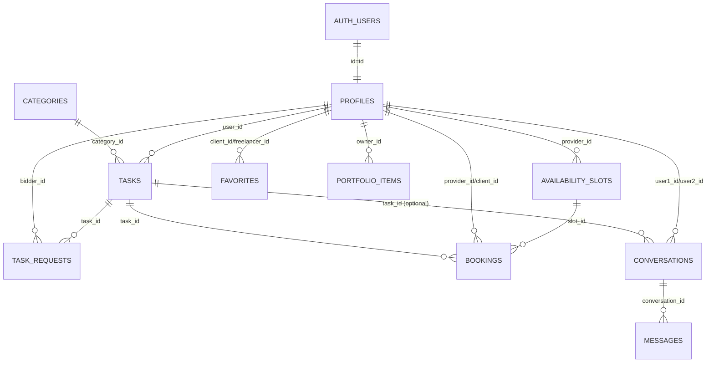

# 🗺️ SLine System Map (Executive Summary)

This section gives any new contributor a complete map of the SLine app: how it’s built, how data flows through Supabase, and how to safely extend it. Use this as your birds‑eye guide; each feature also has its own deep‑dive document under `Sline_everything/DEVELOPER_GUIDE/`.

## 1. Project Overview
- **Framework**: Flutter (Material 3)
- **Backend**: Supabase (Auth, Postgres, Storage, Realtime, RPC)
- **State Mgmt**: Provider + ChangeNotifier (MVVM per feature)
- **Structure**: `lib/features/<feature>/{view,viewmodels,services,models,data}`
- **Security**: Row Level Security (RLS) on all app tables; UI interacts through repositories/services only.

## 2. Runbook (Local Dev)
- **Prereqs**: Flutter SDK, Dart, Supabase project (URL + anon key)
- **Bootstrap Supabase**: ensure DDL/policies in `Sline_everything/SUPABASE_SETUP.md` are applied
- **Configure client**: initialize Supabase once (see `lib/core/services/supabase_config.dart`)
- **Run**: `flutter run -d <device>`

## 3. Architecture (MVVM, per feature)
- **View (`view/`)**: Widgets/screens, local state only (forms), Material 3. No direct backend calls.
- **ViewModel (`viewmodels/`)**: ChangeNotifier with business logic and UI state. Calls repository/service.
- **Repository/Service (`data/`, `services/`)**: Encapsulate Supabase queries, error mapping, and Storage ops.
- **Models (`models/`)**: Immutable data models mirroring DB rows (UTC timestamps).

Conventions
- **English code/comments** only. **Mounted** checks after async in widgets.
- Store **Storage paths** in DB, not signed URLs; generate signed URLs at render time (if bucket private).
- Use **time-based cursors** for paging (ISO timestamps); convert UTC → local for display.

## 4. Data Model (Key Tables)
| Area | Tables (FKs) | Notes |
| --- | --- | --- |
| Identity | `auth.users` → `public.profiles(id)` | App identity row per user; RLS owner-only update. |
| Tasks | `tasks(user_id → profiles.id)` | `task_type_enum` = `tender`/`booking`; `status` open/assigned/closed. |
| Requests | `task_requests(task_id, bidder_id → profiles.id)` | Tender only; unique pending per (task,bidder); guarded triggers. |
| Booking | `availability_slots(provider_id)` → `bookings(task_id, provider_id, client_id, slot_id)` | RLS enforces roles; status guard trigger. |
| Categories | `categories` → `tasks(category_id)` | DB‑first with unique lower(name). |
| Chat | `conversations(user1_id,user2_id,task_id,initiated_by)` → `messages(conversation_id)` | RLS: participants only; DM requires favorite. |
| Favorites | `favorites(client_id, freelancer_id)` | Unique per pair; used to allow DM creation. |
| Portfolio | `portfolio_items(owner_id)` | Public bucket by default; can switch to private + signed URLs. |

### Mini ERD

## 5. Feature Map (Where to look)
- **Core**: `lib/core/` – Supabase bootstrap, logging, theme, utils, shared widgets (signed avatar/image)
- **Auth**: `lib/features/auth/` – signup/login, session
- **Profile**: `lib/features/profile/` – profile edit, avatar upload, role switch, my tasks
- **Tasks**: `lib/features/tasks/` – create/list/details, images, requests (offers)
- **Booking**: `lib/features/booking/` – provider slots, client bookings
- **Chat**: `lib/features/chat/` – conversations/messages, attachments, realtime
- **Favorites**: `lib/features/favorites/` – client’s saved freelancers, enables DMs
- **Saved**: `lib/features/saved/` – saved (bookmarked) tasks per user
- **Portfolio**: `lib/features/portfolio/` – public gallery of freelancer work
- **Categories**: `lib/features/categories/` – read‑mostly, DB‑first

Each feature has a dedicated deep‑dive under `Sline_everything/DEVELOPER_GUIDE/<Feature>.md` with DB mapping, ERD, snippets, and testing.

## 6. RLS/Policies (Golden Rules)
- Always run under a valid **session**; otherwise every RLS‑protected query fails (42501).
- Insert/update checks use `auth.uid()`: set owner fields server‑side where possible (e.g., `provider_id`, `client_id`, `user_id`).
- Follow setup SQL in `SUPABASE_SETUP.md`: DDL, indexes, policies, and triggers (offers tender‑only, booking guard, slot overlap, DM guard via favorites).

## 7. Storage (Buckets)
| Bucket | Visibility | Used by | Access Pattern |
| --- | --- | --- | --- |
| `avatars` | Private | Profile avatars | Store path; create signed URL at render |
| `task-images` | Private | Task images | Store path; signed URL per image |
| `chat-attachments` | Private | Message attachments | Store path; short‑lived signed URLs |
| `portfolio` | Public (current) | Portfolio items | Store public URL (or switch to private + signed URLs) |

## 8. Error Mapping (Common)
| Area | Error | Map to |
| --- | --- | --- |
| Auth | `AuthException(Invalid login credentials)` | “Email or password is incorrect.” |
| RLS | `Postgrest 42501` | “Session expired / Not allowed. Please sign in.” |
| Unique | `23505` (duplicate) | “Already exists.” (favorites, offers) |
| FK | `23503` | “Related item does not exist.” |
| Storage | 404 | “File not available.” |
| Chat | Trigger payload checks | “Offer requires price and days.” |

## 9. How to Add a New Feature (Playbook)
- **Schema**: add tables/columns in `SUPABASE_SETUP.md` (DDL, RLS, indexes, triggers). Apply to Supabase.
- **Module skeleton**: `lib/features/new_feature/{view,viewmodels,services,models,data}`.
- **Models**: mirror DB names; timestamps in UTC.
- **Service/Repo**: put all Supabase calls here; never from UI.
- **ViewModel**: ChangeNotifier with loading/error state; expose typed methods for UI.
- **UI**: Material 3, local form state, mounted checks after awaits.
- **Docs**: create `Sline_everything/DEVELOPER_GUIDE/New Feature.md` using the existing template (overview → DB mapping → inventory → ERD → snippets → errors → tests).

## 10. Testing & Quality
- **Unit**: services (mock Supabase), viewmodels state transitions.
- **Widget**: screen interactions (form validation, loading states, snackbars).
- **Integration**: happy‑paths against staging Supabase (auth, RLS, flows).
- **Checklists**: each feature doc ends with a testing checklist; follow it before merging.

## 11. Quick Links (Deep Dives)
- Core: `DEVELOPER_GUIDE/Core Module.md`
- Auth: `DEVELOPER_GUIDE/Auth Feature.md`
- Profile: `DEVELOPER_GUIDE/Profile Feature.md`
- Tasks: `DEVELOPER_GUIDE/Task Feature.md`
- Booking: `DEVELOPER_GUIDE/Booking Feature.md`
- Chat: `DEVELOPER_GUIDE/Chat Feature.md`
- Favorites: `DEVELOPER_GUIDE/Favorites Feature.md`
- Saved: `DEVELOPER_GUIDE/Saved Feature.md`
- Portfolio: `DEVELOPER_GUIDE/Protfolio Feature.md`
- Categories: `DEVELOPER_GUIDE/Categories Feature.md`

## 12. Gotchas & Tips
- **Offer flow**: only for `task_type='tender'`; unique pending per (task,bidder).
- **DMs**: client‑only; requires freelancer in **favorites**; enforced by triggers.
- **Signed URLs**: keep TTL short; regenerate on demand; never persist signed URLs in DB.
- **Cursors**: prefer time‑based (`created_at`, `starts_at`), not offset paging.
- **Localization**: profile `language` can power a global locale provider.

With this map and the linked deep‑dives, a new engineer can navigate, extend, and debug SLine safely and productively.
