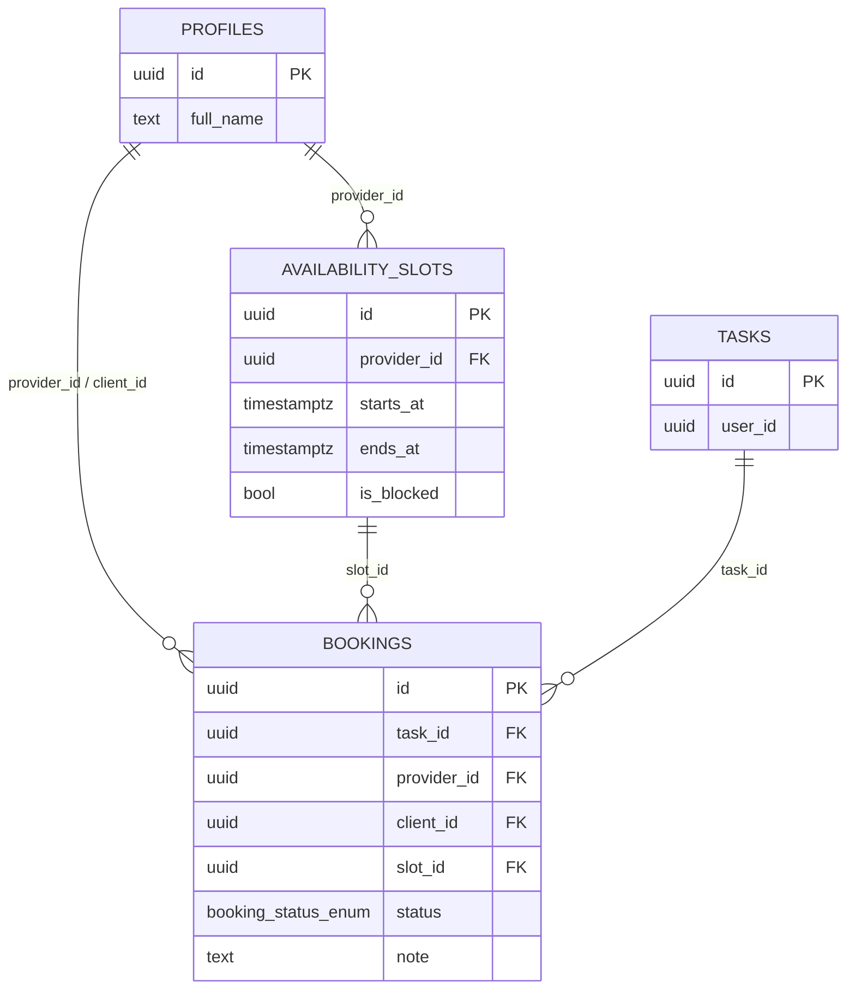

# Booking Feature Reference

1. Human-Readable Overview

The Booking feature lets a client reserve a provider’s available time slot for a task.
It covers two flows:
• Provider flow: create/manage availability slots (open or blocked), see incoming bookings, confirm or complete work.
• Client flow: browse a provider’s available slots, request a booking for a specific task, and cancel if needed.

Key design choices:
• All timestamps are stored in UTC; UI always displays local time.
• A slot can be booked by at most one active booking (pending/confirmed) — enforced with a unique partial index.
• RLS ensures each party only sees/edits what they own (provider vs. client rules).

⸻

2. Supabase Mapping (Tables, Columns, Policies)

2.1 Tables & Columns

### availability_slots

| Column        | Type                        | Purpose / Usage                | Notes                                              |
| ------------- | --------------------------- | ------------------------------ | -------------------------------------------------- |
| `id`          | `uuid` (PK)                 | Slot identifier                | Default `gen_random_uuid()`                        |
| `provider_id` | `uuid` (FK → `profiles.id`) | Owner of the slot (freelancer) | RLS requires `auth.uid() = provider_id` for writes |
| `starts_at`   | `timestamptz`               | UTC start time                 | Convert local → UTC before insert                  |
| `ends_at`     | `timestamptz`               | UTC end time                   | `chk_slot_time` enforces `ends_at > starts_at`     |
| `is_blocked`  | `boolean`                   | Not bookable when true         | Default `false`                                    |
| `created_at`  | `timestamptz`               | Audit timestamp                | Default `now()` (UTC)                              |

### bookings

| Column        | Type                                  | Purpose / Usage                | Notes                                          |
| ------------- | ------------------------------------- | ------------------------------ | ---------------------------------------------- |
| `id`          | `uuid` (PK)                           | Booking identifier             | Default `gen_random_uuid()`                    |
| `task_id`     | `uuid` (FK → `tasks.id`)              | Linked task context            | ON DELETE CASCADE                              |
| `provider_id` | `uuid` (FK → `profiles.id`)           | Provider receiving the booking | Scopes provider views                          |
| `client_id`   | `uuid` (FK → `profiles.id`)           | Client making the booking      | Must equal `auth.uid()` on insert (RLS)        |
| `slot_id`     | `uuid` (FK → `availability_slots.id`) | The reserved slot              | Unique while status in ('pending','confirmed') |
| `status`      | `booking_status_enum`                 | Lifecycle                      | Default `pending`                              |
| `note`        | `text`                                | Optional message               | Nullable                                       |
| `created_at`  | `timestamptz`                         | Audit timestamp                | Default `now()` (UTC)                          |

2.2 Enums

| Enum                  | Values                                          | Notes                                                       |
| --------------------- | ----------------------------------------------- | ----------------------------------------------------------- |
| `booking_status_enum` | `pending`, `confirmed`, `canceled`, `completed` | Guarded by trigger `fn_booking_guard` for valid transitions |

2.3 Indexes & Constraints
• No double booking on the same slot:

CREATE UNIQUE INDEX IF NOT EXISTS uq_bookings_slot_active
ON public.bookings (slot_id)
WHERE status IN ('pending','confirmed');

    •	Performance indexes:
    •	idx_slots_provider_starts (provider_id, starts_at)
    •	idx_bookings_client_created (client_id, created_at desc)
    •	idx_bookings_provider_created (provider_id, created_at desc)

2.4 RLS Policies (Summary)

| Table                | Policy                            | Who           | Action               | Rule                                                 |
| -------------------- | --------------------------------- | ------------- | -------------------- | ---------------------------------------------------- |
| `availability_slots` | `slots_select_all`                | authenticated | SELECT               | `true`                                               |
| `availability_slots` | `slots_cud_owner`                 | authenticated | INSERT/UPDATE/DELETE | `provider_id = auth.uid()`                           |
| `bookings`           | `bookings_select_owner_or_client` | authenticated | SELECT               | `provider_id = auth.uid() OR client_id = auth.uid()` |
| `bookings`           | `bookings_insert_client_only`     | authenticated | INSERT               | `client_id = auth.uid()` AND slot not already active |
| `bookings`           | `bookings_update_roles`           | authenticated | UPDATE               | Provider can confirm/complete; Client can cancel     |

2.5 Triggers / Business Guards
• No overlapping open slots for the same provider:
• Trigger: trg_no_overlap_slots → fn_reject_overlapping_slots
• Booking status transitions guard:
• Trigger: trg_booking_guard → fn_booking_guard
• Allowed:
• pending → confirmed (provider) / canceled (client)
• confirmed → completed (provider) / canceled (client)

⸻

3. File Inventory (Flutter)

File Layer Description
lib/features/booking/data/booking_repository.dart Repository Wraps BookingService and exposes methods for slots/bookings; surfaces current user.
lib/features/booking/services/booking_service.dart Service Executes PostgREST calls for `availability_slots` and `bookings` (list/create/update) and maps to models.
lib/features/booking/viewmodels/booking_view_model.dart ViewModel ChangeNotifier with DI injected BookingService, holding UI state, pagination cursors, optimistic updates, and friendly error mapping.
lib/features/booking/view/availability_screen.dart View Provider availability browser with pull-to-refresh, infinite scroll, and + button for `AddSlotSheet`.
lib/features/booking/view/add_slot_sheet.dart View Bottom sheet to pick local start/end, convert to UTC, and call `BookingViewModel.createSlot()`.
lib/features/booking/view/booking_sheet.dart View Client booking sheet with AppDimens enforcement and optional note; calls `BookingViewModel.bookSlot()`.
lib/features/booking/view/bookings_list_screen.dart View Dual-tab history (As Client / As Provider) with filters, pagination, and action buttons (future confirm/complete/cancel).

Convention: Service owns Supabase calls, ViewModel owns UI state + orchestration, UI is dumb (reads state, triggers ViewModel methods).

⸻

4. ERD (Mini)

ASCII (fallback)

profiles (id) ──< availability_slots (provider_id)
│ │
│ └─< bookings (slot_id, provider_id, client_id)
│
tasks (id) ────────────────────────────────┘ (task_id)

⸻

5. Example SQL & Supabase Dart Snippets

5.1 Create Slot (Provider)

Dart (Service)

final insert = await supabase
.from('availability_slots')
.insert({
'provider_id': providerId, // must equal auth.uid() under RLS
'starts_at' : startsUtc.toIso8601String(),
'ends_at' : endsUtc.toIso8601String(),
'is_blocked' : isBlocked,
})
.select()
.single();

5.2 List Provider Slots (Paged)

final rows = await supabase
.from('availability_slots')
.select()
.eq('provider_id', providerId)
.gte('starts_at', sinceUtc.toIso8601String())
.order('starts_at') // server-side sort
.range(offset, offset + limit - 1);

5.3 Book a Slot (Client)

final row = await supabase
.from('bookings')
.insert({
'task_id' : taskId,
'provider_id': providerId,
'client_id' : clientId, // must equal auth.uid() under RLS
'slot_id' : slotId,
'note' : note,
})
.select()
.single();

5.4 List My Bookings (As Client)

final rows = await supabase
.from('bookings')
.select("""
_,
availability_slots!inner(_)
""")
.eq('client_id', myId) // RLS also enforces this
.order('created_at', ascending: false)
.range(offset, offset + limit - 1);

5.5 Confirm / Complete (Provider) & Cancel (Client)

// Provider confirms
await supabase.from('bookings').update({'status': 'confirmed'}).eq('id', bookingId);

// Provider completes
await supabase.from('bookings').update({'status': 'completed'}).eq('id', bookingId);

// Client cancels
await supabase.from('bookings').update({'status': 'canceled'}).eq('id', bookingId);

The trigger (fn_booking_guard) and RLS (bookings_update_roles) jointly ensure only valid transitions by the authorized party.

⸻

6. Error Handling & Common Pitfalls

Client/ViewModel conventions
• Map Postgres error codes (e.g., 23505 unique violation) → user-friendly messages:
• “This time slot is already booked. Please choose another.”
• For overlap trigger errors on slot creation:
• “This slot overlaps with an existing one.”

Common pitfalls
• Timezone bugs: Always convert UI local → UTC before insert; and UTC → local for display.
• RLS denials:
• Creating a slot with mismatched provider_id (must be auth.uid()).
• Inserting a booking with client_id != auth.uid().
• Ordering + Pagination: Apply filters before `.order()`. Use `.limit()` with time-based cursors (e.g., `gt/lt` on `starts_at` or `created_at`) instead of client-side slicing.
• Double booking race: Unique partial index on bookings(slot_id) with active statuses prevents it.

⸻

7. Testing Checklist (Manual / Automated)
   • Provider creates a non-overlapping open slot → appears in list.
   • Provider tries overlapping slot → fails with friendly error.
   • Client books an open slot → status pending.
   • Provider confirms, then completes → allowed.
   • Client cancels from pending/confirmed → allowed.
   • Second client tries to book the same slot while active → fails.
   • Lists (as Client / as Provider) show correct items with correct sorting & pagination.
   • All date/times render in local timezone.

⸻

8. UI Flow (High-level)
   • AvailabilityScreen (provider):
   • FAB → AddSlotSheet → create open/blocked slot → refresh → list updates.
   • TaskDetails → BookingSheet (client):
   • Pick provider slot → submit booking (pending) → success SnackBar.
   • BookingsListScreen:
   • Tabs: As Client / As Provider → action chips (Confirm, Complete, Cancel).

⸻

9. Integration Notes
   • Works alongside Tasks: A booking always references a task (task_id).
   • Compatible with Chat: You can later notify participants on status changes with Realtime or Notifications.
   • Plays well with Profile: Avatars, names, etc., pulled via joins or client caches.
