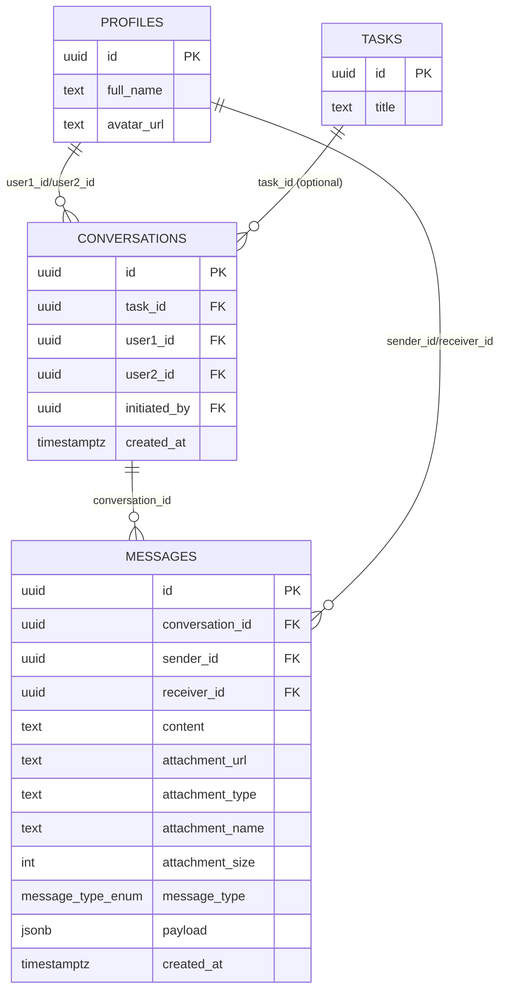

# Chat Feature Reference

## 1. Human Explanation
The chat module provides one-to-one messaging between a client and a freelancer. Conversations may be tied to a `task` (job discussion) or be a client-initiated direct message (DM) to a favorite freelancer. The feature follows MVVM:
- UI in `lib/features/chat/view/` stays declarative.
- `ChatViewModel` orchestrates state, subscriptions, and actions.
- `ChatRepository` wraps `MessageService`, which performs Supabase queries, RPC calls, and Realtime streaming.

## 2. Database & Supabase Mapping

### 2.1 `public.conversations`
| Column | Type | Purpose / Usage | Notes |
| --- | --- | --- | --- |
| `id` | `uuid` (PK) | Conversation id | Generated on insert |
| `task_id` | `uuid` (FK → `tasks.id`, nullable) | Optional task context | Enables task-linked chats |
| `user1_id` | `uuid` (FK → `profiles.id`) | First participant | Used by RLS checks |
| `user2_id` | `uuid` (FK → `profiles.id`) | Second participant | Used by RLS checks |
| `initiated_by` | `uuid` (FK → `profiles.id`) | Who started the conversation | Used by guard trigger/policies |
| `created_at` | `timestamptz` | Creation timestamp (UTC) | Default `now()` |

Indexes/Constraints
- `uq_conversations_pair_task` on `(least(user1_id,user2_id), greatest(user1_id,user2_id), coalesce(task_id, '00000000-0000-0000-0000-000000000000'))` prevents duplicates for the same pair/task.
- `idx_conversations_task`, `idx_conversations_user1`, `idx_conversations_user2` for fast lookups.

### 2.2 `public.message_type_enum`
Values: `text`, `offer`, `offer_update`, `offer_accepted`, `offer_rejected`, `delivery_submitted`, `end_early_request`, `dispute_report`. The app model also includes `MessageType.system` for enum parity (see `message_model.dart`).

### 2.3 `public.messages`
| Column | Type | Purpose / Usage | Notes |
| --- | --- | --- | --- |
| `id` | `uuid` (PK) | Message id | Generated on insert |
| `conversation_id` | `uuid` (FK → `conversations.id`) | Parent conversation | Indexed |
| `sender_id` | `uuid` (FK → `profiles.id`) | Sender | Must equal `auth.uid()` on insert (RLS) |
| `receiver_id` | `uuid` (FK → `profiles.id`, nullable) | Receiver | Optional for some flows |
| `content` | `text` | Text body | May be empty for attachment-only |
| `attachment_url` | `text` | Storage path in private bucket | Generate signed URLs for reads |
| `attachment_type` | `text` | 'image' or 'file' | Optional |
| `attachment_name` | `text` | Original filename | Optional |
| `attachment_size` | `int` | Size in bytes | Optional |
| `message_type` | `message_type_enum` | Message semantics | Default `text` |
| `payload` | `jsonb` | Extra fields (e.g., `{price, days, note}`) | Default `{}` |
| `created_at` | `timestamptz` | Creation timestamp (UTC) | Default `now()` |

Index
- `idx_messages_convo_created` on `(conversation_id, created_at)`.

### 2.4 Storage (private)
- Bucket: `chat-attachments` (private). Store object path; create signed URLs on demand.

### 2.5 RLS Policies (Summary)
| Table | Action | Policy Summary | Notes |
| --- | --- | --- | --- |
| `conversations` | SELECT | Only participants can read | `auth.uid() = user1_id OR auth.uid() = user2_id` |
| `conversations` | INSERT | Client-only creation | DM requires freelancer in client favorites; task-linked only via RPC (non-owner starts). |
| `messages` | SELECT | Only participants can read | Checked via parent conversation |
| `messages` | INSERT | Only participants can send | `sender_id = auth.uid()`, plus guard for `offer_accepted`/`offer_rejected` (task owner or initiator) |

Triggers/Functions
- `trg_conversations_guard`: Only clients can start non-task DMs with favorites; task-linked is started by non-owner via `start_task_conversation_v1`.
- `trg_messages_validate_payload`: Offer messages require `price` and `days` in `payload` (wire format uses `days`, not `delivery`).
- `trg_messages_offer_accepted`: On `offer_accepted`, sets `tasks.assigned_freelancer_id` and moves task `status = 'assigned'`.
- **Archive:** Use RPC `archive_conversation_v1(p_conversation_id)` for per-user, server-timestamped archive (no client timestamp writes).

## 3. File Inventory
| File | Layer | Description |
| --- | --- | --- |
| `lib/features/chat/data/chat_repository.dart` | Repository | Wraps `MessageService`; exposes conversation/message APIs, receipts, and Realtime streams. |
| `lib/features/chat/services/message_service.dart` | Service | PostgREST + Realtime for conversations/messages, RPCs for receipts and task chats. |
| `lib/features/chat/services/attachment_service.dart` | Service | Storage upload/delete/signed URL helpers for attachments. |
| `lib/features/chat/viewmodels/chat_view_model.dart` | ViewModel | `ChangeNotifier` managing conversation list, active conversation, message list, subscriptions, and receipts. |
| `lib/features/chat/view/messages_screen.dart` | View | Conversations list with previews via joined selects. |
| `lib/features/chat/view/chat_screen.dart` | View | Single conversation UI (messages + composer). |
| `lib/features/chat/models/conversation_model.dart` | Model | Conversation with display fields (other user name/avatar, last message). |
| `lib/features/chat/models/message_model.dart` | Model | Message with attachments, type, payload (wire: snake_case message types). |
| `lib/features/chat/models/chat_offer_payload.dart` | Model | Canonical offer payload: `days` on write; read compatibility for legacy `delivery`. |
| `lib/features/chat/services/chat_realtime_merger.dart` | Service | Merges realtime message snapshots (dedupe, sort). |
| `lib/features/chat/attachments/` | Submodule | Upload/compress/pick utils and widgets for attachment UX. |

## 4. ERD Diagram


```text
profiles (id)
  ├─< conversations (user1_id, user2_id, initiated_by)
  │       └─< messages (conversation_id, sender_id, receiver_id)
tasks (id) ──< conversations (task_id, optional)
```

## 5. Supabase Snippets

### 5.1 SQL
```sql
-- Create or fetch a DM conversation (server enforces initiator/participants via policies/triggers)
insert into public.conversations (user1_id, user2_id, initiated_by)
values (auth.uid(), '<other_user_id>', auth.uid())
on conflict do nothing
returning *;

-- Insert a message (participants only)
insert into public.messages (conversation_id, sender_id, receiver_id, content)
values ('<conv_id>', auth.uid(), '<other_user_id>', 'Hello');

-- Query messages ordered by time
select * from public.messages
where conversation_id = '<conv_id>'
order by created_at asc;
```

### 5.2 Dart (supabase_flutter)
```dart
final supabase = Supabase.instance.client;

// Send a message
Future<void> sendText({required String convId, required String receiverId, required String text}) async {
  await supabase.from('messages').insert({
    'conversation_id': convId,
    'sender_id': supabase.auth.currentUser!.id,
    'receiver_id': receiverId,
    'content': text,
  });
}

// Subscribe to messages in a conversation
Stream<Map<String, dynamic>?> streamMessages(String convId) {
  return supabase
      .from('messages')
      .stream(primaryKey: ['id'])
      .eq('conversation_id', convId)
      .order('created_at')
      .map((rows) => rows.isEmpty ? null : rows.last as Map<String, dynamic>);
}

// Upload attachment and send (store path; generate signed URL on read)
Future<void> sendImage({required String convId, required String receiverId, required List<int> bytes, required String mime}) async {
  final userId = supabase.auth.currentUser!.id;
  final path = 'convos/$convId/${DateTime.now().toUtc().toIso8601String()}';
  await supabase.storage.from('chat-attachments').uploadBinary(path, bytes, fileOptions: FileOptions(contentType: mime));
  await supabase.from('messages').insert({
    'conversation_id': convId,
    'sender_id': userId,
    'receiver_id': receiverId,
    'attachment_url': path,
    'attachment_type': 'image',
    'attachment_name': 'image.jpg',
  });
}
```

## 6. Error Handling
| Origin | Error | User-Facing Message | Mitigation |
| --- | --- | --- | --- |
| Start conversation | `23505` (unique `uq_conversations_pair_task`) | "Conversation already exists." | Fetch and open the existing conversation. |
| Insert conversation | RLS (client-only) / trigger guard | "You are not allowed to start this conversation." | Ensure initiator is the client and favorite/task owner checks pass. |
| Send message | `42501` (permission denied) | "You are not a participant in this conversation." | Verify membership and session. |
| Offer messages | Trigger validation | "Offer requires price and days." | Validate payload before sending. |
| Attachment | Storage error or expired signed URL | "Attachment unavailable. Please re-upload or refresh." | Recreate signed URL or re-upload. |
| IDs | `22P02` invalid UUID | "Invalid chat identifier." | Validate IDs before calling APIs. |

## 7. Extra Notes & Testing Checklist
- **Realtime**: Subscribe to `messages` and `conversations` streams for live updates.
- **Signed URLs**: Keep attachments private; generate signed URLs on demand and cache short-term.
- **Time zones**: `created_at` stored in UTC; format locally in UI.
- **Receipts**: RPCs `mark_conversation_delivered` and `mark_conversation_seen` update delivery/read states.
- **DM vs Task**: DM requires the freelancer to be in client's `favorites`; task chat requires task owner.

Testing checklist
- Create/fetch conversation (DM and task-linked) as allowed roles.
- Send/receive text; stream updates in UI.
- Upload attachment; confirm access via signed URLs when reading.
- Attempt non-participant send → denied by RLS.
- Send offer without required payload → trigger error; validate client-side.
