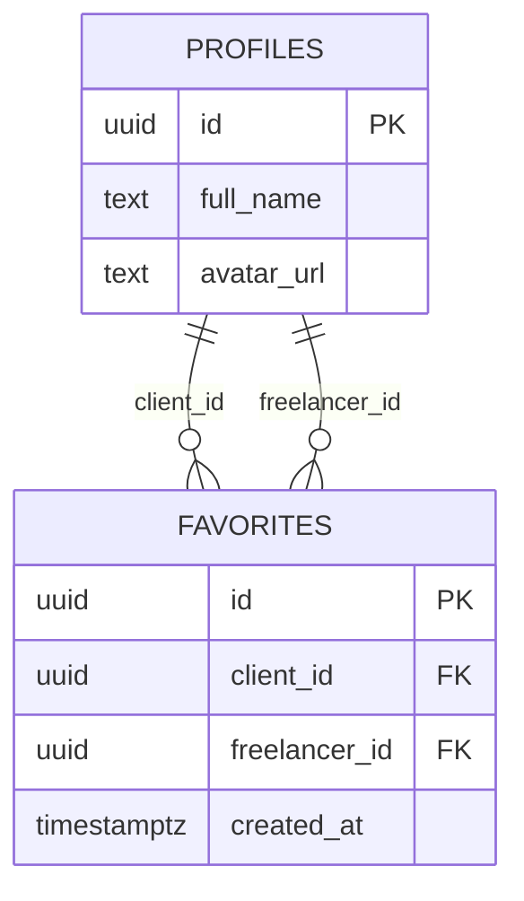

# Favorites Feature Reference

## 1. Human Explanation
The Favorites feature lets a Client bookmark a Freelancer for quick access. It streamlines repeat collaborations and enables a shortcut to start a direct chat (DM) without creating a task first. The implementation follows MVVM:
- UI in `lib/features/favorites/view/` (screen + widgets) stays declarative.
- `FavoritesViewModel` handles list state, add/remove actions, and error surface.
- `FavoritesService` executes Supabase queries under RLS.

## 2. Database & Supabase Mapping

### 2.1 `public.favorites`
| Column | Type | Purpose / Usage | Notes |
| --- | --- | --- | --- |
| `id` | `uuid` (PK) | Favorite record id | Default `gen_random_uuid()` |
| `client_id` | `uuid` (FK → `profiles.id`) | Who favorites | Must equal `auth.uid()` under RLS |
| `freelancer_id` | `uuid` (FK → `profiles.id`) | Who is favorited | Used to gate DM creation |
| `created_at` | `timestamptz` | When the favorite was created (UTC) | Default `now()` |

Indexes & Constraints
- Unique `(client_id, freelancer_id)` to prevent duplicates.
- Indexes on `client_id` and `freelancer_id` for lookups (see `SUPABASE_SETUP.md`).

RLS Policies (Summary)
| Table | Action | Policy | Rule |
| --- | --- | --- | --- |
| `favorites` | SELECT | `favorites_select_own` | `client_id = auth.uid()` |
| `favorites` | INSERT | `favorites_insert_self` | `client_id = auth.uid()` |
| `favorites` | DELETE | `favorites_delete_self` | `client_id = auth.uid()` |

Related Policies
- Chat DM creation references `favorites` via `trg_conversations_guard`: only a client can start a non-task conversation with someone in their favorites.

## 3. File Inventory
| File | Layer | Description |
| --- | --- | --- |
| `lib/features/favorites/data/favorites_service.dart` | Service | CRUD for `favorites` with RLS-safe patterns; joins profiles for display. |
| `lib/features/favorites/models/favorite_model.dart` | Model | `FavoriteModel` (base row). |
| `lib/features/favorites/models/favorite_with_profile_model.dart` | Model | `FavoriteWithProfile` (joined row; null-safe when profile missing). |
| `lib/features/favorites/models/favorites_mutation_result.dart` | Model | Typed result for add/remove (success, duplicate, unauthenticated, forbidden, failure). |
| `lib/features/favorites/viewmodels/favorites_view_model.dart` | ViewModel | Single app-level instance; `ensureLoaded()`, add/remove return `FavoritesMutationResult`. |
| `lib/features/favorites/view/favorites_screen.dart` | View | Consumes app-level `FavoritesViewModel`; list with remove/chat actions. |
| `lib/features/favorites/view/widgets/` | Widgets | Cards/widgets for rendering favorites (if present). |
| `lib/features/favorites/routes/favorites_routes.dart` | Routes | Navigation entry-points to favorites UI. |

## 4. ERD Diagram


```text
profiles (id) ──< favorites (client_id)
profiles (id) ──< favorites (freelancer_id)
```

## 5. Supabase Snippets

### 5.1 SQL
```sql
-- Add a favorite (RLS ensures client_id = auth.uid())
insert into public.favorites (client_id, freelancer_id)
values (auth.uid(), '<freelancer_id>');

-- List my favorites with freelancer profile
select f.created_at, p.id, p.full_name, p.avatar_url
from public.favorites f
join public.profiles p on p.id = f.freelancer_id
where f.client_id = auth.uid()
order by f.created_at desc;

-- Remove a favorite I own
delete from public.favorites
where client_id = auth.uid() and freelancer_id = '<freelancer_id>';
```

### 5.2 Dart (supabase_flutter)

The app uses a single canonical read: `listFavoritesWithProfile()` returns `List<FavoriteWithProfile>`. Add/remove use typed `FavoritesMutationResult` (see CONTRACT_FavoritesMutation). The simple `listFavorites()` method was removed; the ViewModel derives a simple list from the joined result when needed.

```dart
final supabase = Supabase.instance.client;

// Add
Future<void> addFavorite(String freelancerId) async {
  await supabase.from('favorites').insert({
    'client_id': supabase.auth.currentUser!.id,
    'freelancer_id': freelancerId,
  });
}

// List with profile (canonical) — returns FavoriteWithProfile; root freelancer_id required for null-safe parse
Future<List<FavoriteWithProfile>> listFavoritesWithProfile() async {
  final rows = await supabase
      .from('favorites')
      .select('id, client_id, freelancer_id, created_at, freelancer:freelancer_id(id, full_name, avatar_url)')
      .eq('client_id', supabase.auth.currentUser!.id)
      .order('created_at', ascending: false);
  return (rows as List).cast<Map<String, dynamic>>().map(FavoriteWithProfile.fromMap).toList();
}

// Remove
Future<void> removeFavorite(String freelancerId) async {
  await supabase.from('favorites')
      .delete()
      .eq('client_id', supabase.auth.currentUser!.id)
      .eq('freelancer_id', freelancerId);
}

// ViewModel: add/remove return FavoritesMutationResult (success, duplicate, unauthenticated, forbidden, failure)
// Friendly error mapping for UI: map 23505 → "Already in favorites.", RLS → "Not allowed for your role."
```

## 6. Error Handling
| Origin | Error | User-Facing Message | Mitigation |
| --- | --- | --- | --- |
| Add favorite | `23505` unique violation | "This freelancer is already in your favorites." | Disable button or show success state if already present. |
| Any CRUD | `42501` RLS denied | "You can only manage your own favorites." | Ensure session and use current `auth.uid()`. |
| Fetch join | Missing profile row | "Profile unavailable." | Render placeholder name/avatar. |

## 7. Extra Notes & Testing Checklist
- **DM integration**: Direct client-initiated DMs **require** the freelancer to be in the client’s favorites (locked in DECISION_Favorites_DM); enforced by DB policy/trigger.
- **UTC**: `created_at` is UTC; use `formatUtcToLocal()` in UI (e.g. FavoriteCard).
- **Single read path**: One canonical `listFavoritesWithProfile()`; root `freelancer_id` used when joined profile is null (see CONTRACT_FavoritesJoin).
- **Request tile**: Add-to-favorites uses app-level `FavoritesViewModel` only (no direct service in view).

Testing checklist:
- Add → list shows the freelancer at top.
- Add same freelancer again → unique violation mapped to friendly copy.
- Remove → disappears from list and server.
- Attempt cross-user delete → denied by RLS.
- Start DM from a favorite → allowed by conversations guard.
