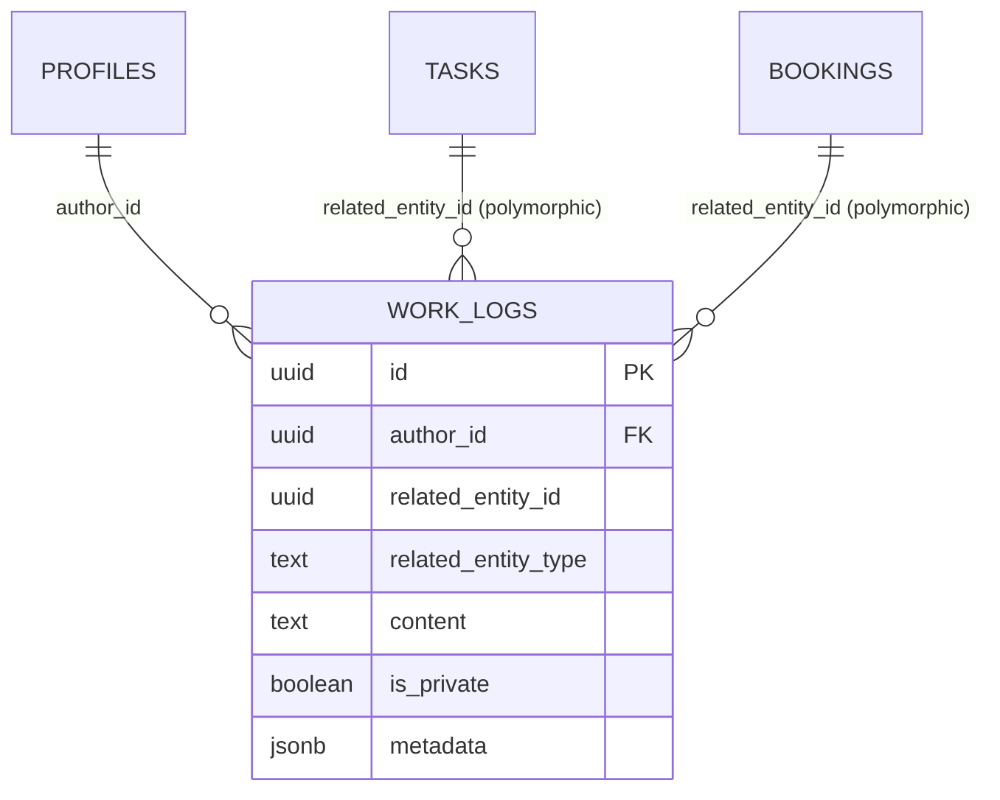

# Order Management Feature Reference

## 1. Human Explanation

The Order Management feature provides a unified, immutable timeline of events and notes for any "Order" (which can be a **Task** or a **Booking**). It serves as the single source of truth for dispute resolution, status changes, and private record-keeping. It implements a polymorphic relationship where a single `work_logs` table links to either `tasks` or `bookings`.

- **UI**: `lib/features/management/view/order_management_panel.dart` - A self-contained, glassmorphic widget that displays the timeline and allows adding notes.
- **ViewModel**: `OrderManagementViewModel` - Manages load/error/send state, preserves drafts on failed sends, and refreshes the timeline after successful mutations.
- **Service**: `WorkLogService` - Handles scope-safe polymorphic queries and RLS-safe inserts.

## 2. Database & Supabase Mapping

### 2.1 `public.work_logs`

| Column | Type | Purpose / Usage | Notes |
| --- | --- | --- | --- |
| `id` | `uuid` (PK) | Log entry ID | Default `gen_random_uuid()` |
| `author_id` | `uuid` (FK) | Who created the log | Must match `auth.uid()` |
| `related_entity_id` | `uuid` | ID of the Task or Booking | Polymorphic FK |
| `related_entity_type` | `text` | Discriminator | 'task' or 'booking' |
| `content` | `text` | The note content or event description | Required |
| `is_private` | `boolean` | Visibility flag | True = Only Author sees it |
| `metadata` | `jsonb` | Structured event data | e.g. `{'event': 'extension_request', 'days': 3}` |
| `created_at` | `timestamptz` | When it happened | Immutable, Default `now()` |

### 2.2 Helper Functions

- **`is_work_log_participant(entity_id, entity_type, user_id)`**:
  - A database function used by RLS policies.
  - Returns `true` if the user is a participant in the related entity (e.g. Owner/Bidder for Tasks, Client/Provider for Bookings).
  - Live status on 2026-03-01: `SECURITY DEFINER`, `VOLATILE`, returns `false` for unsupported `entity_type` values.

### 2.3 RLS Policies

| Policy | Action | Rule |
| --- | --- | --- |
| `work_logs_select` | SELECT | `(is_private = true AND author_id = uid) OR (is_private = false AND is_work_log_participant(...))` |
| `work_logs_insert` | INSERT | `author_id = uid AND is_work_log_participant(...)` |
| `work_logs_deny_update` | UPDATE | `false` (Immutable) |
| `work_logs_deny_delete` | DELETE | `false` (Immutable) |

### 2.4 Live Indexes and Triggers

- Live indexes on 2026-03-01:
  - `work_logs_pkey (id)`
  - `idx_work_logs_entity (related_entity_id, created_at desc)`
  - `idx_work_logs_entity_scope_created_at (related_entity_id, related_entity_type, created_at desc)` after migration `supabase/migrations/20260301_add_management_work_logs_scope_index.sql`
- Live non-internal triggers on 2026-03-01:
  - none

## 3. File Inventory

| File | Layer | Description |
| --- | --- | --- |
| `lib/features/management/models/work_log_scope.dart` | Model | Typed scope contract for `related_entity_id` + `related_entity_type`. |
| `lib/features/management/models/work_log_model.dart` | Model | `WorkLog` class with `author` profile included. |
| `lib/features/management/services/work_log_service.dart` | Service | CRUD methods: `getLogs(scope)`, `addLog(scope, ...)`, `logEvent(scope, ...)`. Handles the polymorphic join. |
| `lib/features/management/viewmodels/order_management_view_model.dart` | ViewModel | State management for the panel. Handles loading logs and posting notes. |
| `lib/features/management/view/order_management_panel.dart` | Widget | The main UI component. Modular and embeddable in any Detail screen. |
| `lib/features/management/view/widgets/order_management_section.dart` | Widget | Shared host wrapper that provides the local `OrderManagementViewModel`. |

## 4. ERD Context



## 5. Usage Snippets

### 5.1 Embedding the Panel

```dart
// In BookingDetailsScreen or TaskDetailsScreen
OrderManagementSection(
  scope: WorkLogScope(
    entityId: widget.booking.id,
    entityType: 'booking', // or 'task'
  ),
  currentUserId: currentUser.id,
)
```

### 5.2 Adding a System Event (Service Layer)

```dart
// Example: Tracking a status change
await workLogService.logEvent(
  scope: WorkLogScope(entityId: bookingId, entityType: 'booking'),
  eventType: 'status_change',
  description: 'Order marked as Delivered',
  additionalMetadata: {'new_status': 'delivered'},
);
```

## 6. Error Handling

| Origin | Error | User Message |
| --- | --- | --- |
| Load Logs | `42501` | "You do not have permission to view this order timeline." |
| Post Note | `23514` | "Invalid note." |
| Post Note | `42501` | "You cannot post notes to this order." |

## 7. Testing Checklist

- [ ] Open Booking/Task as **Client** -> Post public note -> Verify visible.
- [ ] Post **Private** note -> Verify visible to self.
- [ ] Login as **Provider** -> Verify public note visible, private note HIDDEN.
- [ ] Verify "System Events" (if any) render distinctively from user notes.
- [ ] Check RLS: Attempt to fetch logs for an order you are not part of -> Should show the management authz error state.
- [ ] Fail a send attempt and verify draft text remains in the composer.
