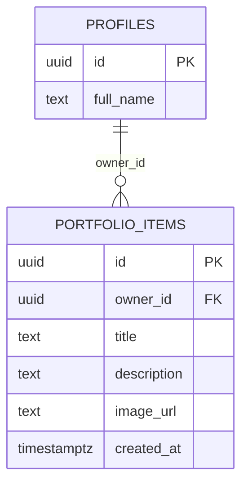

# Portfolio Feature Reference

## 1. Human Explanation
The Portfolio feature lets freelancers showcase their work via items containing title, description, and an image. Items are owned by the profile (`owner_id`) and images are stored under the `portfolio` bucket. MVVM flow:
- UI in `lib/features/portfolio/view/` (screen + sheets + widgets).
- `PortfolioViewModel` orchestrates listing, add, edit, and delete.
- `PortfolioRepository` wraps `PortfolioService` (Storage + PostgREST) and exposes a stable API.

## 2. Database & Supabase Mapping

### 2.1 `public.portfolio_items`
| Column | Type | Purpose / Usage | Notes |
| --- | --- | --- | --- |
| `id` | `uuid` (PK) | Portfolio item id | Default `gen_random_uuid()` |
| `owner_id` | `uuid` (FK → `profiles.id`) | Owner profile id | `ON DELETE CASCADE` |
| `title` | `text` | Work title | Required |
| `description` | `text` | Details | Optional |
| `image_path` | `text` | Storage path (if private) | In schema: `image_path`; app currently uses `image_url` (public) |
| `created_at` | `timestamptz` | When created (UTC) | Default `now()` |

Indexes
- `idx_portfolio_owner_created (owner_id, created_at DESC)` for fast listing.

RLS Policies (Summary)
| Table | Action | Policy | Rule |
| --- | --- | --- | --- |
| `portfolio_items` | SELECT | `portfolio_select_owner_or_public` | `USING (true)` (public-readable) |
| `portfolio_items` | ALL | `portfolio_crud_owner` | `USING/CHECK (auth.uid() = owner_id)` |

### 2.2 Storage bucket
| Bucket | Visibility | Purpose | Notes |
| --- | --- | --- | --- |
| `portfolio` | Public | Host portfolio images | Service stores a public URL via `getPublicUrl()`; if switching to private, use signed URLs instead.

## 3. File Inventory
| File | Layer | Description |
| --- | --- | --- |
| `lib/features/portfolio/data/portfolio_repository.dart` | Repository | Wraps `PortfolioService` and exposes list/add/delete/update methods; surfaces `currentUser`. |
| `lib/features/portfolio/services/portfolio_service.dart` | Service | Uploads bytes to `portfolio` bucket, produces public URL, inserts/reads/deletes rows in `portfolio_items`. |
| `lib/features/portfolio/models/portfolio_item.dart` | Model | Immutable item with `id`, `owner_id`, `title`, `description`, `image_url`, `created_at`. |
| `lib/features/portfolio/viewmodels/portfolio_view_model.dart` | ViewModel | `ChangeNotifier` that manages paging cursor, adds/edits/deletes and updates the list. |
| `lib/features/portfolio/view/portfolio_screen.dart` | View | Grid/List of items with pull-to-refresh and load-more. |
| `lib/features/portfolio/view/sheets/add_portfolio_sheet.dart` | View | Form to pick image + enter title/description; calls ViewModel add. |
| `lib/features/portfolio/view/sheets/edit_portfolio_sheet.dart` | View | Form to edit title/description; calls ViewModel update. |
| `lib/features/portfolio/view/sheets/portfolio_details_sheet.dart` | View | Full-screen preview with details. |
| `lib/features/portfolio/view/widgets/portfolio_tile.dart` | Widget | Card per item (image + title). |

## 4. ERD Diagram


```text
profiles (id) ──< portfolio_items (owner_id)
```

## 5. Supabase Snippets

### 5.1 SQL
```sql
-- Insert a portfolio item (owner-only by RLS)
insert into public.portfolio_items (owner_id, title, description, image_url)
values (auth.uid(), 'Landing Page', 'A marketing website', '<public-url-or-path>')
returning *;

-- List items for a user
select id, title, description, image_url, created_at
from public.portfolio_items
where owner_id = '<profile_id>'
order by created_at desc
limit 30;

-- Update title/description (owner-only)
update public.portfolio_items
set title = 'New Title', description = null
where id = '<item_id>' and owner_id = auth.uid();

-- Delete an item (owner-only)
delete from public.portfolio_items
where id = '<item_id>' and owner_id = auth.uid();
```

### 5.2 Dart (supabase_flutter)
```dart
final supabase = Supabase.instance.client;

// Add item with uploaded image
Future<void> addPortfolioItem({
  required String title,
  String? description,
  required Uint8List imageBytes,
  required String filename,
}) async {
  final ownerId = supabase.auth.currentUser!.id;
  // Upload to Storage
  final path = '$ownerId/${DateTime.now().millisecondsSinceEpoch}_$filename';
  await supabase.storage.from('portfolio').uploadBinary(path, imageBytes,
      fileOptions: const FileOptions(upsert: false));
  final publicUrl = supabase.storage.from('portfolio').getPublicUrl(path);
  // Insert row
  await supabase.from('portfolio_items').insert({
    'owner_id': ownerId,
    'title': title,
    'description': description,
    'image_url': publicUrl,
  });
}

// List items with simple paging cursor
Future<List<Map<String, dynamic>>> listPortfolio({required String ownerId, String? cursorIso, int limit = 30}) async {
  final rows = await supabase
      .from('portfolio_items')
      .select()
      .eq('owner_id', ownerId)
      .order('created_at', ascending: false)
      .limit(limit);
  return (rows as List).cast<Map<String, dynamic>>();
}

// Delete item and optionally remove storage object
Future<void> deletePortfolioItem(String id, {String? publicUrl}) async {
  await supabase.from('portfolio_items').delete().eq('id', id);
  if (publicUrl != null) {
    final marker = '/object/public/portfolio/';
    final idx = publicUrl.indexOf(marker);
    if (idx != -1) {
      final storagePath = publicUrl.substring(idx + marker.length);
      await supabase.storage.from('portfolio').remove([storagePath]);
    }
  }
}
```

## 6. Error Handling
| Origin | Error | User-Facing Message | Mitigation |
| --- | --- | --- | --- |
| Upload | `StorageException` | "Upload failed. Please try again." | Validate file size/type; retry safely. |
| Insert/Update/Delete | `42501` RLS denied | "You can only manage your own portfolio." | Ensure session; check ownership. |
| Delete image | Storage 404 | "Image already removed." | Ignore silently to keep UX smooth. |
| IDs | `22P02` invalid UUID | "Invalid identifier." | Validate IDs before requests. |

## 7. Extra Notes & Testing Checklist
- **Public vs Private**: Current implementation stores a public URL; if privacy is required, store the path and generate signed URLs instead.
- **Paging**: Consider time-based cursors (`created_at`) on the server once SDK supports it.
- **UTC**: All timestamps are UTC; convert to local for display.

Testing checklist:
- Add item (upload + insert) → appears in grid and opens in details.
- Edit title/description → changes persist and reflect in list.
- Delete item → row removed; image cleanup attempted.
- Attempt to edit/delete other user’s item → denied by RLS.
