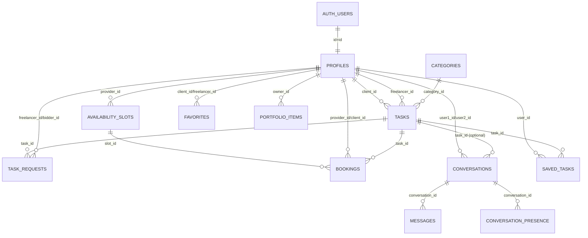

# Supabase Setup for SLine — Complete Database Reference

**Last Updated**: 2025-12-14 (Auto-generated from MCP Server)
**Version**: 2.1
**Database Version**: PostgreSQL 17.4.1
**Project ID**: `isddrknbjsgaantjojhm`
**Region**: `eu-north-1` (Stockholm)
**API URL**: `https://isddrknbjsgaantjojhm.supabase.co`

This document is the **single source of truth** for all Supabase backend setup: tables, enums, relationships, indexes, RLS policies, triggers/functions, storage, views, and Realtime configuration for the SLine freelance marketplace app.

---


---

## 1. Quick Reference (TL;DR)

### Core Tables (Public Schema)

| Table | RLS | Rows | Purpose |
|-------|-----|------|---------|
| `profiles` | ✅ | 0 | User profiles linked to auth.users |
| `tasks` | ✅ | 1 | Job postings (tender/booking) |
| `task_requests` | ✅ | 0 | Bids/proposals on tasks |
| `conversations` | ✅ | 0 | Chat threads |
| `messages` | ✅ | 1 | Chat messages |
| `conversation_presence` | ✅ | 0 | Typing indicators |
| `categories` | ✅ | 0 | Service categories |
| `favorites` | ✅ | 0 | Client's saved freelancers |
| `saved_tasks` | ✅ | 0 | Bookmarked tasks |
| `availability_slots` | ✅ | 0 | Provider availability |
| `bookings` | ✅ | 1 | Session bookings |
| `portfolio_items` | ✅ | 0 | Freelancer portfolio |
| `notifications` | ✅ | 1 | User notifications |

### Enums

| Enum | Values |
|------|--------|
| `task_type_enum` | `tender`, `booking` |
| `booking_status_enum` | `pending`, `confirmed`, `canceled`, `completed` |
| `message_type_enum` | `text`, `system`, `offer`, `offer_update`, `offer_accepted`, `offer_rejected`, `delivery_submitted`, `end_early_request`, `dispute_report` |

### Storage Buckets

| Bucket | Public | Purpose |
|--------|--------|---------|
| `avatars` | ❌ Private | Profile pictures (signed URLs) |
| `task-images` | ❌ Private | Task attachments (signed URLs) |
| `chat-attachments` | ❌ Private | Message files (signed URLs) |
| `portfolio` | ✅ Public | Portfolio work images |

### Realtime

- **Enabled on**: `messages`, `notifications`

### Key Business Rules (Enforced by Triggers)

- ✅ Bids only allowed on `tender` tasks (not `booking`)
- ✅ DM conversations require `favorites` relationship
- ✅ Task-linked conversations: non-owner starts chat
- ✅ Booking status transitions enforced
- ✅ Slot overlap prevention for providers
- ✅ Auto-assign freelancer on offer acceptance
- ✅ Client ID is immutable on tasks

---

## 2. Project Configuration

### Connection Details

```
Project ID: isddrknbjsgaantjojhm
API URL: https://isddrknbjsgaantjojhm.supabase.co
Database Host: db.isddrknbjsgaantjojhm.supabase.co
Region: eu-north-1 (Stockholm)
Postgres Version: 17.4.1
Status: ACTIVE_HEALTHY
Created: 2025-07-16
```

### Conventions

- **Timestamps**: Store in **UTC**, convert to local in UI via `formatUtcToLocal()`
- **Identity**: Comes from `auth.users`; profile data in `public.profiles`
- **Storage**: Store **paths** in database, generate **signed URLs** at render time
- **Session**: All RLS-protected queries require valid session (`auth.uid()`)
- **NIL UUID**: `'00000000-0000-0000-0000-000000000000'` used for unique constraints

---

## 3. Data Model Overview

### Entity Relationship Diagram



### Textual Representation

```text
auth.users (id)
  └─→ profiles (id)
      ├─< tasks (client_id, freelancer_id, assigned_freelancer_id)
      │    ├─< task_requests (task_id, freelancer_id, bidder_id)
      │    ├─< conversations (task_id)
      │    ├─< bookings (task_id)
      │    └─< saved_tasks (task_id)
      ├─< favorites (client_id → freelancer_id)
      ├─< conversations (user1_id, user2_id, initiated_by)
      │    ├─< messages (conversation_id, sender_id, receiver_id)
      │    └─< conversation_presence (conversation_id, user_id)
      ├─< availability_slots (provider_id)
      │    └─< bookings (slot_id, provider_id, client_id)
      └─< portfolio_items (owner_id)

categories (id) ──< tasks (category_id)
```

### Key Unique Constraints

| Table | Constraint | Purpose |
|-------|------------|---------|
| `conversations` | `(LEAST(user1_id,user2_id), GREATEST(user1_id,user2_id), COALESCE(task_id, NIL_UUID))` | One conversation per user pair per task |
| `conversations` | `ux_convo_pair_direct` (WHERE task_id IS NULL) | One direct DM per user pair |
| `conversations` | `ux_convo_pair_task` (WHERE task_id IS NOT NULL) | One conversation per task per user pair |
| `task_requests` | `(task_id, freelancer_id) WHERE deleted_at IS NULL` | One active offer per freelancer per task |
| `favorites` | `(client_id, freelancer_id)` | One favorite per client-freelancer pair |
| `saved_tasks` | `(user_id, task_id)` | One save per user per task |
| `categories` | `UNIQUE(name)` | Unique category names |

---

## 4. Enums

### 4.1 `task_type_enum`

```sql
CREATE TYPE public.task_type_enum AS ENUM ('tender', 'booking');
```

| Value | Description | Use Case |
|-------|-------------|----------|
| `tender` | Traditional bidding task | Freelancers submit proposals, client selects one |
| `booking` | Scheduled appointment | Client books provider's time slot |

### 4.2 `booking_status_enum`

```sql
CREATE TYPE public.booking_status_enum AS ENUM (
  'pending',
  'confirmed',
  'canceled',
  'completed'
);
```

**Status Transitions** (enforced by `fn_booking_guard` trigger):

```
pending ──┬──→ confirmed (by provider)
          └──→ canceled  (by either party)

confirmed ──┬──→ completed (by provider)
            └──→ canceled  (by either party)
```

### 4.3 `message_type_enum`

```sql
CREATE TYPE public.message_type_enum AS ENUM (
  'text',
  'system',
  'offer',
  'offer_update',
  'offer_accepted',
  'offer_rejected',
  'delivery_submitted',
  'end_early_request',
  'dispute_report'
);
```

| Type | Sender | Description | Payload Required |
|------|--------|-------------|------------------|
| `text` | Any participant | Regular message | No |
| `system` | System | Auto-generated notification | No |
| `offer` | Freelancer | Initial offer | `{price, days}` |
| `offer_update` | Freelancer | Modified offer | `{price, days}` |
| `offer_accepted` | Client | Acceptance notification | No |
| `offer_rejected` | Client | Rejection notification | No |
| `delivery_submitted` | Freelancer | Work submission | Optional attachments |
| `end_early_request` | Either | Request to end early | `{reason}` |
| `dispute_report` | Either | Dispute filing | `{reason}` |

---

## 5. Tables

### 5.1 `profiles`

User profile information linked to Supabase Auth.

| Column | Type | Nullable | Default | Description |
|--------|------|----------|---------|-------------|
| `id` | uuid | ❌ | - | PK, FK to auth.users(id) ON DELETE CASCADE |
| `full_name` | text | ✅ | - | Display name |
| `email` | text | ✅ | - | Email address |
| `avatar_url` | text | ✅ | - | Storage path in 'avatars' bucket |
| `roles` | text[] | ✅ | `['client']` | Available roles array |
| `active_role` | text | ✅ | `'client'` | Current active role ('client' or 'freelancer') |
| `skills` | text[] | ✅ | `'{}'` | List of professional skills |
| `created_at` | timestamptz | ✅ | `now()` | Creation timestamp (UTC) |

**Key Relations:**

- Primary source for user identity across the app
- Referenced by: tasks, conversations, messages, favorites, portfolio_items, saved_tasks, task_requests, bookings

---

### 5.2 `tasks`

Job postings (tender or booking type).

| Column | Type | Nullable | Default | Description |
|--------|------|----------|---------|-------------|
| `id` | uuid | ❌ | `gen_random_uuid()` | Primary key |
| `user_id` | uuid | ❌ | - | FK to auth.users (legacy) |
| `client_id` | uuid | ✅ | - | FK to profiles (task owner) |
| `freelancer_id` | uuid | ✅ | - | FK to profiles (assigned) |
| `assigned_freelancer_id` | uuid | ✅ | - | FK to profiles (assigned via offer) |
| `title` | text | ❌ | - | Task title |
| `description` | text | ❌ | - | Task details |
| `budget` | numeric | ❌ | - | Task budget |
| `budget_cents` | bigint | ✅ | Generated | Budget in cents (computed) |
| `deadline` | timestamp | ✅ | - | Due date |
| `category` | text | ✅ | - | Legacy category string |
| `category_id` | uuid | ✅ | - | FK to categories |
| `skills` | text[] | ✅ | `'{}'` | Required skills array |
| `status` | text | ❌ | `'open'` | Status (open/assigned/closed/in_progress/canceled) |
| `task_type` | task_type_enum | ❌ | `'tender'` | Task type |
| `session_price_bigint` | bigint | ✅ | - | Booking session price |
| `hour_rate_bigint` | bigint | ✅ | - | Booking hourly rate |
| `image_paths` | text[] | ✅ | `'{}'` | Storage paths in 'task-images' bucket |
| `packages` | jsonb | ✅ | - | Booking packages (Basic/Standard/Premium) |
| `owner_id` | uuid | ✅ | Generated | `COALESCE(client_id, user_id)` |
| `created_at` | timestamptz | ❌ | `now()` | Creation timestamp |

**Status Values:**

- `open` - Accepting proposals/bookings
- `assigned` - Freelancer assigned
- `in_progress` - Work in progress
- `closed` - Completed
- `canceled` - Canceled

**Check Constraints:**

- `status IN ('open', 'assigned', 'closed', 'in_progress', 'canceled')`

---

### 5.3 `task_requests`

Offers/bids on tender tasks.

| Column | Type | Nullable | Default | Description |
|--------|------|----------|---------|-------------|
| `id` | uuid | ❌ | `gen_random_uuid()` | Primary key |
| `task_id` | uuid | ❌ | - | FK to tasks |
| `freelancer_id` | uuid | ✅ | - | FK to profiles (bidder) |
| `bidder_id` | uuid | ✅ | - | FK to profiles (legacy) |
| `price` | numeric | ❌ | - | Proposed price |
| `days` | integer | ❌ | - | Proposed duration in days |
| `duration_days` | integer | ✅ | - | Duration (synced to days) |
| `amount` | numeric | ✅ | - | Alternative amount field |
| `message` | text | ✅ | - | Proposal message |
| `note` | text | ✅ | - | Additional notes |
| `status` | text | ❌ | `'pending'` | Status (pending/accepted/rejected) |
| `initiated_by` | uuid | ✅ | - | FK to auth.users (who last acted) |
| `deleted_at` | timestamptz | ✅ | - | Soft delete timestamp |
| `created_at` | timestamptz | ❌ | `now()` | Creation timestamp |

**Check Constraints:**

- `days > 0`
- `status IN ('pending', 'accepted', 'rejected')`

---

### 5.4 `categories`

Service categories (database-first approach).

| Column | Type | Nullable | Default | Description |
|--------|------|----------|---------|-------------|
| `id` | uuid | ❌ | `gen_random_uuid()` | Primary key |
| `name` | text | ❌ | - | Category name (unique) |
| `icon_url` | text | ✅ | - | Icon URL/path |
| `created_at` | timestamptz | ❌ | `now()` | Creation timestamp |

---

### 5.5 `conversations`

Chat threads between two users (optional task context).

| Column | Type | Nullable | Default | Description |
|--------|------|----------|---------|-------------|
| `id` | uuid | ❌ | `gen_random_uuid()` | Primary key |
| `task_id` | uuid | ✅ | - | FK to tasks (optional) |
| `user1_id` | uuid | ✅ | - | FK to profiles (normalized: smaller UUID) |
| `user2_id` | uuid | ✅ | - | FK to profiles (normalized: larger UUID) |
| `initiated_by` | uuid | ✅ | - | FK to profiles (who started) |
| `last_message_at` | timestamptz | ✅ | - | Last message timestamp |
| `created_at` | timestamptz | ✅ | `now()` | Creation timestamp |

**Important Notes:**

- `user1_id` and `user2_id` are normalized (user1_id < user2_id) by trigger
- Task-linked conversations: Only non-owner can initiate
- Direct DMs: Requires favorites relationship

---

### 5.6 `messages`

Chat messages with attachments and offer support.

| Column | Type | Nullable | Default | Description |
|--------|------|----------|---------|-------------|
| `id` | uuid | ❌ | `gen_random_uuid()` | Primary key |
| `conversation_id` | uuid | ✅ | - | FK to conversations |
| `sender_id` | uuid | ✅ | - | FK to profiles/auth.users |
| `receiver_id` | uuid | ✅ | - | FK to profiles/auth.users |
| `content` | text | ❌ | - | Message text |
| `message_type` | message_type_enum | ❌ | `'text'` | Message type |
| `payload` | jsonb | ❌ | `'{}'` | Structured data (offer details, etc.) |
| `attachment_url` | text | ✅ | - | Storage path in 'chat-attachments' |
| `attachment_type` | text | ✅ | - | 'image' or 'file' |
| `attachment_name` | text | ✅ | - | Original filename |
| `attachment_size` | bigint | ✅ | - | File size in bytes |
| `delivered_at` | timestamptz | ✅ | - | When delivered to receiver |
| `seen_at` | timestamptz | ✅ | - | When seen by receiver |
| `created_at` | timestamptz | ✅ | `now()` | Creation timestamp |

**Check Constraints:**

- `attachment_type IN ('image', 'file')`

**Payload Examples:**

```json
// offer / offer_update
{ "price": 50000, "days": 5, "note": "Optional message" }

// end_early_request / dispute_report
{ "reason": "Explanation text" }

// delivery_submitted
{ "note": "Delivery message", "attachments": [...] }
```

---

### 5.7 `conversation_presence`

Typing indicators for real-time chat.

| Column | Type | Nullable | Default | Description |
|--------|------|----------|---------|-------------|
| `conversation_id` | uuid | ❌ | - | FK to conversations (PK part) |
| `user_id` | uuid | ❌ | - | FK to profiles (PK part) |
| `is_typing` | boolean | ❌ | `false` | Currently typing |
| `updated_at` | timestamptz | ❌ | `now()` | Last update timestamp |

**Note:** Presence records are automatically expired after 15 seconds by `expire_typing_presence` trigger.

---

### 5.8 `availability_slots`

Provider availability windows for booking tasks.

| Column | Type | Nullable | Default | Description |
|--------|------|----------|---------|-------------|
| `id` | uuid | ❌ | `gen_random_uuid()` | Primary key |
| `provider_id` | uuid | ❌ | - | FK to auth.users |
| `starts_at` | timestamptz | ❌ | - | Slot start time (UTC) |
| `ends_at` | timestamptz | ❌ | - | Slot end time (UTC) |
| `is_blocked` | boolean | ❌ | `false` | Whether slot is blocked |
| `created_at` | timestamptz | ❌ | `now()` | Creation timestamp |

**Business Rules:**

- Non-overlapping open slots enforced by `fn_reject_overlapping_slots` trigger
- Uses GiST index with `tstzrange` for efficient overlap detection

---

### 5.9 `bookings`

Client bookings on provider slots.

| Column | Type | Nullable | Default | Description |
|--------|------|----------|---------|-------------|
| `id` | uuid | ❌ | `gen_random_uuid()` | Primary key |
| `task_id` | uuid | ✅ | - | FK to tasks |
| `provider_id` | uuid | ❌ | - | FK to auth.users |
| `client_id` | uuid | ❌ | - | FK to auth.users |
| `slot_id` | uuid | ❌ | - | FK to availability_slots |
| `status` | booking_status_enum | ❌ | `'pending'` | Booking status |
| `note` | text | ✅ | - | Booking notes |
| `created_at` | timestamptz | ❌ | `now()` | Creation timestamp |

---

### 5.10 `portfolio_items`

Freelancer work gallery.

| Column | Type | Nullable | Default | Description |
|--------|------|----------|---------|-------------|
| `id` | uuid | ❌ | `gen_random_uuid()` | Primary key |
| `owner_id` | uuid | ❌ | - | FK to profiles |
| `title` | text | ❌ | - | Item title |
| `description` | text | ✅ | - | Item description |
| `image_url` | text | ✅ | - | Storage path in 'portfolio' bucket |
| `created_at` | timestamptz | ❌ | `now()` | Creation timestamp |

---

### 5.13 `notifications`

User notifications for messages, offers, and system events.

| Column | Type | Nullable | Default | Description |
|--------|------|----------|---------|-------------|
| `id` | uuid | ❌ | `gen_random_uuid()` | Primary key |
| `user_id` | uuid | ❌ | - | FK to profiles (recipient) |
| `title` | text | ❌ | - | Notification title |
| `message` | text | ❌ | - | Notification body |
| `type` | text | ❌ | - | 'offer', 'message', 'system', 'booking', 'task' |
| `related_entity_id` | uuid | ✅ | - | ID of related object |
| `related_entity_type` | text | ✅ | - | Table name of related object |
| `is_read` | boolean | ❌ | `false` | Read status |
| `metadata` | jsonb | ✅ | `'{}'` | Extra data |
| `created_at` | timestamptz | ❌ | `now()` | Creation timestamp |

---

### 5.11 `favorites`

Client's saved freelancers (enables DM creation).

| Column | Type | Nullable | Default | Description |
|--------|------|----------|---------|-------------|
| `id` | uuid | ❌ | `gen_random_uuid()` | Primary key |
| `client_id` | uuid | ❌ | - | FK to profiles |
| `freelancer_id` | uuid | ❌ | - | FK to profiles |
| `created_at` | timestamptz | ❌ | `now()` | Creation timestamp |

---

### 5.12 `saved_tasks`

User's bookmarked tasks.

| Column | Type | Nullable | Default | Description |
|--------|------|----------|---------|-------------|
| `id` | uuid | ❌ | `gen_random_uuid()` | Primary key |
| `user_id` | uuid | ❌ | - | FK to profiles |
| `task_id` | uuid | ❌ | - | FK to tasks |
| `created_at` | timestamptz | ❌ | `now()` | Creation timestamp |

---

## 6. Views

### 6.1 `tasks_mvp`

Simplified task view for MVP queries.

```sql
SELECT 
  id,
  owner_id AS client_id,
  title,
  description,
  category_id,
  budget_cents,
  status,
  created_at,
  image_paths,
  assigned_freelancer_id,
  deadline,
  skills,
  task_type
FROM tasks;
```

**⚠️ Security Warning:** This view uses `SECURITY DEFINER` which bypasses RLS. Consider changing to `SECURITY INVOKER`.

### 6.2 `user_conversations`

Filtered conversations for current user.

```sql
SELECT id, task_id, user1_id, user2_id, created_at
FROM conversations c
WHERE user1_id = auth.uid() OR user2_id = auth.uid();
```

**⚠️ Security Warning:** Uses `SECURITY DEFINER`.

### 6.3 `users` ⚠️ SECURITY RISK

```sql
SELECT id, email, 
  raw_user_meta_data->>'full_name' AS full_name,
  raw_user_meta_data->>'avatar_url' AS avatar_url
FROM auth.users u;
```

**🚨 CRITICAL:** This view exposes `auth.users` to the `anon` role. **Should be removed or restricted immediately.**

---

## 7. RLS Policies

All tables have Row Level Security (RLS) enabled. Below are the actual policies from the database.

### 7.1 `profiles` Policies

| Policy | Command | Rule |
|--------|---------|------|
| `Profiles are viewable by everyone` | SELECT | `true` (public can view) |
| `Users can read their own profile` | SELECT | `auth.uid() = id` |
| `Allow insert for authenticated users` | INSERT | `auth.uid() = id` |
| `Users can insert their own profile` | INSERT | `auth.uid() = id` |
| `Users can update their own profile` | UPDATE | `auth.uid() = id` |
| `Users can delete their own profile` | DELETE | `auth.uid() = id` |

### 7.2 `tasks` Policies

| Policy | Command | Rule |
|--------|---------|------|
| `Allow read tasks` | SELECT | `true` (all authenticated) |
| `Allow select for all users` | SELECT | `true` |
| `Allow read access with join` | SELECT | `true` |
| `tasks_select_all_auth` | SELECT | `auth.role() = 'authenticated'` |
| `tasks_select_open` | SELECT | `status = 'open' OR client_id = auth.uid() OR freelancer_id = auth.uid()` |
| `tasks_select_policy` | SELECT | Same as above |
| `Allow insert own tasks` | INSERT | `auth.uid() = user_id` |
| `tasks_insert_policy` | INSERT | `is_client(auth.uid()) AND client_id = auth.uid()` |
| `tasks_insert_self` | INSERT | `client_id = auth.uid()` |
| `tasks_insert_owner` | INSERT | `owner_id = auth.uid()` |
| `Allow update own tasks` | UPDATE | `auth.uid() = user_id` |
| `tasks_update_policy` | UPDATE | `client_id = auth.uid()` |
| `tasks_update_involved` | UPDATE | `client_id = auth.uid() OR freelancer_id = auth.uid()` |
| `tasks_update_owner` | UPDATE | `owner_id = auth.uid()` |
| `Allow delete own tasks` | DELETE | `auth.uid() = user_id` |
| `tasks_delete_policy` | DELETE | `client_id = auth.uid()` |

### 7.3 `task_requests` Policies

| Policy | Command | Rule |
|--------|---------|------|
| `tr_select` | SELECT | `freelancer_id = auth.uid() OR EXISTS(task owner check)` |
| `tr_insert` | INSERT | `is_freelancer(uid) AND freelancer_id = uid AND task is open AND not own task` |
| `tr_update` | UPDATE | `freelancer_id = uid AND status = 'pending'` |
| `tr_update_by_owner` | UPDATE | Task owner can update |
| `tr_delete` | DELETE | `freelancer_id = uid AND status = 'pending'` |

### 7.4 `conversations` Policies

| Policy | Command | Rule |
|--------|---------|------|
| `conversations_select` | SELECT | Participant only |
| `conversations_select_by_participant` | SELECT | `auth.uid() = user1_id OR auth.uid() = user2_id` |
| `conversations_insert` | INSERT | Client can insert if participant |
| `conversations_insert_client_only` | INSERT | Complex: task-linked or favorites DM |
| `conversations_update` | UPDATE | Participant only |

### 7.5 `messages` Policies

| Policy | Command | Rule |
|--------|---------|------|
| `messages_select` | SELECT | `is_conversation_participant(conversation_id, uid)` |
| `messages_select_by_participant` | SELECT | Via conversation join |
| `messages_select_participants` | SELECT | Via conversation join |
| `Users can view their messages` | SELECT | `sender_id = uid OR receiver_id = uid` |
| `messages_insert` | INSERT | Participant and sender = uid |
| `messages_insert_by_sender` | INSERT | sender_id = uid and participant |
| `messages_insert_participants_only` | INSERT | Complex with offer acceptance rules |
| `messages_update` | UPDATE | `sender_id = uid` |
| `messages_update_by_receiver` | UPDATE | `receiver_id = uid` (for seen_at) |
| `messages_delete` | DELETE | `sender_id = uid` |

### 7.6 `availability_slots` Policies

| Policy | Command | Rule |
|--------|---------|------|
| `slots_select_read` | SELECT | `true` (all authenticated) |
| `slots_write_owner` | ALL | `provider_id = auth.uid()` |

### 7.7 `bookings` Policies

| Policy | Command | Rule |
|--------|---------|------|
| `bookings_select_by_parties` | SELECT | `client_id = uid OR provider_id = uid` |
| `bookings_insert_by_client` | INSERT | Client can book if slot not blocked |
| `bookings_update_by_provider` | UPDATE | `provider_id = uid` |
| `bookings_cancel_by_client` | UPDATE | `client_id = uid AND status = 'canceled'` |

### 7.8 `favorites` Policies

| Policy | Command | Rule |
|--------|---------|------|
| `favorites_select_own` | SELECT | `client_id = auth.uid()` |
| `favorites_insert_self` | INSERT | `client_id = auth.uid()` |
| `favorites_delete_self` | DELETE | `client_id = auth.uid()` |

### 7.9 `saved_tasks` Policies

| Policy | Command | Rule |
|--------|---------|------|
| `saved_tasks_select_own` | SELECT | `user_id = auth.uid()` |
| `saved_tasks_insert_own` | INSERT | `user_id = auth.uid()` |
| `saved_tasks_delete_own` | DELETE | `user_id = auth.uid()` |

### 7.10 `portfolio_items` Policies

| Policy | Command | Rule |
|--------|---------|------|
| `portfolio_select_all_auth` | SELECT | `true` (public view) |
| `portfolio_insert_owner` | INSERT | `owner_id = auth.uid()` |
| `portfolio_update_owner` | UPDATE | `owner_id = auth.uid()` |
| `portfolio_delete_owner` | DELETE | `owner_id = auth.uid()` |

### 7.11 `categories` Policies

| Policy | Command | Rule |
|--------|---------|------|
| `categories_select_all` | SELECT | `true` (read-only for all) |

### 7.12 `conversation_presence` Policies

| Policy | Command | Rule |
|--------|---------|------|
| `presence_select_participant` | SELECT | Conversation participant |
| `presence_upsert_self` | INSERT | `user_id = auth.uid()` |
| `presence_update_self` | UPDATE | `user_id = auth.uid()` |

---

## 8. Triggers

### 8.1 Availability Slots Triggers

| Trigger | Event | Function | Purpose |
|---------|-------|----------|---------|
| `trg_no_overlap_slots` | BEFORE INSERT/UPDATE | `fn_reject_overlapping_slots()` | Prevent overlapping open slots |

### 8.2 Bookings Triggers

| Trigger | Event | Function | Purpose |
|---------|-------|----------|---------|
| `trg_booking_guard` | BEFORE UPDATE | `fn_booking_guard()` | Enforce valid status transitions |

### 8.3 Conversations Triggers

| Trigger | Event | Function | Purpose |
|---------|-------|----------|---------|
| `trg_conversations_before_insert_guard` | BEFORE INSERT | `conversations_before_insert_guard()` | Validate DM/task-linked rules |
| `trg_normalize_conversation_users` | BEFORE INSERT/UPDATE | `normalize_conversation_users()` | Normalize user1_id < user2_id |

### 8.4 Messages Triggers

| Trigger | Event | Function | Purpose |
|---------|-------|----------|---------|
| `trg_messages_before_insert_validate` | BEFORE INSERT | `messages_before_insert_validate()` | Validate payload for offer types |
| `trg_messages_after_insert_offer_accept` | AFTER INSERT | `messages_after_insert_offer_accept()` | Auto-assign on offer_accepted |

### 8.5 Task Requests Triggers

| Trigger | Event | Function | Purpose |
|---------|-------|----------|---------|
| `trg_task_requests_before_insert_guard` | BEFORE INSERT | `task_requests_before_insert_guard()` | Validate tender-only, set freelancer_id |
| `trg_sync_days_from_duration` | BEFORE INSERT | `trg_sync_days_from_duration()` | Sync days from duration_days |
| `trg_task_requests_status_only` | BEFORE UPDATE | `trg_task_requests_allow_status_only()` | Set initiated_by on update |
| `aaa_set_initiated_by_before_update` | BEFORE UPDATE | `aaa_set_initiated_by_before_update()` | Set initiated_by on update |

### 8.6 Tasks Triggers

| Trigger | Event | Function | Purpose |
|---------|-------|----------|---------|
| `trg_lock_tasks_client_id` | BEFORE INSERT/UPDATE | `lock_tasks_client_id()` | Make client_id immutable |

### 8.7 Conversation Presence Triggers

| Trigger | Event | Function | Purpose |
|---------|-------|----------|---------|
| `trg_expire_presence` | AFTER INSERT/UPDATE | `expire_typing_presence()` | Clean up old presence records |

---

## 9. Functions & RPC

### 9.1 Helper Functions

#### `is_client(uid uuid) → boolean`

Check if user's active role is 'client'.

```sql
SELECT is_client(auth.uid());  -- true/false
```

#### `is_freelancer(uid uuid) → boolean`

Check if user's active role is 'freelancer'.

```sql
SELECT is_freelancer(auth.uid());  -- true/false
```

#### `is_conversation_participant(convo_id uuid, uid uuid) → boolean`

Check if user is participant in conversation.

```sql
SELECT is_conversation_participant('...', auth.uid());  -- true/false
```

### 9.2 RPC Functions

#### `start_task_conversation_v1(p_task_id uuid) → conversations`

Start or get existing conversation for a task.

**Rules:**

- Only non-owner can start
- Returns existing if already exists
- Creates with normalized user order

**Usage:**

```dart
final convo = await supabase.rpc('start_task_conversation_v1', params: {
  'p_task_id': taskId,
});
```

#### `accept_task_request(p_request_id uuid) → task_requests`

Accept a pending offer.

**What it does:**

1. Validates caller is task owner
2. Rejects all other pending offers
3. Accepts this offer
4. Updates task status to 'assigned'
5. Sets assigned_freelancer_id

**Usage:**

```dart
final result = await supabase.rpc('accept_task_request', params: {
  'p_request_id': requestId,
});
```

#### `accept_task_request(p_task_id uuid, p_request_id uuid) → uuid`

Alternative signature that also creates conversation and logs message.

#### `reject_task_request(p_request_id uuid) → task_requests`

Reject a pending offer.

#### `reject_task_request(p_task_id uuid, p_request_id uuid) → uuid`

Alternative signature with conversation creation.

#### `replace_task_request(...)`

Archive previous offer and create new one.

**Parameters:**

- `p_task_id uuid` - Task ID
- `p_freelancer_id uuid` - Freelancer ID (must = auth.uid())
- `p_message text` - Message
- `p_price integer` - Price
- `p_days integer` - Duration

#### `mark_conversation_seen(p_conversation_id uuid) → void`

Mark all messages in conversation as seen for current user.

#### `mark_conversation_delivered(p_conversation_id uuid) → void`

Mark all messages in conversation as delivered for current user.

---

## 10. Indexes

### 10.1 Tasks Indexes

| Index | Columns | Purpose |
|-------|---------|---------|
| `tasks_pkey` | `(id)` | Primary key |
| `idx_tasks_client` | `(client_id)` | Filter by client |
| `idx_tasks_freelancer` | `(freelancer_id)` | Filter by freelancer |
| `idx_tasks_assigned_freelancer` | `(assigned_freelancer_id)` | Filter by assigned |
| `idx_tasks_status` | `(status)` | Filter by status |
| `idx_tasks_status_created` | `(status, created_at DESC)` | List open tasks |
| `idx_tasks_category_id` | `(category_id)` | Filter by category |
| `idx_tasks_type_created_at` | `(task_type, created_at DESC)` | Filter by type |
| `idx_tasks_user_created` | `(user_id, created_at DESC)` | User's tasks |
| `idx_tasks_user_status_created` | `(user_id, status, created_at DESC)` | User's tasks by status |
| `idx_tasks_owner_created` | `(owner_id, created_at DESC)` | Owner's tasks |

### 10.2 Messages Indexes

| Index | Columns | Purpose |
|-------|---------|---------|
| `messages_pkey` | `(id)` | Primary key |
| `idx_messages_conv_created` | `(conversation_id, created_at DESC)` | Message list |
| `idx_messages_conversation_created` | `(conversation_id, created_at DESC)` | Message list |
| `idx_messages_conversation_created_at` | `(conversation_id, created_at DESC)` | Message list |
| `idx_messages_convo_created` | `(conversation_id, created_at)` | Message list (ASC) |
| `idx_messages_participants` | `(sender_id, receiver_id)` | DM queries |
| `idx_messages_type` | `(message_type)` | Filter by type |
| `idx_messages_payload_gin` | `(payload) GIN` | JSONB search |
| `idx_messages_receiver_unseen` | `(receiver_id) WHERE seen_at IS NULL` | Unread count |
| `idx_messages_conv_type` | `(conversation_id, attachment_type)` | Attachments |

### 10.3 Conversations Indexes

| Index | Columns | Purpose |
|-------|---------|---------|
| `conversations_pkey` | `(id)` | Primary key |
| `idx_conversations_task` | `(task_id)` | Task conversations |
| `idx_conversations_user1` | `(user1_id)` | User queries |
| `idx_conversations_user2` | `(user2_id)` | User queries |
| `uq_conversations_pair_task` | `(LEAST, GREATEST, COALESCE(task_id, NIL))` | Unique constraint |
| `ux_convo_pair_direct` | `(LEAST, GREATEST) WHERE task_id IS NULL` | Direct DMs |
| `ux_convo_pair_task` | `(LEAST, GREATEST, task_id) WHERE task_id IS NOT NULL` | Task convos |
| `ux_convo_unique` | `(task_id, user1_id, user2_id)` | Legacy unique |

### 10.4 Task Requests Indexes

| Index | Columns | Purpose |
|-------|---------|---------|
| `task_requests_pkey` | `(id)` | Primary key |
| `idx_task_requests_task` | `(task_id)` | Task's offers |
| `idx_task_requests_freelancer` | `(freelancer_id)` | Freelancer's offers |
| `idx_task_requests_task_created` | `(task_id, created_at DESC)` | Task's offers sorted |
| `ix_tr_task_freelancer` | `(task_id, freelancer_id)` | Composite |
| `ix_tr_task_bidder_status` | `(task_id, bidder_id, status)` | Status check |
| `uq_task_requests_one_active_per_freelancer` | `(task_id, freelancer_id) WHERE deleted_at IS NULL` | One active offer |

### 10.5 Availability Slots Indexes

| Index | Columns | Purpose |
|-------|---------|---------|
| `availability_slots_pkey` | `(id)` | Primary key |
| `excl_slots_provider_time` | `(provider_id, tstzrange) GIST WHERE is_blocked = false` | Overlap detection |

### 10.6 Other Key Indexes

| Table | Index | Purpose |
|-------|-------|---------|
| `favorites` | `idx_favorites_client`, `idx_favorites_freelancer` | Quick lookups |
| `favorites` | `uq_favorites_client_freelancer` | Unique pair |
| `saved_tasks` | `idx_saved_tasks_user`, `idx_saved_tasks_task` | Quick lookups |
| `saved_tasks` | `uq_saved_tasks_user_task` | Unique pair |
| `categories` | `uq_categories_name` | Unique name |
| `categories` | `idx_categories_name_lower` | Case-insensitive search |
| `portfolio_items` | `idx_portfolio_owner_created` | Owner's portfolio |

---

## 11. Storage Buckets

### 11.1 Bucket Configuration

| Bucket | ID | Public | Size Limit | MIME Types | Created |
|--------|-----|--------|------------|------------|---------|
| avatars | `avatars` | ❌ Private | Unlimited | Any | 2025-09-19 |
| task-images | `task-images` | ❌ Private | Unlimited | Any | 2025-09-20 |
| chat-attachments | `chat-attachments` | ❌ Private | Unlimited | Any | 2025-08-16 |
| portfolio | `portfolio` | ✅ Public | Unlimited | Any | 2025-08-23 |

### 11.2 Storage Policies

#### Avatars Bucket

| Policy | Command | Rule |
|--------|---------|------|
| `avatars_select_authenticated` | SELECT | `bucket_id = 'avatars'` |
| `avatars_insert_own_folder` | INSERT | `bucket_id = 'avatars' AND name LIKE uid || '/%'` |
| `avatars_update_own_folder` | UPDATE | `bucket_id = 'avatars' AND name LIKE uid || '/%'` |
| `avatars_delete_own_folder` | DELETE | `bucket_id = 'avatars' AND name LIKE uid || '/%'` |

#### Task Images Bucket

| Policy | Command | Rule |
|--------|---------|------|
| `task_images_select_authenticated` | SELECT | `bucket_id = 'task-images'` |
| `task_images_insert_own_folder` | INSERT | `bucket_id = 'task-images' AND name LIKE uid || '/%'` |
| `task_images_update_own_folder` | UPDATE | Same as insert |
| `task_images_delete_own_folder` | DELETE | Same as insert |

#### Chat Attachments Bucket

| Policy | Command | Rule |
|--------|---------|------|
| `chat_attach_select_auth` | SELECT | `bucket_id = 'chat-attachments'` |
| `chat_attach_insert_auth` | INSERT | `bucket_id = 'chat-attachments' AND owner = auth.uid()` |

#### Portfolio Bucket

| Policy | Command | Rule |
|--------|---------|------|
| `storage_portfolio_select_all` | SELECT | `bucket_id = 'portfolio'` (public) |
| `storage_portfolio_insert_owner` | INSERT | `bucket_id = 'portfolio' AND split_part(name, '/', 1) = uid` |
| `storage_portfolio_update_owner` | UPDATE | Same as insert |
| `storage_portfolio_delete_owner` | DELETE | Same as insert |

### 11.3 Signed URL Usage (Flutter)

```dart
// Generate signed URL for private bucket (1 hour TTL)
final signedUrl = await supabase.storage
  .from('avatars')
  .createSignedUrl(path, 3600);

// Use SignedAvatar widget from lib/core/widgets/
SignedAvatar(
  path: user.avatarUrl,
  radius: 40,
  placeholder: Icon(Icons.person),
)
```

---

## 12. Realtime Configuration

### Enabled Tables

```sql
-- Currently enabled for realtime
SELECT schemaname, tablename 
FROM pg_publication_tables 
WHERE pubname = 'supabase_realtime';

-- Result:
-- public | messages
```

**Note:** Only `messages` table is currently in the realtime publication. Add `conversations` if needed:

```sql
ALTER PUBLICATION supabase_realtime ADD TABLE public.conversations;
```

### Flutter Integration

```dart
// Subscribe to messages in a conversation
final messagesStream = supabase
  .from('messages')
  .stream(primaryKey: ['id'])
  .eq('conversation_id', conversationId)
  .order('created_at');

// Listen for new messages
messagesStream.listen((List<Map<String, dynamic>> data) {
  // Handle new messages
});
```

**Important Notes:**

- Realtime subscriptions respect RLS policies
- Use `primaryKey` parameter for proper stream updates
- Clean up subscriptions in `dispose()` to prevent memory leaks
- Use upsert pattern (by ID) to avoid duplicate messages

---

## 13. Extensions

### 13.1 Installed Extensions

| Extension | Schema | Version | Purpose |
|-----------|--------|---------|---------|
| `pg_stat_statements` | extensions | 1.11 | Query performance monitoring |
| `pg_graphql` | graphql | 1.5.11 | GraphQL API support |
| `pgcrypto` | extensions | 1.3 | Cryptographic functions |
| `uuid-ossp` | extensions | 1.1 | UUID generation |
| `btree_gist` | public | 1.7 | GiST index support (for range overlap) |
| `supabase_vault` | vault | 0.3.1 | Secret management |
| `plpgsql` | pg_catalog | 1.0 | Procedural language |

### 13.2 Available Extensions (Not Installed)

The following extensions are available but not currently installed:

- `postgis` - Geospatial support
- `pg_trgm` - Text similarity (fuzzy search)
- `vector` - Vector embeddings (AI/ML)
- `http` - HTTP client
- `pg_cron` - Job scheduling

---

## 14. Security Advisories

### 14.1 Critical Issues (Must Fix)

| Issue | Severity | Description | Remediation |
|-------|----------|-------------|-------------|
| Exposed Auth Users | 🔴 ERROR | View `public.users` exposes `auth.users` to anon role | [Fix Guide](https://supabase.com/docs/guides/database/database-linter?lint=0002_auth_users_exposed) |
| Security Definer Views | 🔴 ERROR | Views `tasks_mvp`, `users`, `user_conversations` use SECURITY DEFINER | [Fix Guide](https://supabase.com/docs/guides/database/database-linter?lint=0010_security_definer_view) |

**Immediate Actions Required:**

1. Drop or restrict the `public.users` view
2. Change views to `SECURITY INVOKER` or add proper RLS

### 14.2 Warnings

| Issue | Count | Description |
|-------|-------|-------------|
| Mutable search_path | 16 | Functions without explicit `search_path` |
| Extension in public | 1 | `btree_gist` should be moved to `extensions` schema |
| Leaked password protection | 1 | Password leak detection disabled |
| Postgres version | 1 | Security patches available |

---

## 15. Testing & Validation

### 15.1 Test Offers (Tender vs Booking)

```sql
-- As freelancer, try offer on tender task → should SUCCEED
SELECT * FROM rpc('replace_task_request', json_build_object(
  'p_task_id', '<tender-task-id>',
  'p_freelancer_id', auth.uid(),
  'p_message', 'Test offer',
  'p_price', 10000,
  'p_days', 3
));

-- Offer on booking task → should FAIL
-- (task_requests_before_insert_guard enforces tender-only)
```

### 15.2 Test Bookings

```sql
-- As provider: create slot
INSERT INTO availability_slots(provider_id, starts_at, ends_at)
VALUES (auth.uid(), now() + interval '1 day', now() + interval '1 day 1 hour');

-- As client: book slot
INSERT INTO bookings(provider_id, client_id, slot_id, note)
VALUES ('<provider-uuid>', auth.uid(), '<slot-id>', 'Test booking');
```

### 15.3 Test Conversation Guards

```sql
-- DM without favorites → should FAIL
INSERT INTO conversations (user1_id, user2_id, initiated_by)
VALUES (auth.uid(), '<other-user>', auth.uid());

-- Task-linked as owner → should FAIL
-- (Only non-owner can start task conversations)
```

---

## 16. Troubleshooting

### 16.1 Common Errors

| Error Code | Meaning | Solution |
|------------|---------|----------|
| `42501` | RLS permission denied | Ensure valid session; check RLS policies |
| `23505` | Unique violation | Duplicate entry (favorites, offers, etc.) |
| `23503` | Foreign key violation | Referenced row doesn't exist |
| `22P02` | Invalid UUID | Validate UUID format client-side |
| `PGRST116` | Multiple rows returned | Use `.single()` or `.maybeSingle()` |
| `P0001` | User-defined exception | Check trigger error message |

### 16.2 Storage Issues

- **404 errors**: Regenerate signed URLs (they expire after TTL)
- **Upload fails**: Check RLS policy on `storage.objects` for correct bucket
- **Permission denied**: Ensure using `authenticated` role, not `anon`
- **Path format**: Use `{uid}/{filename}` pattern for user-specific files

### 16.3 Realtime Issues

- **No events received**: Verify table is in `supabase_realtime` publication
- **Duplicate messages**: Use upsert by ID instead of re-fetching all
- **Memory leaks**: Always cancel subscriptions in `dispose()`
- **Connection drops**: Implement reconnection logic

---

## 17. Changelog

### Version 2.1 (December 2025)

- **Documentation**: Complete rewrite from MCP server data
- **Security**: Documented all security advisories
- **Indexes**: Complete index documentation
- **Policies**: All actual RLS policies documented
- **Triggers**: All triggers with source code
- **Functions**: All RPC functions documented

### Version 2.0 (December 2025)

- **Task Visuals**: Added computed columns
- **Triggers**: Added `lock_tasks_client_id`

### Version 1.9+ (October 2024)

- **MVVM Restructure**: Complete re-architecture
- **Private Storage**: Migrated to private buckets
- **Chat System**: Added conversation presence, message types

---

## Additional Resources

- **DEVELOPER_GUIDE.md** - Feature-specific documentation
- **CODE_REVIEW.md** - Common mistakes and fixes
- **GEMINI.md** - Development patterns and agents
- **`.cursor/rules/`** - Rule files for specific patterns

---

End of Supabase Setup Documentation
