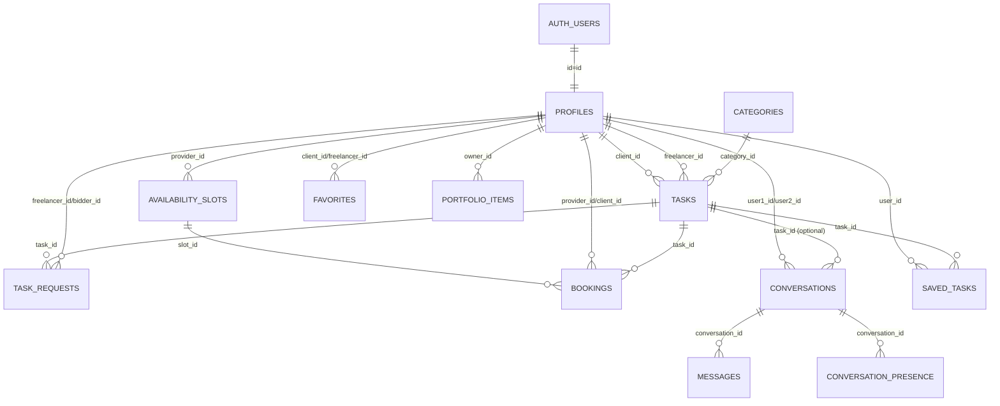

# Supabase Setup for SLine — Complete Database Reference

**Last Updated**: 2026-02-24 (Phase 3: Double-Entry Ledger Integrated)
**Version**: 2.16
**Database Version**: PostgreSQL 17.4.1
**Project ID**: `isddrknbjsgaantjojhm`
**Region**: `eu-north-1` (Stockholm)
**API URL**: `https://isddrknbjsgaantjojhm.supabase.co`

This document is the **single source of truth** for all Supabase backend setup: tables, enums, relationships, indexes, RLS policies, triggers/functions, storage, views, and Realtime configuration for the SLine freelance marketplace app.

---

---

## 1. Quick Reference (TL;DR)

### Core Tables (Public Schema)

| Table                   | RLS | Rows | Purpose                            |
| ----------------------- | --- | ---- | ---------------------------------- |
| `profiles`              | ✅  | 0    | User profiles linked to auth.users |
| `tasks`                 | ✅  | 1    | Job postings (tender/booking)      |
| `task_requests`         | ✅  | 0    | Bids/proposals on tasks            |
| `conversations`         | ✅  | 0    | Chat threads                       |
| `messages`              | ✅  | 1    | Chat messages                      |
| `conversation_presence` | ✅  | 0    | Typing indicators                  |
| `categories`            | ✅  | 0    | Service categories                 |
| `favorites`             | ✅  | 0    | Client's saved freelancers         |
| `saved_tasks`           | ✅  | 0    | Bookmarked tasks                   |
| `availability_slots`    | ✅  | 0    | Provider availability              |
| `bookings`              | ✅  | 1    | Session bookings                   |
| `portfolio_items`       | ✅  | 0    | Freelancer portfolio               |
| `notifications`         | ✅  | 1    | User notifications                 |
| `work_contracts`        | ✅  | 0    | Versioned scope snapshots          |
| `change_requests`       | ✅  | 0    | Scope/price/days change proposals  |
| `extension_requests`    | ✅  | 0    | Deadline extension proposals       |
| `accounts`              | ✅  | -    | **NEW**: Ledger account chart      |
| `journal_entries`       | ✅  | -    | **NEW**: Double-entry journal      |
| `ledger_lines`          | ✅  | -    | **NEW**: Double-entry ledger lines |
| `admin_logs`            | ✅  | 0    | Audit logs for admin actions       |
| `disputes`              | ✅  | 0    | Formal dispute tickets             |
| `dispute_messages`      | ✅  | 0    | Messages in dispute threads        |
| `dispute_evidence`      | ✅  | 0    | Attached dispute files             |
| `withdrawal_requests`   | ✅  | 0    | Freelancer fund withdrawals        |
| `support_tickets`       | ✅  | 0    | General support tickets            |
| `ticket_messages`       | ✅  | 0    | Messages in support tickets        |
| `services`              | ✅  | 0    | Pre-defined freelancer services    |

### Views

| View                    | Purpose                                      |
| ----------------------- | -------------------------------------------- |
| `vw_unified_work_items` | UNION ALL of tasks + bookings (normalized)   |
| `wallet_balances`       | Aggregated wallet balance (available/escrow) |

### Enums

| Enum                  | Values                                                                                                                                     |
| --------------------- | ------------------------------------------------------------------------------------------------------------------------------------------ |
| `task_type_enum`      | `tender`, `booking`                                                                                                                        |
| `booking_status_enum` | `pending`, `confirmed`, `active`, `delivered`, `completed`, `canceled`, `refunded`, `paid_request_pending`, `expired_unanswered`           |
| `payment_status_enum` | `unpaid`, `held`, `released`, `refunded`                                                                                                   |
| `message_type_enum`   | `text`, `system`, `offer`, `offer_update`, `offer_accepted`, `offer_rejected`, `delivery_submitted`, `end_early_request`, `dispute_report` |

### Storage Buckets

| Bucket             | Public     | Purpose                        |
| ------------------ | ---------- | ------------------------------ |
| `avatars`          | ❌ Private | Profile pictures (signed URLs) |
| `task-images`      | ❌ Private | Task attachments (signed URLs) |
| `chat-attachments` | ❌ Private | Message files (signed URLs)    |
| `portfolio`        | ✅ Public  | Portfolio work images          |

### Realtime

- **Enabled on**: `messages`, `notifications`

### Key Business Rules (Enforced by Triggers)

- ✅ Bids only allowed on `tender` tasks (not `booking`)
- ❌ DM conversations NO LONGER require `favorites` relationship (Changed v2.1)
- ✅ Task-linked conversations: non-owner starts chat
- ✅ Booking status transitions enforced
- ✅ Slot overlap prevention for providers
- ✅ Auto-assign freelancer on offer acceptance
- ✅ Client ID is immutable on tasks
- ✅ Contract fields frozen on active work (`trg_freeze_contract_fields`)
- ✅ Auto-create contract on booking confirmation (`trg_activate_contract`)
- ✅ Delivery submission creates contract snapshot (`rpc_submit_delivery`)
- ✅ Revision requests check limit before resetting status (`rpc_request_revision`)
- ✅ **Double-Entry Ledger Implementation (v2.16)**: All financial events go through `process_payment_event_ledger`.
- ✅ **Legacy Freeze**: `wallet_transactions` table is now read-only to prevent drift.

---

## 2. Project Configuration

### Connection Details

```
Project ID: isddrknbjsgaantjojhm
API URL: https://isddrknbjsgaantjojhm.supabase.co
Database Host: db.isddrknbjsgaantjojhm.supabase.co
Region: eu-north-1 (Stockholm)
Postgres Version: 17.4.1
Status: ACTIVE_HEALTHY
Created: 2025-07-16
```

### Conventions

- **Timestamps**: Store in **UTC**, convert to local in UI via `formatUtcToLocal()`
- **Identity**: Comes from `auth.users`; profile data in `public.profiles`
- **Storage**: Store **paths** in database, generate **signed URLs** at render time
- **Session**: All RLS-protected queries require valid session (`auth.uid()`)
- **NIL UUID**: `'00000000-0000-0000-0000-000000000000'` used for unique constraints

---

## 3. Data Model Overview

### Entity Relationship Diagram



### Textual Representation

```text
auth.users (id)
  └─→ profiles (id)
      ├─< tasks (client_id, freelancer_id, assigned_freelancer_id)
      │    ├─< task_requests (task_id, freelancer_id, bidder_id)
      │    ├─< conversations (task_id)
      │    ├─< bookings (task_id)
      │    └─< saved_tasks (task_id)
      ├─< favorites (client_id → freelancer_id)
      ├─< conversations (user1_id, user2_id, initiated_by)
      │    ├─< messages (conversation_id, sender_id, receiver_id)
      │    └─< conversation_presence (conversation_id, user_id)
      ├─< availability_slots (provider_id)
      │    └─< bookings (slot_id, provider_id, client_id)
      └─< portfolio_items (owner_id)

categories (id) ──< tasks (category_id)
```

### Key Unique Constraints

| Table           | Constraint                                                                             | Purpose                                  |
| --------------- | -------------------------------------------------------------------------------------- | ---------------------------------------- |
| `conversations` | `(LEAST(user1_id,user2_id), GREATEST(user1_id,user2_id), COALESCE(task_id, NIL_UUID))` | One conversation per user pair per task  |
| `conversations` | `ux_convo_pair_direct` (WHERE task_id IS NULL)                                         | One direct DM per user pair              |
| `conversations` | `ux_convo_pair_task` (WHERE task_id IS NOT NULL)                                       | One conversation per task per user pair  |
| `task_requests` | `(task_id, freelancer_id) WHERE deleted_at IS NULL`                                    | One active offer per freelancer per task |
| `favorites`     | `(client_id, freelancer_id)`                                                           | One favorite per client-freelancer pair  |
| `saved_tasks`   | `(user_id, task_id)`                                                                   | One save per user per task               |
| `categories`    | `UNIQUE(name)`                                                                         | Unique category names                    |

---

## 4. Enums

### 4.1 `task_type_enum`

```sql
CREATE TYPE public.task_type_enum AS ENUM ('tender', 'booking');
```

| Value     | Description              | Use Case                                         |
| --------- | ------------------------ | ------------------------------------------------ |
| `tender`  | Traditional bidding task | Freelancers submit proposals, client selects one |
| `booking` | Scheduled appointment    | Client books provider's time slot                |

### 4.2 `booking_status_enum`

````sql
### 4.2 `booking_status_enum`

```sql
CREATE TYPE public.booking_status_enum AS ENUM (
  'pending',
  'confirmed',
  'in_progress',
  'canceled',
  'completed',
  'paid_request_pending',
  'active',
  'delivered',
  'refunded',
  'expired_unanswered'
);
````

**Status Transitions** (enforced by `fn_booking_guard` trigger):

```
pending ──┬──→ paid_request_pending (via "Pay" action)
          └──→ canceled (by client)

paid_request_pending ──┬──→ active (via "Accept" by provider)
                       ├──→ refunded (via "Decline" by provider)
                       └──→ expired_unanswered (via system cron)

active ──┬──→ delivered (by provider)
         └──→ canceled (by either side, triggers refund)

delivered ──┬──→ completed (by client approval)
            └──→ canceled (by client, triggers refund)
```

### 4.3 `message_type_enum`

```sql
CREATE TYPE public.message_type_enum AS ENUM (
  'text',
  'system',
  'offer',
  'offer_update',
  'offer_accepted',
  'offer_rejected',
  'delivery_submitted',
  'end_early_request',
  'dispute_report'
);
```

| Type                 | Sender          | Description                 | Payload Required     |
| -------------------- | --------------- | --------------------------- | -------------------- |
| `text`               | Any participant | Regular message             | No                   |
| `system`             | System          | Auto-generated notification | No                   |
| `offer`              | Freelancer      | Initial offer               | `{price, days}`      |
| `offer_update`       | Freelancer      | Modified offer              | `{price, days}`      |
| `offer_accepted`     | Client          | Acceptance notification     | No                   |
| `offer_rejected`     | Client          | Rejection notification      | No                   |
| `delivery_submitted` | Freelancer      | Work submission             | Optional attachments |
| `end_early_request`  | Either          | Request to end early        | `{reason}`           |
| `dispute_report`     | Either          | Dispute filing              | `{reason}`           |

### 4.4 `payment_status_enum` (Legacy)

```sql
CREATE TYPE public.payment_status_enum AS ENUM ('unpaid', 'held', 'released', 'refunded');
```

**Note:** Used in `tasks` and `bookings` status columns. Financial logic now uses the Ledger system (v2.16).

### 4.5 `ledger_account_type_enum` (v2.16)

```sql
CREATE TYPE public.ledger_account_type_enum AS ENUM ('asset', 'liability', 'equity', 'revenue', 'expense');
```

### 4.6 `ledger_direction_enum` (v2.16)

```sql
CREATE TYPE public.ledger_direction_enum AS ENUM ('DEBIT', 'CREDIT');
```

### 4.7 `payment_event_type_enum` (v2.16)

```sql
CREATE TYPE public.payment_event_type_enum AS ENUM (
  'escrow_hold',
  'release_with_fee',
  'refund',
  'withdrawal_request',
  'deposit',
  'withdrawal_complete',
  'withdrawal_failed',
  'admin_credit',
  'admin_adjustment',
  'reversal',
  'gateway_escrow'
);
```

### 4.8 `related_entity_type_enum` (v2.16)

```sql
CREATE TYPE public.related_entity_type_enum AS ENUM (
  'booking',
  'task_request',
  'withdrawal_request',
  'admin_adjustment'
);
```

---

## 5. Tables

### 5.1 `profiles`

User profile information linked to Supabase Auth.

| Column        | Type        | Nullable | Default      | Description                                    |
| ------------- | ----------- | -------- | ------------ | ---------------------------------------------- |
| `id`          | uuid        | ❌       | -            | PK, FK to auth.users(id) ON DELETE CASCADE     |
| `full_name`   | text        | ✅       | -            | Display name                                   |
| `email`       | text        | ✅       | -            | Email address                                  |
| `avatar_url`  | text        | ✅       | -            | Storage path in 'avatars' bucket               |
| `roles`       | text[]      | ✅       | `['client']` | Available roles array                          |
| `active_role` | text        | ✅       | `'client'`   | Current active role ('client' or 'freelancer') |
| `seller_level`| seller_level_enum | ✅  | `'new_seller'` | Discovery tier for safe public summaries     |
| `skills`      | text[]      | ✅       | `'{}'`       | List of professional skills                    |
| `created_at`  | timestamptz | ✅       | `now()`      | Creation timestamp (UTC)                       |

**Key Relations:**

- Primary source for user identity across the app
- Referenced by: tasks, conversations, messages, favorites, portfolio_items, saved_tasks, task_requests, bookings

---

### 5.2 `tasks`

Job postings (tender or booking type).

| Column                   | Type           | Nullable | Default             | Description                                        |
| ------------------------ | -------------- | -------- | ------------------- | -------------------------------------------------- |
| `id`                     | uuid           | ❌       | `gen_random_uuid()` | Primary key                                        |
| `user_id`                | uuid           | ❌       | -                   | FK to auth.users (legacy)                          |
| `client_id`              | uuid           | ✅       | -                   | FK to profiles (task owner)                        |
| `freelancer_id`          | uuid           | ✅       | -                   | FK to profiles (assigned)                          |
| `assigned_freelancer_id` | uuid           | ✅       | -                   | FK to profiles (assigned via offer)                |
| `title`                  | text           | ❌       | -                   | Task title                                         |
| `description`            | text           | ❌       | -                   | Task details                                       |
| `budget`                 | numeric        | ❌       | -                   | Task budget                                        |
| `budget_cents`           | bigint         | ✅       | Generated           | Budget in cents (computed)                         |
| `deadline`               | timestamp      | ✅       | -                   | Due date                                           |
| `category`               | text           | ✅       | -                   | Legacy category string                             |
| `category_id`            | uuid           | ✅       | -                   | FK to categories                                   |
| `skills`                 | text[]         | ✅       | `'{}'`              | Required skills array                              |
| `status`                 | text           | ❌       | `'open'`            | Status (open/assigned/closed/in_progress/canceled) |
| `task_type`              | task_type_enum | ❌       | `'tender'`          | Task type                                          |
| `session_price_bigint`   | bigint         | ✅       | -                   | Booking session price                              |
| `hour_rate_bigint`       | bigint         | ✅       | -                   | Booking hourly rate                                |
| `image_paths`            | text[]         | ✅       | `'{}'`              | Storage paths in 'task-images' bucket              |
| `packages`               | jsonb          | ✅       | -                   | Booking packages (Basic/Standard/Premium)          |
| `owner_id`               | uuid           | ✅       | Generated           | `COALESCE(client_id, user_id)`                     |
| `delivered_at`           | timestamptz    | ✅       | -                   | When work was submitted                            |
| `review_expires_at`      | timestamptz    | ✅       | -                   | Auto-approval deadline                             |
| `revisions_total`        | int            | ❌       | `3`                 | Max revisions allowed                              |
| `revisions_used`         | int            | ❌       | `0`                 | Revisions consumed                                 |
| `revision_note`          | text           | ✅       | -                   | Last revision feedback                             |
| `revision_requested_at`  | timestamptz    | ✅       | -                   | When revision was asked                            |
| `created_at`             | timestamptz    | ❌       | `now()`             | Creation timestamp                                 |

**Status Values:**

- `open` - Accepting proposals/bookings
- `assigned` - Freelancer assigned
- `in_progress` - Work in progress
- `closed` - Completed
- `canceled` - Canceled

**Check Constraints:**

- `status IN ('open', 'assigned', 'closed', 'in_progress', 'canceled')`

---

### 5.3 `task_requests`

Offers/bids on tender tasks.

| Column          | Type        | Nullable | Default             | Description                        |
| --------------- | ----------- | -------- | ------------------- | ---------------------------------- |
| `id`            | uuid        | ❌       | `gen_random_uuid()` | Primary key                        |
| `task_id`       | uuid        | ❌       | -                   | FK to tasks                        |
| `freelancer_id` | uuid        | ✅       | -                   | FK to profiles (bidder)            |
| `bidder_id`     | uuid        | ✅       | -                   | FK to profiles (legacy)            |
| `price`         | numeric     | ❌       | -                   | Proposed price                     |
| `days`          | integer     | ❌       | -                   | Proposed duration in days          |
| `duration_days` | integer     | ✅       | -                   | Duration (synced to days)          |
| `amount`        | numeric     | ✅       | -                   | Alternative amount field           |
| `message`       | text        | ✅       | -                   | Proposal message                   |
| `note`          | text        | ✅       | -                   | Additional notes                   |
| `status`        | text        | ❌       | `'pending'`         | Status (pending/accepted/rejected) |
| `initiated_by`  | uuid        | ✅       | -                   | FK to auth.users (who last acted)  |
| `deleted_at`    | timestamptz | ✅       | -                   | Soft delete timestamp              |
| `created_at`    | timestamptz | ❌       | `now()`             | Creation timestamp                 |

**Check Constraints:**

- `days > 0`
- `status IN ('pending', 'accepted', 'rejected')`

---

### 5.4 `categories`

Service categories (database-first approach).

| Column       | Type        | Nullable | Default             | Description            |
| ------------ | ----------- | -------- | ------------------- | ---------------------- |
| `id`         | uuid        | ❌       | `gen_random_uuid()` | Primary key            |
| `name`       | text        | ❌       | -                   | Category name (unique) |
| `icon_url`   | text        | ✅       | -                   | Icon URL/path          |
| `created_at` | timestamptz | ❌       | `now()`             | Creation timestamp     |

---

### 5.5 `conversations`

Chat threads between two users (optional task context).

| Column            | Type        | Nullable | Default             | Description                               |
| ----------------- | ----------- | -------- | ------------------- | ----------------------------------------- |
| `id`              | uuid        | ❌       | `gen_random_uuid()` | Primary key                               |
| `task_id`         | uuid        | ✅       | -                   | FK to tasks (optional)                    |
| `user1_id`        | uuid        | ✅       | -                   | FK to profiles (normalized: smaller UUID) |
| `user2_id`        | uuid        | ✅       | -                   | FK to profiles (normalized: larger UUID)  |
| `initiated_by`    | uuid        | ✅       | -                   | FK to profiles (who started)              |
| `last_message_at` | timestamptz | ✅       | -                   | Last message timestamp                    |
| `created_at`      | timestamptz | ✅       | `now()`             | Creation timestamp                        |

**Important Notes:**

- `user1_id` and `user2_id` are normalized (user1_id < user2_id) by trigger
- Task-linked conversations: Only non-owner can initiate
- Direct DMs: No longer requires favorites relationship (v2.1 update)

---

### 5.6 `messages`

Chat messages with attachments and offer support.

| Column            | Type              | Nullable | Default             | Description                           |
| ----------------- | ----------------- | -------- | ------------------- | ------------------------------------- |
| `id`              | uuid              | ❌       | `gen_random_uuid()` | Primary key                           |
| `conversation_id` | uuid              | ✅       | -                   | FK to conversations                   |
| `sender_id`       | uuid              | ✅       | -                   | FK to profiles/auth.users             |
| `receiver_id`     | uuid              | ✅       | -                   | FK to profiles/auth.users             |
| `content`         | text              | ❌       | -                   | Message text                          |
| `message_type`    | message_type_enum | ❌       | `'text'`            | Message type                          |
| `payload`         | jsonb             | ❌       | `'{}'`              | Structured data (offer details, etc.) |
| `attachment_url`  | text              | ✅       | -                   | Storage path in 'chat-attachments'    |
| `attachment_type` | text              | ✅       | -                   | 'image' or 'file'                     |
| `attachment_name` | text              | ✅       | -                   | Original filename                     |
| `attachment_size` | bigint            | ✅       | -                   | File size in bytes                    |
| `delivered_at`    | timestamptz       | ✅       | -                   | When delivered to receiver            |
| `seen_at`         | timestamptz       | ✅       | -                   | When seen by receiver                 |
| `created_at`      | timestamptz       | ✅       | `now()`             | Creation timestamp                    |

**Check Constraints:**

- `attachment_type IN ('image', 'file')`

**Payload Examples:**

```json
// offer / offer_update
{ "price": 50000, "days": 5, "note": "Optional message" }

// end_early_request / dispute_report
{ "reason": "Explanation text" }

// delivery_submitted
{ "note": "Delivery message", "attachments": [...] }
```

---

### 5.7 `conversation_presence`

Typing indicators for real-time chat.

| Column            | Type        | Nullable | Default | Description                   |
| ----------------- | ----------- | -------- | ------- | ----------------------------- |
| `conversation_id` | uuid        | ❌       | -       | FK to conversations (PK part) |
| `user_id`         | uuid        | ❌       | -       | FK to profiles (PK part)      |
| `is_typing`       | boolean     | ❌       | `false` | Currently typing              |
| `updated_at`      | timestamptz | ❌       | `now()` | Last update timestamp         |

**Note:** Presence records are automatically expired after 15 seconds by `expire_typing_presence` trigger.

---

### 5.8 `availability_slots`

Provider availability windows for booking tasks.

| Column        | Type        | Nullable | Default             | Description             |
| ------------- | ----------- | -------- | ------------------- | ----------------------- |
| `id`          | uuid        | ❌       | `gen_random_uuid()` | Primary key             |
| `provider_id` | uuid        | ❌       | -                   | FK to auth.users        |
| `starts_at`   | timestamptz | ❌       | -                   | Slot start time (UTC)   |
| `ends_at`     | timestamptz | ❌       | -                   | Slot end time (UTC)     |
| `is_blocked`  | boolean     | ❌       | `false`             | Whether slot is blocked |
| `created_at`  | timestamptz | ❌       | `now()`             | Creation timestamp      |

**Business Rules:**

- Non-overlapping open slots enforced by `fn_reject_overlapping_slots` trigger
- Uses GiST index with `tstzrange` for efficient overlap detection

---

### 5.9 `bookings`

Client bookings on provider slots.

| Column                  | Type                | Nullable | Default             | Description              |
| ----------------------- | ------------------- | -------- | ------------------- | ------------------------ |
| `id`                    | uuid                | ❌       | `gen_random_uuid()` | Primary key              |
| `task_id`               | uuid                | ✅       | -                   | FK to tasks              |
| `provider_id`           | uuid                | ❌       | -                   | FK to auth.users         |
| `client_id`             | uuid                | ❌       | -                   | FK to auth.users         |
| `slot_id`               | uuid                | ✅       | -                   | FK to availability_slots |
| `status`                | booking_status_enum | ❌       | `'pending'`         | Booking status           |
| `payment_status`        | payment_status_enum | ❌       | `'unpaid'`          | Payment status           |
| `price`                 | numeric             | ✅       | `0`                 | Agreed price             |
| `package_id`            | text                | ✅       | -                   | Chosen package ID        |
| `requirements`          | jsonb               | ✅       | `'{}'`              | Client requirements      |
| `payment_request_id`    | text                | ✅       | -                   | Server-side QiCard request id |
| `payment_gateway_id`    | text                | ✅       | -                   | QiCard payment id        |
| `payment_correlation_id`| text                | ✅       | -                   | Canonical booking correlation |
| `payment_expires_at`    | timestamptz         | ✅       | -                   | Payment session expiry   |
| `payment_recovered_at`  | timestamptz         | ✅       | -                   | Last successful reconciliation |
| `note`                  | text                | ✅       | -                   | Booking notes            |
| `delivered_at`          | timestamptz         | ✅       | -                   | When work was submitted  |
| `review_expires_at`     | timestamptz         | ✅       | -                   | Auto-approval deadline   |
| `revisions_total`       | int                 | ❌       | `3`                 | Max revisions allowed    |
| `revisions_used`        | int                 | ❌       | `0`                 | Revisions consumed       |
| `revision_note`         | text                | ✅       | -                   | Last revision feedback   |
| `revision_requested_at` | timestamptz         | ✅       | -                   | When revision was asked  |
| `created_at`            | timestamptz         | ❌       | `now()`             | Creation timestamp       |

---

### 5.14 `wallet_transactions` (DEPRECATED / FROZEN)

**🚨 IMPORTANT**: This table is frozen as of v2.16. All new transactions are written to `journal_entries` and `ledger_lines`.

| Column    | Type    | Nullable | Default             | Description                                 |
| --------- | ------- | -------- | ------------------- | ------------------------------------------- |
| `id`      | uuid    | ❌       | `gen_random_uuid()` | Primary key                                 |
| `user_id` | uuid    | ❌       | -                   | FK to profiles                              |
| `amount`  | numeric | ❌       | -                   | Transaction amount                          |
| `type`    | text    | ❌       | -                   | 'escrow', 'release', 'refund'               |
| `status`  | text    | ❌       | -                   | 'held', 'released', 'completed', 'refunded' |

**Trigger**: `trg_wallet_transactions_freeze` prevents any DML on this table.

---

### 5.20 `accounts` (v2.16)

Chart of accounts for the double-entry system.

| Column         | Type                      | Description                           |
| -------------- | ------------------------- | ------------------------------------- |
| `id`           | uuid                      | Primary Key                           |
| `account_code` | text (Unique)             | e.g., 'user_available:uuid', 'system' |
| `account_type` | payment_account_type_enum | asset, liability, etc.                |
| `owner_id`     | uuid                      | FK to profiles (if user account)      |

### 5.21 `journal_entries` (v2.16)

The "Header" of a financial event.

| Column                | Type                     | Description                         |
| --------------------- | ------------------------ | ----------------------------------- |
| `id`                  | uuid                     | Primary Key                         |
| `event_type`          | payment_event_type_enum  | e.g., 'escrow_hold'                 |
| `related_entity_type` | related_entity_type_enum | 'booking', 'task_request'           |
| `related_entity_id`   | uuid                     | Link to the source object           |
| `idempotency_key`     | text (Unique)            | Prevents double-charging            |
| `status`              | text                     | 'draft', 'posted', 'void'           |
| `meta`                | jsonb                    | Debug info, original transaction ID |

### 5.22 `ledger_lines` (v2.16)

Atomic Debit/Credit entries. Must sum to zero per journal entry.

| Column             | Type    | Description                   |
| ------------------ | ------- | ----------------------------- |
| `id`               | uuid    | Primary Key                   |
| `journal_entry_id` | uuid    | FK to journal_entries         |
| `account_id`       | uuid    | FK to accounts                |
| `direction`        | text    | 'DEBIT' or 'CREDIT'           |
| `amount`           | numeric | Absolute amount (must be > 0) |
| `currency`         | text    | Default 'IQD'                 |

---

### 5.16 `work_contracts`

Immutable snapshots of the work agreement at the moment of activation (or scope change).

| Column                | Type        | Nullable | Default             | Description            |
| --------------------- | ----------- | -------- | ------------------- | ---------------------- |
| `id`                  | uuid        | ❌       | `gen_random_uuid()` | Primary key            |
| `related_entity_type` | text        | ❌       | -                   | 'task' or 'booking'    |
| `related_entity_id`   | uuid        | ❌       | -                   | FK to tasks/bookings   |
| `version`             | int         | ❌       | -                   | Version number         |
| `snapshot`            | jsonb       | ❌       | -                   | Full copy of agreement |
| `contract_hash`       | text        | ❌       | -                   | Integrity hash         |
| `created_at`          | timestamptz | ❌       | `now()`             | Creation timestamp     |

**Constraints:** `UNIQUE(related_entity_type, related_entity_id, version)`

---

### 5.17 `change_requests`

Formal requests to change scope, price, or deadline.

| Column                     | Type        | Nullable | Default             | Description                         |
| -------------------------- | ----------- | -------- | ------------------- | ----------------------------------- |
| `id`                       | uuid        | ❌       | `gen_random_uuid()` | Primary key                         |
| `related_entity_type`      | text        | ❌       | -                   | 'task' or 'booking'                 |
| `related_entity_id`        | uuid        | ❌       | -                   | FK to tasks/bookings                |
| `requester_id`             | uuid        | ❌       | -                   | FK to profiles                      |
| `scope_diff`               | text        | ✅       | -                   | Scope changes                       |
| `price_diff`               | numeric     | ✅       | -                   | Price adjustment                    |
| `days_diff`                | int         | ✅       | -                   | Timeline adjustment                 |
| `status`                   | text        | ❌       | `'pending'`         | pending/accepted/rejected/cancelled |
| `applied_contract_version` | int         | ✅       | -                   | Version applied to                  |
| `created_at`               | timestamptz | ❌       | `now()`             | Creation timestamp                  |
| `resolved_at`              | timestamptz | ✅       | -                   | Resolution timestamp                |

---

### 5.18 `extension_requests`

Requests to extend the deadline.

| Column                | Type        | Nullable | Default             | Description                         |
| --------------------- | ----------- | -------- | ------------------- | ----------------------------------- |
| `id`                  | uuid        | ❌       | `gen_random_uuid()` | Primary key                         |
| `related_entity_type` | text        | ❌       | -                   | 'task' or 'booking'                 |
| `related_entity_id`   | uuid        | ❌       | -                   | FK to tasks/bookings                |
| `requester_id`        | uuid        | ❌       | -                   | FK to profiles                      |
| `new_deadline`        | timestamptz | ❌       | -                   | Proposed deadline                   |
| `reason`              | text        | ✅       | -                   | Extension reason                    |
| `status`              | text        | ❌       | `'pending'`         | pending/accepted/rejected/cancelled |
| `created_at`          | timestamptz | ❌       | `now()`             | Creation timestamp                  |

---

### 5.15 `work_logs`

Centralized immutable record of notes and system events.

| Column                | Type        | Nullable | Default             | Description                 |
| --------------------- | ----------- | -------- | ------------------- | --------------------------- |
| `id`                  | uuid        | ❌       | `gen_random_uuid()` | Primary key                 |
| `author_id`           | uuid        | ❌       | -                   | FK to profiles              |
| `related_entity_id`   | uuid        | ❌       | -                   | task_id or booking_id       |
| `related_entity_type` | text        | ❌       | -                   | 'task' or 'booking'         |
| `content`             | text        | ❌       | -                   | Note content or event label |
| `is_private`          | boolean     | ❌       | `false`             | Access control flag         |
| `metadata`            | jsonb       | ✅       | `'{}'`              | Event metadata              |
| `created_at`          | timestamptz | ❌       | `now()`             | Creation timestamp          |

**Indexes:** `idx_work_logs_entity` (related_entity_id, created_at desc), `idx_work_logs_entity_scope_created_at` (related_entity_id, related_entity_type, created_at desc)
| `status` | text | ❌ | - | 'held', 'released', 'completed', 'refunded' |
| `related_entity_id` | uuid | ✅ | - | Linked entity ID (booking) |
| `related_entity_type` | text | ✅ | - | Linked entity type ('booking', 'task') |
| `related_txn_id` | uuid | ✅ | - | Parent transaction ID |
| `created_at` | timestamptz | ❌ | `now()` | Creation timestamp |

---

### 5.10 `portfolio_items`

Freelancer work gallery.

| Column        | Type        | Nullable | Default             | Description                        |
| ------------- | ----------- | -------- | ------------------- | ---------------------------------- |
| `id`          | uuid        | ❌       | `gen_random_uuid()` | Primary key                        |
| `owner_id`    | uuid        | ❌       | -                   | FK to profiles                     |
| `title`       | text        | ❌       | -                   | Item title                         |
| `description` | text        | ✅       | -                   | Item description                   |
| `image_path`  | text        | ✅       | -                   | **Canonical**: Storage path in 'portfolio' bucket (e.g., `ownerId/filename.jpg`) |
| `image_url`   | text        | ✅       | -                   | **Legacy**: Public URL (deprecated, backwards compatibility) |
| `created_at`  | timestamptz | ❌       | `now()`             | Creation timestamp                 |

**Image Resolution Pattern (v2.16.8+)**:
- New code writes to `image_path` only
- `ProfileRepository.resolvePortfolioImageUrl()` generates signed URLs (2-hour TTL)
- Legacy rows with `image_url` still render via `effectiveImageRef` fallback
- App uses signed URLs for security consistency with other private buckets

---

### 5.13 `notifications`

User notifications for messages, offers, and system events.

| Column                | Type        | Nullable | Default             | Description                                     |
| --------------------- | ----------- | -------- | ------------------- | ----------------------------------------------- |
| `id`                  | uuid        | ❌       | `gen_random_uuid()` | Primary key                                     |
| `user_id`             | uuid        | ❌       | -                   | FK to profiles (recipient)                      |
| `title`               | text        | ❌       | -                   | Notification title                              |
| `message`             | text        | ❌       | -                   | Notification body                               |
| `type`                | text        | ❌       | -                   | 'offer', 'message', 'system', 'booking', 'task' |
| `related_entity_id`   | uuid        | ✅       | -                   | ID of related object                            |
| `related_entity_type` | text        | ✅       | -                   | Table name of related object                    |
| `is_read`             | boolean     | ❌       | `false`             | Read status                                     |
| `metadata`            | jsonb       | ✅       | `'{}'`              | Extra data                                      |
| `created_at`          | timestamptz | ❌       | `now()`             | Creation timestamp                              |

---

### 5.11 `favorites`

Client's saved freelancers (enables DM creation).

| Column          | Type        | Nullable | Default             | Description        |
| --------------- | ----------- | -------- | ------------------- | ------------------ |
| `id`            | uuid        | ❌       | `gen_random_uuid()` | Primary key        |
| `client_id`     | uuid        | ❌       | -                   | FK to profiles     |
| `freelancer_id` | uuid        | ❌       | -                   | FK to profiles     |
| `created_at`    | timestamptz | ❌       | `now()`             | Creation timestamp |

---

### 5.12 `saved_tasks`

User's bookmarked tasks.

| Column       | Type        | Nullable | Default             | Description        |
| ------------ | ----------- | -------- | ------------------- | ------------------ |
| `id`         | uuid        | ❌       | `gen_random_uuid()` | Primary key        |
| `user_id`    | uuid        | ❌       | -                   | FK to profiles     |
| `task_id`    | uuid        | ❌       | -                   | FK to tasks        |
| `created_at` | timestamptz | ❌       | `now()`             | Creation timestamp |

---

### 5.23 `admin_logs`

Audit logs for admin actions.

| Column            | Type        | Nullable | Default             | Description                 |
| ----------------- | ----------- | -------- | ------------------- | --------------------------- |
| `id`              | uuid        | ❌       | `gen_random_uuid()` | Primary key                 |
| `actor_id`        | uuid        | ✅       | -                   | FK to profiles (admin user) |
| `action`          | text        | ✅       | -                   | Action performed            |
| `target_resource` | text        | ✅       | -                   | Resource type               |
| `target_id`       | uuid        | ✅       | -                   | Affected entity             |
| `metadata`        | jsonb       | ✅       | -                   | Extra structured data       |
| `created_at`      | timestamptz | ✅       | `now()`             | Timestamp                   |

---

### 5.24 `disputes`

Formal dispute tickets between clients and freelancers.

| Column           | Type        | Nullable | Default             | Description              |
| ---------------- | ----------- | -------- | ------------------- | ------------------------ |
| `id`             | uuid        | ❌       | `gen_random_uuid()` | Primary key              |
| `task_id`        | uuid        | ✅       | -                   | FK to tasks              |
| `complainant_id` | uuid        | ✅       | -                   | FK to profiles           |
| `defendant_id`   | uuid        | ✅       | -                   | FK to profiles           |
| `reason`         | text        | ✅       | -                   | Dispute reason           |
| `status`         | text        | ✅       | -                   | 'open', 'resolved', etc. |
| `resolution`     | text        | ✅       | -                   | Admin decision           |
| `created_at`     | timestamptz | ✅       | `now()`             | Creation timestamp       |
| `resolved_at`    | timestamptz | ✅       | -                   | Resolution timestamp     |

---

### 5.25 `dispute_messages`

Messages exchanged within a dispute thread.

| Column       | Type        | Nullable | Default             | Description           |
| ------------ | ----------- | -------- | ------------------- | --------------------- |
| `id`         | uuid        | ❌       | `gen_random_uuid()` | Primary key           |
| `dispute_id` | uuid        | ✅       | -                   | FK to disputes        |
| `sender_id`  | uuid        | ✅       | -                   | FK to profiles        |
| `content`    | text        | ✅       | -                   | Message body          |
| `is_admin`   | boolean     | ✅       | -                   | True if sent by admin |
| `created_at` | timestamptz | ✅       | `now()`             | Timestamp             |

---

### 5.26 `dispute_evidence`

Files and evidence attached to a dispute.

| Column        | Type        | Nullable | Default             | Description                 |
| ------------- | ----------- | -------- | ------------------- | --------------------------- |
| `id`          | uuid        | ❌       | `gen_random_uuid()` | Primary key                 |
| `dispute_id`  | uuid        | ✅       | -                   | FK to disputes              |
| `uploader_id` | uuid        | ✅       | -                   | FK to profiles              |
| `file_url`    | text        | ✅       | -                   | Storage path                |
| `file_type`   | text        | ✅       | -                   | MIME type or 'image'/'file' |
| `description` | text        | ✅       | -                   | Optional context            |
| `created_at`  | timestamptz | ✅       | `now()`             | Timestamp                   |

---

### 5.27 `withdrawal_requests`

Freelancer requests to withdraw available funds.

| Column       | Type        | Nullable | Default             | Description                     |
| ------------ | ----------- | -------- | ------------------- | ------------------------------- |
| `id`         | uuid        | ❌       | `gen_random_uuid()` | Primary key                     |
| `user_id`    | uuid        | ✅       | -                   | FK to profiles                  |
| `status`     | text        | ✅       | -                   | 'pending', 'approved', 'failed' |
| `amount`     | numeric     | ✅       | -                   | Withdrawal amount               |
| `currency`   | text        | ✅       | -                   | ISO code (IQD, USD)             |
| `created_at` | timestamptz | ✅       | `now()`             | Timestamp                       |

---

### 5.28 `support_tickets`

General support tickets raised by users.

| Column        | Type        | Nullable | Default             | Description                       |
| ------------- | ----------- | -------- | ------------------- | --------------------------------- |
| `id`          | uuid        | ❌       | `gen_random_uuid()` | Primary key                       |
| `user_id`     | uuid        | ✅       | -                   | FK to profiles                    |
| `assignee_id` | uuid        | ✅       | -                   | FK to profiles (admin)            |
| `subject`     | text        | ✅       | -                   | Ticket subject                    |
| `category`    | text        | ✅       | -                   | Issue category                    |
| `priority`    | text        | ✅       | -                   | 'low', 'medium', 'high', 'urgent' |
| `status`      | text        | ✅       | -                   | 'open', 'in_progress', 'resolved' |
| `created_at`  | timestamptz | ✅       | `now()`             | Creation timestamp                |
| `updated_at`  | timestamptz | ✅       | `now()`             | Last update timestamp             |

---

### 5.29 `ticket_messages`

Messages within a support ticket.

| Column        | Type        | Nullable | Default             | Description              |
| ------------- | ----------- | -------- | ------------------- | ------------------------ |
| `id`          | uuid        | ❌       | `gen_random_uuid()` | Primary key              |
| `ticket_id`   | uuid        | ✅       | -                   | FK to support_tickets    |
| `sender_id`   | uuid        | ✅       | -                   | FK to profiles           |
| `message`     | text        | ✅       | -                   | Message body             |
| `is_internal` | boolean     | ✅       | -                   | Admin-only internal note |
| `created_at`  | timestamptz | ✅       | `now()`             | Timestamp                |

---

### 5.30 `services`

Pre-defined service packages offered by freelancers.

| Column          | Type        | Nullable | Default             | Description               |
| --------------- | ----------- | -------- | ------------------- | ------------------------- |
| `id`            | uuid        | ❌       | `gen_random_uuid()` | Primary key               |
| `freelancer_id` | uuid        | ✅       | -                   | FK to profiles            |
| `title`         | text        | ✅       | -                   | Service title             |
| `description`   | text        | ✅       | -                   | What the service includes |
| `price`         | numeric     | ✅       | -                   | Fixed price               |
| `delivery_days` | integer     | ✅       | -                   | Expected delivery time    |
| `status`        | text        | ✅       | -                   | 'active', 'paused'        |
| `image_urls`    | text[]      | ✅       | -                   | Service images            |
| `created_at`    | timestamptz | ✅       | `now()`             | Timestamp                 |

---

## 6. Views

### 6.1 `tasks_mvp`

Simplified task view for MVP queries.

```sql
SELECT
  id,
  owner_id AS client_id,
  title,
  description,
  category_id,
  budget_cents,
  status,
  created_at,
  image_paths,
  assigned_freelancer_id,
  deadline,
  skills,
  task_type
FROM tasks;
```

**⚠️ Security Warning:** This view uses `SECURITY DEFINER` which bypasses RLS. Consider changing to `SECURITY INVOKER`.

### 6.2 `user_conversations`

Filtered conversations for current user.

```sql
SELECT id, task_id, user1_id, user2_id, created_at
FROM conversations c
WHERE auth.uid() = user1_id OR auth.uid() = user2_id;
```

### 6.3 `wallet_balances` (v2.16)

Aggregates `available` (user accounts) and `held` (escrow accounts) funds from the ledger.

```sql
CREATE OR REPLACE VIEW public.wallet_balances AS
SELECT
    p.id AS user_id,
    COALESCE(SUM(CASE WHEN a.account_code = 'platform_escrow' THEN (CASE WHEN ll.direction = 'CREDIT' THEN ll.amount ELSE -ll.amount END) ELSE 0 END), 0) AS held_balance,
    COALESCE(SUM(CASE WHEN a.account_code = 'user_available:' || p.id::text THEN (CASE WHEN ll.direction = 'CREDIT' THEN ll.amount ELSE -ll.amount END) ELSE 0 END), 0) AS available_balance
FROM public.profiles p
LEFT JOIN public.accounts a ON a.owner_id = p.id OR a.account_code = 'platform_escrow'
LEFT JOIN public.ledger_lines ll ON ll.account_id = a.id
GROUP BY p.id;
```

**⚠️ Security Warning:** This view uses `SECURITY INVOKER`.

### 6.4 `vw_unified_work_items`

Maps Tasks and Bookings to a single schema for the 'Work Management' UI.

```sql
CREATE OR REPLACE VIEW public.vw_unified_work_items AS
SELECT
    t.id,
    'task' AS source_type,
    t.status AS source_status,
    CASE
        WHEN t.status = 'in_progress' THEN 'active'
        WHEN t.status = 'delivered' THEN 'delivered'
        WHEN t.status = 'completed' THEN 'completed'
        WHEN t.status = 'canceled' THEN 'canceled'
        ELSE t.status
    END AS unified_status,
    t.title,
    t.budget AS price,
    t.deadline,
    t.client_id,
    t.assigned_freelancer_id AS freelancer_id,
    t.delivered_at,
    t.review_expires_at,
    t.revisions_total,
    t.revisions_used
FROM public.tasks t
WHERE t.assigned_freelancer_id IS NOT NULL
  AND t.status IN ('in_progress', 'delivered', 'completed')

UNION ALL

SELECT
    b.id,
    'booking' AS source_type,
    b.status::text AS source_status,
    b.status::text AS unified_status,
    (t.title || ' - Session') AS title,
    b.price,
    av.starts_at AS deadline,
    b.client_id,
    b.provider_id AS freelancer_id,
    b.delivered_at,
    b.review_expires_at,
    b.revisions_total,
    b.revisions_used
FROM public.bookings b
LEFT JOIN public.tasks t ON b.task_id = t.id
LEFT JOIN public.availability_slots av ON b.slot_id = av.id
WHERE b.status IN ('active', 'delivered', 'completed');
```

**⚠️ Security Warning:** This view uses `SECURITY INVOKER` (default). RLS on base tables (`tasks`, `bookings`) will apply.

### 6.3 `users` ⚠️ SECURITY RISK

```sql
SELECT id, email,
  raw_user_meta_data->>'full_name' AS full_name,
  raw_user_meta_data->>'avatar_url' AS avatar_url
FROM auth.users u;
```

**🚨 CRITICAL:** This view exposes `auth.users` to the `anon` role. **Should be removed or restricted immediately.**

---

## 7. RLS Policies

All tables have Row Level Security (RLS) enabled. The tables below describe the required contract after applying the `20260301_*home*` migrations in this repository.

### 7.1 `profiles` Policies

| Policy                                   | Command | Rule              |
| ---------------------------------------- | ------- | ----------------- |
| `profiles_select_self`                   | SELECT  | `auth.uid() = id` |
| `Allow insert for authenticated users`   | INSERT  | `auth.uid() = id` |
| `Users can insert their own profile`     | INSERT  | `auth.uid() = id` |
| `Users can update their own profile`     | UPDATE  | `auth.uid() = id` |
| `Users can delete their own profile`     | DELETE  | `auth.uid() = id` |

Cross-user profile summaries must go through `public.rpc_get_profile_summaries(uuid[])` or the safe `public.search_profiles(...)` function. Base-table reads are intentionally self-only because `profiles` contains sensitive fields such as `email` and `metadata`.

### 7.2 `tasks` Policies

| Policy | Command | Rule |
| ------ | ------- | ---- |
| `tasks_select_authenticated_open_or_involved` | SELECT | `status = 'open' OR owner_id = auth.uid() OR freelancer_id = auth.uid() OR assigned_freelancer_id = auth.uid()` |
| `tasks_insert_owner` | INSERT | `owner_id = auth.uid()` |
| `tasks_update_involved` | UPDATE | `owner_id = auth.uid() OR freelancer_id = auth.uid() OR assigned_freelancer_id = auth.uid()` |
| `tasks_update_owner` | UPDATE | `owner_id = auth.uid()` |
| `tasks_delete_owner` | DELETE | `owner_id = auth.uid()` |

`owner_id` is the canonical authorization column for task ownership. `owner_id` is generated from `COALESCE(client_id, user_id)` for compatibility with legacy rows, but new RLS and owner-side RPC checks must bind to `owner_id`.

### 7.3 `task_requests` Policies

| Policy               | Command | Rule                                                                           |
| -------------------- | ------- | ------------------------------------------------------------------------------ |
| `tr_select`          | SELECT  | `freelancer_id = auth.uid() OR EXISTS(task owner check)`                       |
| `tr_insert`          | INSERT  | `is_freelancer(uid) AND freelancer_id = uid AND task is open AND not own task` |
| `tr_update`          | UPDATE  | `freelancer_id = uid AND status = 'pending'`                                   |
| `tr_update_by_owner` | UPDATE  | Task owner can update                                                          |
| `tr_delete`          | DELETE  | `freelancer_id = uid AND status = 'pending'`                                   |

### 7.4 `conversations` Policies

| Policy                                | Command | Rule                                             |
| ------------------------------------- | ------- | ------------------------------------------------ |
| `conversations_select`                | SELECT  | Participant only                                 |
| `conversations_select_by_participant` | SELECT  | `auth.uid() = user1_id OR auth.uid() = user2_id` |
| `conversations_insert`                | INSERT  | Client can insert if participant                 |
| `conversations_insert_client_only`    | INSERT  | Complex: task-linked or favorites DM             |
| `conversations_update`                | UPDATE  | Participant only                                 |

### 7.5 `messages` Policies

| Policy                              | Command | Rule                                                |
| ----------------------------------- | ------- | --------------------------------------------------- |
| `messages_select`                   | SELECT  | `is_conversation_participant(conversation_id, uid)` |
| `messages_select_by_participant`    | SELECT  | Via conversation join                               |
| `messages_select_participants`      | SELECT  | Via conversation join                               |
| `Users can view their messages`     | SELECT  | `sender_id = uid OR receiver_id = uid`              |
| `messages_insert`                   | INSERT  | Participant and sender = uid                        |
| `messages_insert_by_sender`         | INSERT  | sender_id = uid and participant                     |
| `messages_insert_participants_only` | INSERT  | Complex with offer acceptance rules                 |
| `messages_update`                   | UPDATE  | `sender_id = uid`                                   |
| `messages_update_by_receiver`       | UPDATE  | `receiver_id = uid` (for seen_at)                   |
| `messages_delete`                   | DELETE  | `sender_id = uid`                                   |

### 7.6 `availability_slots` Policies

| Policy              | Command | Rule                       |
| ------------------- | ------- | -------------------------- |
| `slots_select_read` | SELECT  | `true` (all authenticated) |
| `slots_write_owner` | ALL     | `provider_id = auth.uid()` |

### 7.7 `bookings` Policies

| Policy                        | Command | Rule                                                            |
| ----------------------------- | ------- | --------------------------------------------------------------- |
| `bookings_select_parties`     | SELECT  | `client_id = uid OR provider_id = uid`                          |
| `bookings_insert_client`      | INSERT  | `client_id = uid`                                               |
| `bookings_update_status_only` | UPDATE  | `client_id = uid OR provider_id = uid` (Cols locked via REVOKE) |
| `bookings_deny_delete`        | DELETE  | `false`                                                         |

### 7.13 `wallet_transactions` Policies

| Policy              | Command | Rule                   |
| ------------------- | ------- | ---------------------- |
| `wallet_select_own` | SELECT  | `user_id = auth.uid()` |
| `wallet_deny_mod`   | ALL     | `false` (System only)  |

### 7.15 `work_contracts` Policies

| Policy                  | Command | Rule                          |
| ----------------------- | ------- | ----------------------------- |
| `work_contracts_select` | SELECT  | Participant of related entity |

### 7.16 `change_requests` Policies

| Policy                        | Command | Rule                                                      |
| ----------------------------- | ------- | --------------------------------------------------------- |
| `change_requests_select`      | SELECT  | Requester OR Participant of related entity                |
| `change_requests_insert`      | INSERT  | Requester = uid AND Participant of related entity         |
| `change_requests_soft_delete` | UPDATE  | Requester = uid (cancel only) - Status transition via RPC |

### 7.17 `extension_requests` Policies

| Policy                      | Command | Rule                                              |
| --------------------------- | ------- | ------------------------------------------------- |
| `extension_requests_select` | SELECT  | Requester OR Participant of related entity        |
| `extension_requests_insert` | INSERT  | Requester = uid AND Participant of related entity |

### 7.14 `work_logs` Policies

| Policy                  | Command | Rule                                                        |
| ----------------------- | ------- | ----------------------------------------------------------- |
| `work_logs_select`      | SELECT  | Private: `author_id=uid`, Shared: `is_work_log_participant` |
| `work_logs_insert`      | INSERT  | `author_id=uid AND is_work_log_participant`                 |
| `work_logs_deny_update` | UPDATE  | `false` (Immutable)                                         |
| `work_logs_deny_delete` | DELETE  | `false` (Immutable)                                         |

### 7.8 `favorites` Policies

| Policy                  | Command | Rule                     |
| ----------------------- | ------- | ------------------------ |
| `favorites_select_own`  | SELECT  | `client_id = auth.uid()` |
| `favorites_insert_self` | INSERT  | `client_id = auth.uid()` |
| `favorites_delete_self` | DELETE  | `client_id = auth.uid()` |

### 7.9 `saved_tasks` Policies

| Policy                   | Command | Rule                   |
| ------------------------ | ------- | ---------------------- |
| `saved_tasks_select_own` | SELECT  | `user_id = auth.uid()` |
| `saved_tasks_insert_own` | INSERT  | `user_id = auth.uid()` |
| `saved_tasks_delete_own` | DELETE  | `user_id = auth.uid()` |

### 7.10 `portfolio_items` Policies

| Policy                      | Command | Rule                    |
| --------------------------- | ------- | ----------------------- |
| `portfolio_select_all_auth` | SELECT  | `true` (public view)    |
| `portfolio_insert_owner`    | INSERT  | `owner_id = auth.uid()` |
| `portfolio_update_owner`    | UPDATE  | `owner_id = auth.uid()` |
| `portfolio_delete_owner`    | DELETE  | `owner_id = auth.uid()` |

### 7.11 `categories` Policies

| Policy                  | Command | Rule                       |
| ----------------------- | ------- | -------------------------- |
| `categories_select_all` | SELECT  | `true` (read-only for all) |

### 7.12 `conversation_presence` Policies

| Policy                        | Command | Rule                     |
| ----------------------------- | ------- | ------------------------ |
| `presence_select_participant` | SELECT  | Conversation participant |
| `presence_upsert_self`        | INSERT  | `user_id = auth.uid()`   |
| `presence_update_self`        | UPDATE  | `user_id = auth.uid()`   |

---

## 8. Triggers

### 8.1 Availability Slots Triggers

| Trigger                | Event                | Function                        | Purpose                        |
| ---------------------- | -------------------- | ------------------------------- | ------------------------------ |
| `trg_no_overlap_slots` | BEFORE INSERT/UPDATE | `fn_reject_overlapping_slots()` | Prevent overlapping open slots |

### 8.2 Bookings Triggers

| Trigger             | Event         | Function             | Purpose                          |
| ------------------- | ------------- | -------------------- | -------------------------------- |
| `trg_booking_guard` | BEFORE UPDATE | `fn_booking_guard()` | Enforce valid status transitions |

### 8.3 Conversations Triggers

| Trigger                                 | Event                | Function                              | Purpose                       |
| --------------------------------------- | -------------------- | ------------------------------------- | ----------------------------- |
| `trg_conversations_before_insert_guard` | BEFORE INSERT        | `conversations_before_insert_guard()` | Validate DM/task-linked rules |
| `trg_normalize_conversation_users`      | BEFORE INSERT/UPDATE | `normalize_conversation_users()`      | Normalize user1_id < user2_id |

### 8.5 Work Contract Triggers

| `t_freeze_contract_fields` | BEFORE UPDATE | `trg_freeze_contract_fields()` | Prevent direct updates to frozen fields on active items |

### 8.8 Wallet Management (v2.16)

| Trigger                          | Event                | Function                          | Purpose                                      |
| -------------------------------- | -------------------- | --------------------------------- | -------------------------------------------- |
| `trg_wallet_transactions_freeze` | BEFORE INSERT/UPDATE | `fn_wallet_transactions_freeze()` | Prevent legacy writes to wallet_transactions |

### 8.4 Messages Triggers

| Trigger               | Event        | Function              | Purpose                                 |
| --------------------- | ------------ | --------------------- | --------------------------------------- |
| `trg_messages_notify` | AFTER INSERT | `fn_notify_message()` | Send push notification for new messages |

---

## 9. RPC Functions

### 9.1 Search

**`search_tasks(query, limit_val, offset_val)`**

- Full-text search on `title` and `description`
- Filters: `status = 'open'`
- Returns: `setof tasks`

**`search_profiles(query, role_filter, limit_val, offset_val)`**

- Full-text search on `full_name`
- Filters: Optional `active_role` filter
- Returns: safe summary rows only: `id`, `full_name`, `avatar_url`, `bio`, `active_role`, `skills`, `created_at`, `seller_level`

**`rpc_get_profile_summaries(p_ids uuid[])`**

- Requires an authenticated session
- Input: array of profile ids
- Returns: safe summary rows only: `id`, `full_name`, `avatar_url`, `bio`, `active_role`, `skills`, `created_at`, `seller_level`

---

## 10. Indexes

| Table      | Columns                                                     | Type | Purpose          |
| ---------- | ----------------------------------------------------------- | ---- | ---------------- |
| `tasks`    | `(to_tsvector('english', title \|\| ' ' \|\| description))` | GIN  | Full-text search |
| `tasks`    | `(skills)`                                                  | GIN  | Skills filtering |
| `tasks`    | `(status, created_at DESC, id DESC)`                        | BTREE| Home feed pagination |
| `profiles` | `(to_tsvector('english', full_name))`                       | GIN  | Full-text search |
| `profiles` | `(skills)`                                                  | GIN  | Skills filtering |

| Trigger                                  | Event         | Function                               | Purpose                          |
| ---------------------------------------- | ------------- | -------------------------------------- | -------------------------------- |
| `trg_messages_before_insert_validate`    | BEFORE INSERT | `messages_before_insert_validate()`    | Validate payload for offer types |
| `trg_messages_after_insert_offer_accept` | AFTER INSERT  | `messages_after_insert_offer_accept()` | Auto-assign on offer_accepted    |

### 8.5 Task Requests Triggers

| Trigger                                 | Event         | Function                                | Purpose                                 |
| --------------------------------------- | ------------- | --------------------------------------- | --------------------------------------- |
| `trg_task_requests_before_insert_guard` | BEFORE INSERT | `task_requests_before_insert_guard()`   | Validate tender-only, set freelancer_id |
| `trg_sync_days_from_duration`           | BEFORE INSERT | `trg_sync_days_from_duration()`         | Sync days from duration_days            |
| `trg_task_requests_status_only`         | BEFORE UPDATE | `trg_task_requests_allow_status_only()` | Set initiated_by on update              |
| `aaa_set_initiated_by_before_update`    | BEFORE UPDATE | `aaa_set_initiated_by_before_update()`  | Set initiated_by on update              |

### 8.6 Tasks Triggers

| Trigger                    | Event                | Function                 | Purpose                  |
| -------------------------- | -------------------- | ------------------------ | ------------------------ |
| `trg_lock_tasks_client_id` | BEFORE INSERT/UPDATE | `lock_tasks_client_id()` | Make client_id immutable |

### 8.7 Conversation Presence Triggers

| Trigger               | Event               | Function                   | Purpose                       |
| --------------------- | ------------------- | -------------------------- | ----------------------------- |
| `trg_expire_presence` | AFTER INSERT/UPDATE | `expire_typing_presence()` | Clean up old presence records |

---

## 9. Functions & RPC

### 9.1 Helper Functions

#### `is_work_log_participant()`

Returns true if user is client/freelancer/provider of the entity.

```sql
create or replace function public.is_work_log_participant(p_id uuid, p_type text, p_uid uuid)
returns boolean as $$
begin
  if p_type = 'task' then
    return exists (select 1 from public.tasks where id = p_id and (client_id = p_uid or freelancer_id = p_uid));
  elsif p_type = 'booking' then
    return exists (select 1 from public.bookings where id = p_id and (client_id = p_uid or provider_id = p_uid));
  end if;
  return false;
end;
$$ language plpgsql security definer;
```

#### `fn_booking_guard()`

Enforces valid booking status transitions (Pay-First Flow).

```sql
CREATE OR REPLACE FUNCTION public.fn_booking_guard()
 RETURNS trigger
 LANGUAGE plpgsql
 SECURITY DEFINER
AS $function$
DECLARE
    v_is_client boolean;
    v_is_provider boolean;
BEGIN
    v_is_client := (auth.uid() = OLD.client_id);
    v_is_provider := (auth.uid() = OLD.provider_id);

    -- 1. Pending -> Paid Request Pending (Simulated Pay)
    IF OLD.status = 'pending' AND NEW.status = 'paid_request_pending' THEN
       RETURN NEW;
    END IF;

    -- 2. Paid Request -> Active (Provider Accepts)
    IF OLD.status = 'paid_request_pending' AND NEW.status = 'active' THEN
        IF NOT v_is_provider THEN
            RAISE EXCEPTION 'Only provider can accept a booking';
        END IF;
        RETURN NEW;
    END IF;

    -- 3. Paid Request -> Refunded (Provider Declines)
    IF OLD.status = 'paid_request_pending' AND NEW.status = 'refunded' THEN
        RETURN NEW; -- Allow decline
    END IF;

    -- 4. Active -> Delivered (Provider Marks Done)
    IF OLD.status = 'active' AND NEW.status = 'delivered' THEN
        IF NOT v_is_provider THEN
             RAISE EXCEPTION 'Only provider can mark delivered';
        END IF;
        RETURN NEW;
    END IF;

    -- 5. Delivered -> Completed (Client Approves)
    IF OLD.status = 'delivered' AND NEW.status = 'completed' THEN
        IF NOT v_is_client THEN
            RAISE EXCEPTION 'Only client can approve/complete';
        END IF;
        RETURN NEW;
    END IF;

    -- Allow Cancellation
    IF NEW.status = 'canceled' THEN
       RETURN NEW;
    END IF;

    -- Legacy / Fallback
    IF OLD.status = NEW.status THEN
        RETURN NEW;
    END IF;

    RAISE EXCEPTION 'Invalid booking status transition: % -> %', OLD.status, NEW.status;
END;
$function$
```

#### `is_client(uid uuid) → boolean`

Check if user's active role is 'client'.

```sql
SELECT is_client(auth.uid());  -- true/false
```

#### `is_freelancer(uid uuid) → boolean`

Check if user's active role is 'freelancer'.

```sql
SELECT is_freelancer(auth.uid());  -- true/false
```

#### `is_conversation_participant(convo_id uuid, uid uuid) → boolean`

Check if user is participant in conversation.

```sql
SELECT is_conversation_participant('...', auth.uid());  -- true/false
```

### 9.2 RPC Functions

#### `start_task_conversation_v1(p_task_id uuid) → conversations`

Start or get existing conversation for a task.

**Rules:**

- Only non-owner can start
- Returns existing if already exists
- Creates with normalized user order

**Usage:**

```dart
final convo = await supabase.rpc('start_task_conversation_v1', params: {
  'p_task_id': taskId,
});
```

#### `accept_task_request(p_task_id uuid, p_request_id uuid) → uuid`

Canonical owner-side offer acceptance RPC.

**What it does:**

1. Validates caller is the canonical task owner via `tasks.owner_id`
2. Accepts the selected pending offer
3. Rejects other pending offers on the same task
4. Moves the task to `assigned` and sets both freelancer columns
5. Creates or reuses the task conversation
6. Logs the acceptance system message
7. Creates the freelancer notification server-side

**Usage:**

```dart
final conversationId = await supabase.rpc('accept_task_request', params: {
  'p_task_id': taskId,
  'p_request_id': requestId,
});
```

#### `accept_task_request(p_request_id uuid) → task_requests`

Legacy compatibility wrapper. It resolves `task_id`, delegates to the canonical two-argument RPC above, and returns the refreshed `task_requests` row.

#### `process_payment_event_ledger(event_type, related_entity_type, related_entity_id, amount_override)` (v2.16)

The core orchestration function for the double-entry system.

- **Purpose**: Creates journal entries and ledger lines based on business events.
- **Access**: System-only (enforced by RLS on ledger tables).
- **Logic**:
  - `escrow_hold`: DR Client Available, CR platform_escrow.
  - `release_with_fee`: DR platform_escrow, CR Provider Available, CR system_revenue.
  - `refund`: DR platform_escrow, CR Client Available.

#### Booking remediation RPCs / functions (2026-02-28)

- `rpc_create_booking_draft_validated(...) -> bookings`
  - Validates slot/task/provider consistency, derives canonical `bookings.price` on the server, and allows multiple slotless direct bookings for the same client/task pair.
- `rpc_finalize_booking_refund(...) -> bookings`
  - Finalizes terminal refunded booking state after a successful server-side refund.
- Edge functions:
  - `qicard_payment_create`
  - `qicard_payment_recovery`
  - `booking_decline_refund`
- Booking webhook:
  - `qicard_webhook_handler` must reject unsigned payloads unless explicit local-dev override is enabled.

#### `fn_wallet_transactions_freeze()` (v2.16)

- **Purpose**: Throws an exception if anyone tries to write to `wallet_transactions`.
- **Logic**: `RAISE EXCEPTION 'wallet_transactions is frozen. Use process_payment_event_ledger instead.';`

#### `process_payment_event(...)` (LEGACY)

**🚨 DEPRECATED**: Use `process_payment_event_ledger` instead. This function is kept for backward compatibility but is effectively disconnected from the frontend.

#### `process_expired_requests() → jsonb`

Finds >24h pending requests, expires them, and triggers refund.

#### `reject_task_request(p_task_id uuid, p_request_id uuid) → uuid`

Canonical owner-side offer rejection RPC. It validates `tasks.owner_id`, rejects the selected pending offer, creates or reuses the task conversation, logs an `offer_rejected` system message, and creates the freelancer notification server-side.

#### `reject_task_request(p_request_id uuid) → task_requests`

Legacy compatibility wrapper. It resolves `task_id`, delegates to the canonical two-argument RPC above, and returns the refreshed `task_requests` row.

#### `replace_task_request(...) → void`

Archive the previous offer and create a replacement offer.

Frontend contract:

- The function does not return the replacement row.
- Clients must re-fetch the caller's active `task_requests` row after the RPC succeeds.

#### Notification write contract (2026-03-01)

- Client code must not insert into `public.notifications` directly.
- Orders, offers, chat, and task-status notifications are server-side:
  - `trg_task_requests_after_insert_notify_owner` notifies the task owner on new bids
  - `accept_task_request(...)` and `reject_task_request(...)` notify the bidder on offer decisions
  - `trg_messages_after_insert_notify_receiver` upserts unread conversation notifications
  - `trg_tasks_after_status_change_notify_parties` notifies the assigned freelancer when the owner closes or cancels a task
- `notifications_insert_any` was removed. Reads remain user-scoped via `notifications_select_own`; updates remain user-scoped via `notifications_update_own`.

**Parameters:**

- `p_task_id uuid` - Task ID
- `p_freelancer_id uuid` - Freelancer ID (must = auth.uid())
- `p_message text` - Message
- `p_price integer` - Price
- `p_days integer` - Duration

#### `mark_conversation_seen(p_conversation_id uuid) → void`

Mark all messages in conversation as seen for current user.

#### `mark_conversation_delivered(p_conversation_id uuid) → void`

Mark all messages in conversation as delivered for current user.

---

## 10. Indexes

### 10.1 Tasks Indexes

| Index                           | Columns                              | Purpose                |
| ------------------------------- | ------------------------------------ | ---------------------- |
| `tasks_pkey`                    | `(id)`                               | Primary key            |
| `idx_tasks_client`              | `(client_id)`                        | Filter by client       |
| `idx_tasks_freelancer`          | `(freelancer_id)`                    | Filter by freelancer   |
| `idx_tasks_assigned_freelancer` | `(assigned_freelancer_id)`           | Filter by assigned     |
| `idx_tasks_status`              | `(status)`                           | Filter by status       |
| `idx_tasks_status_created`      | `(status, created_at DESC)`          | List open tasks        |
| `idx_tasks_category_id`         | `(category_id)`                      | Filter by category     |
| `idx_tasks_type_created_at`     | `(task_type, created_at DESC)`       | Filter by type         |
| `idx_tasks_user_created`        | `(user_id, created_at DESC)`         | User's tasks           |
| `idx_tasks_user_status_created` | `(user_id, status, created_at DESC)` | User's tasks by status |
| `idx_tasks_owner_created`       | `(owner_id, created_at DESC)`        | Owner's tasks          |

### 10.2 Messages Indexes

| Index                                  | Columns                               | Purpose            |
| -------------------------------------- | ------------------------------------- | ------------------ |
| `messages_pkey`                        | `(id)`                                | Primary key        |
| `idx_messages_conv_created`            | `(conversation_id, created_at DESC)`  | Message list       |
| `idx_messages_conversation_created`    | `(conversation_id, created_at DESC)`  | Message list       |
| `idx_messages_conversation_created_at` | `(conversation_id, created_at DESC)`  | Message list       |
| `idx_messages_convo_created`           | `(conversation_id, created_at)`       | Message list (ASC) |
| `idx_messages_participants`            | `(sender_id, receiver_id)`            | DM queries         |
| `idx_messages_type`                    | `(message_type)`                      | Filter by type     |
| `idx_messages_payload_gin`             | `(payload) GIN`                       | JSONB search       |
| `idx_messages_receiver_unseen`         | `(receiver_id) WHERE seen_at IS NULL` | Unread count       |
| `idx_messages_conv_type`               | `(conversation_id, attachment_type)`  | Attachments        |

### 10.3 Conversations Indexes

| Index                        | Columns                                                | Purpose            |
| ---------------------------- | ------------------------------------------------------ | ------------------ |
| `conversations_pkey`         | `(id)`                                                 | Primary key        |
| `idx_conversations_task`     | `(task_id)`                                            | Task conversations |
| `idx_conversations_user1`    | `(user1_id)`                                           | User queries       |
| `idx_conversations_user2`    | `(user2_id)`                                           | User queries       |
| `uq_conversations_pair_task` | `(LEAST, GREATEST, COALESCE(task_id, NIL))`            | Unique constraint  |
| `ux_convo_pair_direct`       | `(LEAST, GREATEST) WHERE task_id IS NULL`              | Direct DMs         |
| `ux_convo_pair_task`         | `(LEAST, GREATEST, task_id) WHERE task_id IS NOT NULL` | Task convos        |
| `ux_convo_unique`            | `(task_id, user1_id, user2_id)`                        | Legacy unique      |

### 10.4 Task Requests Indexes

| Index                                        | Columns                                             | Purpose              |
| -------------------------------------------- | --------------------------------------------------- | -------------------- |
| `task_requests_pkey`                         | `(id)`                                              | Primary key          |
| `idx_task_requests_task`                     | `(task_id)`                                         | Task's offers        |
| `idx_task_requests_freelancer`               | `(freelancer_id)`                                   | Freelancer's offers  |
| `idx_task_requests_task_created`             | `(task_id, created_at DESC)`                        | Task's offers sorted |
| `ix_tr_task_freelancer`                      | `(task_id, freelancer_id)`                          | Composite            |
| `ix_tr_task_bidder_status`                   | `(task_id, bidder_id, status)`                      | Status check         |
| `uq_task_requests_one_active_per_freelancer` | `(task_id, freelancer_id) WHERE deleted_at IS NULL` | One active offer     |

### 10.5 Availability Slots Indexes

| Index                      | Columns                                                  | Purpose           |
| -------------------------- | -------------------------------------------------------- | ----------------- |
| `availability_slots_pkey`  | `(id)`                                                   | Primary key       |
| `excl_slots_provider_time` | `(provider_id, tstzrange) GIST WHERE is_blocked = false` | Overlap detection |

### 10.6 Other Key Indexes

| Table             | Index                                              | Purpose                 |
| ----------------- | -------------------------------------------------- | ----------------------- |
| `favorites`       | `idx_favorites_client`, `idx_favorites_freelancer` | Quick lookups           |
| `favorites`       | `uq_favorites_client_freelancer`                   | Unique pair             |
| `saved_tasks`     | `idx_saved_tasks_user`, `idx_saved_tasks_task`     | Quick lookups           |
| `saved_tasks`     | `uq_saved_tasks_user_task`                         | Unique pair             |
| `categories`      | `uq_categories_name`                               | Unique name             |
| `categories`      | `idx_categories_name_lower`                        | Case-insensitive search |
| `portfolio_items` | `idx_portfolio_owner_created`                      | Owner's portfolio       |

---

## 11. Storage Buckets

### 11.1 Bucket Configuration

| Bucket           | ID                 | Public     | Size Limit | MIME Types | Created    |
| ---------------- | ------------------ | ---------- | ---------- | ---------- | ---------- |
| avatars          | `avatars`          | ❌ Private | Unlimited  | Any        | 2025-09-19 |
| task-images      | `task-images`      | ❌ Private | Unlimited  | Any        | 2025-09-20 |
| chat-attachments | `chat-attachments` | ❌ Private | Unlimited  | Any        | 2025-08-16 |
| portfolio        | `portfolio`        | ✅ Public  | Unlimited  | Any        | 2025-08-23 |

### 11.2 Storage Policies

#### Avatars Bucket

| Policy                         | Command | Rule                                     |
| ------------------------------ | ------- | ---------------------------------------- | --- | ----- |
| `avatars_select_authenticated` | SELECT  | `bucket_id = 'avatars'`                  |
| `avatars_insert_own_folder`    | INSERT  | `bucket_id = 'avatars' AND name LIKE uid |     | '/%'` |
| `avatars_update_own_folder`    | UPDATE  | `bucket_id = 'avatars' AND name LIKE uid |     | '/%'` |
| `avatars_delete_own_folder`    | DELETE  | `bucket_id = 'avatars' AND name LIKE uid |     | '/%'` |

#### Task Images Bucket

| Policy                             | Command | Rule                                         |
| ---------------------------------- | ------- | -------------------------------------------- | --- | ----- |
| `task_images_select_authenticated` | SELECT  | `bucket_id = 'task-images'`                  |
| `task_images_insert_own_folder`    | INSERT  | `bucket_id = 'task-images' AND name LIKE uid |     | '/%'` |
| `task_images_update_own_folder`    | UPDATE  | Same as insert                               |
| `task_images_delete_own_folder`    | DELETE  | Same as insert                               |

#### Chat Attachments Bucket

| Policy                    | Command | Rule                                                    |
| ------------------------- | ------- | ------------------------------------------------------- |
| `chat_attach_select_auth` | SELECT  | `bucket_id = 'chat-attachments'`                        |
| `chat_attach_insert_auth` | INSERT  | `bucket_id = 'chat-attachments' AND owner = auth.uid()` |

#### Portfolio Bucket

| Policy                           | Command | Rule                                                         |
| -------------------------------- | ------- | ------------------------------------------------------------ |
| `storage_portfolio_select_all`   | SELECT  | `bucket_id = 'portfolio'` (public)                           |
| `storage_portfolio_insert_owner` | INSERT  | `bucket_id = 'portfolio' AND split_part(name, '/', 1) = uid` |
| `storage_portfolio_update_owner` | UPDATE  | Same as insert                                               |
| `storage_portfolio_delete_owner` | DELETE  | Same as insert                                               |

### 11.3 Signed URL Usage (Flutter)

```dart
// Generate signed URL for private bucket (1 hour TTL)
final signedUrl = await supabase.storage
  .from('avatars')
  .createSignedUrl(path, 3600);

// Use SignedAvatar widget from lib/core/widgets/
SignedAvatar(
  path: user.avatarUrl,
  radius: 40,
  placeholder: Icon(Icons.person),
)
```

---

## 12. Realtime Configuration

### Enabled Tables

```sql
-- Currently enabled for realtime
SELECT schemaname, tablename
FROM pg_publication_tables
WHERE pubname = 'supabase_realtime';

-- Result:
-- public | messages
```

**Note:** Only `messages` table is currently in the realtime publication. Add `conversations` if needed:

```sql
ALTER PUBLICATION supabase_realtime ADD TABLE public.conversations;
```

### Flutter Integration

```dart
// Subscribe to messages in a conversation
final messagesStream = supabase
  .from('messages')
  .stream(primaryKey: ['id'])
  .eq('conversation_id', conversationId)
  .order('created_at');

// Listen for new messages
messagesStream.listen((List<Map<String, dynamic>> data) {
  // Handle new messages
});
```

**Important Notes:**

- Realtime subscriptions respect RLS policies
- Use `primaryKey` parameter for proper stream updates
- Clean up subscriptions in `dispose()` to prevent memory leaks
- Use upsert pattern (by ID) to avoid duplicate messages

---

## 13. Extensions

### 13.1 Installed Extensions

| Extension            | Schema     | Version | Purpose                                |
| -------------------- | ---------- | ------- | -------------------------------------- |
| `pg_stat_statements` | extensions | 1.11    | Query performance monitoring           |
| `pg_graphql`         | graphql    | 1.5.11  | GraphQL API support                    |
| `pgcrypto`           | extensions | 1.3     | Cryptographic functions                |
| `uuid-ossp`          | extensions | 1.1     | UUID generation                        |
| `btree_gist`         | public     | 1.7     | GiST index support (for range overlap) |
| `supabase_vault`     | vault      | 0.3.1   | Secret management                      |
| `plpgsql`            | pg_catalog | 1.0     | Procedural language                    |

### 13.2 Available Extensions (Not Installed)

The following extensions are available but not currently installed:

- `postgis` - Geospatial support
- `pg_trgm` - Text similarity (fuzzy search)
- `vector` - Vector embeddings (AI/ML)
- `http` - HTTP client
- `pg_cron` - Job scheduling

---

## 14. Security Advisories

### 14.1 Critical Issues (Must Fix)

| Issue                  | Severity | Description                                                           | Remediation                                                                                            |
| ---------------------- | -------- | --------------------------------------------------------------------- | ------------------------------------------------------------------------------------------------------ |
| Exposed Auth Users     | 🔴 ERROR | View `public.users` exposes `auth.users` to anon role                 | [Fix Guide](https://supabase.com/docs/guides/database/database-linter?lint=0002_auth_users_exposed)    |
| Security Definer Views | 🔴 ERROR | Views `tasks_mvp`, `users`, `user_conversations` use SECURITY DEFINER | [Fix Guide](https://supabase.com/docs/guides/database/database-linter?lint=0010_security_definer_view) |

**Immediate Actions Required:**

1. Drop or restrict the `public.users` view
2. Change views to `SECURITY INVOKER` or add proper RLS

### 14.2 Warnings

| Issue                      | Count | Description                                         |
| -------------------------- | ----- | --------------------------------------------------- |
| Mutable search_path        | 16    | Functions without explicit `search_path`            |
| Extension in public        | 1     | `btree_gist` should be moved to `extensions` schema |
| Leaked password protection | 1     | Password leak detection disabled                    |
| Postgres version           | 1     | Security patches available                          |

---

## 15. Testing & Validation

### 15.1 Test Offers (Tender vs Booking)

```sql
-- As freelancer, try offer on tender task → should SUCCEED
SELECT * FROM rpc('replace_task_request', json_build_object(
  'p_task_id', '<tender-task-id>',
  'p_freelancer_id', auth.uid(),
  'p_message', 'Test offer',
  'p_price', 10000,
  'p_days', 3
));

-- Offer on booking task → should FAIL
-- (task_requests_before_insert_guard enforces tender-only)
```

### 15.2 Test Bookings

```sql
-- As provider: create slot
INSERT INTO availability_slots(provider_id, starts_at, ends_at)
VALUES (auth.uid(), now() + interval '1 day', now() + interval '1 day 1 hour');

-- As client: book slot
INSERT INTO bookings(provider_id, client_id, slot_id, note)
VALUES ('<provider-uuid>', auth.uid(), '<slot-id>', 'Test booking');
```

### 15.3 Test Conversation Guards

```sql
-- DM without favorites → should SUCCEED (Restriction removed v2.1)
INSERT INTO conversations (user1_id, user2_id, initiated_by)
VALUES (auth.uid(), '<other-user>', auth.uid());

-- Task-linked as owner → should FAIL
-- (Only non-owner can start task conversations)
```

---

### 9. Functions (RPCs)

All functions use `SECURITY DEFINER` and include explicit `auth.uid()` checks.

### 9.1 `rpc_submit_delivery`

- **Purpose**: Mark work as delivered and start review timer.
- **Access**: Assigned Freelancer Only.
- **Logic**:
  - **Tasks**: Sets `status='delivered'`, `delivered_at=now()`, `review_expires_at=now() + 3 days`.
  - **Bookings**: If current status is `confirmed` or `paid_request_pending`, first updates to `active`, then to `delivered` (legacy/pay-first states must pass through `active` before `delivered`). Then sets `delivered_at`, `review_expires_at`, `revision_note`. Only allows submit when status is `active` or (for tasks) equivalent.
- **Migration**: `supabase/migrations/20260224_fix_rpc_submit_delivery_booking_transition.sql`

### 9.2 `rpc_request_revision`

- **Purpose**: Reject delivery and request changes.
- **Access**: Client Only.
- **Logic**: Resets `status='active'`, increments `revisions_used`, clears `delivered_at`.

### 9.3 `rpc_accept_change_request`

- **Purpose**: Apply a change request (scope/price/deadline) to the entity.
- **Access**: Recipient of request Only.
- **Logic**: Updates `tasks`/`bookings` columns + `wallet` (if price changed).

### 9.4 `rpc_finalize_auto_approval`

- **Purpose**: Auto-complete work if review timer expired.
- **Access**: Public/System (Lazy guard).
- **Logic**: Checks `now() > review_expires_at`, sets `status='completed'`, releases payment.

### 9.5 `rpc_approve_delivery`

- **Purpose**: Client approves delivered work; completes the order and releases funds when payment is held.
- **Access**: Client (owner) only.
- **Logic**:
  - **Tasks**: Sets `status='completed'`, clears `review_expires_at`.
  - **Bookings**: If `payment_status='held'`, computes idempotency key via `extensions.digest(entity_id::text || ':release_with_fee:' || now()::text, 'sha256')` (hex-encoded), then calls `process_payment_event_ledger('release_with_fee', 'booking', entity_id, idempotency_key, ...)`. On success, updates `status='completed'` and clears `review_expires_at`. If payment is not held, only updates status.
- **Migration**: `supabase/migrations/20260224_fix_rpc_approve_delivery_digest_schema.sql` (ensures `extensions.digest` is used where pgcrypto is in `extensions` schema).

---

## 16. Troubleshooting

### 16.1 Common Errors

| Error Code | Meaning                | Solution                                  |
| ---------- | ---------------------- | ----------------------------------------- |
| `42501`    | RLS permission denied  | Ensure valid session; check RLS policies  |
| `23505`    | Unique violation       | Duplicate entry (favorites, offers, etc.) |
| `23503`    | Foreign key violation  | Referenced row doesn't exist              |
| `22P02`    | Invalid UUID           | Validate UUID format client-side          |
| `PGRST116` | Multiple rows returned | Use `.single()` or `.maybeSingle()`       |
| `P0001`    | User-defined exception | Check trigger error message               |

### 16.2 Storage Issues

- **404 errors**: Regenerate signed URLs (they expire after TTL)
- **Upload fails**: Check RLS policy on `storage.objects` for correct bucket
- **Permission denied**: Ensure using `authenticated` role, not `anon`
- **Path format**: Use `{uid}/{filename}` pattern for user-specific files

### 16.3 Realtime Issues

- **No events received**: Verify table is in `supabase_realtime` publication
- **Duplicate messages**: Use upsert by ID instead of re-fetching all
- **Memory leaks**: Always cancel subscriptions in `dispose()`
- **Connection drops**: Implement reconnection logic

---

## 17. Changelog

### Version 2.16.1 (February 2026)

- **Delivery RPCs**: `rpc_submit_delivery` — booking status transition: `confirmed`/`paid_request_pending` → `active` then `delivered` (migration `20260224_fix_rpc_submit_delivery_booking_transition.sql`). `rpc_approve_delivery` — idempotency key for ledger release uses `extensions.digest()` when `payment_status=held` (migration `20260224_fix_rpc_approve_delivery_digest_schema.sql`).
- **Ledger**: `gateway_escrow` event type and webhook-driven escrow hold (QiCard) documented in plan/execution logs; see `process_payment_event_ledger` and `qicard_webhook_handler`.

### Version 2.16 (February 2026)

- **Ledger System Phase 3**: Full migration to Double-Entry Ledger.
- **FROZEN**: `wallet_transactions` table is now read-only.
- **Tables**: Added `accounts`, `journal_entries`, `ledger_lines`.
- **Logic**: Added `process_payment_event_ledger` RPC.
- **Stability**: Updated all RPCs (`rpc_approve_delivery`, `process_expired_requests`) to use the new ledger system.
- **Backfill**: Migrated 100% of legacy wallet logs into the new ledger for historical accuracy.

### Version 2.9 (January 2026)

### Version 2.1 (December 2025)

- **Documentation**: Complete rewrite from MCP server data
- **Security**: Documented all security advisories
- **Indexes**: Complete index documentation
- **Policies**: All actual RLS policies documented
- **Triggers**: All triggers with source code
- **Functions**: All RPC functions documented

### Version 2.0 (December 2025)

- **Task Visuals**: Added computed columns
- **Triggers**: Added `lock_tasks_client_id`

### Version 1.9+ (October 2024)

- **MVVM Restructure**: Complete re-architecture
- **Private Storage**: Migrated to private buckets
- **Chat System**: Added conversation presence, message types

---

## Additional Resources

- **DEVELOPER_GUIDE.md** - Feature-specific documentation
- **CODE_REVIEW.md** - Common mistakes and fixes
- **GEMINI.md** - Development patterns and agents
- **`.cursor/rules/`** - Rule files for specific patterns

---

End of Supabase Setup Documentation
