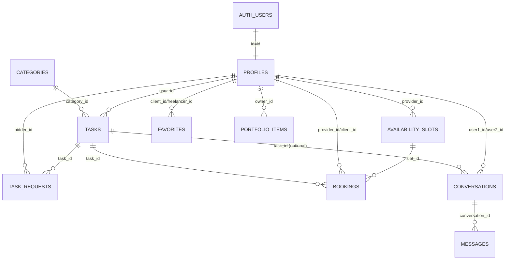

# Supabase Setup for SLine — Database + RLS + Realtime + Storage

**Last Updated**: 2025-11-01
**Version**: 1.9+

This document is the single source of truth for all Supabase backend setup: tables, enums, relationships, indexes, RLS policies, triggers/functions, storage, and Realtime configuration for the SLine freelance marketplace app.

All SQL scripts in this document are idempotent (safe to re-run).

---

## Table of Contents
1. [Quick Reference (TL;DR)](#1-quick-reference-tldr)
2. [Important Constants](#2-important-constants)
3. [Data Model Overview](#3-data-model-overview)
4. [Enums](#4-enums)
5. [Tables](#5-tables)
6. [RLS Policies](#6-rls-policies)
7. [Triggers & Functions](#7-triggers--functions)
8. [Storage Buckets](#8-storage-buckets)
9. [Realtime Configuration](#9-realtime-configuration)
10. [Testing & Validation](#10-testing--validation)
11. [Troubleshooting](#11-troubleshooting)
12. [Changelog](#12-changelog)

---

## 1. Quick Reference (TL;DR)

### Core Tables
- **Identity**: `profiles` (linked to `auth.users`)
- **Tasks**: `tasks`, `task_requests`, `categories`
- **Chat**: `conversations`, `messages`
- **Booking**: `availability_slots`, `bookings`
- **Social**: `favorites`, `saved_tasks`, `portfolio_items`

### Enums
- `task_type_enum`: `tender` | `booking`
- `booking_status_enum`: `pending` | `confirmed` | `canceled` | `completed`
- `message_type_enum`: `text` | `offer` | `offer_update` | `offer_accepted` | `offer_rejected` | `delivery_submitted` | `end_early_request` | `dispute_report`

### Storage Buckets
- `avatars` (Private) — Profile pictures with signed URLs
- `task-images` (Private) — Task attachments with signed URLs
- `chat-attachments` (Private) — Message files with signed URLs
- `portfolio` (Public/Private) — Portfolio work images

### Realtime
- Enabled on: `messages`, `conversations`

### Key Guards & Triggers
- Offers only allowed on `tender` tasks
- DM conversations require `favorites` relationship
- Task-linked conversations: non-owner starts chat
- Booking status transitions enforced by trigger
- Slot overlap prevention for providers
- Auto-assign freelancer on offer acceptance

---

## 2. Important Constants

```sql
-- NIL UUID for unique constraints
NIL_UUID = '00000000-0000-0000-0000-000000000000'
```

**Conventions:**
- All timestamps stored in **UTC** (convert to local in UI)
- Identity comes from `auth.users`; profile data in `public.profiles`
- Store **storage paths** in database, generate **signed URLs** at render time
- Session-based access control via RLS on all tables

---

## 3. Data Model Overview

### Entity Relationship Diagram




### Textual Representation

```text
auth.users (id)
  ├─→ profiles (id)
      ├─< tasks (user_id)
      │    ├─< task_requests (task_id, bidder_id
      │    └─< bookings (task_id)
      ├─< favorites (client_id → freelancer_id)
      ├─< conversations (user1_id, user2_id, [task_id], initiated_by)
      │    └─< messages (conversation_id, sender_id, receiver_id)
      ├─< availability_slots (provider_id)
      │    └─< bookings (slot_id, provider_id, client_id)
      └─< portfolio_items (owner_id)

categories (id) ──< tasks (category_id)
```

### Key Unique Constraints
- **Conversations**: One conversation per `(user pair, task)` via unique index on `(least(user1_id,user2_id), greatest(user1_id,user2_id), coalesce(task_id, NIL_UUID))`
- **Bookings**: One active booking per slot via partial unique index `WHERE status IN ('pending','confirmed')`
- **Task Requests**: One pending offer per `(task_id, bidder_id)` via partial unique index `WHERE status = 'pending'`
- **Favorites**: One favorite per `(client_id, freelancer_id)` pair
- **Categories**: Case-insensitive unique name via `UNIQUE INDEX ON categories(LOWER(name))`

---

## 4. Enums

### 4.1 Task Type Enum

```sql
DO $$
BEGIN
  IF NOT EXISTS (SELECT 1 FROM pg_type WHERE typname = 'task_type_enum') THEN
    CREATE TYPE public.task_type_enum AS ENUM ('tender', 'booking');
  END IF;
END$$;
```

**Values:**
- `tender` — Traditional bidding/offer tasks (default)
- `booking` — Scheduled appointment tasks

### 4.2 Booking Status Enum

```sql
DO $$
BEGIN
  IF NOT EXISTS (SELECT 1 FROM pg_type WHERE typname = 'booking_status_enum') THEN
    CREATE TYPE public.booking_status_enum AS ENUM (
      'pending',
      'confirmed',
      'canceled',
      'completed'
    );
  END IF;
END$$;
```

**Status Transitions** (enforced by trigger):
- `pending` → `confirmed` (provider) or `canceled` (client/provider)
- `confirmed` → `completed` (provider) or `canceled` (client/provider)

### 4.3 Message Type Enum

```sql
DO $$
BEGIN
  IF NOT EXISTS (SELECT 1 FROM pg_type WHERE typname = 'message_type_enum') THEN
    CREATE TYPE public.message_type_enum AS ENUM (
      'text',
      'offer',
      'offer_update',
      'offer_accepted',
      'offer_rejected',
      'delivery_submitted',
      'end_early_request',
      'dispute_report'
    );
  END IF;
END$$;
```

---

## 5. Tables

### 5.1 `profiles`

User profile information linked to Supabase Auth.

```sql
CREATE TABLE IF NOT EXISTS public.profiles (
  id uuid PRIMARY KEY REFERENCES auth.users(id) ON DELETE CASCADE,
  full_name text,
  email text,
  avatar_url text,  -- Storage path in private 'avatars' bucket
  phone text,
  bio text,
  role text DEFAULT 'client',  -- 'client' | 'freelancer'
  language text DEFAULT 'en',
  created_at timestamptz NOT NULL DEFAULT now(),
  updated_at timestamptz NOT NULL DEFAULT now()
);

-- Index for faster lookups
CREATE INDEX IF NOT EXISTS idx_profiles_role ON public.profiles(role);

-- Enable RLS
ALTER TABLE public.profiles ENABLE ROW LEVEL SECURITY;
```

**RLS Policies:**
- SELECT: All authenticated users can view profiles
- INSERT/UPDATE/DELETE: Owner only (`auth.uid() = id`)

### 5.2 `tasks`

Job postings (tender or booking type).

```sql
CREATE TABLE IF NOT EXISTS public.tasks (
  id uuid PRIMARY KEY DEFAULT gen_random_uuid(),
  user_id uuid NOT NULL REFERENCES auth.users(id) ON DELETE CASCADE,
  title text NOT NULL,
  description text NOT NULL,
  budget numeric NOT NULL,
  deadline timestamptz,
  category text,  -- Legacy field, kept for backward compatibility
  skills text[],
  status text NOT NULL DEFAULT 'open',  -- 'open' | 'assigned' | 'closed' | 'inProgress'
  task_type public.task_type_enum NOT NULL DEFAULT 'tender',
  session_price_bigint bigint,  -- For booking tasks
  hour_rate_bigint bigint,  -- For booking tasks
  assigned_freelancer_id uuid REFERENCES public.profiles(id),
  category_id uuid REFERENCES public.categories(id),
  image_paths text[],  -- Storage paths in private 'task-images' bucket
  created_at timestamptz NOT NULL DEFAULT now()
);

-- Indexes for performance
CREATE INDEX IF NOT EXISTS idx_tasks_user_status_created
  ON public.tasks (user_id, status, created_at DESC);

CREATE INDEX IF NOT EXISTS idx_tasks_type_created_at
  ON public.tasks (task_type, created_at DESC);

CREATE INDEX IF NOT EXISTS idx_tasks_assigned_freelancer
  ON public.tasks (assigned_freelancer_id);

CREATE INDEX IF NOT EXISTS idx_tasks_category_id
  ON public.tasks (category_id);

-- Enable RLS
ALTER TABLE public.tasks ENABLE ROW LEVEL SECURITY;
```

**Columns:**
| Column | Type | Purpose | Notes |
|--------|------|---------|-------|
| `id` | uuid | Primary key | Auto-generated |
| `user_id` | uuid | Task owner (client) | FK to `auth.users.id` |
| `title` | text | Task title | Required |
| `description` | text | Task details | Required |
| `budget` | numeric | Task budget | Required |
| `deadline` | timestamptz | Optional due date | UTC |
| `category` | text | Legacy category | For backward compatibility |
| `skills` | text[] | Required skills | Optional array |
| `status` | text | Task status | open/assigned/closed/inProgress |
| `task_type` | task_type_enum | Task type | tender/booking (default: tender) |
| `session_price_bigint` | bigint | Booking session price | For booking tasks only |
| `hour_rate_bigint` | bigint | Booking hourly rate | For booking tasks only |
| `assigned_freelancer_id` | uuid | Assigned freelancer | Set when offer accepted |
| `category_id` | uuid | Category FK | FK to categories table |
| `image_paths` | text[] | Task images | Storage paths (private bucket) |
| `created_at` | timestamptz | Creation time | UTC, auto-set |

### 5.3 `task_requests`

Offers/bids on tender tasks only.

```sql
CREATE TABLE IF NOT EXISTS public.task_requests (
  id uuid PRIMARY KEY DEFAULT gen_random_uuid(),
  task_id uuid NOT NULL REFERENCES public.tasks(id) ON DELETE CASCADE,
  bidder_id uuid NOT NULL REFERENCES public.profiles(id) ON DELETE CASCADE,
  price bigint NOT NULL CHECK (price > 0),
  days int NOT NULL CHECK (days > 0),
  note text,
  status text NOT NULL DEFAULT 'pending',  -- 'pending' | 'accepted' | 'rejected'
  created_at timestamptz NOT NULL DEFAULT now()
);

-- Index for listing offers by task
CREATE INDEX IF NOT EXISTS idx_task_requests_task_created
  ON public.task_requests (task_id, created_at DESC);

-- Unique constraint: one pending offer per (task, bidder)
CREATE UNIQUE INDEX IF NOT EXISTS uq_task_requests_unique_pending_per_user
  ON public.task_requests (task_id, bidder_id)
  WHERE status = 'pending';

-- Enable RLS
ALTER TABLE public.task_requests ENABLE ROW LEVEL SECURITY;
```

### 5.4 `categories`

Service categories (database-first approach).

```sql
CREATE TABLE IF NOT EXISTS public.categories (
  id uuid PRIMARY KEY DEFAULT gen_random_uuid(),
  name text NOT NULL,
  icon_url text,
  created_at timestamptz NOT NULL DEFAULT now()
);

-- Case-insensitive unique name
CREATE UNIQUE INDEX IF NOT EXISTS uq_categories_name
  ON public.categories (LOWER(name));

CREATE INDEX IF NOT EXISTS idx_categories_name_lower
  ON public.categories (LOWER(name));

-- Enable RLS
ALTER TABLE public.categories ENABLE ROW LEVEL SECURITY;

-- Seed categories (idempotent)
INSERT INTO public.categories (id, name) VALUES
  ('6ec632a0-e5f1-426e-ba6a-839167f9b6ae', 'Design'),
  ('fe47be26-cf55-4918-9032-f75314341492', 'Development'),
  ('1b11a22a-1d65-4da8-9ebf-faca877c15fd', 'Marketing'),
  ('9550c76b-9096-4aca-b310-560b019582da', 'Photography'),
  ('8c357ad7-4f90-4999-b685-38f356384068', 'Writing'),
  ('5a4767ab-ef09-4c4a-8dde-6b45c2b040e3', 'Cleaning'),
  ('870360da-1eea-4a36-bdd4-2dc0f35c77f6', 'Other')
ON CONFLICT (id) DO NOTHING;
```

### 5.5 `favorites`

Client's saved freelancers (enables DM creation).

```sql
CREATE TABLE IF NOT EXISTS public.favorites (
  id uuid PRIMARY KEY DEFAULT gen_random_uuid(),
  client_id uuid NOT NULL REFERENCES public.profiles(id) ON DELETE CASCADE,
  freelancer_id uuid NOT NULL REFERENCES public.profiles(id) ON DELETE CASCADE,
  created_at timestamptz NOT NULL DEFAULT now(),
  UNIQUE (client_id, freelancer_id)
);

CREATE INDEX IF NOT EXISTS idx_favorites_client ON public.favorites(client_id);
CREATE INDEX IF NOT EXISTS idx_favorites_freelancer ON public.favorites(freelancer_id);

-- Enable RLS
ALTER TABLE public.favorites ENABLE ROW LEVEL SECURITY;
```

### 5.6 `conversations`

Chat threads between two users (optional task context).

```sql
CREATE TABLE IF NOT EXISTS public.conversations (
  id uuid PRIMARY KEY DEFAULT gen_random_uuid(),
  task_id uuid REFERENCES public.tasks(id) ON DELETE CASCADE,
  user1_id uuid NOT NULL REFERENCES public.profiles(id) ON DELETE CASCADE,
  user2_id uuid NOT NULL REFERENCES public.profiles(id) ON DELETE CASCADE,
  initiated_by uuid NOT NULL REFERENCES public.profiles(id) ON DELETE CASCADE,
  created_at timestamptz NOT NULL DEFAULT now()
);

-- Unique constraint: one conversation per (user pair, task)
CREATE UNIQUE INDEX IF NOT EXISTS uq_conversations_pair_task
ON public.conversations (
  LEAST(user1_id, user2_id),
  GREATEST(user1_id, user2_id),
  COALESCE(task_id, '00000000-0000-0000-0000-000000000000'::uuid)
);

CREATE INDEX IF NOT EXISTS idx_conversations_task ON public.conversations(task_id);
CREATE INDEX IF NOT EXISTS idx_conversations_user1 ON public.conversations(user1_id);
CREATE INDEX IF NOT EXISTS idx_conversations_user2 ON public.conversations(user2_id);

-- Enable RLS
ALTER TABLE public.conversations ENABLE ROW LEVEL SECURITY;
```

### 5.7 `messages`

Chat messages with attachments and offer support.

```sql
CREATE TABLE IF NOT EXISTS public.messages (
  id uuid PRIMARY KEY DEFAULT gen_random_uuid(),
  conversation_id uuid NOT NULL REFERENCES public.conversations(id) ON DELETE CASCADE,
  sender_id uuid NOT NULL REFERENCES public.profiles(id) ON DELETE CASCADE,
  receiver_id uuid NOT NULL REFERENCES public.profiles(id) ON DELETE CASCADE,
  content text DEFAULT '',
  attachment_url text,  -- Storage path in private 'chat-attachments' bucket
  attachment_type text,  -- 'image' | 'file'
  attachment_name text,
  attachment_size int,
  message_type public.message_type_enum NOT NULL DEFAULT 'text',
  payload jsonb DEFAULT '{}',  -- For offer data: {price, days, note}
  delivered_at timestamptz,
  seen_at timestamptz,
  created_at timestamptz NOT NULL DEFAULT now()
);

CREATE INDEX IF NOT EXISTS idx_messages_convo_created
  ON public.messages (conversation_id, created_at);

-- Enable RLS
ALTER TABLE public.messages ENABLE ROW LEVEL SECURITY;
```

### 5.8 `availability_slots`

Provider availability windows for booking tasks.

```sql
CREATE TABLE IF NOT EXISTS public.availability_slots (
  id uuid PRIMARY KEY DEFAULT gen_random_uuid(),
  provider_id uuid NOT NULL REFERENCES public.profiles(id) ON DELETE CASCADE,
  starts_at timestamptz NOT NULL,
  ends_at timestamptz NOT NULL,
  is_blocked boolean NOT NULL DEFAULT false,
  created_at timestamptz NOT NULL DEFAULT now(),
  CONSTRAINT chk_slot_time CHECK (ends_at > starts_at)
);

CREATE INDEX IF NOT EXISTS idx_slots_provider_starts
  ON public.availability_slots (provider_id, starts_at);

-- Enable RLS
ALTER TABLE public.availability_slots ENABLE ROW LEVEL SECURITY;
```

### 5.9 `bookings`

Client bookings on provider slots.

```sql
CREATE TABLE IF NOT EXISTS public.bookings (
  id uuid PRIMARY KEY DEFAULT gen_random_uuid(),
  task_id uuid NOT NULL REFERENCES public.tasks(id) ON DELETE CASCADE,
  provider_id uuid NOT NULL REFERENCES public.profiles(id) ON DELETE CASCADE,
  client_id uuid NOT NULL REFERENCES public.profiles(id) ON DELETE CASCADE,
  slot_id uuid NOT NULL REFERENCES public.availability_slots(id) ON DELETE CASCADE,
  status public.booking_status_enum NOT NULL DEFAULT 'pending',
  note text,
  created_at timestamptz NOT NULL DEFAULT now()
);

CREATE INDEX IF NOT EXISTS idx_bookings_client_created
  ON public.bookings (client_id, created_at DESC);

CREATE INDEX IF NOT EXISTS idx_bookings_provider_created
  ON public.bookings (provider_id, created_at DESC);

-- Unique constraint: one active booking per slot
CREATE UNIQUE INDEX IF NOT EXISTS uq_bookings_slot_active
  ON public.bookings (slot_id)
  WHERE status IN ('pending', 'confirmed');

-- Enable RLS
ALTER TABLE public.bookings ENABLE ROW LEVEL SECURITY;
```

### 5.10 `portfolio_items`

Freelancer work gallery.

```sql
CREATE TABLE IF NOT EXISTS public.portfolio_items (
  id uuid PRIMARY KEY DEFAULT gen_random_uuid(),
  owner_id uuid NOT NULL REFERENCES public.profiles(id) ON DELETE CASCADE,
  title text NOT NULL,
  description text,
  image_path text,  -- Storage path in 'portfolio' bucket
  created_at timestamptz NOT NULL DEFAULT now()
);

CREATE INDEX IF NOT EXISTS idx_portfolio_owner_created
  ON public.portfolio_items (owner_id, created_at DESC);

-- Enable RLS
ALTER TABLE public.portfolio_items ENABLE ROW LEVEL SECURITY;
```

### 5.11 `saved_tasks`

User's bookmarked tasks.

```sql
CREATE TABLE IF NOT EXISTS public.saved_tasks (
  id uuid PRIMARY KEY DEFAULT gen_random_uuid(),
  user_id uuid NOT NULL REFERENCES public.profiles(id) ON DELETE CASCADE,
  task_id uuid NOT NULL REFERENCES public.tasks(id) ON DELETE CASCADE,
  created_at timestamptz NOT NULL DEFAULT now(),
  UNIQUE (user_id, task_id)
);

CREATE INDEX IF NOT EXISTS idx_saved_tasks_user ON public.saved_tasks(user_id);

-- Enable RLS
ALTER TABLE public.saved_tasks ENABLE ROW LEVEL SECURITY;
```

---

## 6. RLS Policies

### 6.1 `profiles`

```sql
-- SELECT: All authenticated users can view profiles
CREATE POLICY IF NOT EXISTS profiles_select_all
ON public.profiles FOR SELECT
TO authenticated
USING (true);

-- INSERT/UPDATE/DELETE: Owner only
CREATE POLICY IF NOT EXISTS profiles_owner_only
ON public.profiles FOR ALL
TO authenticated
USING (auth.uid() = id)
WITH CHECK (auth.uid() = id);
```

### 6.2 `tasks`

```sql
-- SELECT: All authenticated users can view tasks
CREATE POLICY IF NOT EXISTS tasks_select_all
ON public.tasks FOR SELECT
TO authenticated
USING (true);

-- INSERT/UPDATE/DELETE: Owner only
CREATE POLICY IF NOT EXISTS tasks_owner_only
ON public.tasks FOR ALL
TO authenticated
USING (auth.uid() = user_id)
WITH CHECK (auth.uid() = user_id);
```

### 6.3 `task_requests`

```sql
-- SELECT: Task owner (tender only) or bidder
CREATE POLICY IF NOT EXISTS owner_selects_offers
ON public.task_requests FOR SELECT
TO authenticated
USING (
  EXISTS (
    SELECT 1 FROM public.tasks t
    WHERE t.id = task_requests.task_id
      AND t.user_id = auth.uid()
      AND t.task_type = 'tender'::task_type_enum
  )
);

CREATE POLICY IF NOT EXISTS bidder_selects_own_offers
ON public.task_requests FOR SELECT
TO authenticated
USING (bidder_id = auth.uid());

-- INSERT: Bidder only (tender tasks only)
CREATE POLICY IF NOT EXISTS bidder_inserts_offer
ON public.task_requests FOR INSERT
TO authenticated
WITH CHECK (
  bidder_id = auth.uid()
  AND EXISTS (
    SELECT 1 FROM public.tasks t
    WHERE t.id = task_requests.task_id
      AND t.task_type = 'tender'::task_type_enum
  )
);

-- UPDATE: Task owner only
CREATE POLICY IF NOT EXISTS owner_updates_offer_status
ON public.task_requests FOR UPDATE
TO authenticated
USING (
  EXISTS (
    SELECT 1 FROM public.tasks t
    WHERE t.id = task_requests.task_id
      AND t.user_id = auth.uid()
      AND t.task_type = 'tender'::task_type_enum
  )
);
```

### 6.4 `categories`

```sql
-- SELECT: All authenticated users (read-only)
CREATE POLICY IF NOT EXISTS categories_select_auth
ON public.categories FOR SELECT
TO authenticated
USING (true);
```

### 6.5 `favorites`

```sql
-- SELECT/INSERT/DELETE: Client only
CREATE POLICY IF NOT EXISTS favorites_select_own
ON public.favorites FOR SELECT
TO authenticated
USING (client_id = auth.uid());

CREATE POLICY IF NOT EXISTS favorites_insert_own
ON public.favorites FOR INSERT
TO authenticated
WITH CHECK (client_id = auth.uid());

CREATE POLICY IF NOT EXISTS favorites_delete_own
ON public.favorites FOR DELETE
TO authenticated
USING (client_id = auth.uid());
```

### 6.6 `conversations`

```sql
-- SELECT: Participants only
CREATE POLICY IF NOT EXISTS conversations_select_participants
ON public.conversations FOR SELECT
TO authenticated
USING (auth.uid() = user1_id OR auth.uid() = user2_id);

-- INSERT: Complex guard (see trigger for full enforcement)
CREATE POLICY IF NOT EXISTS conversations_insert_client_only
ON public.conversations FOR INSERT
TO authenticated
WITH CHECK (
  initiated_by = auth.uid()
  AND (user1_id = auth.uid() OR user2_id = auth.uid())
  AND (
    -- Task-linked: requires task owner as other participant
    (task_id IS NOT NULL AND EXISTS (
      SELECT 1 FROM public.tasks t
      WHERE t.id = task_id AND t.user_id = auth.uid()
    ))
    OR
    -- DM: requires freelancer in favorites
    (task_id IS NULL AND EXISTS (
      SELECT 1 FROM public.favorites f
      WHERE f.client_id = auth.uid()
        AND f.freelancer_id = CASE
          WHEN user1_id = auth.uid() THEN user2_id
          ELSE user1_id
        END
    ))
  )
);
```

### 6.7 `messages`

```sql
-- SELECT: Participants only (via conversation)
CREATE POLICY IF NOT EXISTS messages_select_participants
ON public.messages FOR SELECT
TO authenticated
USING (
  EXISTS (
    SELECT 1 FROM public.conversations c
    WHERE c.id = messages.conversation_id
      AND (c.user1_id = auth.uid() OR c.user2_id = auth.uid())
  )
);

-- INSERT: Participants only, sender must be current user
CREATE POLICY IF NOT EXISTS messages_insert_participants_only
ON public.messages FOR INSERT
TO authenticated
WITH CHECK (
  sender_id = auth.uid()
  AND EXISTS (
    SELECT 1 FROM public.conversations c
    WHERE c.id = messages.conversation_id
      AND (c.user1_id = auth.uid() OR c.user2_id = auth.uid())
  )
  AND (
    -- Offer acceptance/rejection: task owner or initiator only
    message_type NOT IN ('offer_accepted', 'offer_rejected')
    OR EXISTS (
      SELECT 1 FROM public.conversations c
      LEFT JOIN public.tasks t ON t.id = c.task_id
      WHERE c.id = messages.conversation_id
        AND (
          (c.task_id IS NOT NULL AND t.user_id = auth.uid())  -- Task owner
          OR
          (c.task_id IS NULL AND c.initiated_by = auth.uid()) -- DM initiator
        )
    )
  )
);
```

### 6.8 `availability_slots`

```sql
-- SELECT: All authenticated users
CREATE POLICY IF NOT EXISTS slots_select_all
ON public.availability_slots FOR SELECT
TO authenticated
USING (true);

-- INSERT/UPDATE/DELETE: Provider only
CREATE POLICY IF NOT EXISTS slots_cud_owner
ON public.availability_slots FOR ALL
TO authenticated
USING (provider_id = auth.uid())
WITH CHECK (provider_id = auth.uid());
```

### 6.9 `bookings`

```sql
-- SELECT: Provider or client
CREATE POLICY IF NOT EXISTS bookings_select_owner_or_client
ON public.bookings FOR SELECT
TO authenticated
USING (provider_id = auth.uid() OR client_id = auth.uid());

-- INSERT: Client only (no double booking)
CREATE POLICY IF NOT EXISTS bookings_insert_client_only
ON public.bookings FOR INSERT
TO authenticated
WITH CHECK (
  client_id = auth.uid()
  AND NOT EXISTS (
    SELECT 1 FROM public.bookings b
    WHERE b.slot_id = bookings.slot_id
      AND b.status IN ('pending', 'confirmed')
  )
);

-- UPDATE: Role-based status changes
CREATE POLICY IF NOT EXISTS bookings_update_roles
ON public.bookings FOR UPDATE
TO authenticated
USING (provider_id = auth.uid() OR client_id = auth.uid())
WITH CHECK (
  (provider_id = auth.uid() AND NEW.status IN ('confirmed', 'completed'))
  OR (client_id = auth.uid() AND NEW.status = 'canceled')
);
```

### 6.10 `portfolio_items`

```sql
-- SELECT: Public (all authenticated users)
CREATE POLICY IF NOT EXISTS portfolio_select_owner_or_public
ON public.portfolio_items FOR SELECT
TO authenticated
USING (true);

-- INSERT/UPDATE/DELETE: Owner only
CREATE POLICY IF NOT EXISTS portfolio_crud_owner
ON public.portfolio_items FOR ALL
TO authenticated
USING (auth.uid() = owner_id)
WITH CHECK (auth.uid() = owner_id);
```

### 6.11 `saved_tasks`

```sql
-- SELECT/INSERT/DELETE: User only
CREATE POLICY IF NOT EXISTS saved_tasks_select_own
ON public.saved_tasks FOR SELECT
TO authenticated
USING (user_id = auth.uid());

CREATE POLICY IF NOT EXISTS saved_tasks_insert_own
ON public.saved_tasks FOR INSERT
TO authenticated
WITH CHECK (user_id = auth.uid());

CREATE POLICY IF NOT EXISTS saved_tasks_delete_own
ON public.saved_tasks FOR DELETE
TO authenticated
USING (user_id = auth.uid());
```

---

## 7. Triggers & Functions

### 7.1 Task Requests: Tender-Only Guard

Ensures offers are only submitted on `tender` tasks with positive values.

```sql
CREATE OR REPLACE FUNCTION public.trg_check_task_is_tender()
RETURNS trigger AS $$
BEGIN
  IF NOT EXISTS (
    SELECT 1 FROM public.tasks t
    WHERE t.id = NEW.task_id
      AND t.task_type = 'tender'
  ) THEN
    RAISE EXCEPTION 'Offers are only allowed on tender tasks';
  END IF;

  IF NEW.price <= 0 OR NEW.days <= 0 THEN
    RAISE EXCEPTION 'Offer price and days must be positive';
  END IF;

  RETURN NEW;
END;
$$ LANGUAGE plpgsql;

DROP TRIGGER IF EXISTS trg_task_requests_only_for_tender ON public.task_requests;
CREATE TRIGGER trg_task_requests_only_for_tender
  BEFORE INSERT ON public.task_requests
  FOR EACH ROW EXECUTE FUNCTION public.trg_check_task_is_tender();
```

### 7.2 Conversations: Guard for DM and Task-Linked Chats

Enforces business rules for conversation creation.

```sql
CREATE OR REPLACE FUNCTION public.conversations_before_insert_guard()
RETURNS trigger
LANGUAGE plpgsql
SECURITY DEFINER
SET search_path TO 'public'
AS $$
DECLARE
  v_other       uuid;
  v_task_owner  uuid;
  v_me          uuid := auth.uid();
  tmp           uuid;
BEGIN
  IF v_me IS NULL THEN
    RAISE EXCEPTION 'unauthenticated';
  END IF;

  -- Set initiated_by to current user
  IF NEW.initiated_by IS NULL THEN
    NEW.initiated_by := v_me;
  END IF;
  IF NEW.initiated_by IS DISTINCT FROM v_me THEN
    RAISE EXCEPTION 'initiated_by must equal current user';
  END IF;

  -- Initiator must be one of the participants
  IF NOT (NEW.user1_id = v_me OR NEW.user2_id = v_me) THEN
    RAISE EXCEPTION 'initiator must be one of the participants';
  END IF;

  -- Task-linked: non-owner starts, other must be task owner
  IF NEW.task_id IS NOT NULL THEN
    SELECT t.user_id INTO v_task_owner
    FROM public.tasks t
    WHERE t.id = NEW.task_id;

    IF v_task_owner IS NULL THEN
      RAISE EXCEPTION 'linked task not found';
    END IF;

    IF v_task_owner = v_me THEN
      RAISE EXCEPTION 'task owner cannot start a task-linked conversation';
    END IF;

    v_other := CASE WHEN NEW.user1_id = v_me THEN NEW.user2_id ELSE NEW.user1_id END;
    IF v_other IS DISTINCT FROM v_task_owner THEN
      RAISE EXCEPTION 'for a task-linked chat, the other participant must be the task owner';
    END IF;

    -- Normalize order to avoid duplicates
    IF NEW.user1_id > NEW.user2_id THEN
      tmp := NEW.user1_id;
      NEW.user1_id := NEW.user2_id;
      NEW.user2_id := tmp;
    END IF;

  -- Non-task DM: requires favorite
  ELSE
    v_other := CASE WHEN NEW.user1_id = v_me THEN NEW.user2_id ELSE NEW.user1_id END;
    IF NOT EXISTS (
      SELECT 1 FROM public.favorites f
      WHERE f.client_id = v_me
        AND f.freelancer_id = v_other
    ) THEN
      RAISE EXCEPTION 'to start a non-task chat, the other user must be in your favorites';
    END IF;
  END IF;

  RETURN NEW;
END;
$$;

DROP TRIGGER IF EXISTS trg_conversations_before_insert_guard ON public.conversations;
CREATE TRIGGER trg_conversations_before_insert_guard
  BEFORE INSERT ON public.conversations
  FOR EACH ROW EXECUTE FUNCTION public.conversations_before_insert_guard();
```

### 7.3 RPC: Start Task Conversation (v1)

Helper RPC for non-owners to start task-linked conversations.

```sql
DROP FUNCTION IF EXISTS public.start_task_conversation_v1(uuid);

CREATE OR REPLACE FUNCTION public.start_task_conversation_v1(p_task_id uuid)
RETURNS conversations
LANGUAGE plpgsql
SECURITY DEFINER
SET search_path TO 'public'
AS $$
DECLARE
  v_owner uuid;
  v_me    uuid := auth.uid();
  v_a     uuid;
  v_b     uuid;
  v_convo conversations;
BEGIN
  SELECT t.user_id INTO v_owner FROM tasks t WHERE t.id = p_task_id;
  IF v_owner IS NULL THEN
    RAISE EXCEPTION 'task not found' USING ERRCODE = 'P0001';
  END IF;

  IF v_owner = v_me THEN
    RAISE EXCEPTION 'task owner cannot start a task-linked conversation' USING ERRCODE = 'P0001';
  END IF;

  v_a := LEAST(v_owner, v_me);
  v_b := GREATEST(v_owner, v_me);

  SELECT * INTO v_convo
  FROM conversations
  WHERE task_id = p_task_id
    AND LEAST(user1_id, user2_id) = v_a
    AND GREATEST(user1_id, user2_id) = v_b
  LIMIT 1;

  IF FOUND THEN
    RETURN v_convo;
  END IF;

  INSERT INTO conversations (id, task_id, user1_id, user2_id, initiated_by)
  VALUES (gen_random_uuid(), p_task_id, v_a, v_b, v_me)
  RETURNING * INTO v_convo;

  RETURN v_convo;
END;
$$;

GRANT EXECUTE ON FUNCTION public.start_task_conversation_v1(uuid) TO authenticated;
```

### 7.4 Messages: Payload Validation

Validates offer messages have required payload fields.

```sql
CREATE OR REPLACE FUNCTION public.trg_messages_validate_payload()
RETURNS trigger AS $$
BEGIN
  IF NEW.message_type IN ('offer', 'offer_update') THEN
    IF NOT (NEW.payload ? 'price' AND NEW.payload ? 'days') THEN
      RAISE EXCEPTION 'Offer messages require price and days in payload';
    END IF;
  END IF;
  RETURN NEW;
END;
$$ LANGUAGE plpgsql;

DROP TRIGGER IF EXISTS trg_messages_validate_payload ON public.messages;
CREATE TRIGGER trg_messages_validate_payload
  BEFORE INSERT ON public.messages
  FOR EACH ROW EXECUTE FUNCTION public.trg_messages_validate_payload();
```

### 7.5 Messages: Auto-Assign on Offer Accepted

Automatically assigns freelancer to task when offer is accepted.

```sql
CREATE OR REPLACE FUNCTION public.trg_messages_offer_accepted()
RETURNS trigger AS $$
BEGIN
  IF NEW.message_type = 'offer_accepted' THEN
    UPDATE public.tasks
    SET assigned_freelancer_id = NEW.sender_id,
        status = 'assigned'
    WHERE id = (
      SELECT c.task_id
      FROM public.conversations c
      WHERE c.id = NEW.conversation_id
    );
  END IF;
  RETURN NULL;
END;
$$ LANGUAGE plpgsql;

DROP TRIGGER IF EXISTS trg_messages_offer_accepted ON public.messages;
CREATE TRIGGER trg_messages_offer_accepted
  AFTER INSERT ON public.messages
  FOR EACH ROW EXECUTE FUNCTION public.trg_messages_offer_accepted();
```

### 7.6 Availability Slots: Prevent Overlap

Prevents providers from creating overlapping open slots.

```sql
CREATE OR REPLACE FUNCTION public.fn_reject_overlapping_slots()
RETURNS trigger
LANGUAGE plpgsql AS $$
BEGIN
  IF NEW.is_blocked = FALSE THEN
    IF EXISTS (
      SELECT 1 FROM public.availability_slots s
      WHERE s.provider_id = NEW.provider_id
        AND s.is_blocked = FALSE
        AND tstzrange(s.starts_at, s.ends_at, '[)') &&
            tstzrange(NEW.starts_at, NEW.ends_at, '[)')
        AND s.id <> COALESCE(NEW.id, '00000000-0000-0000-0000-000000000000'::uuid)
    ) THEN
      RAISE EXCEPTION 'Overlapping availability slot for provider %', NEW.provider_id;
    END IF;
  END IF;
  RETURN NEW;
END;
$$;

DROP TRIGGER IF EXISTS trg_no_overlap_slots ON public.availability_slots;
CREATE TRIGGER trg_no_overlap_slots
  BEFORE INSERT OR UPDATE ON public.availability_slots
  FOR EACH ROW EXECUTE FUNCTION public.fn_reject_overlapping_slots();
```

### 7.7 Bookings: Status Transition Guard

Enforces valid booking status transitions.

```sql
CREATE OR REPLACE FUNCTION public.fn_booking_guard()
RETURNS trigger
LANGUAGE plpgsql AS $$
DECLARE
  old_status public.booking_status_enum := COALESCE(OLD.status, 'pending');
  new_status public.booking_status_enum := NEW.status;
BEGIN
  IF TG_OP = 'UPDATE' AND old_status <> new_status THEN
    -- Allowed transitions
    IF old_status = 'pending' AND new_status IN ('confirmed', 'canceled') THEN
      RETURN NEW;
    END IF;
    IF old_status = 'confirmed' AND new_status IN ('completed', 'canceled') THEN
      RETURN NEW;
    END IF;

    RAISE EXCEPTION 'Invalid booking status transition: % -> %', old_status, new_status;
  END IF;
  RETURN NEW;
END;
$$;

DROP TRIGGER IF EXISTS trg_booking_guard ON public.bookings;
CREATE TRIGGER trg_booking_guard
  BEFORE UPDATE ON public.bookings
  FOR EACH ROW EXECUTE FUNCTION public.fn_booking_guard();
```

### 7.8 Tasks: Auto-Update Offer Count

Maintains the `offers` count on the tasks table when requests are added or removed.

```sql
CREATE OR REPLACE FUNCTION update_task_offer_count()
RETURNS TRIGGER AS $$
BEGIN
    IF (TG_OP = 'INSERT') THEN
        UPDATE public.tasks
        SET offers = offers + 1
        WHERE id = NEW.task_id;
    ELSIF (TG_OP = 'DELETE') THEN
        UPDATE public.tasks
        SET offers = GREATEST(0, offers - 1)
        WHERE id = OLD.task_id;
    END IF;
    RETURN NULL;
END;
$$ LANGUAGE plpgsql;

DROP TRIGGER IF EXISTS update_offers_count ON public.task_requests;
CREATE TRIGGER update_offers_count
AFTER INSERT OR DELETE ON public.task_requests
FOR EACH ROW
EXECUTE FUNCTION update_task_offer_count();
```

---

## 8. Storage Buckets

### 8.1 Create Buckets

```sql
-- Avatars (Private)
INSERT INTO storage.buckets (id, name, public)
VALUES ('avatars', 'avatars', false)
ON CONFLICT (id) DO NOTHING;

-- Task Images (Private)
INSERT INTO storage.buckets (id, name, public)
VALUES ('task-images', 'task-images', false)
ON CONFLICT (id) DO NOTHING;

-- Chat Attachments (Private)
INSERT INTO storage.buckets (id, name, public)
VALUES ('chat-attachments', 'chat-attachments', false)
ON CONFLICT (id) DO NOTHING;

-- Portfolio (Public or Private)
INSERT INTO storage.buckets (id, name, public)
VALUES ('portfolio', 'portfolio', false)
ON CONFLICT (id) DO NOTHING;
```

### 8.2 Storage Policies

**Avatars Bucket:**

```sql
DO $$
BEGIN
  IF NOT EXISTS (
    SELECT 1 FROM pg_policies
    WHERE policyname = 'avatars_insert_own'
      AND schemaname = 'storage'
      AND tablename = 'objects'
  ) THEN
    CREATE POLICY "avatars_insert_own"
    ON storage.objects FOR INSERT TO authenticated
    WITH CHECK (bucket_id = 'avatars' AND owner = auth.uid());
  END IF;

  IF NOT EXISTS (
    SELECT 1 FROM pg_policies
    WHERE policyname = 'avatars_select_own'
      AND schemaname = 'storage'
      AND tablename = 'objects'
  ) THEN
    CREATE POLICY "avatars_select_own"
    ON storage.objects FOR SELECT TO authenticated
    USING (bucket_id = 'avatars' AND owner = auth.uid());
  END IF;
END$$;
```

**Task Images Bucket:**

```sql
DO $$
BEGIN
  IF NOT EXISTS (
    SELECT 1 FROM pg_policies
    WHERE policyname = 'task_images_insert_auth'
      AND schemaname = 'storage'
      AND tablename = 'objects'
  ) THEN
    CREATE POLICY "task_images_insert_auth"
    ON storage.objects FOR INSERT TO authenticated
    WITH CHECK (bucket_id = 'task-images' AND owner = auth.uid());
  END IF;

  IF NOT EXISTS (
    SELECT 1 FROM pg_policies
    WHERE policyname = 'task_images_select_auth'
      AND schemaname = 'storage'
      AND tablename = 'objects'
  ) THEN
    CREATE POLICY "task_images_select_auth"
    ON storage.objects FOR SELECT TO authenticated
    USING (bucket_id = 'task-images');
  END IF;
END$$;
```

**Chat Attachments Bucket:**

```sql
DO $$
BEGIN
  IF NOT EXISTS (
    SELECT 1 FROM pg_policies
    WHERE policyname = 'chat_attach_insert_auth'
      AND schemaname = 'storage'
      AND tablename = 'objects'
  ) THEN
    CREATE POLICY "chat_attach_insert_auth"
    ON storage.objects FOR INSERT TO authenticated
    WITH CHECK (bucket_id = 'chat-attachments' AND owner = auth.uid());
  END IF;

  IF NOT EXISTS (
    SELECT 1 FROM pg_policies
    WHERE policyname = 'chat_attach_select_auth'
      AND schemaname = 'storage'
      AND tablename = 'objects'
  ) THEN
    CREATE POLICY "chat_attach_select_auth"
    ON storage.objects FOR SELECT TO authenticated
    USING (bucket_id = 'chat-attachments');
  END IF;
END$$;
```

**Portfolio Bucket:**

```sql
DO $$
BEGIN
  IF NOT EXISTS (
    SELECT 1 FROM pg_policies
    WHERE policyname = 'portfolio_insert_auth'
      AND schemaname = 'storage'
      AND tablename = 'objects'
  ) THEN
    CREATE POLICY "portfolio_insert_auth"
    ON storage.objects FOR INSERT TO authenticated
    WITH CHECK (bucket_id = 'portfolio' AND owner = auth.uid());
  END IF;

  IF NOT EXISTS (
    SELECT 1 FROM pg_policies
    WHERE policyname = 'portfolio_select_auth'
      AND schemaname = 'storage'
      AND tablename = 'objects'
  ) THEN
    CREATE POLICY "portfolio_select_auth"
    ON storage.objects FOR SELECT TO authenticated
    USING (bucket_id = 'portfolio');
  END IF;
END$$;
```

### 8.3 Verify Storage Policies

```sql
SELECT policyname, schemaname, tablename, cmd
FROM pg_policies
WHERE schemaname = 'storage'
  AND tablename = 'objects'
ORDER BY policyname;
```

### 8.4 Signed URL Usage (Flutter)

```dart
// Generate signed URL for private bucket (1 hour TTL)
final signedUrl = await supabase.storage
  .from('avatars')
  .createSignedUrl(path, 3600);

// Use SignedAvatar widget from lib/core/widgets/
SignedAvatar(
  path: user.avatarUrl,
  radius: 40,
  placeholder: Icon(Icons.person),
)
```

---

## 9. Realtime Configuration

Enable Realtime for messages and conversations:

```sql
ALTER PUBLICATION supabase_realtime ADD TABLE public.messages;
ALTER PUBLICATION supabase_realtime ADD TABLE public.conversations;
```

**Flutter Integration:**

```dart
// Subscribe to messages in a conversation
final messagesStream = supabase
  .from('messages')
  .stream(primaryKey: ['id'])
  .eq('conversation_id', conversationId)
  .order('created_at');

// Subscribe to conversation list updates
final conversationsStream = supabase
  .from('conversations')
  .stream(primaryKey: ['id'])
  .order('created_at', ascending: false);
```

**Important Notes:**
- Realtime subscriptions respect RLS policies
- Use `primaryKey` parameter for proper stream updates
- Clean up subscriptions in `dispose()` to prevent memory leaks
- Use upsert pattern (by ID) to avoid duplicate messages

---

## 10. Testing & Validation

### 10.1 Test Offers (Tender vs Booking)

```sql
-- Impersonate a bidder
SELECT set_config('request.jwt.claims',
  json_build_object('sub', '<bidder-uuid>', 'role', 'authenticated')::text,
  true);
SET ROLE authenticated;

-- Try offer on booking task → should FAIL
INSERT INTO public.task_requests(task_id, bidder_id, price, days, note)
VALUES ('<booking-task-id>', '<bidder-uuid>', 10000, 3, 'test');

-- Try offer on tender task → should SUCCEED
INSERT INTO public.task_requests(task_id, bidder_id, price, days, note)
VALUES ('<tender-task-id>', '<bidder-uuid>', 15000, 5, 'fast delivery');
```

### 10.2 Test Bookings

```sql
-- As provider: create slot
SELECT set_config('request.jwt.claims',
  json_build_object('sub', '<provider-uuid>', 'role', 'authenticated')::text,
  true);
INSERT INTO public.availability_slots(provider_id, starts_at, ends_at)
VALUES ('<provider-uuid>', now() + interval '1 day', now() + interval '1 day 1 hour')
RETURNING *;

-- As client: book slot
SELECT set_config('request.jwt.claims',
  json_build_object('sub', '<client-uuid>', 'role', 'authenticated')::text,
  true);
INSERT INTO public.bookings(provider_id, client_id, task_id, slot_id, note)
VALUES ('<provider-uuid>', '<client-uuid>', '<task-id>', '<slot-id>', 'demo')
RETURNING id, status;

-- Try booking same slot again → should FAIL (unique constraint)
```

### 10.3 Test Categories (Read-Only)

```sql
SELECT set_config('request.jwt.claims',
  json_build_object('sub', '<user-uuid>', 'role', 'authenticated')::text,
  true);

-- SELECT: should succeed
SELECT id, name FROM public.categories ORDER BY name LIMIT 10;

-- INSERT: should fail (RLS)
INSERT INTO public.categories (name) VALUES ('ShouldFail');
```

### 10.4 Test Conversations

```sql
-- DM: requires favorite relationship
-- Task chat: non-owner starts conversation

-- Use Flutter client or RPC function to test
```

---

## 11. Troubleshooting

### Common Errors

| Error Code | Meaning | Solution |
|-----------|---------|----------|
| `42501` | RLS permission denied | Ensure valid session; check RLS policies |
| `23505` | Unique violation | Duplicate entry (favorites, offers, etc.) |
| `23503` | Foreign key violation | Referenced row doesn't exist |
| `22P02` | Invalid UUID | Validate UUID format client-side |
| `PGRST116` | Multiple rows returned | Use `.single()` or `.maybeSingle()` |

### Storage Issues

- **404 errors**: Regenerate signed URLs (they expire)
- **Upload fails**: Check RLS policy on `storage.objects` for correct bucket
- **Permission denied**: Ensure using `authenticated` role, not `anon`

### Realtime Issues

- **Duplicate messages**: Use upsert by ID instead of re-fetching all
- **Subscription not working**: Verify table added to `supabase_realtime` publication
- **Memory leaks**: Always cancel subscriptions in `dispose()`

### SDK Issues (Flutter/Dart)

- Use `.in_()` instead of deprecated `inFilter()`
- Order nested queries: `.order('created_at', foreignTable: 'messages')`
- Handle nullable `last_message` safely (may be Map, List, or null)

---

## 12. Changelog

### Version 2.0 (December 2025)
- **Task Visuals**: Added `is_hot`, `bg_color`, and `offers` columns to `tasks`.
- **Triggers**: Added `update_task_offer_count` to auto-sync offer counts.

### Version 1.9+ (October 2024)
- **MVVM Restructure**: Complete re-architecture to strict MVVM pattern
- **Private Storage**: Migrated avatars and task-images to private buckets with signed URLs
- **Unified Profile**: Consolidated profile management via ProfileController
- **Documentation**: Comprehensive guides added for all features

### Sprint 3 (September 2024)
- Added `favorites` table with client-only DM guard
- Unique constraint for conversations per (user pair, task)
- Added `message_type` enum and `payload` jsonb field
- Auto-assignment trigger on `offer_accepted`
- Tightened `task_requests` policies (tender-only + positive values)

### Sprint 2 (August 2024)
- Booking system: `availability_slots` + `bookings` tables
- Status transition guard for bookings
- Slot overlap prevention trigger
- Categories database-first with seed data
- Category FK in tasks table

### Previous Releases
- Chat attachments with signed URLs
- Realtime subscriptions for messaging
- `assigned_freelancer_id` field in tasks
- Portfolio items with storage integration

---

## Security Notes

### RLS Best Practices
- All tables have RLS enabled
- Session-based access control via `auth.uid()`
- Private storage requires signed URLs
- Triggers enforce business logic at database level

### Grant Recommendations
Consider tightening grants on `anon` role before production:

```sql
REVOKE ALL ON TABLE public.tasks FROM anon;
REVOKE ALL ON TABLE public.messages FROM anon;
REVOKE ALL ON TABLE public.conversations FROM anon;
```

Keep `service_role` for server-side operations only (never expose in client).

---

## Additional Resources

For detailed feature-specific documentation, see:
- `Sline_everything/DEVELOPER_GUIDE.md` — System map and overview
- `Sline_everything/DEVELOPER_GUIDE/<Feature>.md` — Feature deep dives
- `CLAUDE.md` — Development patterns and best practices
- `Sline_Log.md` — Complete version history

---

**End of Supabase Setup Documentation**
